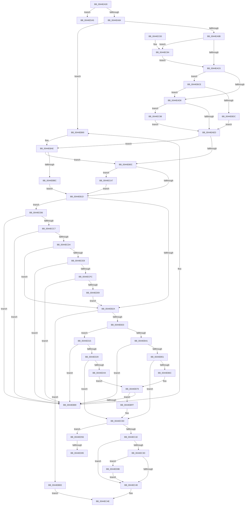

# CcSetLogHandleForFileEx

- RVA: `0x0044EA30`–`0x0044EDC3` (길이 `915` bytes)
- VA: `0x000000014044EA30`
- 실행 섹션: `.text`
- PDB 이름 있음: `예`; PDB Function 태그: `예`
- unwind 정보 RVA: `0x000A6AE0`
- 디코드: `204`개 명령, `915/915` bytes 표시
- 미해석 바이트: `0` (있으면 어셈블리에 `.byte`로 보존)

> 이 문서는 커널 이미지의 기계어와 PDB 기호를 분석해 생성했습니다. 4번과 5번은 함수 원형과 자료형을 바이너리 사용 방식에서 추정한 C 해석이며 원본 소스 복구 결과는 아닙니다.

## 1. Dependencies

- 직접 호출 지점: **11**; 고유 호출 대상: **8**
- 직접 호출자로 확인된 함수: **0**
- RIP 상대 이미지 참조: **6**

### Outgoing calls
- `0x0044EBA8` → [KeBugCheckEx](../4F/KeBugCheckEx_function_004FD660.md) (function, `0x004FD660`)
- `0x0044EBC4` → [KiAcquireQueuedSpinLockInstrumented](../27/KiAcquireQueuedSpinLockInstrumented_function_00275850.md) (function, `0x00275850`)
- `0x0044EBE4` → [KiAcquireQueuedSpinLockInstrumented](../27/KiAcquireQueuedSpinLockInstrumented_function_00275850.md) (function, `0x00275850`)
- `0x0044EC53` → [KeReleaseInStackQueuedSpinLockFromDpcLevel](../21/KeReleaseInStackQueuedSpinLockFromDpcLevel_function_002171B0.md) (function, `0x002171B0`)
- `0x0044EC5D` → [KeReleaseInStackQueuedSpinLock](../34/KeReleaseInStackQueuedSpinLock_function_00342CE0.md) (function, `0x00342CE0`)
- `0x0044EC87` → [KiRaiseIrqlProcessIrqlFlags](../4F/KiRaiseIrqlProcessIrqlFlags_function_004F56FC.md) (function, `0x004F56FC`)
- `0x0044EC9D` → [KxWaitForLockOwnerShip](../25/KxWaitForLockOwnerShip_function_00257EB0.md) (function, `0x00257EB0`)
- `0x0044ECAC` → [KxWaitForLockOwnerShip](../25/KxWaitForLockOwnerShip_function_00257EB0.md) (function, `0x00257EB0`)
- `0x0044ED62` → [memset](../6C/memset_function_006C6C40.md) (function, `0x006C6C40`)
- `0x0044ED8D` → [ObfReferenceObjectWithTag](../21/ObfReferenceObjectWithTag_function_00210710.md) (function, `0x00210710`)
- `0x0044EDBD` → [KeBugCheckEx](../4F/KeBugCheckEx_function_004FD660.md) (function, `0x004FD660`)

### Direct callers
- 이 함수 시작 RVA로 연결되는 직접 call은 확인되지 않았습니다. 간접 호출은 완전히 역산할 수 없습니다.

### Static image references
- `0x0044EA9B` → RVA `0x00E11CC0` (`.data`; read)
- `0x0044EAB9` → RVA `0x00FC6D20` (`ALMOSTRO`; read)
- `0x0044EAC6` → RVA `0x00FC6B06` (`ALMOSTRO`; read)
- `0x0044EADD` → RVA `0x00E11CC0` (`.data`; read/write)
- `0x0044EB51` → RVA `0x00E65B88` (`.data`; read)
- `0x0044EBAE` → RVA `0x00F0DE58` (`.data`; read)

## 2. Other-region calls and transfers

- 다른 실행 섹션으로 향하는 call: **0**
- call이 아닌 외부 분기/꼬리 이동: **2**
  - `0x0044ED7F` → [sub_006F1166](../6F/Unknown_function_006F1166.md) (`tail-transfer`)
  - `0x0044ED96` → [sub_006F1166](../6F/Unknown_function_006F1166.md) (`tail-transfer`)

## 3. Assembly (complete function range)

```asm
0044EA30  48 8B C4                        mov rax, rsp
0044EA33  48 89 58 08                     mov qword ptr [rax + 8], rbx
0044EA37  48 89 70 10                     mov qword ptr [rax + 0x10], rsi
0044EA3B  48 89 78 18                     mov qword ptr [rax + 0x18], rdi
0044EA3F  55                              push rbp
0044EA40  41 54                           push r12
0044EA42  41 55                           push r13
0044EA44  41 56                           push r14
0044EA46  41 57                           push r15
0044EA48  48 8D 68 A9                     lea rbp, [rax - 0x57]
0044EA4C  48 81 EC 00 01 00 00            sub rsp, 0x100
0044EA53  33 C0                           xor eax, eax
0044EA55  45 33 ED                        xor r13d, r13d
0044EA58  48 89 44 24 40                  mov qword ptr [rsp + 0x40], rax
0044EA5D  0F 57 C0                        xorps xmm0, xmm0
0044EA60  48 8B 41 28                     mov rax, qword ptr [rcx + 0x28]
0044EA64  4D 8B F9                        mov r15, r9
0044EA67  0F 11 44 24 30                  movups xmmword ptr [rsp + 0x30], xmm0
0044EA6C  4C 89 6D 87                     mov qword ptr [rbp - 0x79], r13
0044EA70  4D 8B E0                        mov r12, r8
0044EA73  4C 8B F2                        mov r14, rdx
0044EA76  48 8B 58 08                     mov rbx, qword ptr [rax + 8]
0044EA7A  44 39 6B 04                     cmp dword ptr [rbx + 4], r13d
0044EA7E  0F 84 21 03 00 00               je 0x14044eda5
0044EA84  F7 83 98 00 00 00 00 00 00 02   test dword ptr [rbx + 0x98], 0x2000000
0044EA8E  48 8B B3 18 02 00 00            mov rsi, qword ptr [rbx + 0x218]
0044EA95  0F 85 F5 00 00 00               jne 0x14044eb90
0044EA9B  48 8D 0D 1E 32 9C 00            lea rcx, [rip + 0x9c321e]
0044EAA2  4C 89 6C 24 30                  mov qword ptr [rsp + 0x30], r13
0044EAA7  48 89 4C 24 38                  mov qword ptr [rsp + 0x38], rcx
0044EAAC  90                              nop
0044EAAD  44 0F 20 C7                     mov rdi, cr8
0044EAB1  41 8D 55 02                     lea edx, [r13 + 2]
0044EAB5  44 0F 22 C2                     mov cr8, rdx
0044EAB9  44 39 2D 60 82 B7 00            cmp dword ptr [rip + 0xb78260], r13d
0044EAC0  0F 85 BE 01 00 00               jne 0x14044ec84
0044EAC6  F6 05 39 80 B7 00 21            test byte ptr [rip + 0xb78039], 0x21
0044EACD  40 88 7C 24 40                  mov byte ptr [rsp + 0x40], dil
0044EAD2  0F 85 F6 00 00 00               jne 0x14044ebce
0044EAD8  48 8D 54 24 30                  lea rdx, [rsp + 0x30]
0044EADD  48 87 15 DC 31 9C 00            xchg qword ptr [rip + 0x9c31dc], rdx
0044EAE4  48 85 D2                        test rdx, rdx
0044EAE7  0F 85 AB 01 00 00               jne 0x14044ec98
0044EAED  48 8D 8E 00 03 00 00            lea rcx, [rsi + 0x300]
0044EAF4  4C 89 6C 24 48                  mov qword ptr [rsp + 0x48], r13
0044EAF9  48 89 4C 24 50                  mov qword ptr [rsp + 0x50], rcx
0044EAFE  90                              nop
0044EAFF  F6 05 00 80 B7 00 21            test byte ptr [rip + 0xb78000], 0x21
0044EB06  0F 85 A2 00 00 00               jne 0x14044ebae
0044EB0C  48 8D 54 24 48                  lea rdx, [rsp + 0x48]
0044EB11  48 87 11                        xchg qword ptr [rcx], rdx
0044EB14  48 85 D2                        test rdx, rdx
0044EB17  0F 85 8A 01 00 00               jne 0x14044eca7
0044EB1D  4C 39 AB F8 00 00 00            cmp qword ptr [rbx + 0xf8], r13
0044EB24  0F 85 8C 01 00 00               jne 0x14044ecb6
0044EB2A  4D 85 F6                        test r14, r14
0044EB2D  0F 84 BB 00 00 00               je 0x14044ebee
0044EB33  48 8D 43 78                     lea rax, [rbx + 0x78]
0044EB37  44 39 6B 70                     cmp dword ptr [rbx + 0x70], r13d
0044EB3B  0F 85 D4 01 00 00               jne 0x14044ed15
0044EB41  48 8D 8E 90 02 00 00            lea rcx, [rsi + 0x290]
0044EB48  48 8B 51 08                     mov rdx, qword ptr [rcx + 8]
0044EB4C  48 39 0A                        cmp qword ptr [rdx], rcx
0044EB4F  75 38                           jne 0x14044eb89
0044EB51  44 38 2D 30 70 A1 00            cmp byte ptr [rip + 0xa17030], r13b
0044EB58  48 89 08                        mov qword ptr [rax], rcx
0044EB5B  48 89 50 08                     mov qword ptr [rax + 8], rdx
0044EB5F  48 89 02                        mov qword ptr [rdx], rax
0044EB62  48 89 41 08                     mov qword ptr [rcx + 8], rax
0044EB66  0F 84 A1 00 00 00               je 0x14044ec0d
0044EB6C  48 8B 83 58 02 00 00            mov rax, qword ptr [rbx + 0x258]
0044EB73  48 05 70 02 00 00               add rax, 0x270
0044EB79  48 8B 50 08                     mov rdx, qword ptr [rax + 8]
0044EB7D  48 8D 8B 48 02 00 00            lea rcx, [rbx + 0x248]
0044EB84  48 39 02                        cmp qword ptr [rdx], rax
0044EB87  74 76                           je 0x14044ebff
0044EB89  B9 03 00 00 00                  mov ecx, 3
0044EB8E  CD 29                           int 0x29
0044EB90  45 33 C9                        xor r9d, r9d
0044EB93  4C 89 6C 24 20                  mov qword ptr [rsp + 0x20], r13
0044EB98  BA 3E 02 00 00                  mov edx, 0x23e
0044EB9D  49 C7 C0 20 04 00 C0            mov r8, 0xffffffffc0000420
0044EBA4  41 8D 49 34                     lea ecx, [r9 + 0x34]
0044EBA8  E8 B3 EA 0A 00                  call 0x1404fd660
0044EBAD  CC                              int3
0044EBAE  8B 05 A4 F2 AB 00               mov eax, dword ptr [rip + 0xabf2a4]
0044EBB4  85 C0                           test eax, eax
0044EBB6  0F 85 50 FF FF FF               jne 0x14044eb0c
0044EBBC  48 8B D1                        mov rdx, rcx
0044EBBF  48 8D 4C 24 48                  lea rcx, [rsp + 0x48]
0044EBC4  E8 87 6C E2 FF                  call 0x140275850
0044EBC9  E9 4F FF FF FF                  jmp 0x14044eb1d
0044EBCE  8B 05 84 F2 AB 00               mov eax, dword ptr [rip + 0xabf284]
0044EBD4  85 C0                           test eax, eax
0044EBD6  0F 85 FC FE FF FF               jne 0x14044ead8
0044EBDC  48 8B D1                        mov rdx, rcx
0044EBDF  48 8D 4C 24 30                  lea rcx, [rsp + 0x30]
0044EBE4  E8 67 6C E2 FF                  call 0x140275850
0044EBE9  E9 FF FE FF FF                  jmp 0x14044eaed
0044EBEE  0F BA B3 98 00 00 00 18         btr dword ptr [rbx + 0x98], 0x18
0044EBF6  4C 89 AB F8 00 00 00            mov qword ptr [rbx + 0xf8], r13
0044EBFD  EB 4F                           jmp 0x14044ec4e
0044EBFF  48 89 01                        mov qword ptr [rcx], rax
0044EC02  48 89 51 08                     mov qword ptr [rcx + 8], rdx
0044EC06  48 89 0A                        mov qword ptr [rdx], rcx
0044EC09  48 89 48 08                     mov qword ptr [rax + 8], rcx
0044EC0D  48 8B 83 00 02 00 00            mov rax, qword ptr [rbx + 0x200]
0044EC14  4C 39 68 30                     cmp qword ptr [rax + 0x30], r13
0044EC18  0F 84 38 01 00 00               je 0x14044ed56
0044EC1E  48 8B 8B 00 02 00 00            mov rcx, qword ptr [rbx + 0x200]
0044EC25  BA 00 00 00 01                  mov edx, 0x1000000
0044EC2A  48 83 C1 30                     add rcx, 0x30
0044EC2E  48 89 8B F8 00 00 00            mov qword ptr [rbx + 0xf8], rcx
0044EC35  85 93 98 00 00 00               test dword ptr [rbx + 0x98], edx
0044EC3B  75 0B                           jne 0x14044ec48
0044EC3D  8B 43 70                        mov eax, dword ptr [rbx + 0x70]
0044EC40  85 C0                           test eax, eax
0044EC42  0F 85 53 01 00 00               jne 0x14044ed9b
0044EC48  09 93 98 00 00 00               or dword ptr [rbx + 0x98], edx
0044EC4E  48 8D 4C 24 48                  lea rcx, [rsp + 0x48]
0044EC53  E8 58 85 DC FF                  call 0x1402171b0
0044EC58  48 8D 4C 24 30                  lea rcx, [rsp + 0x30]
0044EC5D  E8 7E 40 EF FF                  call 0x140342ce0
0044EC62  4C 8D 9C 24 00 01 00 00         lea r11, [rsp + 0x100]
0044EC6A  49 8B 5B 30                     mov rbx, qword ptr [r11 + 0x30]
0044EC6E  49 8B 73 38                     mov rsi, qword ptr [r11 + 0x38]
0044EC72  49 8B 7B 40                     mov rdi, qword ptr [r11 + 0x40]
0044EC76  49 8B E3                        mov rsp, r11
0044EC79  41 5F                           pop r15
0044EC7B  41 5E                           pop r14
0044EC7D  41 5D                           pop r13
0044EC7F  41 5C                           pop r12
0044EC81  5D                              pop rbp
0044EC82  C3                              ret
0044EC83  CC                              int3
0044EC84  40 8A CF                        mov cl, dil
0044EC87  E8 70 6A 0A 00                  call 0x1404f56fc
0044EC8C  48 8D 0D 2D 30 9C 00            lea rcx, [rip + 0x9c302d]
0044EC93  E9 2E FE FF FF                  jmp 0x14044eac6
0044EC98  48 8D 4C 24 30                  lea rcx, [rsp + 0x30]
0044EC9D  E8 0E 92 E0 FF                  call 0x140257eb0
0044ECA2  E9 46 FE FF FF                  jmp 0x14044eaed
0044ECA7  48 8D 4C 24 48                  lea rcx, [rsp + 0x48]
0044ECAC  E8 FF 91 E0 FF                  call 0x140257eb0
0044ECB1  E9 67 FE FF FF                  jmp 0x14044eb1d
0044ECB6  48 8D 43 78                     lea rax, [rbx + 0x78]
0044ECBA  48 8B 10                        mov rdx, qword ptr [rax]
0044ECBD  48 39 42 08                     cmp qword ptr [rdx + 8], rax
0044ECC1  0F 85 C2 FE FF FF               jne 0x14044eb89
0044ECC7  48 8B 48 08                     mov rcx, qword ptr [rax + 8]
0044ECCB  48 39 01                        cmp qword ptr [rcx], rax
0044ECCE  0F 85 B5 FE FF FF               jne 0x14044eb89
0044ECD4  44 38 2D AD 6E A1 00            cmp byte ptr [rip + 0xa16ead], r13b
0044ECDB  48 89 11                        mov qword ptr [rcx], rdx
0044ECDE  48 89 4A 08                     mov qword ptr [rdx + 8], rcx
0044ECE2  0F 84 42 FE FF FF               je 0x14044eb2a
0044ECE8  48 8D 83 48 02 00 00            lea rax, [rbx + 0x248]
0044ECEF  48 8B 10                        mov rdx, qword ptr [rax]
0044ECF2  48 39 42 08                     cmp qword ptr [rdx + 8], rax
0044ECF6  0F 85 8D FE FF FF               jne 0x14044eb89
0044ECFC  48 8B 48 08                     mov rcx, qword ptr [rax + 8]
0044ED00  48 39 01                        cmp qword ptr [rcx], rax
0044ED03  0F 85 80 FE FF FF               jne 0x14044eb89
0044ED09  48 89 11                        mov qword ptr [rcx], rdx
0044ED0C  48 89 4A 08                     mov qword ptr [rdx + 8], rcx
0044ED10  E9 15 FE FF FF                  jmp 0x14044eb2a
0044ED15  48 8D 8E D0 02 00 00            lea rcx, [rsi + 0x2d0]
0044ED1C  48 8B 51 08                     mov rdx, qword ptr [rcx + 8]
0044ED20  48 39 0A                        cmp qword ptr [rdx], rcx
0044ED23  0F 85 60 FE FF FF               jne 0x14044eb89
0044ED29  44 38 2D 58 6E A1 00            cmp byte ptr [rip + 0xa16e58], r13b
0044ED30  48 89 08                        mov qword ptr [rax], rcx
0044ED33  48 89 50 08                     mov qword ptr [rax + 8], rdx
0044ED37  48 89 02                        mov qword ptr [rdx], rax
0044ED3A  48 89 41 08                     mov qword ptr [rcx + 8], rax
0044ED3E  0F 84 C9 FE FF FF               je 0x14044ec0d
0044ED44  48 8B 83 58 02 00 00            mov rax, qword ptr [rbx + 0x258]
0044ED4B  48 05 B0 02 00 00               add rax, 0x2b0
0044ED51  E9 23 FE FF FF                  jmp 0x14044eb79
0044ED56  33 D2                           xor edx, edx
0044ED58  48 8D 4D 8F                     lea rcx, [rbp - 0x71]
0044ED5C  41 B8 98 00 00 00               mov r8d, 0x98
0044ED62  E8 D9 7E 27 00                  call 0x1406c6c40
0044ED67  48 83 4D 17 FF                  or qword ptr [rbp + 0x17], 0xffffffffffffffff
0044ED6C  48 8B 7D 7F                     mov rdi, qword ptr [rbp + 0x7f]
0044ED70  4C 89 7D 9F                     mov qword ptr [rbp - 0x61], r15
0044ED74  4C 89 65 97                     mov qword ptr [rbp - 0x69], r12
0044ED78  4C 89 75 8F                     mov qword ptr [rbp - 0x71], r14
0044ED7C  48 85 FF                        test rdi, rdi
0044ED7F  0F 84 E1 23 2A 00               je 0x1406f1166
0044ED85  BA 44 66 6C 74                  mov edx, 0x746c6644
0044ED8A  48 8B CF                        mov rcx, rdi
0044ED8D  E8 7E 19 DC FF                  call 0x140210710
0044ED92  48 89 7D 07                     mov qword ptr [rbp + 7], rdi
0044ED96  E9 CB 23 2A 00                  jmp 0x1406f1166
0044ED9B  F0 48 01 41 18                  lock add qword ptr [rcx + 0x18], rax
0044EDA0  E9 A3 FE FF FF                  jmp 0x14044ec48
0044EDA5  45 33 C9                        xor r9d, r9d
0044EDA8  4C 89 6C 24 20                  mov qword ptr [rsp + 0x20], r13
0044EDAD  BA 2F 02 00 00                  mov edx, 0x22f
0044EDB2  49 C7 C0 20 04 00 C0            mov r8, 0xffffffffc0000420
0044EDB9  41 8D 49 34                     lea ecx, [r9 + 0x34]
0044EDBD  E8 9E E8 0A 00                  call 0x1404fd660
0044EDC2  CC                              int3
```

## 4. C-style interpretation (structured pseudocode)

```c
__int64 __fastcall CcSetLogHandleForFileEx(__int64 a1, __int64 a2, __int64 a3, __int64 a4)
{
    __int64 result;
    __int64 v_r13;
    __int64 v_rsp;
    unsigned __int64 v_stack_m108;
    unsigned __int64 v_stack_m28;
    unsigned __int64 v_stack_mB8;
    unsigned __int64 v_stack_mD0;
    unsigned __int64 v_stack_mD8;
    unsigned __int64 v_stack_mE0;
    unsigned __int64 v_stack_mE8;
    unsigned __int64 v_stack_mF0;
    unsigned __int64 v_stack_mF8;

    *(unsigned __int64 *)(v_rsp + 8) = v_rbx;
    *(unsigned __int64 *)(v_rsp + 16) = v_rsi;
    *(unsigned __int64 *)(v_rsp + 24) = v_rdi;
    v_rsp = (v_rsp) - (256);
    result = 0;
    v_r13 = 0;
    v_stack_mE8 = 0;
    v_stack_mF8 = v_xmm0;
    *(unsigned __int64 *)(v_rsp - 87 - 121) = 0;
    if ((*(unsigned int *)(*(unsigned __int64 *)(*(unsigned __int64 *)(a1 + 40) + 8) + 4)) == 0) goto loc_0044EDA5;
    if (((*(unsigned int *)(*(unsigned __int64 *)(*(unsigned __int64 *)(a1 + 40) + 8) + 152)) & (0x2000000ULL)) != 0) goto loc_0044EB90;
    v_stack_mF8 = 0;
    v_stack_mF0 = v_rip + 10236446;
    if ((*(unsigned int *)(v_rip + 12026464)) != 0) goto loc_0044EC84;
loc_0044EAC6:
    v_stack_mE8 = (unsigned __int8)(v_cr8);
    if (((*(unsigned __int8 *)(v_rip + 12025913)) & (33)) != 0) goto loc_0044EBCE;
loc_0044EAD8:
    if (v_stack_mF8 != 0) goto loc_0044EC98;
loc_0044EAED:
    v_stack_mE0 = 0;
    v_stack_mD8 = *(unsigned __int64 *)(*(unsigned __int64 *)(*(unsigned __int64 *)(a1 + 40) + 8) + 536) + 768;
    if (((*(unsigned __int8 *)(v_rip + 12025856)) & (33)) != 0) goto loc_0044EBAE;
loc_0044EB0C:
    if (v_stack_mE0 != 0) goto loc_0044ECA7;
loc_0044EB1D:
    if ((*(unsigned __int64 *)(*(unsigned __int64 *)(*(unsigned __int64 *)(a1 + 40) + 8) + 248)) != 0) goto loc_0044ECB6;
loc_0044EB2A:
    if (a2 == 0) goto loc_0044EBEE;
    if ((*(unsigned int *)(*(unsigned __int64 *)(*(unsigned __int64 *)(a1 + 40) + 8) + 112)) != 0) goto loc_0044ED15;
    if ((*(unsigned __int64 *)(*(unsigned __int64 *)(*(unsigned __int64 *)(*(unsigned __int64 *)(*(unsigned __int64 *)(a1 + 40) + 8) + 536) + 656 + 8))) != (*(unsigned __int64 *)(*(unsigned __int64 *)(*(unsigned __int64 *)(a1 + 40) + 8) + 536) + 656)) goto loc_0044EB89;
    *(unsigned __int64 *)(*(unsigned __int64 *)(*(unsigned __int64 *)(a1 + 40) + 8) + 120) = *(unsigned __int64 *)(*(unsigned __int64 *)(*(unsigned __int64 *)(a1 + 40) + 8) + 536) + 656;
    *(unsigned __int64 *)(*(unsigned __int64 *)(*(unsigned __int64 *)(a1 + 40) + 8) + 120 + 8) = *(unsigned __int64 *)(*(unsigned __int64 *)(*(unsigned __int64 *)(*(unsigned __int64 *)(a1 + 40) + 8) + 536) + 656 + 8);
    *(unsigned __int64 *)(*(unsigned __int64 *)(*(unsigned __int64 *)(*(unsigned __int64 *)(*(unsigned __int64 *)(a1 + 40) + 8) + 536) + 656 + 8)) = *(unsigned __int64 *)(*(unsigned __int64 *)(a1 + 40) + 8) + 120;
    *(unsigned __int64 *)(*(unsigned __int64 *)(*(unsigned __int64 *)(*(unsigned __int64 *)(a1 + 40) + 8) + 536) + 656 + 8) = *(unsigned __int64 *)(*(unsigned __int64 *)(a1 + 40) + 8) + 120;
    if ((*(unsigned __int8 *)(v_rip + 10580016)) == 0) goto loc_0044EC0D;
    result = (*(unsigned __int64 *)(*(unsigned __int64 *)(*(unsigned __int64 *)(a1 + 40) + 8) + 600)) + (624);
loc_0044EB79:
    if ((*(unsigned __int64 *)(*(unsigned __int64 *)(result + 8))) == result) goto loc_0044EBFF;
loc_0044EB89:
loc_0044EB90:
    a4 = 0;
    v_stack_m108 = 0;
    result = KeBugCheckEx(a4 + 52, 574, 0xFFFFFFFFC0000420ULL, a4);
loc_0044EBAE:
    if ((unsigned int)((unsigned int)(*(unsigned int *)(v_rip + 11268772))) != 0) goto loc_0044EB0C;
    result = KiAcquireQueuedSpinLockInstrumented(v_stack_mE0, a4 + 52, 0xFFFFFFFFC0000420ULL, a4);
    goto loc_0044EB1D;
loc_0044EBCE:
    if ((unsigned int)((unsigned int)(*(unsigned int *)(v_rip + 11268740))) != 0) goto loc_0044EAD8;
    result = KiAcquireQueuedSpinLockInstrumented(v_stack_mF8, v_stack_mE0, 0xFFFFFFFFC0000420ULL, a4);
    goto loc_0044EAED;
loc_0044EBEE:
    *(unsigned __int64 *)(*(unsigned __int64 *)(*(unsigned __int64 *)(a1 + 40) + 8) + 248) = 0;
    goto loc_0044EC4E;
loc_0044EBFF:
    *(unsigned __int64 *)(v_stack_mF8) = result;
    *(unsigned __int64 *)(v_stack_mF8 + 8) = v_stack_mE0;
    *(unsigned __int64 *)(v_stack_mE0) = v_stack_mF8;
    *(unsigned __int64 *)(result + 8) = v_stack_mF8;
loc_0044EC0D:
    if ((*(unsigned __int64 *)(*(unsigned __int64 *)(*(unsigned __int64 *)(*(unsigned __int64 *)(a1 + 40) + 8) + 512) + 48)) == 0) goto loc_0044ED56;
    a1 = (*(unsigned __int64 *)(*(unsigned __int64 *)(*(unsigned __int64 *)(a1 + 40) + 8) + 512)) + (48);
    *(unsigned __int64 *)(*(unsigned __int64 *)(*(unsigned __int64 *)(a1 + 40) + 8) + 248) = a1;
    if (((*(unsigned int *)(*(unsigned __int64 *)(*(unsigned __int64 *)(a1 + 40) + 8) + 152)) & ((unsigned int)((unsigned int)(0x1000000ULL)))) != 0) goto loc_0044EC48;
    if ((unsigned int)((unsigned int)(*(unsigned int *)(*(unsigned __int64 *)(*(unsigned __int64 *)(a1 + 40) + 8) + 112))) != 0) goto loc_0044ED9B;
loc_0044EC48:
loc_0044EC4E:
    result = KeReleaseInStackQueuedSpinLockFromDpcLevel(v_stack_mE0, (unsigned int)(0x1000000ULL), 0xFFFFFFFFC0000420ULL, a4);
    result = KeReleaseInStackQueuedSpinLock(v_stack_mF8, (unsigned int)(0x1000000ULL), 0xFFFFFFFFC0000420ULL, a4);
    return result;
loc_0044EC84:
    result = KiRaiseIrqlProcessIrqlFlags((unsigned __int8)(*(unsigned __int64 *)(v_stack_m28 + 64)), (unsigned int)(0x1000000ULL), 0xFFFFFFFFC0000420ULL, a4);
    goto loc_0044EAC6;
loc_0044EC98:
    result = KxWaitForLockOwnerShip(v_stack_mD0, (unsigned int)(0x1000000ULL), 0xFFFFFFFFC0000420ULL, a4);
    goto loc_0044EAED;
loc_0044ECA7:
    result = KxWaitForLockOwnerShip(v_stack_mB8, (unsigned int)(0x1000000ULL), 0xFFFFFFFFC0000420ULL, a4);
    goto loc_0044EB1D;
loc_0044ECB6:
    if ((*(unsigned __int64 *)(*(unsigned __int64 *)(*(unsigned __int64 *)(v_stack_m28 + 48) + 120) + 8)) != (*(unsigned __int64 *)(v_stack_m28 + 48) + 120)) goto loc_0044EB89;
    if ((*(unsigned __int64 *)(*(unsigned __int64 *)(*(unsigned __int64 *)(v_stack_m28 + 48) + 120 + 8))) != (*(unsigned __int64 *)(v_stack_m28 + 48) + 120)) goto loc_0044EB89;
    *(unsigned __int64 *)(*(unsigned __int64 *)(*(unsigned __int64 *)(v_stack_m28 + 48) + 120 + 8)) = *(unsigned __int64 *)(*(unsigned __int64 *)(v_stack_m28 + 48) + 120);
    *(unsigned __int64 *)(*(unsigned __int64 *)(*(unsigned __int64 *)(v_stack_m28 + 48) + 120) + 8) = *(unsigned __int64 *)(*(unsigned __int64 *)(v_stack_m28 + 48) + 120 + 8);
    if ((*(unsigned __int8 *)(v_rip + 10579629)) == 0) goto loc_0044EB2A;
    if ((*(unsigned __int64 *)(*(unsigned __int64 *)(*(unsigned __int64 *)(v_stack_m28 + 48) + 584) + 8)) != (*(unsigned __int64 *)(v_stack_m28 + 48) + 584)) goto loc_0044EB89;
    if ((*(unsigned __int64 *)(*(unsigned __int64 *)(*(unsigned __int64 *)(v_stack_m28 + 48) + 584 + 8))) != (*(unsigned __int64 *)(v_stack_m28 + 48) + 584)) goto loc_0044EB89;
    *(unsigned __int64 *)(*(unsigned __int64 *)(*(unsigned __int64 *)(v_stack_m28 + 48) + 584 + 8)) = *(unsigned __int64 *)(*(unsigned __int64 *)(v_stack_m28 + 48) + 584);
    *(unsigned __int64 *)(*(unsigned __int64 *)(*(unsigned __int64 *)(v_stack_m28 + 48) + 584) + 8) = *(unsigned __int64 *)(*(unsigned __int64 *)(v_stack_m28 + 48) + 584 + 8);
    goto loc_0044EB2A;
loc_0044ED15:
    if ((*(unsigned __int64 *)(*(unsigned __int64 *)(*(unsigned __int64 *)(v_stack_m28 + 56) + 720 + 8))) != (*(unsigned __int64 *)(v_stack_m28 + 56) + 720)) goto loc_0044EB89;
    *(unsigned __int64 *)(*(unsigned __int64 *)(v_stack_m28 + 48) + 584) = *(unsigned __int64 *)(v_stack_m28 + 56) + 720;
    *(unsigned __int64 *)(*(unsigned __int64 *)(v_stack_m28 + 48) + 584 + 8) = *(unsigned __int64 *)(*(unsigned __int64 *)(v_stack_m28 + 56) + 720 + 8);
    *(unsigned __int64 *)(*(unsigned __int64 *)(*(unsigned __int64 *)(v_stack_m28 + 56) + 720 + 8)) = *(unsigned __int64 *)(v_stack_m28 + 48) + 584;
    *(unsigned __int64 *)(*(unsigned __int64 *)(v_stack_m28 + 56) + 720 + 8) = *(unsigned __int64 *)(v_stack_m28 + 48) + 584;
    if ((*(unsigned __int8 *)(v_rip + 10579544)) == 0) goto loc_0044EC0D;
    result = (*(unsigned __int64 *)(*(unsigned __int64 *)(v_stack_m28 + 48) + 600)) + (688);
    goto loc_0044EB79;
loc_0044ED56:
    a2 = 0;
    result = memset(v_rsp - 87 - 113, a2, 152, a4);
    *(unsigned __int64 *)(v_rsp - 87 - 97) = 0;
    *(unsigned __int64 *)(v_rsp - 87 - 105) = a3;
    *(unsigned __int64 *)(v_rsp - 87 - 113) = 0;
    result = ObfReferenceObjectWithTag(*(unsigned __int64 *)(v_rsp - 87 + 127), (unsigned int)(0x746C6644ULL), 152, a4);
    *(unsigned __int64 *)(v_rsp - 87 + 7) = *(unsigned __int64 *)(v_rsp - 87 + 127);
loc_0044ED9B:
    goto loc_0044EC48;
loc_0044EDA5:
    a4 = 0;
    v_stack_mE0 = 0;
    result = KeBugCheckEx(a4 + 52, 559, 0xFFFFFFFFC0000420ULL, a4);
    return result;
}
```

## 5. (Beta) C Style

```c
int64_t CcSetLogHandleForFileEx(void *Arg1, int64_t Arg2, int64_t Arg3, int64_t Arg4)
{
    uint8_t *arg1 = (uint8_t *)Arg1;

    int64_t result;
    int64_t local_r13;
    int64_t local_rsp;
    uint64_t v_stack_m108;
    uint64_t v_stack_m28;
    uint64_t v_stack_mB8;
    uint64_t v_stack_mD0;
    uint64_t v_stack_mD8;
    uint64_t v_stack_mE0;
    uint64_t v_stack_mE8;
    uint64_t v_stack_mF0;
    uint64_t v_stack_mF8;

    *(uint64_t *)(local_rsp + 0x8) = local_rbx;
    *(uint64_t *)(local_rsp + 0x10) = local_rsi;
    *(uint64_t *)(local_rsp + 0x18) = local_rdi;
    local_rsp = (local_rsp) - (256);
    result = 0;
    local_r13 = 0;
    v_stack_mE8 = 0;
    v_stack_mF8 = v_xmm0;
    *(uint64_t *)(local_rsp - 0x57 - 0x79) = 0;
    if ((*(uint32_t *)(*(uint64_t *)(*(uint64_t *)(arg1 + 0x28) + 0x8) + 0x4)) == 0) goto loc_0044EDA5;
    if (((*(uint32_t *)(*(uint64_t *)(*(uint64_t *)(arg1 + 0x28) + 0x8) + 0x98)) & (0x2000000ULL)) != 0) goto loc_0044EB90;
    v_stack_mF8 = 0;
    v_stack_mF0 = v_rip + 10236446;
    if ((*(uint32_t *)(v_rip + 0xB78260)) != 0) goto loc_0044EC84;
loc_0044EAC6:
    v_stack_mE8 = (uint8_t)(v_cr8);
    if (((*(uint8_t *)(v_rip + 0xB78039)) & (33)) != 0) goto loc_0044EBCE;
loc_0044EAD8:
    if (v_stack_mF8 != 0) goto loc_0044EC98;
loc_0044EAED:
    v_stack_mE0 = 0;
    v_stack_mD8 = *(uint64_t *)(*(uint64_t *)(*(uint64_t *)(arg1 + 0x28) + 0x8) + 0x218) + 768;
    if (((*(uint8_t *)(v_rip + 0xB78000)) & (33)) != 0) goto loc_0044EBAE;
loc_0044EB0C:
    if (v_stack_mE0 != 0) goto loc_0044ECA7;
loc_0044EB1D:
    if ((*(uint64_t *)(*(uint64_t *)(*(uint64_t *)(arg1 + 0x28) + 0x8) + 0xF8)) != 0) goto loc_0044ECB6;
loc_0044EB2A:
    if (Arg2 == 0) goto loc_0044EBEE;
    if ((*(uint32_t *)(*(uint64_t *)(*(uint64_t *)(arg1 + 0x28) + 0x8) + 0x70)) != 0) goto loc_0044ED15;
    if ((*(uint64_t *)(*(uint64_t *)(*(uint64_t *)(*(uint64_t *)(*(uint64_t *)(arg1 + 0x28) + 0x8) + 0x218) + 0x290 + 0x8))) != (*(uint64_t *)(*(uint64_t *)(*(uint64_t *)(arg1 + 0x28) + 0x8) + 0x218) + 656)) goto loc_0044EB89;
    *(uint64_t *)(*(uint64_t *)(*(uint64_t *)(arg1 + 0x28) + 0x8) + 0x78) = *(uint64_t *)(*(uint64_t *)(*(uint64_t *)(arg1 + 0x28) + 0x8) + 0x218) + 656;
    *(uint64_t *)(*(uint64_t *)(*(uint64_t *)(arg1 + 0x28) + 0x8) + 0x78 + 0x8) = *(uint64_t *)(*(uint64_t *)(*(uint64_t *)(*(uint64_t *)(arg1 + 0x28) + 0x8) + 0x218) + 0x290 + 0x8);
    *(uint64_t *)(*(uint64_t *)(*(uint64_t *)(*(uint64_t *)(*(uint64_t *)(arg1 + 0x28) + 0x8) + 0x218) + 0x290 + 0x8)) = *(uint64_t *)(*(uint64_t *)(arg1 + 0x28) + 0x8) + 120;
    *(uint64_t *)(*(uint64_t *)(*(uint64_t *)(*(uint64_t *)(arg1 + 0x28) + 0x8) + 0x218) + 0x290 + 0x8) = *(uint64_t *)(*(uint64_t *)(arg1 + 0x28) + 0x8) + 120;
    if ((*(uint8_t *)(v_rip + 0xA17030)) == 0) goto loc_0044EC0D;
    result = (*(uint64_t *)(*(uint64_t *)(*(uint64_t *)(arg1 + 0x28) + 0x8) + 0x258)) + (624);
loc_0044EB79:
    if ((*(uint64_t *)(*(uint64_t *)(result + 0x8))) == result) goto loc_0044EBFF;
loc_0044EB89:
loc_0044EB90:
    Arg4 = 0;
    v_stack_m108 = 0;
    result = KeBugCheckEx(Arg4 + 52, 574, 0xFFFFFFFFC0000420ULL, Arg4);
loc_0044EBAE:
    if ((uint32_t)((uint32_t)(*(uint32_t *)(v_rip + 0xABF2A4))) != 0) goto loc_0044EB0C;
    result = KiAcquireQueuedSpinLockInstrumented(v_stack_mE0, Arg4 + 52, 0xFFFFFFFFC0000420ULL, Arg4);
    goto loc_0044EB1D;
loc_0044EBCE:
    if ((uint32_t)((uint32_t)(*(uint32_t *)(v_rip + 0xABF284))) != 0) goto loc_0044EAD8;
    result = KiAcquireQueuedSpinLockInstrumented(v_stack_mF8, v_stack_mE0, 0xFFFFFFFFC0000420ULL, Arg4);
    goto loc_0044EAED;
loc_0044EBEE:
    *(uint64_t *)(*(uint64_t *)(*(uint64_t *)(arg1 + 0x28) + 0x8) + 0xF8) = 0;
    goto loc_0044EC4E;
loc_0044EBFF:
    *(uint64_t *)(v_stack_mF8) = result;
    *(uint64_t *)(v_stack_mF8 + 0x8) = v_stack_mE0;
    *(uint64_t *)(v_stack_mE0) = v_stack_mF8;
    *(uint64_t *)(result + 0x8) = v_stack_mF8;
loc_0044EC0D:
    if ((*(uint64_t *)(*(uint64_t *)(*(uint64_t *)(*(uint64_t *)(arg1 + 0x28) + 0x8) + 0x200) + 0x30)) == 0) goto loc_0044ED56;
    Arg1 = (*(uint64_t *)(*(uint64_t *)(*(uint64_t *)(arg1 + 0x28) + 0x8) + 0x200)) + (48);
    *(void **)(*(uint64_t *)(*(uint64_t *)(arg1 + 0x28) + 0x8) + 0xF8) = Arg1;
    if (((*(uint32_t *)(*(uint64_t *)(*(uint64_t *)(arg1 + 0x28) + 0x8) + 0x98)) & ((uint32_t)((uint32_t)(0x1000000ULL)))) != 0) goto loc_0044EC48;
    if ((uint32_t)((uint32_t)(*(uint32_t *)(*(uint64_t *)(*(uint64_t *)(arg1 + 0x28) + 0x8) + 0x70))) != 0) goto loc_0044ED9B;
loc_0044EC48:
loc_0044EC4E:
    result = KeReleaseInStackQueuedSpinLockFromDpcLevel(v_stack_mE0, (uint32_t)(0x1000000ULL), 0xFFFFFFFFC0000420ULL, Arg4);
    result = KeReleaseInStackQueuedSpinLock(v_stack_mF8, (uint32_t)(0x1000000ULL), 0xFFFFFFFFC0000420ULL, Arg4);
    return result;
loc_0044EC84:
    result = KiRaiseIrqlProcessIrqlFlags((uint8_t)(*(uint64_t *)(v_stack_m28 + 0x40)), (uint32_t)(0x1000000ULL), 0xFFFFFFFFC0000420ULL, Arg4);
    goto loc_0044EAC6;
loc_0044EC98:
    result = KxWaitForLockOwnerShip(v_stack_mD0, (uint32_t)(0x1000000ULL), 0xFFFFFFFFC0000420ULL, Arg4);
    goto loc_0044EAED;
loc_0044ECA7:
    result = KxWaitForLockOwnerShip(v_stack_mB8, (uint32_t)(0x1000000ULL), 0xFFFFFFFFC0000420ULL, Arg4);
    goto loc_0044EB1D;
loc_0044ECB6:
    if ((*(uint64_t *)(*(uint64_t *)(*(uint64_t *)(v_stack_m28 + 0x30) + 0x78) + 0x8)) != (*(uint64_t *)(v_stack_m28 + 0x30) + 120)) goto loc_0044EB89;
    if ((*(uint64_t *)(*(uint64_t *)(*(uint64_t *)(v_stack_m28 + 0x30) + 0x78 + 0x8))) != (*(uint64_t *)(v_stack_m28 + 0x30) + 120)) goto loc_0044EB89;
    *(uint64_t *)(*(uint64_t *)(*(uint64_t *)(v_stack_m28 + 0x30) + 0x78 + 0x8)) = *(uint64_t *)(*(uint64_t *)(v_stack_m28 + 0x30) + 0x78);
    *(uint64_t *)(*(uint64_t *)(*(uint64_t *)(v_stack_m28 + 0x30) + 0x78) + 0x8) = *(uint64_t *)(*(uint64_t *)(v_stack_m28 + 0x30) + 0x78 + 0x8);
    if ((*(uint8_t *)(v_rip + 0xA16EAD)) == 0) goto loc_0044EB2A;
    if ((*(uint64_t *)(*(uint64_t *)(*(uint64_t *)(v_stack_m28 + 0x30) + 0x248) + 0x8)) != (*(uint64_t *)(v_stack_m28 + 0x30) + 584)) goto loc_0044EB89;
    if ((*(uint64_t *)(*(uint64_t *)(*(uint64_t *)(v_stack_m28 + 0x30) + 0x248 + 0x8))) != (*(uint64_t *)(v_stack_m28 + 0x30) + 584)) goto loc_0044EB89;
    *(uint64_t *)(*(uint64_t *)(*(uint64_t *)(v_stack_m28 + 0x30) + 0x248 + 0x8)) = *(uint64_t *)(*(uint64_t *)(v_stack_m28 + 0x30) + 0x248);
    *(uint64_t *)(*(uint64_t *)(*(uint64_t *)(v_stack_m28 + 0x30) + 0x248) + 0x8) = *(uint64_t *)(*(uint64_t *)(v_stack_m28 + 0x30) + 0x248 + 0x8);
    goto loc_0044EB2A;
loc_0044ED15:
    if ((*(uint64_t *)(*(uint64_t *)(*(uint64_t *)(v_stack_m28 + 0x38) + 0x2D0 + 0x8))) != (*(uint64_t *)(v_stack_m28 + 0x38) + 720)) goto loc_0044EB89;
    *(uint64_t *)(*(uint64_t *)(v_stack_m28 + 0x30) + 0x248) = *(uint64_t *)(v_stack_m28 + 0x38) + 720;
    *(uint64_t *)(*(uint64_t *)(v_stack_m28 + 0x30) + 0x248 + 0x8) = *(uint64_t *)(*(uint64_t *)(v_stack_m28 + 0x38) + 0x2D0 + 0x8);
    *(uint64_t *)(*(uint64_t *)(*(uint64_t *)(v_stack_m28 + 0x38) + 0x2D0 + 0x8)) = *(uint64_t *)(v_stack_m28 + 0x30) + 584;
    *(uint64_t *)(*(uint64_t *)(v_stack_m28 + 0x38) + 0x2D0 + 0x8) = *(uint64_t *)(v_stack_m28 + 0x30) + 584;
    if ((*(uint8_t *)(v_rip + 0xA16E58)) == 0) goto loc_0044EC0D;
    result = (*(uint64_t *)(*(uint64_t *)(v_stack_m28 + 0x30) + 0x258)) + (688);
    goto loc_0044EB79;
loc_0044ED56:
    Arg2 = 0;
    result = memset(local_rsp - 87 - 113, Arg2, 152, Arg4);
    *(uint64_t *)(local_rsp - 0x57 - 0x61) = 0;
    *(uint64_t *)(local_rsp - 0x57 - 0x69) = Arg3;
    *(uint64_t *)(local_rsp - 0x57 - 0x71) = 0;
    result = ObfReferenceObjectWithTag(*(uint64_t *)(local_rsp - 0x57 + 0x7F), (uint32_t)(0x746C6644ULL), 152, Arg4);
    *(uint64_t *)(local_rsp - 0x57 + 0x7) = *(uint64_t *)(local_rsp - 0x57 + 0x7F);
loc_0044ED9B:
    goto loc_0044EC48;
loc_0044EDA5:
    Arg4 = 0;
    v_stack_mE0 = 0;
    result = KeBugCheckEx(Arg4 + 52, 559, 0xFFFFFFFFC0000420ULL, Arg4);
    return result;
}
```

### 관측된 메모리 오프셋

구조체 형식이 확인되지 않은 접근은 인자 기준의 오프셋으로만 기록했습니다.

| 기준 인자 | 오프셋 표현 | 폭 (bit) | 접근 |
|---|---:|---:|---|
| `Arg1` | `+ 0x28` | `64` | `R` |

## 6. Execution-region graph

[열기: 2D/3D 그래프와 함수 탐색 컨트롤 패널](../../../control-panel.html?section=text&rva=0x0044EA30&view=graph)

- 2D 그래프는 위에서 아래로 흐르고, 3D 그래프는 빈 공간을 드래그해 회전합니다. Shift+드래그는 이동, 휠은 확대·축소, 함수 노드 선택은 대상 보고서 이동입니다.

### Static fallback


