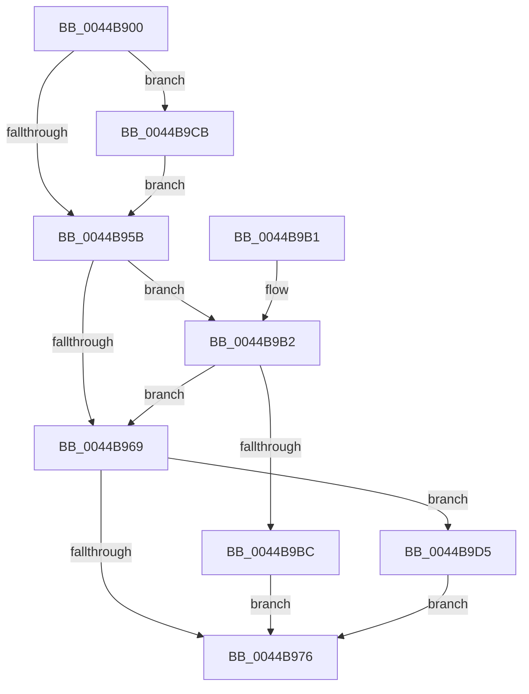

# CcSetParallelFlushFile

- RVA: `0x0044B900`–`0x0044B9E1` (길이 `225` bytes)
- VA: `0x000000014044B900`
- 실행 섹션: `.text`
- PDB 이름 있음: `예`; PDB Function 태그: `아니요`
- unwind 정보 RVA: `0x000A679C`
- 디코드: `59`개 명령, `225/225` bytes 표시
- 미해석 바이트: `0` (있으면 어셈블리에 `.byte`로 보존)

> 이 문서는 커널 이미지의 기계어와 PDB 기호를 분석해 생성했습니다. 4번과 5번은 함수 원형과 자료형을 바이너리 사용 방식에서 추정한 C 해석이며 원본 소스 복구 결과는 아닙니다.

## 1. Dependencies

- 직접 호출 지점: **4**; 고유 호출 대상: **4**
- 직접 호출자로 확인된 함수: **0**
- RIP 상대 이미지 참조: **3**

### Outgoing calls
- `0x0044B997` → [KeReleaseInStackQueuedSpinLock](../34/KeReleaseInStackQueuedSpinLock_function_00342CE0.md) (function, `0x00342CE0`)
- `0x0044B9C4` → [KiAcquireQueuedSpinLockInstrumented](../27/KiAcquireQueuedSpinLockInstrumented_function_00275850.md) (function, `0x00275850`)
- `0x0044B9CE` → [KiRaiseIrqlProcessIrqlFlags](../4F/KiRaiseIrqlProcessIrqlFlags_function_004F56FC.md) (function, `0x004F56FC`)
- `0x0044B9DA` → [KxWaitForLockOwnerShip](../25/KxWaitForLockOwnerShip_function_00257EB0.md) (function, `0x00257EB0`)

### Direct callers
- 이 함수 시작 RVA로 연결되는 직접 call은 확인되지 않았습니다. 간접 호출은 완전히 역산할 수 없습니다.

### Static image references
- `0x0044B952` → RVA `0x00FC6D20` (`ALMOSTRO`; read)
- `0x0044B95B` → RVA `0x00FC6B06` (`ALMOSTRO`; read)
- `0x0044B9B2` → RVA `0x00F0DE58` (`.data`; read)

## 2. Other-region calls and transfers

- 다른 실행 섹션으로 향하는 call: **0**
- 별도 외부 분기/꼬리 이동을 확인하지 못했습니다.

## 3. Assembly (complete function range)

```asm
0044B900  4C 8B DC                        mov r11, rsp
0044B903  49 89 5B 08                     mov qword ptr [r11 + 8], rbx
0044B907  49 89 6B 10                     mov qword ptr [r11 + 0x10], rbp
0044B90B  49 89 73 18                     mov qword ptr [r11 + 0x18], rsi
0044B90F  57                              push rdi
0044B910  48 83 EC 40                     sub rsp, 0x40
0044B914  33 C0                           xor eax, eax
0044B916  0F 57 C0                        xorps xmm0, xmm0
0044B919  0F 11 44 24 20                  movups xmmword ptr [rsp + 0x20], xmm0
0044B91E  49 89 43 E8                     mov qword ptr [r11 - 0x18], rax
0044B922  40 8A EA                        mov bpl, dl
0044B925  48 8B 41 28                     mov rax, qword ptr [rcx + 0x28]
0044B929  48 8B 70 08                     mov rsi, qword ptr [rax + 8]
0044B92D  48 8B 9E 18 02 00 00            mov rbx, qword ptr [rsi + 0x218]
0044B934  48 81 C3 00 03 00 00            add rbx, 0x300
0044B93B  49 83 63 D8 00                  and qword ptr [r11 - 0x28], 0
0044B940  49 89 5B E0                     mov qword ptr [r11 - 0x20], rbx
0044B944  90                              nop
0044B945  44 0F 20 C7                     mov rdi, cr8
0044B949  BA 02 00 00 00                  mov edx, 2
0044B94E  44 0F 22 C2                     mov cr8, rdx
0044B952  83 3D C7 B3 B7 00 00            cmp dword ptr [rip + 0xb7b3c7], 0
0044B959  75 70                           jne 0x14044b9cb
0044B95B  F6 05 A4 B1 B7 00 21            test byte ptr [rip + 0xb7b1a4], 0x21
0044B962  40 88 7C 24 30                  mov byte ptr [rsp + 0x30], dil
0044B967  75 49                           jne 0x14044b9b2
0044B969  48 8D 54 24 20                  lea rdx, [rsp + 0x20]
0044B96E  48 87 13                        xchg qword ptr [rbx], rdx
0044B971  48 85 D2                        test rdx, rdx
0044B974  75 5F                           jne 0x14044b9d5
0044B976  8B 8E 98 00 00 00               mov ecx, dword ptr [rsi + 0x98]
0044B97C  8B C1                           mov eax, ecx
0044B97E  0F BA E9 12                     bts ecx, 0x12
0044B982  0F BA F0 12                     btr eax, 0x12
0044B986  40 84 ED                        test bpl, bpl
0044B989  0F 44 C8                        cmove ecx, eax
0044B98C  89 8E 98 00 00 00               mov dword ptr [rsi + 0x98], ecx
0044B992  48 8D 4C 24 20                  lea rcx, [rsp + 0x20]
0044B997  E8 44 73 EF FF                  call 0x140342ce0
0044B99C  48 8B 5C 24 50                  mov rbx, qword ptr [rsp + 0x50]
0044B9A1  48 8B 6C 24 58                  mov rbp, qword ptr [rsp + 0x58]
0044B9A6  48 8B 74 24 60                  mov rsi, qword ptr [rsp + 0x60]
0044B9AB  48 83 C4 40                     add rsp, 0x40
0044B9AF  5F                              pop rdi
0044B9B0  C3                              ret
0044B9B1  CC                              int3
0044B9B2  8B 05 A0 24 AC 00               mov eax, dword ptr [rip + 0xac24a0]
0044B9B8  85 C0                           test eax, eax
0044B9BA  75 AD                           jne 0x14044b969
0044B9BC  48 8B D3                        mov rdx, rbx
0044B9BF  48 8D 4C 24 20                  lea rcx, [rsp + 0x20]
0044B9C4  E8 87 9E E2 FF                  call 0x140275850
0044B9C9  EB AB                           jmp 0x14044b976
0044B9CB  40 8A CF                        mov cl, dil
0044B9CE  E8 29 9D 0A 00                  call 0x1404f56fc
0044B9D3  EB 86                           jmp 0x14044b95b
0044B9D5  48 8D 4C 24 20                  lea rcx, [rsp + 0x20]
0044B9DA  E8 D1 C4 E0 FF                  call 0x140257eb0
0044B9DF  EB 95                           jmp 0x14044b976
```

## 4. C-style interpretation (structured pseudocode)

```c
__int64 __fastcall CcSetParallelFlushFile(__int64 a1, unsigned __int8 a2)
{
    __int64 result;
    __int64 v_rbx;
    __int64 v_rsp;
    unsigned __int8 v_stack_m18;
    unsigned __int64 v_stack_m28;
    unsigned __int64 v_stack_p10;
    unsigned __int64 v_stack_p18;
    unsigned __int64 v_stack_p20;
    unsigned __int64 v_stack_p8;

    *(unsigned __int64 *)(v_rsp + 8) = v_rbx;
    *(unsigned __int64 *)(v_rsp + 16) = v_rbp;
    *(unsigned __int64 *)(v_rsp + 24) = v_rsi;
    v_rsp = (v_rsp) - (64);
    result = 0;
    v_stack_m28 = v_xmm0;
    *(unsigned __int64 *)(v_rsp - 24) = 0;
    v_rbx = (*(unsigned __int64 *)(*(unsigned __int64 *)(*(unsigned __int64 *)(a1 + 40) + 8) + 536)) + (768);
    *(unsigned __int64 *)(v_rsp - 32) = v_rbx;
    if ((*(unsigned int *)(v_rip + 12039111)) != 0) goto loc_0044B9CB;
loc_0044B95B:
    v_stack_m18 = (unsigned __int8)(v_cr8);
    if (((*(unsigned __int8 *)(v_rip + 12038564)) & (33)) != 0) goto loc_0044B9B2;
loc_0044B969:
    if (v_stack_m28 != 0) goto loc_0044B9D5;
loc_0044B976:
    a1 = (unsigned int)(*(unsigned int *)(*(unsigned __int64 *)(*(unsigned __int64 *)(a1 + 40) + 8) + 152));
    if (a2 == 0) { a1 = (unsigned int)((unsigned int)((unsigned int)((unsigned int)(*(unsigned int *)(*(unsigned __int64 *)(*(unsigned __int64 *)(a1 + 40) + 8) + 152))))); }
    *(unsigned int *)(*(unsigned __int64 *)(*(unsigned __int64 *)(a1 + 40) + 8) + 152) = (unsigned int)(a1);
    result = KeReleaseInStackQueuedSpinLock(v_stack_m28, v_stack_m28, a3, a4);
    v_rsp = (v_rsp) + (64);
    return result;
loc_0044B9B2:
    if ((unsigned int)((unsigned int)(*(unsigned int *)(v_rip + 11281568))) != 0) goto loc_0044B969;
    result = KiAcquireQueuedSpinLockInstrumented(v_stack_p20, v_stack_p8, a3, a4);
    goto loc_0044B976;
loc_0044B9CB:
    result = KiRaiseIrqlProcessIrqlFlags((unsigned __int8)(v_cr8), v_stack_p8, a3, a4);
    goto loc_0044B95B;
loc_0044B9D5:
    result = KxWaitForLockOwnerShip(v_stack_p20, v_stack_p8, a3, a4);
    goto loc_0044B976;
}
```

## 5. (Beta) C Style

```c
int64_t CcSetParallelFlushFile(void *Arg1, uint8_t Arg2)
{
    uint8_t *arg1 = (uint8_t *)Arg1;

    int64_t result;
    int64_t local_rbx;
    int64_t local_rsp;
    uint8_t v_stack_m18;
    uint64_t v_stack_m28;
    uint64_t v_stack_p10;
    uint64_t v_stack_p18;
    uint64_t v_stack_p20;
    uint64_t v_stack_p8;

    *(uint64_t *)(local_rsp + 0x8) = local_rbx;
    *(uint64_t *)(local_rsp + 0x10) = local_rbp;
    *(uint64_t *)(local_rsp + 0x18) = local_rsi;
    local_rsp = (local_rsp) - (64);
    result = 0;
    v_stack_m28 = v_xmm0;
    *(uint64_t *)(local_rsp - 0x18) = 0;
    local_rbx = (*(uint64_t *)(*(uint64_t *)(*(uint64_t *)(arg1 + 0x28) + 0x8) + 0x218)) + (768);
    *(uint64_t *)(local_rsp - 0x20) = local_rbx;
    if ((*(uint32_t *)(v_rip + 0xB7B3C7)) != 0) goto loc_0044B9CB;
loc_0044B95B:
    v_stack_m18 = (uint8_t)(v_cr8);
    if (((*(uint8_t *)(v_rip + 0xB7B1A4)) & (33)) != 0) goto loc_0044B9B2;
loc_0044B969:
    if (v_stack_m28 != 0) goto loc_0044B9D5;
loc_0044B976:
    Arg1 = (uint32_t)(*(uint32_t *)(*(uint64_t *)(*(uint64_t *)(arg1 + 0x28) + 0x8) + 0x98));
    if (Arg2 == 0) { Arg1 = (uint32_t)((uint32_t)((uint32_t)((uint32_t)(*(uint32_t *)(*(uint64_t *)(*(uint64_t *)(arg1 + 0x28) + 0x8) + 0x98))))); }
    *(uint32_t *)(*(uint64_t *)(*(uint64_t *)(arg1 + 0x28) + 0x8) + 0x98) = (uint32_t)(Arg1);
    result = KeReleaseInStackQueuedSpinLock(v_stack_m28, v_stack_m28, a3, a4);
    local_rsp = (local_rsp) + (64);
    return result;
loc_0044B9B2:
    if ((uint32_t)((uint32_t)(*(uint32_t *)(v_rip + 0xAC24A0))) != 0) goto loc_0044B969;
    result = KiAcquireQueuedSpinLockInstrumented(v_stack_p20, v_stack_p8, a3, a4);
    goto loc_0044B976;
loc_0044B9CB:
    result = KiRaiseIrqlProcessIrqlFlags((uint8_t)(v_cr8), v_stack_p8, a3, a4);
    goto loc_0044B95B;
loc_0044B9D5:
    result = KxWaitForLockOwnerShip(v_stack_p20, v_stack_p8, a3, a4);
    goto loc_0044B976;
}
```

### 관측된 메모리 오프셋

구조체 형식이 확인되지 않은 접근은 인자 기준의 오프셋으로만 기록했습니다.

| 기준 인자 | 오프셋 표현 | 폭 (bit) | 접근 |
|---|---:|---:|---|
| `Arg1` | `+ 0x28` | `64` | `R` |

## 6. Execution-region graph

[열기: 2D/3D 그래프와 함수 탐색 컨트롤 패널](../../../control-panel.html?section=text&rva=0x0044B900&view=graph)

- 2D 그래프는 위에서 아래로 흐르고, 3D 그래프는 빈 공간을 드래그해 회전합니다. Shift+드래그는 이동, 휠은 확대·축소, 함수 노드 선택은 대상 보고서 이동입니다.

### Static fallback


