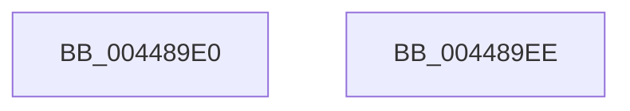

# CmpFreePoolWithTag

- RVA: `0x004489E0`–`0x004489EF` (길이 `15` bytes)
- VA: `0x00000001404489E0`
- 실행 섹션: `.text`
- PDB 이름 있음: `예`; PDB Function 태그: `아니요`
- unwind 정보 RVA: `0x0005C788`
- 디코드: `5`개 명령, `15/15` bytes 표시
- 미해석 바이트: `0` (있으면 어셈블리에 `.byte`로 보존)

> 이 문서는 커널 이미지의 기계어와 PDB 기호를 분석해 생성했습니다. 4번과 5번은 함수 원형과 자료형을 바이너리 사용 방식에서 추정한 C 해석이며 원본 소스 복구 결과는 아닙니다.

## 1. Dependencies

- 직접 호출 지점: **1**; 고유 호출 대상: **1**
- 직접 호출자로 확인된 함수: **56**
- RIP 상대 이미지 참조: **0**

### Outgoing calls
- `0x004489E4` → [ExFreePoolWithTag](../../poolcode/B8/ExFreePoolWithTag_function_00B82870.md) (function, `0x00B82870`)

### Direct callers
- [SshpFreeDataEntry](../../page/77/SshpFreeDataEntry_function_00773614.md) at `0x0077369C`
- [SshpFreeDataEntry](../../page/77/SshpFreeDataEntry_function_00773614.md) at `0x007736B2`
- [SleepstudyHelperDestroyLibrary](../../page/77/SleepstudyHelperDestroyLibrary_function_00774720.md) at `0x0077487F`
- [SshpAlpcMessageCallback](../../page/77/SshpAlpcMessageCallback_function_00774E80.md) at `0x00774F8C`
- [SshpAlpcMessageCallback](../../page/77/SshpAlpcMessageCallback_function_00774E80.md) at `0x00774F99`
- [CmpLoadHiveVolatile](../../page/7D/CmpLoadHiveVolatile_function_007DE5F0.md) at `0x007DEA96`
- [CmpDumpKeyBodyList](../../page/7E/CmpDumpKeyBodyList_function_007EAB20.md) at `0x007EAC33`
- [CmpReportAuditVirtualizationEvent](../../page/7E/CmpReportAuditVirtualizationEvent_function_007ED758.md) at `0x007ED9D5`
- [CmpReportAuditVirtualizationEvent](../../page/7E/CmpReportAuditVirtualizationEvent_function_007ED758.md) at `0x007ED9FB`
- [CmpFreeSiloKeyLockEntry](../../page/7E/CmpFreeSiloKeyLockEntry_function_007EDD38.md) at `0x007EDD68`
- [CmpGlobalUnlockKeyForWrite](../../page/7E/CmpGlobalUnlockKeyForWrite_function_007EDD80.md) at `0x007EDE19`
- [CmAddLogForAction](../../page/84/CmAddLogForAction_function_008445AC.md) at `0x008449B4`
- [CmSetValueKey](../../page/84/CmSetValueKey_function_008457C0.md) at `0x008467E4`
- [CmSetValueKey](../../page/84/CmSetValueKey_function_008457C0.md) at `0x008467F6`
- [CmDeleteValueKey](../../page/84/CmDeleteValueKey_function_008476E8.md) at `0x00848362`
- [CmDeleteValueKey](../../page/84/CmDeleteValueKey_function_008476E8.md) at `0x00848374`
- [sub_008515D5](../../page/85/Unknown_function_008515D5.md) at `0x0085167F`
- [CmpCreateKeyControlBlock](../../page/85/CmpCreateKeyControlBlock_function_00851DB0.md) at `0x008523B1`
- [CmQueryKey](../../page/85/CmQueryKey_function_00858240.md) at `0x00858C2B`
- [CmpDoParseKey](../../page/85/CmpDoParseKey_function_0085F750.md) at `0x00860BAB`
- [sub_00861F68](../../page/86/Unknown_function_00861F68.md) at `0x00861FD5`
- [CmpDecommisssionKcb](../../page/86/CmpDecommisssionKcb_function_00862750.md) at `0x008627A7`
- [CmpDereferenceNameControlBlockWithLock](../../page/86/CmpDereferenceNameControlBlockWithLock_function_00862840.md) at `0x00862909`
- [sub_00862CD4](../../page/86/Unknown_function_00862CD4.md) at `0x00862D49`
- [sub_00862E81](../../page/86/Unknown_function_00862E81.md) at `0x00862F95`
- [CmLoadDifferencingKey](../../page/87/CmLoadDifferencingKey_function_00875670.md) at `0x008760E1`
- [CmpFreeExtraParameter](../../page/87/CmpFreeExtraParameter_function_00876894.md) at `0x008768C7`
- [sub_0087692F](../../page/87/Unknown_function_0087692F.md) at `0x0087698D`
- [CmpLinkHiveToMaster](../../page/87/CmpLinkHiveToMaster_function_00877D6C.md) at `0x008780EF`
- [sub_00878374](../../page/87/Unknown_function_00878374.md) at `0x008783BF`
- [sub_008B4A38](../../page/8B/Unknown_function_008B4A38.md) at `0x008B4A66`
- [CmpTraceSecurityChanging](../../page/94/CmpTraceSecurityChanging_function_00949EEC.md) at `0x00949F68`
- [CmRealKCBToVirtualPath](../../page/99/CmRealKCBToVirtualPath_function_00990130.md) at `0x009902C4`
- [CmpLogTransactionAbortedWithChildName](../../page/9A/CmpLogTransactionAbortedWithChildName_function_009AED70.md) at `0x009AEE74`
- [CmpCleanupLightWeightUoWData](../../page/9B/CmpCleanupLightWeightUoWData_function_009B0A68.md) at `0x009B0B0C`
- [CmpFreeKeyControlBlock](../../page/9D/CmpFreeKeyControlBlock_function_009DB7B0.md) at `0x009DB7F6`
- [sub_009DC609](../../page/9D/Unknown_function_009DC609.md) at `0x009DC60E`
- [CmpConstructAndCacheName](../../page/9F/CmpConstructAndCacheName_function_009FE6F0.md) at `0x009FE78B`
- [CmCallbackReleaseKeyObjectIDEx](../../page/A0/CmCallbackReleaseKeyObjectIDEx_function_00A0DB60.md) at `0x00A0DB69`
- [CmpLightWeightPrepareSetValueKeyUoW](../../page/A0/CmpLightWeightPrepareSetValueKeyUoW_function_00A0EF28.md) at `0x00A0F393`
- [CmpLightWeightPrepareDeleteValueKeyUoW](../../page/A0/CmpLightWeightPrepareDeleteValueKeyUoW_function_00A0F3D8.md) at `0x00A0F631`
- [SleepstudyHelper_GetPdoFriendlyName](../../page/A2/SleepstudyHelper_GetPdoFriendlyName_function_00A2D570.md) at `0x00A2D5DC`
- [SleepstudyHelperBuildBlocker](../../page/A2/SleepstudyHelperBuildBlocker_function_00A2DAD0.md) at `0x00A2DE54`
- [SleepstudyHelperBuildBlocker](../../page/A2/SleepstudyHelperBuildBlocker_function_00A2DAD0.md) at `0x00A2DE64`
- [SleepstudyHelperDestroyBlockerBuilder](../../page/A2/SleepstudyHelperDestroyBlockerBuilder_function_00A2DE80.md) at `0x00A2DEAD`
- [SleepstudyHelperDestroyBlockerBuilder](../../page/A2/SleepstudyHelperDestroyBlockerBuilder_function_00A2DE80.md) at `0x00A2DEE3`
- [SleepstudyHelperDestroyBlockerBuilder](../../page/A2/SleepstudyHelperDestroyBlockerBuilder_function_00A2DE80.md) at `0x00A2DF04`
- [SleepstudyHelperDestroyBlockerBuilder](../../page/A2/SleepstudyHelperDestroyBlockerBuilder_function_00A2DE80.md) at `0x00A2DF0D`
- [SshpGenerateDeviceFriendlyName](../../page/A2/SshpGenerateDeviceFriendlyName_function_00A2E184.md) at `0x00A2E306`
- [SshpGenerateDeviceVerboseDescription](../../page/A2/SshpGenerateDeviceVerboseDescription_function_00A2E448.md) at `0x00A2E6A7`
- [CmpLightWeightCommitDeleteValueKeyUoW](../../page/A3/CmpLightWeightCommitDeleteValueKeyUoW_function_00A39E54.md) at `0x00A39EC3`
- [CmpLightWeightCommitSetValueKeyUoW](../../page/A3/CmpLightWeightCommitSetValueKeyUoW_function_00A39FA0.md) at `0x00A3A065`
- [CmpLightWeightCleanupSetValueKeyUoW](../../page/A3/CmpLightWeightCleanupSetValueKeyUoW_function_00A3A114.md) at `0x00A3A13F`
- [SshpFreeBlockerEntry](../../page/A4/SshpFreeBlockerEntry_function_00A4E15C.md) at `0x00A4E19B`
- [SshpFreeBlockerEntry](../../page/A4/SshpFreeBlockerEntry_function_00A4E15C.md) at `0x00A4E1B5`
- [SshpFreeBlockerEntry](../../page/A4/SshpFreeBlockerEntry_function_00A4E15C.md) at `0x00A4E1C0`
- [SshpFreeBlockerEntry](../../page/A4/SshpFreeBlockerEntry_function_00A4E15C.md) at `0x00A4E1CB`
- [SshpFreeBlockerEntry](../../page/A4/SshpFreeBlockerEntry_function_00A4E15C.md) at `0x00A4E1E4`
- [CmpLightWeightCleanupModifyKeyDataUoW](../../page/A5/CmpLightWeightCleanupModifyKeyDataUoW_function_00A54EE4.md) at `0x00A54F1D`
- [SshNotifySystemSessionChange](../../page/A6/SshNotifySystemSessionChange_function_00A602BC.md) at `0x00A606D7`
- [SshNotifySystemSessionChange](../../page/A6/SshNotifySystemSessionChange_function_00A602BC.md) at `0x00A606E3`
- [SshpFlushBlockerDataCache](../../page/A6/SshpFlushBlockerDataCache_function_00A606F4.md) at `0x00A60790`
- [CmVirtualKCBToRealPath](../../page/A7/CmVirtualKCBToRealPath_function_00A76BE8.md) at `0x00A76C81`
- [SshpCacheDatabaseFree](../../page/A7/SshpCacheDatabaseFree_function_00A78840.md) at `0x00A78851`
- [CmEtwRunDown](../../page/A8/CmEtwRunDown_function_00A85AC0.md) at `0x00A85C63`
- [CmpTraceHiveSaveStart](../../page/AD/CmpTraceHiveSaveStart_function_00AD8A5C.md) at `0x00AD8AFA`
- [CmQueryKey$fin$0](../../page/B0/CmQueryKey_fin_0_function_00B0E530.md) at `0x00B0E5B1`
- [sub_00B160F4](../../page/B1/Unknown_function_00B160F4.md) at `0x00B1618E`
- [sub_00B36A1E](../../page/B3/Unknown_function_00B36A1E.md) at `0x00B36A26`
- [CmpDoAccessCheckOnSubtree](../../pagecmrc/BC/CmpDoAccessCheckOnSubtree_function_00BC9CD0.md) at `0x00BC9E38`

### Static image references
- 디코드된 RIP-relative 메모리 참조가 없습니다.

## 2. Other-region calls and transfers

- 다른 실행 섹션으로 향하는 call: **1**
  - `0x004489E4` → [ExFreePoolWithTag](../../poolcode/B8/ExFreePoolWithTag_function_00B82870.md) (`.text` → `POOLCODE`)
- 별도 외부 분기/꼬리 이동을 확인하지 못했습니다.

## 3. Assembly (complete function range)

```asm
004489E0  48 83 EC 28                     sub rsp, 0x28
004489E4  E8 87 9E 73 00                  call 0x140b82870
004489E9  48 83 C4 28                     add rsp, 0x28
004489ED  C3                              ret
004489EE  CC                              int3
```

## 4. C-style interpretation (structured pseudocode)

```c
__int64 __fastcall CmpFreePoolWithTag(void)
{
    __int64 result;
    __int64 v_rsp;

    v_rsp = (v_rsp) - (40);
    result = ExFreePoolWithTag(a1, a2, a3, a4);
    v_rsp = (v_rsp) + (40);
    return result;
}
```

## 5. (Beta) C Style

```c
void CmpFreePoolWithTag(void)
{
    int64_t result;
    int64_t local_rsp;

    local_rsp = (local_rsp) - (40);
    result = ExFreePoolWithTag(a1, a2, a3, a4);
    local_rsp = (local_rsp) + (40);
    return result;
}
```

## 6. Execution-region graph

[열기: 2D/3D 그래프와 함수 탐색 컨트롤 패널](../../../control-panel.html?section=text&rva=0x004489E0&view=graph)

- 2D 그래프는 위에서 아래로 흐르고, 3D 그래프는 빈 공간을 드래그해 회전합니다. Shift+드래그는 이동, 휠은 확대·축소, 함수 노드 선택은 대상 보고서 이동입니다.

### Static fallback


