# EmpEvaluateTargetRule

- RVA: `0x00442E50`–`0x00443135` (길이 `741` bytes)
- VA: `0x0000000140442E50`
- 실행 섹션: `.text`
- PDB 이름 있음: `예`; PDB Function 태그: `아니요`
- unwind 정보 RVA: `0x000A541C`
- 디코드: `197`개 명령, `741/741` bytes 표시
- 미해석 바이트: `0` (있으면 어셈블리에 `.byte`로 보존)

> 이 문서는 커널 이미지의 기계어와 PDB 기호를 분석해 생성했습니다. 4번과 5번은 함수 원형과 자료형을 바이너리 사용 방식에서 추정한 C 해석이며 원본 소스 복구 결과는 아닙니다.

## 1. Dependencies

- 직접 호출 지점: **7**; 고유 호출 대상: **3**
- 직접 호출자로 확인된 함수: **2**
- RIP 상대 이미지 참조: **1**

### Outgoing calls
- `0x00442EB0` → [ExAllocatePool2](../../poolcode/B8/ExAllocatePool2_function_00B820F0.md) (function, `0x00B820F0`)
- `0x0044300B` → [EmpEvaluateNodeLink](EmpEvaluateNodeLink_function_0044313C.md) (function, `0x0044313C`)
- `0x00443080` → [ExFreePoolWithTag](../../poolcode/B8/ExFreePoolWithTag_function_00B82870.md) (function, `0x00B82870`)
- `0x00443092` → [ExAllocatePool2](../../poolcode/B8/ExAllocatePool2_function_00B820F0.md) (function, `0x00B820F0`)
- `0x004430B0` → [ExFreePoolWithTag](../../poolcode/B8/ExFreePoolWithTag_function_00B82870.md) (function, `0x00B82870`)
- `0x004430DD` → [ExFreePoolWithTag](../../poolcode/B8/ExFreePoolWithTag_function_00B82870.md) (function, `0x00B82870`)
- `0x004430F2` → [ExAllocatePool2](../../poolcode/B8/ExAllocatePool2_function_00B820F0.md) (function, `0x00B820F0`)

### Direct callers
- [EmpEvaluateUpdateRuleEvalState](../58/EmpEvaluateUpdateRuleEvalState_function_00580DC8.md) at `0x00580EE0`
- [EmClientRuleEvaluate](../../pagelk/B7/EmClientRuleEvaluate_function_00B77E90.md) at `0x00B77F52`

### Static image references
- `0x00442F8A` → RVA `0x00E65BE0` (`.data`; read)

## 2. Other-region calls and transfers

- 다른 실행 섹션으로 향하는 call: **6**
  - `0x00442EB0` → [ExAllocatePool2](../../poolcode/B8/ExAllocatePool2_function_00B820F0.md) (`.text` → `POOLCODE`)
  - `0x00443080` → [ExFreePoolWithTag](../../poolcode/B8/ExFreePoolWithTag_function_00B82870.md) (`.text` → `POOLCODE`)
  - `0x00443092` → [ExAllocatePool2](../../poolcode/B8/ExAllocatePool2_function_00B820F0.md) (`.text` → `POOLCODE`)
  - `0x004430B0` → [ExFreePoolWithTag](../../poolcode/B8/ExFreePoolWithTag_function_00B82870.md) (`.text` → `POOLCODE`)
  - `0x004430DD` → [ExFreePoolWithTag](../../poolcode/B8/ExFreePoolWithTag_function_00B82870.md) (`.text` → `POOLCODE`)
  - `0x004430F2` → [ExAllocatePool2](../../poolcode/B8/ExAllocatePool2_function_00B820F0.md) (`.text` → `POOLCODE`)
- 별도 외부 분기/꼬리 이동을 확인하지 못했습니다.

## 3. Assembly (complete function range)

```asm
00442E50  44 89 44 24 18                  mov dword ptr [rsp + 0x18], r8d
00442E55  48 89 54 24 10                  mov qword ptr [rsp + 0x10], rdx
00442E5A  53                              push rbx
00442E5B  55                              push rbp
00442E5C  56                              push rsi
00442E5D  57                              push rdi
00442E5E  41 54                           push r12
00442E60  41 55                           push r13
00442E62  41 56                           push r14
00442E64  41 57                           push r15
00442E66  48 81 EC 98 00 00 00            sub rsp, 0x98
00442E6D  4C 8B F9                        mov r15, rcx
00442E70  C7 44 24 60 01 00 00 00         mov dword ptr [rsp + 0x60], 1
00442E78  48 8B 49 08                     mov rcx, qword ptr [rcx + 8]
00442E7C  BD 00 10 00 00                  mov ebp, 0x1000
00442E81  48 89 4C 24 78                  mov qword ptr [rsp + 0x78], rcx
00442E86  41 B8 45 4D 65 76               mov r8d, 0x76654d45
00442E8C  8B D5                           mov edx, ebp
00442E8E  33 FF                           xor edi, edi
00442E90  49 8B 47 10                     mov rax, qword ptr [r15 + 0x10]
00442E94  33 F6                           xor esi, esi
00442E96  44 8B 69 2C                     mov r13d, dword ptr [rcx + 0x2c]
00442E9A  44 8B 71 28                     mov r14d, dword ptr [rcx + 0x28]
00442E9E  B9 00 01 00 00                  mov ecx, 0x100
00442EA3  44 89 AC 24 F8 00 00 00         mov dword ptr [rsp + 0xf8], r13d
00442EAB  48 89 44 24 70                  mov qword ptr [rsp + 0x70], rax
00442EB0  E8 3B F2 73 00                  call 0x140b820f0
00442EB5  48 8B D8                        mov rbx, rax
00442EB8  48 89 84 24 80 00 00 00         mov qword ptr [rsp + 0x80], rax
00442EC0  48 F7 D8                        neg rax
00442EC3  4C 8B E3                        mov r12, rbx
00442EC6  1B C0                           sbb eax, eax
00442EC8  23 C5                           and eax, ebp
00442ECA  89 84 24 E0 00 00 00            mov dword ptr [rsp + 0xe0], eax
00442ED1  8B E8                           mov ebp, eax
00442ED3  45 85 F6                        test r14d, r14d
00442ED6  0F 84 37 02 00 00               je 0x140443113
00442EDC  41 8B 47 18                     mov eax, dword ptr [r15 + 0x18]
00442EE0  4B 8D 0C 2E                     lea rcx, [r14 + r13]
00442EE4  33 D2                           xor edx, edx
00442EE6  48 F7 F1                        div rcx
00442EE9  48 89 44 24 68                  mov qword ptr [rsp + 0x68], rax
00442EEE  45 85 F6                        test r14d, r14d
00442EF1  74 23                           je 0x140442f16
00442EF3  4A 8D 14 F5 00 00 00 00         lea rdx, [r14*8]
00442EFB  48 85 DB                        test rbx, rbx
00442EFE  0F 84 83 01 00 00               je 0x140443087
00442F04  48 3B EA                        cmp rbp, rdx
00442F07  0F 82 7A 01 00 00               jb 0x140443087
00442F0D  4C 8D 24 1A                     lea r12, [rdx + rbx]
00442F11  2B EA                           sub ebp, edx
00442F13  48 8B FB                        mov rdi, rbx
00442F16  45 8B C5                        mov r8d, r13d
00442F19  45 85 ED                        test r13d, r13d
00442F1C  74 2C                           je 0x140442f4a
00442F1E  4A 8D 14 AD 00 00 00 00         lea rdx, [r13*4]
00442F26  48 8D 4A 07                     lea rcx, [rdx + 7]
00442F2A  48 83 E1 F8                     and rcx, 0xfffffffffffffff8
00442F2E  4D 85 E4                        test r12, r12
00442F31  0F 84 B0 01 00 00               je 0x1404430e7
00442F37  8B C5                           mov eax, ebp
00442F39  48 3B C1                        cmp rax, rcx
00442F3C  0F 82 A5 01 00 00               jb 0x1404430e7
00442F42  49 8B F4                        mov rsi, r12
00442F45  4C 03 E1                        add r12, rcx
00442F48  2B E9                           sub ebp, ecx
00442F4A  47 8D 2C 30                     lea r13d, [r8 + r14]
00442F4E  45 33 FF                        xor r15d, r15d
00442F51  41 8B C5                        mov eax, r13d
00442F54  45 8B D5                        mov r10d, r13d
00442F57  44 39 7C 24 68                  cmp dword ptr [rsp + 0x68], r15d
00442F5C  0F 86 D6 00 00 00               jbe 0x140443038
00442F62  8B 9C 24 F8 00 00 00            mov ebx, dword ptr [rsp + 0xf8]
00442F69  4C 8B 5C 24 70                  mov r11, qword ptr [rsp + 0x70]
00442F6E  45 33 C0                        xor r8d, r8d
00442F71  45 85 F6                        test r14d, r14d
00442F74  74 2B                           je 0x140442fa1
00442F76  8B D0                           mov edx, eax
00442F78  4C 8B CF                        mov r9, rdi
00442F7B  41 0F AF D7                     imul edx, r15d
00442F7F  42 8D 04 02                     lea eax, [rdx + r8]
00442F83  41 FF C0                        inc r8d
00442F86  41 8B 0C 83                     mov ecx, dword ptr [r11 + rax*4]
00442F8A  48 8B 05 4F 2C A2 00            mov rax, qword ptr [rip + 0xa22c4f]
00442F91  48 8B 0C C8                     mov rcx, qword ptr [rax + rcx*8]
00442F95  49 89 09                        mov qword ptr [r9], rcx
00442F98  4D 8D 49 08                     lea r9, [r9 + 8]
00442F9C  45 3B C6                        cmp r8d, r14d
00442F9F  72 DE                           jb 0x140442f7f
00442FA1  45 8B C6                        mov r8d, r14d
00442FA4  45 3B F2                        cmp r14d, r10d
00442FA7  73 20                           jae 0x140442fc9
00442FA9  45 8B CD                        mov r9d, r13d
00442FAC  45 0F AF CF                     imul r9d, r15d
00442FB0  41 8B C8                        mov ecx, r8d
00442FB3  43 8D 04 01                     lea eax, [r9 + r8]
00442FB7  41 8B 04 83                     mov eax, dword ptr [r11 + rax*4]
00442FBB  41 2B CE                        sub ecx, r14d
00442FBE  41 FF C0                        inc r8d
00442FC1  89 04 8E                        mov dword ptr [rsi + rcx*4], eax
00442FC4  45 3B C2                        cmp r8d, r10d
00442FC7  72 E7                           jb 0x140442fb0
00442FC9  8B 84 24 F0 00 00 00            mov eax, dword ptr [rsp + 0xf0]
00442FD0  4C 8B CE                        mov r9, rsi
00442FD3  89 6C 24 50                     mov dword ptr [rsp + 0x50], ebp
00442FD7  45 8B C6                        mov r8d, r14d
00442FDA  4C 89 64 24 48                  mov qword ptr [rsp + 0x48], r12
00442FDF  48 8B D7                        mov rdx, rdi
00442FE2  83 64 24 40 00                  and dword ptr [rsp + 0x40], 0
00442FE7  48 83 64 24 38 00               and qword ptr [rsp + 0x38], 0
00442FED  89 44 24 30                     mov dword ptr [rsp + 0x30], eax
00442FF1  48 8B 84 24 E8 00 00 00         mov rax, qword ptr [rsp + 0xe8]
00442FF9  48 89 44 24 28                  mov qword ptr [rsp + 0x28], rax
00442FFE  48 8B 44 24 78                  mov rax, qword ptr [rsp + 0x78]
00443003  89 5C 24 20                     mov dword ptr [rsp + 0x20], ebx
00443007  48 8B 48 60                     mov rcx, qword ptr [rax + 0x60]
0044300B  E8 2C 01 00 00                  call 0x14044313c
00443010  89 44 24 60                     mov dword ptr [rsp + 0x60], eax
00443014  8D 48 FF                        lea ecx, [rax - 1]
00443017  83 F9 01                        cmp ecx, 1
0044301A  76 14                           jbe 0x140443030
0044301C  41 FF C7                        inc r15d
0044301F  45 8B D5                        mov r10d, r13d
00443022  41 8B C5                        mov eax, r13d
00443025  44 3B 7C 24 68                  cmp r15d, dword ptr [rsp + 0x68]
0044302A  0F 82 39 FF FF FF               jb 0x140442f69
00443030  48 8B 9C 24 80 00 00 00         mov rbx, qword ptr [rsp + 0x80]
00443038  48 85 F6                        test rsi, rsi
0044303B  0F 84 C6 00 00 00               je 0x140443107
00443041  48 85 DB                        test rbx, rbx
00443044  0F 84 84 00 00 00               je 0x1404430ce
0044304A  48 3B F3                        cmp rsi, rbx
0044304D  72 7F                           jb 0x1404430ce
0044304F  8B AC 24 E0 00 00 00            mov ebp, dword ptr [rsp + 0xe0]
00443056  48 8D 04 2B                     lea rax, [rbx + rbp]
0044305A  48 3B F0                        cmp rsi, rax
0044305D  73 76                           jae 0x1404430d5
0044305F  48 85 FF                        test rdi, rdi
00443062  74 3F                           je 0x1404430a3
00443064  48 85 DB                        test rbx, rbx
00443067  74 0F                           je 0x140443078
00443069  48 3B FB                        cmp rdi, rbx
0044306C  72 0A                           jb 0x140443078
0044306E  8B C5                           mov eax, ebp
00443070  48 03 C3                        add rax, rbx
00443073  48 3B F8                        cmp rdi, rax
00443076  72 30                           jb 0x1404430a8
00443078  BA 45 4D 65 76                  mov edx, 0x76654d45
0044307D  48 8B CF                        mov rcx, rdi
00443080  E8 EB F7 73 00                  call 0x140b82870
00443085  EB 1C                           jmp 0x1404430a3
00443087  B9 00 01 00 00                  mov ecx, 0x100
0044308C  41 B8 45 4D 65 76               mov r8d, 0x76654d45
00443092  E8 59 F0 73 00                  call 0x140b820f0
00443097  48 8B F8                        mov rdi, rax
0044309A  48 85 C0                        test rax, rax
0044309D  0F 85 73 FE FF FF               jne 0x140442f16
004430A3  48 85 DB                        test rbx, rbx
004430A6  74 0D                           je 0x1404430b5
004430A8  BA 45 4D 65 76                  mov edx, 0x76654d45
004430AD  48 8B CB                        mov rcx, rbx
004430B0  E8 BB F7 73 00                  call 0x140b82870
004430B5  8B 44 24 60                     mov eax, dword ptr [rsp + 0x60]
004430B9  48 81 C4 98 00 00 00            add rsp, 0x98
004430C0  41 5F                           pop r15
004430C2  41 5E                           pop r14
004430C4  41 5D                           pop r13
004430C6  41 5C                           pop r12
004430C8  5F                              pop rdi
004430C9  5E                              pop rsi
004430CA  5D                              pop rbp
004430CB  5B                              pop rbx
004430CC  C3                              ret
004430CD  CC                              int3
004430CE  8B AC 24 E0 00 00 00            mov ebp, dword ptr [rsp + 0xe0]
004430D5  BA 45 4D 65 76                  mov edx, 0x76654d45
004430DA  48 8B CE                        mov rcx, rsi
004430DD  E8 8E F7 73 00                  call 0x140b82870
004430E2  E9 78 FF FF FF                  jmp 0x14044305f
004430E7  B9 00 01 00 00                  mov ecx, 0x100
004430EC  41 B8 45 4D 65 76               mov r8d, 0x76654d45
004430F2  E8 F9 EF 73 00                  call 0x140b820f0
004430F7  48 8B F0                        mov rsi, rax
004430FA  48 85 C0                        test rax, rax
004430FD  74 08                           je 0x140443107
004430FF  45 8B C5                        mov r8d, r13d
00443102  E9 43 FE FF FF                  jmp 0x140442f4a
00443107  8B AC 24 E0 00 00 00            mov ebp, dword ptr [rsp + 0xe0]
0044310E  E9 4C FF FF FF                  jmp 0x14044305f
00443113  45 85 ED                        test r13d, r13d
00443116  0F 85 C0 FD FF FF               jne 0x140442edc
0044311C  45 8B EE                        mov r13d, r14d
0044311F  C7 44 24 68 01 00 00 00         mov dword ptr [rsp + 0x68], 1
00443127  45 33 FF                        xor r15d, r15d
0044312A  41 8B C5                        mov eax, r13d
0044312D  45 8B D5                        mov r10d, r13d
00443130  E9 2D FE FF FF                  jmp 0x140442f62
```

## 4. C-style interpretation (structured pseudocode)

```c
__int64 __fastcall EmpEvaluateTargetRule(__int64 a1, __int64 a2, int a3)
{
    __int64 result;
    __int64 v_r12;
    __int64 v_r15;
    __int64 v_rbp;
    __int64 v_rdi;
    __int64 v_rsi;
    __int64 v_rsp;
    unsigned __int64 v_stack_m58;
    unsigned __int64 v_stack_m60;
    unsigned __int64 v_stack_m68;
    unsigned __int64 v_stack_m70;
    unsigned int v_stack_m78;
    unsigned int v_stack_m88;
    unsigned __int64 v_stack_m90;
    unsigned int v_stack_m98;
    unsigned __int64 v_stack_mA0;
    unsigned int v_stack_mA8;
    unsigned __int64 v_stack_mB0;
    unsigned int v_stack_mB8;
    unsigned __int64 v_stack_p10;
    unsigned int v_stack_p18;
    unsigned int v_stack_p20;
    unsigned int v_stack_p68;
    unsigned int v_stack_p8;
    unsigned int v_stack_pE0;

    v_stack_p18 = a3;
    v_stack_p10 = a2;
    v_rsp = (v_rsp) - (152);
    v_stack_m78 = 1;
    v_stack_m60 = *(unsigned __int64 *)(a1 + 8);
    v_rdi = 0;
    v_rsi = 0;
    v_stack_p20 = (unsigned int)((unsigned int)(*(unsigned int *)(*(unsigned __int64 *)(a1 + 8) + 44)));
    v_stack_m68 = *(unsigned __int64 *)(a1 + 16);
    result = ExAllocatePool2(256, (unsigned int)((unsigned int)((unsigned int)(0x1000ULL))), (unsigned int)(0x76654D45ULL), a4);
    v_stack_m58 = result;
    result = -(result);
    result = (unsigned int)((result) & ((unsigned int)((unsigned int)(0x1000ULL))));
    v_stack_p8 = (unsigned int)(result);
    if ((unsigned int)((unsigned int)(*(unsigned int *)(*(unsigned __int64 *)(a1 + 8) + 40))) == 0) goto loc_00443113;
loc_00442EDC:
    a2 = 0;
    v_stack_m70 = (unsigned int)(*(unsigned int *)(a1 + 24));
    if ((unsigned int)((unsigned int)(*(unsigned int *)(*(unsigned __int64 *)(a1 + 8) + 40))) == 0) goto loc_00442F16;
    if (result == 0) goto loc_00443087;
    if (((unsigned int)((unsigned int)(result))) < ((unsigned int)(*(unsigned int *)(*(unsigned __int64 *)(a1 + 8) + 40)) * 8)) goto loc_00443087;
    v_rbp = (unsigned int)(((unsigned int)((unsigned int)(result))) - ((unsigned int)((unsigned int)(*(unsigned int *)(*(unsigned __int64 *)(a1 + 8) + 40)) * 8)));
loc_00442F16:
    if ((unsigned int)((unsigned int)(*(unsigned int *)(*(unsigned __int64 *)(a1 + 8) + 44))) == 0) goto loc_00442F4A;
    a1 = ((unsigned int)(*(unsigned int *)(*(unsigned __int64 *)(a1 + 8) + 44)) * 4 + 7) & (-8);
    if ((unsigned int)(*(unsigned int *)(*(unsigned __int64 *)(a1 + 8) + 40)) * 8 + result * 1 == 0) goto loc_004430E7;
    if (((unsigned int)((unsigned int)(v_rbp))) < a1) goto loc_004430E7;
    v_r12 = ((unsigned int)(*(unsigned int *)(*(unsigned __int64 *)(a1 + 8) + 40)) * 8 + result * 1) + (a1);
    v_rbp = (unsigned int)((v_rbp) - ((unsigned int)(a1)));
loc_00442F4A:
    v_r15 = 0;
    if (v_stack_m70 <= 0) goto loc_00443038;
loc_00442F62:
loc_00442F69:
    a3 = 0;
    if ((unsigned int)((unsigned int)(*(unsigned int *)(*(unsigned __int64 *)(a1 + 8) + 40))) == 0) goto loc_00442FA1;
    a2 = (unsigned int)(((unsigned int)((unsigned int)((unsigned int)((unsigned int)((unsigned int)((unsigned int)((unsigned int)(*(unsigned int *)(*(unsigned __int64 *)(a1 + 8) + 44)))) + (unsigned int)(*(unsigned int *)(*(unsigned __int64 *)(a1 + 8) + 40)) * 1))))) * (0));
loc_00442F7F:
    a3 = (unsigned int)((a3) + 1);
    *(unsigned __int64 *)(result) = *(unsigned __int64 *)(*(unsigned __int64 *)(v_rip + 10628175) + (unsigned int)(*(unsigned int *)(v_stack_m68 + a2 + a3 * 1 * 4)) * 8);
    if (a3 < ((unsigned int)((unsigned int)(*(unsigned int *)(*(unsigned __int64 *)(a1 + 8) + 40))))) goto loc_00442F7F;
loc_00442FA1:
    if (((unsigned int)((unsigned int)(*(unsigned int *)(*(unsigned __int64 *)(a1 + 8) + 40)))) >= ((unsigned int)((unsigned int)((unsigned int)((unsigned int)((unsigned int)((unsigned int)(*(unsigned int *)(*(unsigned __int64 *)(a1 + 8) + 44)))) + (unsigned int)(*(unsigned int *)(*(unsigned __int64 *)(a1 + 8) + 40)) * 1))))) goto loc_00442FC9;
    a4 = (unsigned int)(((unsigned int)((unsigned int)((unsigned int)((unsigned int)((unsigned int)(*(unsigned int *)(*(unsigned __int64 *)(a1 + 8) + 44)))) + (unsigned int)(*(unsigned int *)(*(unsigned __int64 *)(a1 + 8) + 40)) * 1))) * (0));
loc_00442FB0:
    a1 = (unsigned int)(((unsigned int)((unsigned int)((unsigned int)((unsigned int)((unsigned int)(*(unsigned int *)(*(unsigned __int64 *)(a1 + 8) + 40))))))) - ((unsigned int)((unsigned int)(*(unsigned int *)(*(unsigned __int64 *)(a1 + 8) + 40)))));
    a3 = (unsigned int)(((unsigned int)((unsigned int)((unsigned int)(*(unsigned int *)(*(unsigned __int64 *)(a1 + 8) + 40))))) + 1);
    *(unsigned int *)((unsigned int)(*(unsigned int *)(*(unsigned __int64 *)(a1 + 8) + 40)) * 8 + result * 1 + a1 * 4) = (unsigned int)((unsigned int)(*(unsigned int *)(v_stack_m68 + a4 + (unsigned int)((unsigned int)((unsigned int)(*(unsigned int *)(*(unsigned __int64 *)(a1 + 8) + 40)))) * 1 * 4)));
    if (a3 < ((unsigned int)((unsigned int)((unsigned int)((unsigned int)((unsigned int)((unsigned int)(*(unsigned int *)(*(unsigned __int64 *)(a1 + 8) + 44)))) + (unsigned int)(*(unsigned int *)(*(unsigned __int64 *)(a1 + 8) + 40)) * 1))))) goto loc_00442FB0;
loc_00442FC9:
    v_stack_m88 = (unsigned int)(v_rbp);
    v_stack_m90 = v_r12;
    v_stack_mA8 = (unsigned int)((unsigned int)(v_stack_p18));
    v_stack_mB0 = v_stack_p10;
    v_stack_mB8 = (unsigned int)((unsigned int)(v_stack_p20));
    result = EmpEvaluateNodeLink(*(unsigned __int64 *)(v_stack_m60 + 96), result, (unsigned int)((unsigned int)((unsigned int)(*(unsigned int *)(*(unsigned __int64 *)(a1 + 8) + 40)))), (unsigned int)(*(unsigned int *)(*(unsigned __int64 *)(a1 + 8) + 40)) * 8 + result * 1);
    v_stack_m78 = (unsigned int)(result);
    if (((unsigned int)(result - 1)) <= 1) goto loc_00443030;
    v_r15 = (unsigned int)((v_r15) + 1);
    if (((unsigned int)(v_r15)) < v_stack_m70) goto loc_00442F69;
loc_00443030:
loc_00443038:
    if ((unsigned int)(*(unsigned int *)(*(unsigned __int64 *)(a1 + 8) + 40)) * 8 + result * 1 == 0) goto loc_00443107;
    if (v_stack_m58 == 0) goto loc_004430CE;
    if (((unsigned int)(*(unsigned int *)(*(unsigned __int64 *)(a1 + 8) + 40)) * 8 + result * 1) < v_stack_m58) goto loc_004430CE;
    if (((unsigned int)(*(unsigned int *)(*(unsigned __int64 *)(a1 + 8) + 40)) * 8 + result * 1) >= (v_stack_m58 + (unsigned int)(v_stack_p8) * 1)) goto loc_004430D5;
loc_0044305F:
    if (result == 0) goto loc_004430A3;
    if (v_stack_m58 == 0) goto loc_00443078;
    if (result < v_stack_m58) goto loc_00443078;
    result = ((unsigned int)((unsigned int)((unsigned int)(v_stack_p8)))) + (v_stack_m58);
    if (result < result) goto loc_004430A8;
loc_00443078:
    result = ExFreePoolWithTag(result, (unsigned int)(0x76654D45ULL), (unsigned int)((unsigned int)((unsigned int)(*(unsigned int *)(*(unsigned __int64 *)(a1 + 8) + 40)))), (unsigned int)(*(unsigned int *)(*(unsigned __int64 *)(a1 + 8) + 40)) * 8 + result * 1);
    goto loc_004430A3;
loc_00443087:
    result = ExAllocatePool2(256, (unsigned int)(0x76654D45ULL), (unsigned int)(0x76654D45ULL), (unsigned int)(*(unsigned int *)(*(unsigned __int64 *)(a1 + 8) + 40)) * 8 + result * 1);
    if (result != 0) goto loc_00442F16;
loc_004430A3:
    if (v_stack_m58 != 0) {
        a2 = 0x76654D45ULL;
        a1 = v_stack_m58;
        result = ExFreePoolWithTag(a1, a2, (unsigned int)(0x76654D45ULL), (unsigned int)(*(unsigned int *)(*(unsigned __int64 *)(a1 + 8) + 40)) * 8 + result * 1);
    }
    v_rsp = (v_rsp) + (152);
    return (unsigned int)(v_stack_m78);
loc_004430CE:
loc_004430D5:
    result = ExFreePoolWithTag((unsigned int)(*(unsigned int *)(*(unsigned __int64 *)(a1 + 8) + 40)) * 8 + result * 1, (unsigned int)(0x76654D45ULL), (unsigned int)(0x76654D45ULL), (unsigned int)(*(unsigned int *)(*(unsigned __int64 *)(a1 + 8) + 40)) * 8 + result * 1);
    goto loc_0044305F;
loc_004430E7:
    result = ExAllocatePool2(256, (unsigned int)(0x76654D45ULL), (unsigned int)(0x76654D45ULL), (unsigned int)(*(unsigned int *)(*(unsigned __int64 *)(a1 + 8) + 40)) * 8 + result * 1);
    if (result == 0) goto loc_00443107;
    goto loc_00442F4A;
loc_00443107:
    goto loc_0044305F;
loc_00443113:
    if ((unsigned int)((unsigned int)((unsigned int)((unsigned int)(*(unsigned int *)(*(unsigned __int64 *)(a1 + 8) + 44)))) + (unsigned int)(*(unsigned int *)(*(unsigned __int64 *)(a1 + 8) + 40)) * 1) != 0) goto loc_00442EDC;
    v_stack_p68 = 1;
    v_r15 = 0;
    goto loc_00442F62;
}
```

## 5. (Beta) C Style

```c
int64_t EmpEvaluateTargetRule(void *Arg1, int64_t Arg2, int32_t Arg3)
{
    uint8_t *arg1 = (uint8_t *)Arg1;

    int64_t result;
    int64_t local_r12;
    int64_t local_r15;
    int64_t local_rbp;
    int64_t local_rdi;
    int64_t local_rsi;
    int64_t local_rsp;
    uint64_t v_stack_m58;
    uint64_t v_stack_m60;
    uint64_t v_stack_m68;
    uint64_t v_stack_m70;
    uint32_t v_stack_m78;
    uint32_t v_stack_m88;
    uint64_t v_stack_m90;
    uint32_t v_stack_m98;
    uint64_t v_stack_mA0;
    uint32_t v_stack_mA8;
    uint64_t v_stack_mB0;
    uint32_t v_stack_mB8;
    uint64_t v_stack_p10;
    uint32_t v_stack_p18;
    uint32_t v_stack_p20;
    uint32_t v_stack_p68;
    uint32_t v_stack_p8;
    uint32_t v_stack_pE0;

    v_stack_p18 = Arg3;
    v_stack_p10 = Arg2;
    local_rsp = (local_rsp) - (152);
    v_stack_m78 = 1;
    v_stack_m60 = *(uint64_t *)(arg1 + 0x8);
    local_rdi = 0;
    local_rsi = 0;
    v_stack_p20 = (uint32_t)((uint32_t)(*(uint32_t *)(*(uint64_t *)(arg1 + 0x8) + 0x2C)));
    v_stack_m68 = *(uint64_t *)(arg1 + 0x10);
    result = ExAllocatePool2(256, (uint32_t)((uint32_t)((uint32_t)(0x1000ULL))), (uint32_t)(0x76654D45ULL), a4);
    v_stack_m58 = result;
    result = -(result);
    result = (uint32_t)((result) & ((uint32_t)((uint32_t)(0x1000ULL))));
    v_stack_p8 = (uint32_t)(result);
    if ((uint32_t)((uint32_t)(*(uint32_t *)(*(uint64_t *)(arg1 + 0x8) + 0x28))) == 0) goto loc_00443113;
loc_00442EDC:
    Arg2 = 0;
    v_stack_m70 = (uint32_t)(*(uint32_t *)(arg1 + 0x18));
    if ((uint32_t)((uint32_t)(*(uint32_t *)(*(uint64_t *)(arg1 + 0x8) + 0x28))) == 0) goto loc_00442F16;
    if (result == 0) goto loc_00443087;
    if (((uint32_t)((uint32_t)(result))) < ((uint32_t)(*(uint32_t *)(*(uint64_t *)(arg1 + 0x8) + 0x28)) * 8)) goto loc_00443087;
    local_rbp = (uint32_t)(((uint32_t)((uint32_t)(result))) - ((uint32_t)((uint32_t)(*(uint32_t *)(*(uint64_t *)(arg1 + 0x8) + 0x28)) * 8)));
loc_00442F16:
    if ((uint32_t)((uint32_t)(*(uint32_t *)(*(uint64_t *)(arg1 + 0x8) + 0x2C))) == 0) goto loc_00442F4A;
    Arg1 = ((uint32_t)(*(uint32_t *)(*(uint64_t *)(arg1 + 0x8) + 0x2C)) * 4 + 7) & (-8);
    if ((uint32_t)(*(uint32_t *)(*(uint64_t *)(arg1 + 0x8) + 0x28)) * 8 + result * 1 == 0) goto loc_004430E7;
    if (((uint32_t)((uint32_t)(local_rbp))) < Arg1) goto loc_004430E7;
    local_r12 = ((uint32_t)(*(uint32_t *)(*(uint64_t *)(arg1 + 0x8) + 0x28)) * 8 + result * 1) + (Arg1);
    local_rbp = (uint32_t)((local_rbp) - ((uint32_t)(Arg1)));
loc_00442F4A:
    local_r15 = 0;
    if (v_stack_m70 <= 0) goto loc_00443038;
loc_00442F62:
loc_00442F69:
    Arg3 = 0;
    if ((uint32_t)((uint32_t)(*(uint32_t *)(*(uint64_t *)(arg1 + 0x8) + 0x28))) == 0) goto loc_00442FA1;
    Arg2 = (uint32_t)(((uint32_t)((uint32_t)((uint32_t)((uint32_t)((uint32_t)((uint32_t)((uint32_t)(*(uint32_t *)(*(uint64_t *)(arg1 + 0x8) + 0x2C)))) + (uint32_t)(*(uint32_t *)(*(uint64_t *)(arg1 + 0x8) + 0x28)) * 1))))) * (0));
loc_00442F7F:
    Arg3 = (uint32_t)((Arg3) + 1);
    *(uint64_t *)(result) = *(uint64_t *)(*(uint64_t *)(v_rip + 0xA22C4F) + (uint32_t)(*(uint32_t *)(v_stack_m68 + Arg2 + Arg3 * 1 * 4)) * 8);
    if (Arg3 < ((uint32_t)((uint32_t)(*(uint32_t *)(*(uint64_t *)(arg1 + 0x8) + 0x28))))) goto loc_00442F7F;
loc_00442FA1:
    if (((uint32_t)((uint32_t)(*(uint32_t *)(*(uint64_t *)(arg1 + 0x8) + 0x28)))) >= ((uint32_t)((uint32_t)((uint32_t)((uint32_t)((uint32_t)((uint32_t)(*(uint32_t *)(*(uint64_t *)(arg1 + 0x8) + 0x2C)))) + (uint32_t)(*(uint32_t *)(*(uint64_t *)(arg1 + 0x8) + 0x28)) * 1))))) goto loc_00442FC9;
    a4 = (uint32_t)(((uint32_t)((uint32_t)((uint32_t)((uint32_t)((uint32_t)(*(uint32_t *)(*(uint64_t *)(arg1 + 0x8) + 0x2C)))) + (uint32_t)(*(uint32_t *)(*(uint64_t *)(arg1 + 0x8) + 0x28)) * 1))) * (0));
loc_00442FB0:
    Arg1 = (uint32_t)(((uint32_t)((uint32_t)((uint32_t)((uint32_t)((uint32_t)(*(uint32_t *)(*(uint64_t *)(arg1 + 0x8) + 0x28))))))) - ((uint32_t)((uint32_t)(*(uint32_t *)(*(uint64_t *)(arg1 + 0x8) + 0x28)))));
    Arg3 = (uint32_t)(((uint32_t)((uint32_t)((uint32_t)(*(uint32_t *)(*(uint64_t *)(arg1 + 0x8) + 0x28))))) + 1);
    *(uint32_t *)((uint32_t)(*(uint32_t *)(*(uint64_t *)(arg1 + 0x8) + 0x28)) * 8 + result * 1 + arg1 * 4) = (uint32_t)((uint32_t)(*(uint32_t *)(v_stack_m68 + a4 + (uint32_t)((uint32_t)((uint32_t)(*(uint32_t *)(*(uint64_t *)(arg1 + 0x8) + 0x28)))) * 1 * 4)));
    if (Arg3 < ((uint32_t)((uint32_t)((uint32_t)((uint32_t)((uint32_t)((uint32_t)(*(uint32_t *)(*(uint64_t *)(arg1 + 0x8) + 0x2C)))) + (uint32_t)(*(uint32_t *)(*(uint64_t *)(arg1 + 0x8) + 0x28)) * 1))))) goto loc_00442FB0;
loc_00442FC9:
    v_stack_m88 = (uint32_t)(local_rbp);
    v_stack_m90 = local_r12;
    v_stack_mA8 = (uint32_t)((uint32_t)(v_stack_p18));
    v_stack_mB0 = v_stack_p10;
    v_stack_mB8 = (uint32_t)((uint32_t)(v_stack_p20));
    result = EmpEvaluateNodeLink(*(uint64_t *)(v_stack_m60 + 0x60), result, (uint32_t)((uint32_t)((uint32_t)(*(uint32_t *)(*(uint64_t *)(arg1 + 0x8) + 0x28)))), (uint32_t)(*(uint32_t *)(*(uint64_t *)(arg1 + 0x8) + 0x28)) * 8 + result * 1);
    v_stack_m78 = (uint32_t)(result);
    if (((uint32_t)(result - 1)) <= 1) goto loc_00443030;
    local_r15 = (uint32_t)((local_r15) + 1);
    if (((uint32_t)(local_r15)) < v_stack_m70) goto loc_00442F69;
loc_00443030:
loc_00443038:
    if ((uint32_t)(*(uint32_t *)(*(uint64_t *)(arg1 + 0x8) + 0x28)) * 8 + result * 1 == 0) goto loc_00443107;
    if (v_stack_m58 == 0) goto loc_004430CE;
    if (((uint32_t)(*(uint32_t *)(*(uint64_t *)(arg1 + 0x8) + 0x28)) * 8 + result * 1) < v_stack_m58) goto loc_004430CE;
    if (((uint32_t)(*(uint32_t *)(*(uint64_t *)(arg1 + 0x8) + 0x28)) * 8 + result * 1) >= (v_stack_m58 + (uint32_t)(v_stack_p8) * 1)) goto loc_004430D5;
loc_0044305F:
    if (result == 0) goto loc_004430A3;
    if (v_stack_m58 == 0) goto loc_00443078;
    if (result < v_stack_m58) goto loc_00443078;
    result = ((uint32_t)((uint32_t)((uint32_t)(v_stack_p8)))) + (v_stack_m58);
    if (result < result) goto loc_004430A8;
loc_00443078:
    result = ExFreePoolWithTag(result, (uint32_t)(0x76654D45ULL), (uint32_t)((uint32_t)((uint32_t)(*(uint32_t *)(*(uint64_t *)(arg1 + 0x8) + 0x28)))), (uint32_t)(*(uint32_t *)(*(uint64_t *)(arg1 + 0x8) + 0x28)) * 8 + result * 1);
    goto loc_004430A3;
loc_00443087:
    result = ExAllocatePool2(256, (uint32_t)(0x76654D45ULL), (uint32_t)(0x76654D45ULL), (uint32_t)(*(uint32_t *)(*(uint64_t *)(arg1 + 0x8) + 0x28)) * 8 + result * 1);
    if (result != 0) goto loc_00442F16;
loc_004430A3:
    if (v_stack_m58 != 0) {
        Arg2 = 0x76654D45ULL;
        Arg1 = v_stack_m58;
        result = ExFreePoolWithTag(Arg1, Arg2, (uint32_t)(0x76654D45ULL), (uint32_t)(*(uint32_t *)(*(uint64_t *)(arg1 + 0x8) + 0x28)) * 8 + result * 1);
    }
    local_rsp = (local_rsp) + (152);
    return (uint32_t)(v_stack_m78);
loc_004430CE:
loc_004430D5:
    result = ExFreePoolWithTag((uint32_t)(*(uint32_t *)(*(uint64_t *)(arg1 + 0x8) + 0x28)) * 8 + result * 1, (uint32_t)(0x76654D45ULL), (uint32_t)(0x76654D45ULL), (uint32_t)(*(uint32_t *)(*(uint64_t *)(arg1 + 0x8) + 0x28)) * 8 + result * 1);
    goto loc_0044305F;
loc_004430E7:
    result = ExAllocatePool2(256, (uint32_t)(0x76654D45ULL), (uint32_t)(0x76654D45ULL), (uint32_t)(*(uint32_t *)(*(uint64_t *)(arg1 + 0x8) + 0x28)) * 8 + result * 1);
    if (result == 0) goto loc_00443107;
    goto loc_00442F4A;
loc_00443107:
    goto loc_0044305F;
loc_00443113:
    if ((uint32_t)((uint32_t)((uint32_t)((uint32_t)(*(uint32_t *)(*(uint64_t *)(arg1 + 0x8) + 0x2C)))) + (uint32_t)(*(uint32_t *)(*(uint64_t *)(arg1 + 0x8) + 0x28)) * 1) != 0) goto loc_00442EDC;
    v_stack_p68 = 1;
    local_r15 = 0;
    goto loc_00442F62;
}
```

### 관측된 메모리 오프셋

구조체 형식이 확인되지 않은 접근은 인자 기준의 오프셋으로만 기록했습니다.

| 기준 인자 | 오프셋 표현 | 폭 (bit) | 접근 |
|---|---:|---:|---|
| `Arg1` | `+ 0x8` | `64` | `R` |
| `Arg1` | `+ 0x10` | `64` | `R` |
| `Arg1` | `+ 0x18` | `32` | `R` |

## 6. Execution-region graph

[열기: 2D/3D 그래프와 함수 탐색 컨트롤 패널](../../../control-panel.html?section=text&rva=0x00442E50&view=graph)

- 2D 그래프는 위에서 아래로 흐르고, 3D 그래프는 빈 공간을 드래그해 회전합니다. Shift+드래그는 이동, 휠은 확대·축소, 함수 노드 선택은 대상 보고서 이동입니다.

### Static fallback

```mermaid
flowchart TD
  bb_00442E50[BB_00442E50]
  bb_00442EDC[BB_00442EDC]
  bb_00442EF3[BB_00442EF3]
  bb_00442F04[BB_00442F04]
  bb_00442F0D[BB_00442F0D]
  bb_00442F16[BB_00442F16]
  bb_00442F1E[BB_00442F1E]
  bb_00442F37[BB_00442F37]
  bb_00442F42[BB_00442F42]
  bb_00442F4A[BB_00442F4A]
  bb_00442F62[BB_00442F62]
  bb_00442F69[BB_00442F69]
  bb_00442F76[BB_00442F76]
  bb_00442F7F[BB_00442F7F]
  bb_00442FA1[BB_00442FA1]
  bb_00442FA9[BB_00442FA9]
  bb_00442FB0[BB_00442FB0]
  bb_00442FC9[BB_00442FC9]
  bb_0044301C[BB_0044301C]
  bb_00443030[BB_00443030]
  bb_00443038[BB_00443038]
  bb_00443041[BB_00443041]
  bb_0044304A[BB_0044304A]
  bb_0044304F[BB_0044304F]
  bb_0044305F[BB_0044305F]
  bb_00443064[BB_00443064]
  bb_00443069[BB_00443069]
  bb_0044306E[BB_0044306E]
  bb_00443078[BB_00443078]
  bb_00443087[BB_00443087]
  bb_004430A3[BB_004430A3]
  bb_004430A8[BB_004430A8]
  bb_004430B5[BB_004430B5]
  bb_004430CD[BB_004430CD]
  bb_004430CE[BB_004430CE]
  bb_004430D5[BB_004430D5]
  bb_004430E7[BB_004430E7]
  bb_004430FF[BB_004430FF]
  bb_00443107[BB_00443107]
  bb_00443113[BB_00443113]
  bb_0044311C[BB_0044311C]
  bb_00442E50 -->|branch| bb_00443113
  bb_00442E50 -->|fallthrough| bb_00442EDC
  bb_00442EDC -->|branch| bb_00442F16
  bb_00442EDC -->|fallthrough| bb_00442EF3
  bb_00442EF3 -->|branch| bb_00443087
  bb_00442EF3 -->|fallthrough| bb_00442F04
  bb_00442F04 -->|branch| bb_00443087
  bb_00442F04 -->|fallthrough| bb_00442F0D
  bb_00442F0D -->|flow| bb_00442F16
  bb_00442F16 -->|branch| bb_00442F4A
  bb_00442F16 -->|fallthrough| bb_00442F1E
  bb_00442F1E -->|branch| bb_004430E7
  bb_00442F1E -->|fallthrough| bb_00442F37
  bb_00442F37 -->|branch| bb_004430E7
  bb_00442F37 -->|fallthrough| bb_00442F42
  bb_00442F42 -->|flow| bb_00442F4A
  bb_00442F4A -->|branch| bb_00443038
  bb_00442F4A -->|fallthrough| bb_00442F62
  bb_00442F62 -->|flow| bb_00442F69
  bb_00442F69 -->|branch| bb_00442FA1
  bb_00442F69 -->|fallthrough| bb_00442F76
  bb_00442F76 -->|flow| bb_00442F7F
  bb_00442F7F -->|branch| bb_00442F7F
  bb_00442F7F -->|fallthrough| bb_00442FA1
  bb_00442FA1 -->|branch| bb_00442FC9
  bb_00442FA1 -->|fallthrough| bb_00442FA9
  bb_00442FA9 -->|flow| bb_00442FB0
  bb_00442FB0 -->|branch| bb_00442FB0
  bb_00442FB0 -->|fallthrough| bb_00442FC9
  bb_00442FC9 -->|branch| bb_00443030
  bb_00442FC9 -->|fallthrough| bb_0044301C
  bb_0044301C -->|branch| bb_00442F69
  bb_0044301C -->|fallthrough| bb_00443030
  bb_00443030 -->|flow| bb_00443038
  bb_00443038 -->|branch| bb_00443107
  bb_00443038 -->|fallthrough| bb_00443041
  bb_00443041 -->|branch| bb_004430CE
  bb_00443041 -->|fallthrough| bb_0044304A
  bb_0044304A -->|branch| bb_004430CE
  bb_0044304A -->|fallthrough| bb_0044304F
  bb_0044304F -->|branch| bb_004430D5
  bb_0044304F -->|fallthrough| bb_0044305F
  bb_0044305F -->|branch| bb_004430A3
  bb_0044305F -->|fallthrough| bb_00443064
  bb_00443064 -->|branch| bb_00443078
  bb_00443064 -->|fallthrough| bb_00443069
  bb_00443069 -->|branch| bb_00443078
  bb_00443069 -->|fallthrough| bb_0044306E
  bb_0044306E -->|branch| bb_004430A8
  bb_0044306E -->|fallthrough| bb_00443078
  bb_00443078 -->|branch| bb_004430A3
  bb_00443087 -->|branch| bb_00442F16
  bb_00443087 -->|fallthrough| bb_004430A3
  bb_004430A3 -->|branch| bb_004430B5
  bb_004430A3 -->|fallthrough| bb_004430A8
  bb_004430A8 -->|flow| bb_004430B5
  bb_004430CD -->|flow| bb_004430CE
  bb_004430CE -->|flow| bb_004430D5
  bb_004430D5 -->|branch| bb_0044305F
  bb_004430E7 -->|branch| bb_00443107
  bb_004430E7 -->|fallthrough| bb_004430FF
  bb_004430FF -->|branch| bb_00442F4A
  bb_00443107 -->|branch| bb_0044305F
  bb_00443113 -->|branch| bb_00442EDC
  bb_00443113 -->|fallthrough| bb_0044311C
  bb_0044311C -->|branch| bb_00442F62
```


