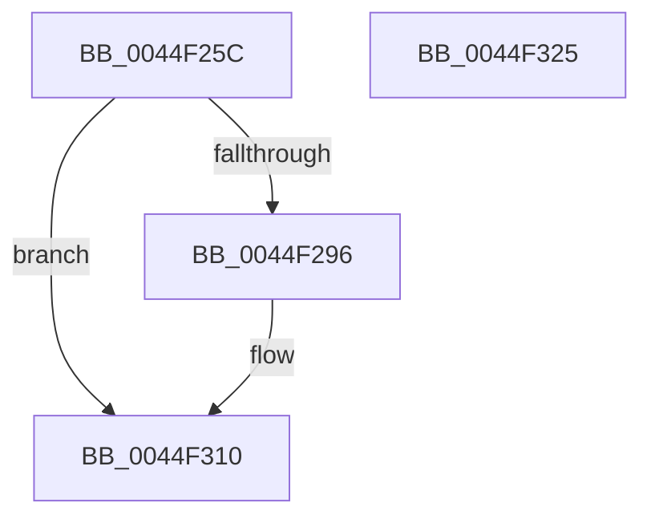

# EtwTraceDpcProfilingStackBegin

- RVA: `0x0044F25C`–`0x0044F326` (길이 `202` bytes)
- VA: `0x000000014044F25C`
- 실행 섹션: `.text`
- PDB 이름 있음: `예`; PDB Function 태그: `아니요`
- unwind 정보 RVA: `0x000A6C08`
- 디코드: `45`개 명령, `202/202` bytes 표시
- 미해석 바이트: `0` (있으면 어셈블리에 `.byte`로 보존)

> 이 문서는 커널 이미지의 기계어와 PDB 기호를 분석해 생성했습니다. 4번과 5번은 함수 원형과 자료형을 바이너리 사용 방식에서 추정한 C 해석이며 원본 소스 복구 결과는 아닙니다.

## 1. Dependencies

- 직접 호출 지점: **2**; 고유 호출 대상: **2**
- 직접 호출자로 확인된 함수: **1**
- RIP 상대 이미지 참조: **3**

### Outgoing calls
- `0x0044F30B` → [EtwWriteEx](../25/EtwWriteEx_function_0025F0D0.md) (function, `0x0025F0D0`)
- `0x0044F317` → [_security_check_cookie](../6A/_security_check_cookie_function_006AC640.md) (function, `0x006AC640`)

### Direct callers
- [KeAccumulateTicks](../39/KeAccumulateTicks_function_0039C140.md) at `0x0039C4C7`
- [KeAccumulateTicks](../39/KeAccumulateTicks_function_0039C140.md) at `0x0039C4ED`

### Static image references
- `0x0044F279` → RVA `0x00E0A740` (`.data`; read)
- `0x0044F287` → RVA `0x00EFF830` (`.data`; read)
- `0x0044F2A6` → RVA `0x00021560` (`.rdata`; read)

## 2. Other-region calls and transfers

- 다른 실행 섹션으로 향하는 call: **0**
- 별도 외부 분기/꼬리 이동을 확인하지 못했습니다.

## 3. Assembly (complete function range)

```asm
0044F25C  48 8B C4                        mov rax, rsp
0044F25F  44 89 48 20                     mov dword ptr [rax + 0x20], r9d
0044F263  44 89 40 18                     mov dword ptr [rax + 0x18], r8d
0044F267  89 50 10                        mov dword ptr [rax + 0x10], edx
0044F26A  89 48 08                        mov dword ptr [rax + 8], ecx
0044F26D  55                              push rbp
0044F26E  48 8D 68 A9                     lea rbp, [rax - 0x57]
0044F272  48 81 EC A0 00 00 00            sub rsp, 0xa0
0044F279  48 8B 05 C0 B4 9B 00            mov rax, qword ptr [rip + 0x9bb4c0]
0044F280  48 33 C4                        xor rax, rsp
0044F283  48 89 45 3F                     mov qword ptr [rbp + 0x3f], rax
0044F287  48 8B 0D A2 05 AB 00            mov rcx, qword ptr [rip + 0xab05a2]
0044F28E  45 33 C0                        xor r8d, r8d
0044F291  48 85 C9                        test rcx, rcx
0044F294  74 7A                           je 0x14044f310
0044F296  48 8D 45 5F                     lea rax, [rbp + 0x5f]
0044F29A  48 C7 45 F7 04 00 00 00         mov qword ptr [rbp - 9], 4
0044F2A2  48 89 45 EF                     mov qword ptr [rbp - 0x11], rax
0044F2A6  48 8D 15 B3 22 BD FF            lea rdx, [rip - 0x42dd4d]
0044F2AD  48 8D 45 67                     lea rax, [rbp + 0x67]
0044F2B1  48 C7 45 07 04 00 00 00         mov qword ptr [rbp + 7], 4
0044F2B9  48 89 45 FF                     mov qword ptr [rbp - 1], rax
0044F2BD  45 33 C9                        xor r9d, r9d
0044F2C0  48 8D 45 6F                     lea rax, [rbp + 0x6f]
0044F2C4  48 C7 45 17 04 00 00 00         mov qword ptr [rbp + 0x17], 4
0044F2CC  48 89 45 0F                     mov qword ptr [rbp + 0xf], rax
0044F2D0  48 8D 45 77                     lea rax, [rbp + 0x77]
0044F2D4  48 89 45 1F                     mov qword ptr [rbp + 0x1f], rax
0044F2D8  48 8D 45 7F                     lea rax, [rbp + 0x7f]
0044F2DC  48 89 45 2F                     mov qword ptr [rbp + 0x2f], rax
0044F2E0  48 8D 45 EF                     lea rax, [rbp - 0x11]
0044F2E4  48 89 44 24 38                  mov qword ptr [rsp + 0x38], rax
0044F2E9  C7 44 24 30 05 00 00 00         mov dword ptr [rsp + 0x30], 5
0044F2F1  4C 89 44 24 28                  mov qword ptr [rsp + 0x28], r8
0044F2F6  4C 89 44 24 20                  mov qword ptr [rsp + 0x20], r8
0044F2FB  48 C7 45 27 04 00 00 00         mov qword ptr [rbp + 0x27], 4
0044F303  48 C7 45 37 04 00 00 00         mov qword ptr [rbp + 0x37], 4
0044F30B  E8 C0 FD E0 FF                  call 0x14025f0d0
0044F310  48 8B 4D 3F                     mov rcx, qword ptr [rbp + 0x3f]
0044F314  48 33 CC                        xor rcx, rsp
0044F317  E8 24 D3 25 00                  call 0x1406ac640
0044F31C  48 81 C4 A0 00 00 00            add rsp, 0xa0
0044F323  5D                              pop rbp
0044F324  C3                              ret
0044F325  CC                              int3
```

## 4. C-style interpretation (structured pseudocode)

```c
__int64 __fastcall EtwTraceDpcProfilingStackBegin(int a1, int a2, int a3, int a4)
{
    __int64 result;
    __int64 v_rsp;
    unsigned __int64 v_stack_m70;
    unsigned int v_stack_m78;
    unsigned __int64 v_stack_m80;
    unsigned __int64 v_stack_m88;

    *(unsigned int *)(v_rsp + 32) = a4;
    *(unsigned int *)(v_rsp + 24) = a3;
    *(unsigned int *)(v_rsp + 16) = a2;
    *(unsigned int *)(v_rsp + 8) = a1;
    v_rsp = (v_rsp) - (160);
    result = (*(unsigned __int64 *)(v_rip + 10204352)) ^ (v_rsp);
    *(unsigned __int64 *)(v_rsp - 87 + 63) = result;
    a3 = 0;
    if (*(unsigned __int64 *)(v_rip + 11208098) != 0) {
        result = v_rsp - 87 + 95;
        *(unsigned __int64 *)(v_rsp - 87 - 9) = 4;
        *(unsigned __int64 *)(v_rsp - 87 - 17) = result;
        a2 = v_rip - 4382029;
        result = v_rsp - 87 + 103;
        *(unsigned __int64 *)(v_rsp - 87 + 7) = 4;
        *(unsigned __int64 *)(v_rsp - 87 - 1) = result;
        a4 = 0;
        result = v_rsp - 87 + 111;
        *(unsigned __int64 *)(v_rsp - 87 + 23) = 4;
        *(unsigned __int64 *)(v_rsp - 87 + 15) = result;
        result = v_rsp - 87 + 119;
        *(unsigned __int64 *)(v_rsp - 87 + 31) = result;
        result = v_rsp - 87 + 127;
        *(unsigned __int64 *)(v_rsp - 87 + 47) = result;
        result = v_rsp - 87 - 17;
        v_stack_m70 = result;
        v_stack_m78 = 5;
        v_stack_m80 = 0;
        v_stack_m88 = 0;
        *(unsigned __int64 *)(v_rsp - 87 + 39) = 4;
        *(unsigned __int64 *)(v_rsp - 87 + 55) = 4;
        result = EtwWriteEx(*(unsigned __int64 *)(v_rip + 11208098), a2, a3, a4);
    }
    a1 = (*(unsigned __int64 *)(v_rsp - 87 + 63)) ^ (v_rsp);
    result = _security_check_cookie(a1, a2, a3, a4);
    v_rsp = (v_rsp) + (160);
    return result;
}
```

## 5. (Beta) C Style

```c
int64_t EtwTraceDpcProfilingStackBegin(int32_t Arg1, int32_t Arg2, int32_t Arg3, int32_t Arg4)
{
    int64_t result;
    int64_t local_rsp;
    uint64_t v_stack_m70;
    uint32_t v_stack_m78;
    uint64_t v_stack_m80;
    uint64_t v_stack_m88;

    *(uint32_t *)(local_rsp + 0x20) = Arg4;
    *(uint32_t *)(local_rsp + 0x18) = Arg3;
    *(uint32_t *)(local_rsp + 0x10) = Arg2;
    *(uint32_t *)(local_rsp + 0x8) = Arg1;
    local_rsp = (local_rsp) - (160);
    result = (*(uint64_t *)(v_rip + 0x9BB4C0)) ^ (local_rsp);
    *(uint64_t *)(local_rsp - 0x57 + 0x3F) = result;
    Arg3 = 0;
    if (*(uint64_t *)(v_rip + 0xAB05A2) != 0) {
        result = local_rsp - 87 + 95;
        *(uint64_t *)(local_rsp - 0x57 - 0x9) = 4;
        *(uint64_t *)(local_rsp - 0x57 - 0x11) = result;
        Arg2 = v_rip - 4382029;
        result = local_rsp - 87 + 103;
        *(uint64_t *)(local_rsp - 0x57 + 0x7) = 4;
        *(uint64_t *)(local_rsp - 0x57 - 0x1) = result;
        Arg4 = 0;
        result = local_rsp - 87 + 111;
        *(uint64_t *)(local_rsp - 0x57 + 0x17) = 4;
        *(uint64_t *)(local_rsp - 0x57 + 0xF) = result;
        result = local_rsp - 87 + 119;
        *(uint64_t *)(local_rsp - 0x57 + 0x1F) = result;
        result = local_rsp - 87 + 127;
        *(uint64_t *)(local_rsp - 0x57 + 0x2F) = result;
        result = local_rsp - 87 - 17;
        v_stack_m70 = result;
        v_stack_m78 = 5;
        v_stack_m80 = 0;
        v_stack_m88 = 0;
        *(uint64_t *)(local_rsp - 0x57 + 0x27) = 4;
        *(uint64_t *)(local_rsp - 0x57 + 0x37) = 4;
        result = EtwWriteEx(*(uint64_t *)(v_rip + 0xAB05A2), Arg2, Arg3, Arg4);
    }
    Arg1 = (*(uint64_t *)(local_rsp - 0x57 + 0x3F)) ^ (local_rsp);
    result = _security_check_cookie(Arg1, Arg2, Arg3, Arg4);
    local_rsp = (local_rsp) + (160);
    return result;
}
```

## 6. Execution-region graph

[열기: 2D/3D 그래프와 함수 탐색 컨트롤 패널](../../../control-panel.html?section=text&rva=0x0044F25C&view=graph)

- 2D 그래프는 위에서 아래로 흐르고, 3D 그래프는 빈 공간을 드래그해 회전합니다. Shift+드래그는 이동, 휠은 확대·축소, 함수 노드 선택은 대상 보고서 이동입니다.

### Static fallback


