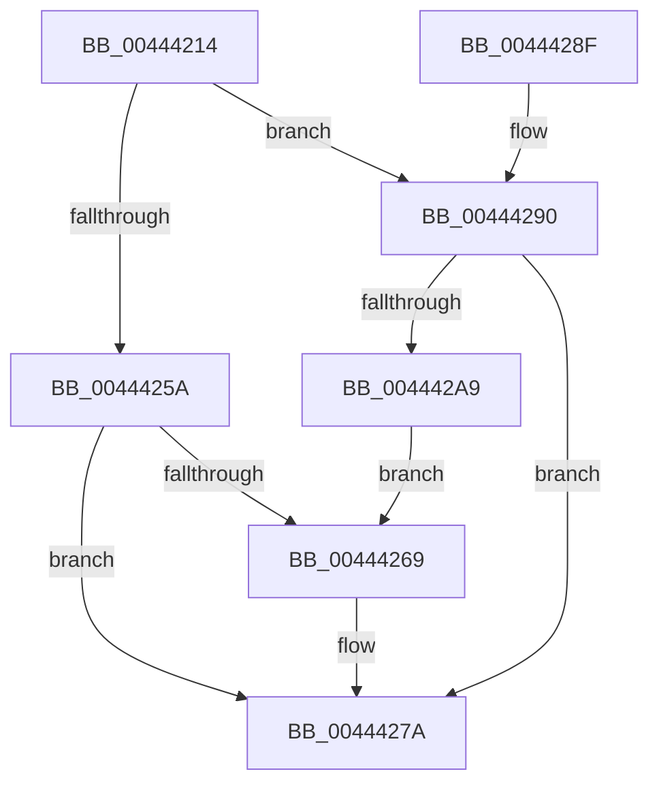

# EtwpCovSampCaptureApcRelease

- RVA: `0x00444214`–`0x004442AB` (길이 `151` bytes)
- VA: `0x0000000140444214`
- 실행 섹션: `.text`
- PDB 이름 있음: `예`; PDB Function 태그: `아니요`
- unwind 정보 RVA: `0x0009C38C`
- 디코드: `42`개 명령, `151/151` bytes 표시
- 미해석 바이트: `0` (있으면 어셈블리에 `.byte`로 보존)

> 이 문서는 커널 이미지의 기계어와 PDB 기호를 분석해 생성했습니다. 4번과 5번은 함수 원형과 자료형을 바이너리 사용 방식에서 추정한 C 해석이며 원본 소스 복구 결과는 아닙니다.

## 1. Dependencies

- 직접 호출 지점: **4**; 고유 호출 대상: **3**
- 직접 호출자로 확인된 함수: **4**
- RIP 상대 이미지 참조: **1**

### Outgoing calls
- `0x0044423C` → [memset](../6C/memset_function_006C6C40.md) (function, `0x006C6C40`)
- `0x0044425D` → [ExpInterlockedPushEntrySList](../6B/ExpInterlockedPushEntrySList_function_006BA5B0.md) (function, `0x006BA5B0`)
- `0x00444275` → [KeInsertQueueDpc](../20/KeInsertQueueDpc_function_00207C50.md) (function, `0x00207C50`)
- `0x00444293` → [ExpInterlockedPushEntrySList](../6B/ExpInterlockedPushEntrySList_function_006BA5B0.md) (function, `0x006BA5B0`)

### Direct callers
- [EtwpCovSampCaptureApc](EtwpCovSampCaptureApc_function_004440D0.md) at `0x0044414B`
- [EtwpCovSampCaptureCancelApcs](../65/EtwpCovSampCaptureCancelApcs_function_00653B44.md) at `0x00653BCA`
- [EtwpCovSampCaptureQueueApc](../65/EtwpCovSampCaptureQueueApc_function_00653CF0.md) at `0x00653EB1`
- [EtwpCovSampCaptureApcRundown](../../page/7C/EtwpCovSampCaptureApcRundown_function_007C1490.md) at `0x007C1498`

### Static image references
- `0x00444228` → RVA `0x00EFF1E8` (`.data`; read)

## 2. Other-region calls and transfers

- 다른 실행 섹션으로 향하는 call: **0**
- 별도 외부 분기/꼬리 이동을 확인하지 못했습니다.

## 3. Assembly (complete function range)

```asm
00444214  48 89 5C 24 08                  mov qword ptr [rsp + 8], rbx
00444219  48 89 6C 24 10                  mov qword ptr [rsp + 0x10], rbp
0044421E  48 89 74 24 18                  mov qword ptr [rsp + 0x18], rsi
00444223  57                              push rdi
00444224  48 83 EC 20                     sub rsp, 0x20
00444228  48 8B 2D B9 AF AB 00            mov rbp, qword ptr [rip + 0xabafb9]
0044422F  33 D2                           xor edx, edx
00444231  48 8B F9                        mov rdi, rcx
00444234  48 83 C1 38                     add rcx, 0x38
00444238  44 8D 42 58                     lea r8d, [rdx + 0x58]
0044423C  E8 FF 29 28 00                  call 0x1406c6c40
00444241  83 A7 90 00 00 00 00            and dword ptr [rdi + 0x90], 0
00444248  48 8B D7                        mov rdx, rdi
0044424B  48 8B 77 30                     mov rsi, qword ptr [rdi + 0x30]
0044424F  8B 46 28                        mov eax, dword ptr [rsi + 0x28]
00444252  48 8B 5E 20                     mov rbx, qword ptr [rsi + 0x20]
00444256  85 C0                           test eax, eax
00444258  74 36                           je 0x140444290
0044425A  48 8B CE                        mov rcx, rsi
0044425D  E8 4E 63 27 00                  call 0x1406ba5b0
00444262  8B 46 28                        mov eax, dword ptr [rsi + 0x28]
00444265  85 C0                           test eax, eax
00444267  75 11                           jne 0x14044427a
00444269  45 33 C0                        xor r8d, r8d
0044426C  48 8D 8D A8 04 00 00            lea rcx, [rbp + 0x4a8]
00444273  33 D2                           xor edx, edx
00444275  E8 D6 39 DC FF                  call 0x140207c50
0044427A  48 8B 5C 24 30                  mov rbx, qword ptr [rsp + 0x30]
0044427F  48 8B 6C 24 38                  mov rbp, qword ptr [rsp + 0x38]
00444284  48 8B 74 24 40                  mov rsi, qword ptr [rsp + 0x40]
00444289  48 83 C4 20                     add rsp, 0x20
0044428D  5F                              pop rdi
0044428E  C3                              ret
0044428F  CC                              int3
00444290  48 8B CB                        mov rcx, rbx
00444293  E8 18 63 27 00                  call 0x1406ba5b0
00444298  B8 01 00 00 00                  mov eax, 1
0044429D  F0 0F C1 43 4C                  lock xadd dword ptr [rbx + 0x4c], eax
004442A2  FF C0                           inc eax
004442A4  3B 43 48                        cmp eax, dword ptr [rbx + 0x48]
004442A7  72 D1                           jb 0x14044427a
004442A9  EB BE                           jmp 0x140444269
```

## 4. C-style interpretation (structured pseudocode)

```c
__int64 __fastcall EtwpCovSampCaptureApcRelease(__int64 a1, int a2)
{
    __int64 result;
    __int64 v_rsp;
    unsigned __int64 v_stack_p10;
    unsigned __int64 v_stack_p18;
    unsigned __int64 v_stack_p8;

    v_stack_p8 = v_rbx;
    v_stack_p10 = v_rbp;
    v_stack_p18 = v_rsi;
    v_rsp = (v_rsp) - (32);
    a2 = 0;
    a1 = (a1) + (56);
    result = memset(a1, a2, a2 + 88, a4);
    if ((unsigned int)((unsigned int)(*(unsigned int *)(*(unsigned __int64 *)(a1 + 48) + 40))) == 0) goto loc_00444290;
    result = ExpInterlockedPushEntrySList(*(unsigned __int64 *)(a1 + 48), a1, a2 + 88, a4);
    result = (unsigned int)(*(unsigned int *)(*(unsigned __int64 *)(a1 + 48) + 40));
    if ((unsigned int)((unsigned int)(*(unsigned int *)(*(unsigned __int64 *)(a1 + 48) + 40))) == 0) {
        a3 = 0;
        a1 = *(unsigned __int64 *)(v_rip + 11251641) + 1192;
        a2 = 0;
        result = KeInsertQueueDpc(a1, a2, a3, a4);
    }
    v_rsp = (v_rsp) + (32);
    return result;
loc_00444290:
    result = ExpInterlockedPushEntrySList(v_stack_p8, a2, a3, a4);
    result = (unsigned int)((1) + 1);
    if (((unsigned int)(result)) < (*(unsigned int *)(v_stack_p8 + 72))) goto loc_0044427A;
    goto loc_00444269;
}
```

## 5. (Beta) C Style

```c
int64_t EtwpCovSampCaptureApcRelease(void *Arg1, int32_t Arg2)
{
    uint8_t *arg1 = (uint8_t *)Arg1;

    int64_t result;
    int64_t local_rsp;
    uint64_t v_stack_p10;
    uint64_t v_stack_p18;
    uint64_t v_stack_p8;

    v_stack_p8 = local_rbx;
    v_stack_p10 = local_rbp;
    v_stack_p18 = local_rsi;
    local_rsp = (local_rsp) - (32);
    Arg2 = 0;
    Arg1 = (Arg1) + (56);
    result = memset(Arg1, Arg2, Arg2 + 88, a4);
    if ((uint32_t)((uint32_t)(*(uint32_t *)(*(uint64_t *)(arg1 + 0x30) + 0x28))) == 0) goto loc_00444290;
    result = ExpInterlockedPushEntrySList(*(uint64_t *)(arg1 + 0x30), Arg1, Arg2 + 88, a4);
    result = (uint32_t)(*(uint32_t *)(*(uint64_t *)(arg1 + 0x30) + 0x28));
    if ((uint32_t)((uint32_t)(*(uint32_t *)(*(uint64_t *)(arg1 + 0x30) + 0x28))) == 0) {
        a3 = 0;
        Arg1 = *(uint64_t *)(v_rip + 0xABAFB9) + 1192;
        Arg2 = 0;
        result = KeInsertQueueDpc(Arg1, Arg2, a3, a4);
    }
    local_rsp = (local_rsp) + (32);
    return result;
loc_00444290:
    result = ExpInterlockedPushEntrySList(v_stack_p8, Arg2, a3, a4);
    result = (uint32_t)((1) + 1);
    if (((uint32_t)(result)) < (*(uint32_t *)(v_stack_p8 + 0x48))) goto loc_0044427A;
    goto loc_00444269;
}
```

### 관측된 메모리 오프셋

구조체 형식이 확인되지 않은 접근은 인자 기준의 오프셋으로만 기록했습니다.

| 기준 인자 | 오프셋 표현 | 폭 (bit) | 접근 |
|---|---:|---:|---|
| `Arg1` | `+ 0x30` | `64` | `R` |
| `Arg1` | `+ 0x90` | `32` | `R/W` |

## 6. Execution-region graph

[열기: 2D/3D 그래프와 함수 탐색 컨트롤 패널](../../../control-panel.html?section=text&rva=0x00444214&view=graph)

- 2D 그래프는 위에서 아래로 흐르고, 3D 그래프는 빈 공간을 드래그해 회전합니다. Shift+드래그는 이동, 휠은 확대·축소, 함수 노드 선택은 대상 보고서 이동입니다.

### Static fallback


