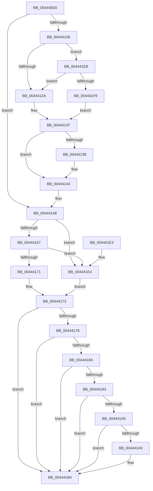

# EtwpCovSampCaptureApc

- RVA: `0x004440D0`–`0x0044420B` (길이 `315` bytes)
- VA: `0x00000001404440D0`
- 실행 섹션: `.text`
- PDB 이름 있음: `예`; PDB Function 태그: `아니요`
- unwind 정보 RVA: `0x000A5678`
- 디코드: `74`개 명령, `315/315` bytes 표시
- 미해석 바이트: `0` (있으면 어셈블리에 `.byte`로 보존)

> 이 문서는 커널 이미지의 기계어와 PDB 기호를 분석해 생성했습니다. 4번과 5번은 함수 원형과 자료형을 바이너리 사용 방식에서 추정한 C 해석이며 원본 소스 복구 결과는 아닙니다.

## 1. Dependencies

- 직접 호출 지점: **6**; 고유 호출 대상: **6**
- 직접 호출자로 확인된 함수: **1**
- RIP 상대 이미지 참조: **3**

### Outgoing calls
- `0x00444110` → [KeAcquireSpinLockRaiseToDpc](../20/KeAcquireSpinLockRaiseToDpc_function_00208470.md) (function, `0x00208470`)
- `0x0044413F` → [KiLowerIrqlProcessIrqlFlags](../4F/KiLowerIrqlProcessIrqlFlags_function_004F5698.md) (function, `0x004F5698`)
- `0x0044414B` → [EtwpCovSampCaptureApcRelease](EtwpCovSampCaptureApcRelease_function_00444214.md) (function, `0x00444214`)
- `0x0044418A` → [MmCanThreadFault](../2F/MmCanThreadFault_function_002F86B0.md) (function, `0x002F86B0`)
- `0x004441AF` → [EtwpCovSampCaptureUserAddresses](../../page/8D/EtwpCovSampCaptureUserAddresses_function_008D73BC.md) (function, `0x008D73BC`)
- `0x00444201` → [KiReleaseSpinLockInstrumented](../39/KiReleaseSpinLockInstrumented_function_00392EF0.md) (function, `0x00392EF0`)

### Direct callers
- [sub_002514A5](../25/Unknown_function_002514A5.md) at `0x002515DB`

### Static image references
- `0x0044411A` → RVA `0x00FC6B06` (`ALMOSTRO`; read)
- `0x0044412F` → RVA `0x00FC6D20` (`ALMOSTRO`; read)
- `0x004441EB` → RVA `0x00F0DE58` (`.data`; read)

## 2. Other-region calls and transfers

- 다른 실행 섹션으로 향하는 call: **1**
  - `0x004441AF` → [EtwpCovSampCaptureUserAddresses](../../page/8D/EtwpCovSampCaptureUserAddresses_function_008D73BC.md) (`.text` → `PAGE`)
- 별도 외부 분기/꼬리 이동을 확인하지 못했습니다.

## 3. Assembly (complete function range)

```asm
004440D0  48 8B C4                        mov rax, rsp
004440D3  48 89 58 08                     mov qword ptr [rax + 8], rbx
004440D7  48 89 68 10                     mov qword ptr [rax + 0x10], rbp
004440DB  48 89 70 18                     mov qword ptr [rax + 0x18], rsi
004440DF  48 89 78 20                     mov qword ptr [rax + 0x20], rdi
004440E3  41 56                           push r14
004440E5  48 83 EC 20                     sub rsp, 0x20
004440E9  49 8B 28                        mov rbp, qword ptr [r8]
004440EC  48 8D 71 C8                     lea rsi, [rcx - 0x38]
004440F0  4D 8B 31                        mov r14, qword ptr [r9]
004440F3  48 83 22 00                     and qword ptr [rdx], 0
004440F7  F0 83 0C 24 00                  lock or dword ptr [rsp], 0
004440FC  48 8B 46 30                     mov rax, qword ptr [rsi + 0x30]
00444100  83 78 28 00                     cmp dword ptr [rax + 0x28], 0
00444104  74 42                           je 0x140444148
00444106  48 8D 9D 78 02 00 00            lea rbx, [rbp + 0x278]
0044410D  48 8B CB                        mov rcx, rbx
00444110  E8 5B 43 DC FF                  call 0x140208470
00444115  48 83 66 40 00                  and qword ptr [rsi + 0x40], 0
0044411A  F6 05 E5 29 B8 00 01            test byte ptr [rip + 0xb829e5], 1
00444121  0F B6 F8                        movzx edi, al
00444124  0F 85 C1 00 00 00               jne 0x1404441eb
0044412A  F0 48 83 23 00                  lock and qword ptr [rbx], 0
0044412F  83 3D EA 2B B8 00 00            cmp dword ptr [rip + 0xb82bea], 0
00444136  74 0C                           je 0x140444144
00444138  44 0F 20 C1                     mov rcx, cr8
0044413C  40 8A D7                        mov dl, dil
0044413F  E8 54 15 0B 00                  call 0x1404f5698
00444144  44 0F 22 C7                     mov cr8, rdi
00444148  48 8B CE                        mov rcx, rsi
0044414B  E8 C4 00 00 00                  call 0x140444214
00444150  44 0F 20 C2                     mov rdx, cr8
00444154  65 48 8B 0C 25 88 01 00 00      mov rcx, qword ptr gs:[0x188]
0044415D  8B 81 A0 05 00 00               mov eax, dword ptr [rcx + 0x5a0]
00444163  A8 01                           test al, 1
00444165  75 7D                           jne 0x1404441e4
00444167  48 83 B9 F0 00 00 00 00         cmp qword ptr [rcx + 0xf0], 0
0044416F  74 73                           je 0x1404441e4
00444171  33 DB                           xor ebx, ebx
00444173  80 FA 02                        cmp dl, 2
00444176  73 3C                           jae 0x1404441b4
00444178  65 48 8B 04 25 88 01 00 00      mov rax, qword ptr gs:[0x188]
00444181  83 B8 E4 01 00 00 00            cmp dword ptr [rax + 0x1e4], 0
00444188  75 2A                           jne 0x1404441b4
0044418A  E8 21 45 EB FF                  call 0x1402f86b0
0044418F  85 C0                           test eax, eax
00444191  74 21                           je 0x1404441b4
00444193  65 48 8B 04 25 88 01 00 00      mov rax, qword ptr gs:[0x188]
0044419C  80 B8 4A 02 00 00 01            cmp byte ptr [rax + 0x24a], 1
004441A3  74 0F                           je 0x1404441b4
004441A5  85 DB                           test ebx, ebx
004441A7  75 0B                           jne 0x1404441b4
004441A9  49 8B D6                        mov rdx, r14
004441AC  48 8B CD                        mov rcx, rbp
004441AF  E8 08 32 49 00                  call 0x1408d73bc
004441B4  65 48 8B 04 25 88 01 00 00      mov rax, qword ptr gs:[0x188]
004441BD  F0 81 A0 A0 05 00 00 FF FF 7F FF  lock and dword ptr [rax + 0x5a0], 0xff7fffff
004441C8  48 8B 5C 24 30                  mov rbx, qword ptr [rsp + 0x30]
004441CD  48 8B 6C 24 38                  mov rbp, qword ptr [rsp + 0x38]
004441D2  48 8B 74 24 40                  mov rsi, qword ptr [rsp + 0x40]
004441D7  48 8B 7C 24 48                  mov rdi, qword ptr [rsp + 0x48]
004441DC  48 83 C4 20                     add rsp, 0x20
004441E0  41 5E                           pop r14
004441E2  C3                              ret
004441E3  CC                              int3
004441E4  BB 01 00 00 00                  mov ebx, 1
004441E9  EB 88                           jmp 0x140444173
004441EB  8B 15 67 9C AC 00               mov edx, dword ptr [rip + 0xac9c67]
004441F1  85 D2                           test edx, edx
004441F3  0F 85 31 FF FF FF               jne 0x14044412a
004441F9  48 8B 54 24 28                  mov rdx, qword ptr [rsp + 0x28]
004441FE  48 8B CB                        mov rcx, rbx
00444201  E8 EA EC F4 FF                  call 0x140392ef0
00444206  E9 24 FF FF FF                  jmp 0x14044412f
```

## 4. C-style interpretation (structured pseudocode)

```c
__int64 __fastcall EtwpCovSampCaptureApc(__int64 a1, __int64 a2, __int64 a3, __int64 a4)
{
    __int64 result;
    __int64 v_rbx;
    __int64 v_rsp;
    unsigned int v_stack_m28;
    unsigned __int64 v_stack_p10;
    unsigned __int64 v_stack_p18;
    unsigned __int64 v_stack_p20;
    unsigned __int64 v_stack_p28;
    unsigned __int64 v_stack_p8;

    *(unsigned __int64 *)(v_rsp + 8) = v_rbx;
    *(unsigned __int64 *)(v_rsp + 16) = v_rbp;
    *(unsigned __int64 *)(v_rsp + 24) = v_rsi;
    *(unsigned __int64 *)(v_rsp + 32) = v_rdi;
    v_rsp = (v_rsp) - (32);
    if ((*(unsigned int *)(*(unsigned __int64 *)(a1 - 56 + 48) + 40)) == 0) goto loc_00444148;
    result = KeAcquireSpinLockRaiseToDpc(*(unsigned __int64 *)(a3) + 632, a2, a3, a4);
    if (((*(unsigned __int8 *)(v_rip + 12069349)) & (1)) != 0) goto loc_004441EB;
loc_0044412A:
loc_0044412F:
    if ((*(unsigned int *)(v_rip + 12069866)) != 0) {
        a1 = v_cr8;
        a2 = (unsigned __int8)((unsigned __int8)(result));
        result = KiLowerIrqlProcessIrqlFlags(a1, a2, a3, a4);
    }
loc_00444148:
    result = EtwpCovSampCaptureApcRelease(a1 - 56, a2, a3, a4);
    if ((((unsigned __int8)((unsigned int)(*(unsigned int *)(*(unsigned __int64 *)(gs_base + (0 + 392)) + 1440)))) & (1)) != 0) goto loc_004441E4;
    if ((*(unsigned __int64 *)(*(unsigned __int64 *)(gs_base + (0 + 392)) + 240)) == 0) goto loc_004441E4;
    v_rbx = 0;
loc_00444173:
    if (((unsigned __int8)((unsigned __int8)(result))) >= 2) goto loc_004441B4;
    if ((*(unsigned int *)(*(unsigned __int64 *)(gs_base + (0 + 392)) + 484)) != 0) goto loc_004441B4;
    result = MmCanThreadFault(*(unsigned __int64 *)(gs_base + (0 + 392)), (unsigned __int8)(result), a3, a4);
    if ((unsigned int)(result) == 0) goto loc_004441B4;
    if ((*(unsigned __int8 *)(*(unsigned __int64 *)(gs_base + (0 + 392)) + 586)) == 1) goto loc_004441B4;
    result = *(unsigned __int64 *)(gs_base + (0 + 392));
    if (0 == 0) {
        a2 = *(unsigned __int64 *)(a4);
        a1 = *(unsigned __int64 *)(a3);
        result = EtwpCovSampCaptureUserAddresses(a1, a2, a3, a4);
    }
    v_rsp = (v_rsp) + (32);
    return *(unsigned __int64 *)(gs_base + (0 + 392));
loc_004441E4:
    goto loc_00444173;
loc_004441EB:
    if ((unsigned int)((unsigned int)(*(unsigned int *)(v_rip + 11312231))) != 0) goto loc_0044412A;
    result = KiReleaseSpinLockInstrumented(1, v_stack_p28, a3, a4);
    goto loc_0044412F;
}
```

## 5. (Beta) C Style

```c
int64_t EtwpCovSampCaptureApc(void *Arg1, void *Arg2, void *Arg3, void *Arg4)
{
    uint8_t *arg1 = (uint8_t *)Arg1;
    uint8_t *arg2 = (uint8_t *)Arg2;
    uint8_t *arg3 = (uint8_t *)Arg3;
    uint8_t *arg4 = (uint8_t *)Arg4;

    int64_t result;
    int64_t local_rbx;
    int64_t local_rsp;
    uint32_t v_stack_m28;
    uint64_t v_stack_p10;
    uint64_t v_stack_p18;
    uint64_t v_stack_p20;
    uint64_t v_stack_p28;
    uint64_t v_stack_p8;

    *(uint64_t *)(local_rsp + 0x8) = local_rbx;
    *(uint64_t *)(local_rsp + 0x10) = local_rbp;
    *(uint64_t *)(local_rsp + 0x18) = local_rsi;
    *(uint64_t *)(local_rsp + 0x20) = local_rdi;
    local_rsp = (local_rsp) - (32);
    if ((*(uint32_t *)(*(uint64_t *)(arg1 - 0x38 + 0x30) + 0x28)) == 0) goto loc_00444148;
    result = KeAcquireSpinLockRaiseToDpc(*(uint64_t *)(arg3) + 632, Arg2, Arg3, Arg4);
    if (((*(uint8_t *)(v_rip + 0xB829E5)) & (1)) != 0) goto loc_004441EB;
loc_0044412A:
loc_0044412F:
    if ((*(uint32_t *)(v_rip + 0xB82BEA)) != 0) {
        Arg1 = v_cr8;
        Arg2 = (uint8_t)((uint8_t)(result));
        result = KiLowerIrqlProcessIrqlFlags(Arg1, Arg2, Arg3, Arg4);
    }
loc_00444148:
    result = EtwpCovSampCaptureApcRelease(Arg1 - 56, Arg2, Arg3, Arg4);
    if ((((uint8_t)((uint32_t)(*(uint32_t *)(*(uint64_t *)(gs_base + (0 + 0x188)) + 0x5A0)))) & (1)) != 0) goto loc_004441E4;
    if ((*(uint64_t *)(*(uint64_t *)(gs_base + (0 + 0x188)) + 0xF0)) == 0) goto loc_004441E4;
    local_rbx = 0;
loc_00444173:
    if (((uint8_t)((uint8_t)(result))) >= 2) goto loc_004441B4;
    if ((*(uint32_t *)(*(uint64_t *)(gs_base + (0 + 0x188)) + 0x1E4)) != 0) goto loc_004441B4;
    result = MmCanThreadFault(*(uint64_t *)(gs_base + (0 + 0x188)), (uint8_t)(result), Arg3, Arg4);
    if ((uint32_t)(result) == 0) goto loc_004441B4;
    if ((*(uint8_t *)(*(uint64_t *)(gs_base + (0 + 0x188)) + 0x24A)) == 1) goto loc_004441B4;
    result = *(uint64_t *)(gs_base + (0 + 0x188));
    if (0 == 0) {
        Arg2 = *(uint64_t *)(arg4);
        Arg1 = *(uint64_t *)(arg3);
        result = EtwpCovSampCaptureUserAddresses(Arg1, Arg2, Arg3, Arg4);
    }
    local_rsp = (local_rsp) + (32);
    return *(uint64_t *)(gs_base + (0 + 0x188));
loc_004441E4:
    goto loc_00444173;
loc_004441EB:
    if ((uint32_t)((uint32_t)(*(uint32_t *)(v_rip + 0xAC9C67))) != 0) goto loc_0044412A;
    result = KiReleaseSpinLockInstrumented(1, v_stack_p28, Arg3, Arg4);
    goto loc_0044412F;
}
```

### 관측된 메모리 오프셋

구조체 형식이 확인되지 않은 접근은 인자 기준의 오프셋으로만 기록했습니다.

| 기준 인자 | 오프셋 표현 | 폭 (bit) | 접근 |
|---|---:|---:|---|
| `Arg1` | `- 0x38` | `64` | `R` |
| `Arg1` | `+ 0x30` | `64` | `R` |
| `Arg1` | `+ 0x40` | `64` | `R/W` |
| `Arg2` | `+ 0x0` | `64` | `R/W` |
| `Arg3` | `+ 0x0` | `64` | `R` |
| `Arg4` | `+ 0x0` | `64` | `R` |

## 6. Execution-region graph

[열기: 2D/3D 그래프와 함수 탐색 컨트롤 패널](../../../control-panel.html?section=text&rva=0x004440D0&view=graph)

- 2D 그래프는 위에서 아래로 흐르고, 3D 그래프는 빈 공간을 드래그해 회전합니다. Shift+드래그는 이동, 휠은 확대·축소, 함수 노드 선택은 대상 보고서 이동입니다.

### Static fallback


