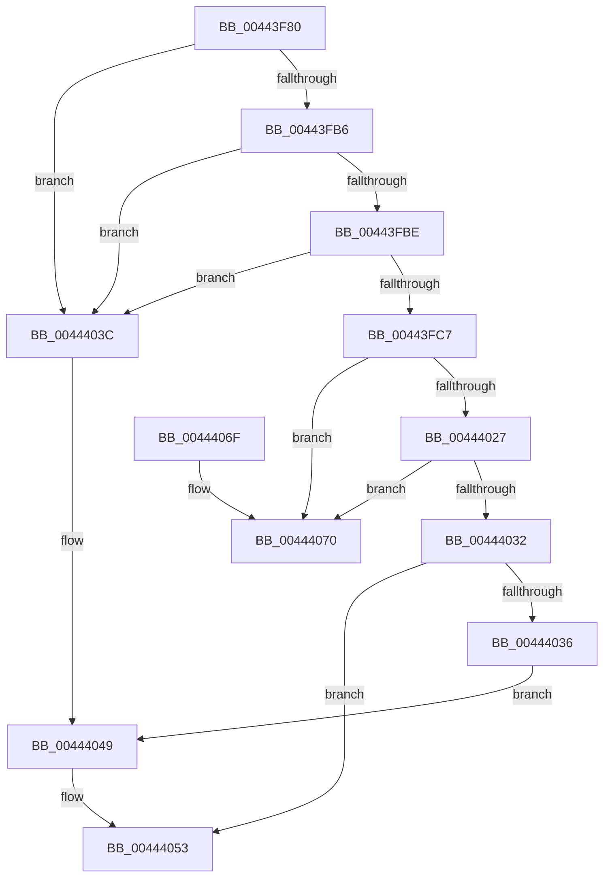

# EtwpExpandStackAndWalkFrameChain

- RVA: `0x00443F80`–`0x0044408E` (길이 `270` bytes)
- VA: `0x0000000140443F80`
- 실행 섹션: `.text`
- PDB 이름 있음: `예`; PDB Function 태그: `아니요`
- unwind 정보 RVA: `0x000A565C`
- 디코드: `74`개 명령, `270/270` bytes 표시
- 미해석 바이트: `0` (있으면 어셈블리에 `.byte`로 보존)

> 이 문서는 커널 이미지의 기계어와 PDB 기호를 분석해 생성했습니다. 4번과 5번은 함수 원형과 자료형을 바이너리 사용 방식에서 추정한 C 해석이며 원본 소스 복구 결과는 아닙니다.

## 1. Dependencies

- 직접 호출 지점: **5**; 고유 호출 대상: **5**
- 직접 호출자로 확인된 함수: **1**
- RIP 상대 이미지 참조: **1**

### Outgoing calls
- `0x00443FA9` → [KeAreInterruptsEnabled](../2F/KeAreInterruptsEnabled_function_002F8060.md) (function, `0x002F8060`)
- `0x00443FBE` → [Feature_ETWStackExpandedStackwalks__private_IsEnabledDeviceUsageNoInline](Feature_ETWStackExpandedStackwalks__private_IsEnabledDeviceUsageNoInline_function_00444094.md) (function, `0x00444094`)
- `0x00444017` → [KeExpandKernelStackAndCalloutInternal](../2F/KeExpandKernelStackAndCalloutInternal_function_002F8450.md) (function, `0x002F8450`)
- `0x00444044` → [RtlWalkFrameChain](../2F/RtlWalkFrameChain_function_002F85E0.md) (function, `0x002F85E0`)
- `0x00444088` → [KeBugCheckEx](../4F/KeBugCheckEx_function_004FD660.md) (function, `0x004FD660`)

### Direct callers
- [EtwpGetStackExtendedHeaderItem](EtwpGetStackExtendedHeaderItem_function_00443D70.md) at `0x00443E72`
- [EtwpGetStackExtendedHeaderItem](EtwpGetStackExtendedHeaderItem_function_00443D70.md) at `0x00443F08`

### Static image references
- `0x00443FD6` → RVA `0x00453680` (`EtwpExpandedStackWalk`; read)

## 2. Other-region calls and transfers

- 다른 실행 섹션으로 향하는 call: **0**
- 별도 외부 분기/꼬리 이동을 확인하지 못했습니다.

## 3. Assembly (complete function range)

```asm
00443F80  48 89 5C 24 08                  mov qword ptr [rsp + 8], rbx
00443F85  48 89 6C 24 10                  mov qword ptr [rsp + 0x10], rbp
00443F8A  48 89 74 24 18                  mov qword ptr [rsp + 0x18], rsi
00443F8F  57                              push rdi
00443F90  41 56                           push r14
00443F92  41 57                           push r15
00443F94  48 83 EC 60                     sub rsp, 0x60
00443F98  4D 8B 78 18                     mov r15, qword ptr [r8 + 0x18]
00443F9C  41 8B F1                        mov esi, r9d
00443F9F  49 8B F8                        mov rdi, r8
00443FA2  8B EA                           mov ebp, edx
00443FA4  4C 8B F1                        mov r14, rcx
00443FA7  33 DB                           xor ebx, ebx
00443FA9  E8 B2 40 EB FF                  call 0x1402f8060
00443FAE  84 C0                           test al, al
00443FB0  0F 84 86 00 00 00               je 0x14044403c
00443FB6  44 0F 20 C0                     mov rax, cr8
00443FBA  3C 02                           cmp al, 2
00443FBC  77 7E                           ja 0x14044403c
00443FBE  E8 D1 00 00 00                  call 0x140444094
00443FC3  85 C0                           test eax, eax
00443FC5  74 75                           je 0x14044403c
00443FC7  48 89 5C 24 50                  mov qword ptr [rsp + 0x50], rbx
00443FCC  48 8D 54 24 30                  lea rdx, [rsp + 0x30]
00443FD1  4C 89 74 24 30                  mov qword ptr [rsp + 0x30], r14
00443FD6  48 8D 0D A3 F6 00 00            lea rcx, [rip + 0xf6a3]
00443FDD  4C 89 7C 24 38                  mov qword ptr [rsp + 0x38], r15
00443FE2  41 B9 08 00 00 40               mov r9d, 0x40000008
00443FE8  89 6C 24 48                     mov dword ptr [rsp + 0x48], ebp
00443FEC  41 B8 00 60 00 00               mov r8d, 0x6000
00443FF2  89 74 24 4C                     mov dword ptr [rsp + 0x4c], esi
00443FF6  65 48 8B 34 25 88 01 00 00      mov rsi, qword ptr gs:[0x188]
00443FFF  48 89 74 24 40                  mov qword ptr [rsp + 0x40], rsi
00444004  4C 89 7C 24 20                  mov qword ptr [rsp + 0x20], r15
00444009  48 89 BE B0 06 00 00            mov qword ptr [rsi + 0x6b0], rdi
00444010  0F B6 7E 7D                     movzx edi, byte ptr [rsi + 0x7d]
00444014  83 E7 01                        and edi, 1
00444017  E8 34 44 EB FF                  call 0x1402f8450
0044401C  8B D8                           mov ebx, eax
0044401E  41 0F B6 47 07                  movzx eax, byte ptr [r15 + 7]
00444023  A8 02                           test al, 2
00444025  75 49                           jne 0x140444070
00444027  0F B6 46 7D                     movzx eax, byte ptr [rsi + 0x7d]
0044402B  83 E0 01                        and eax, 1
0044402E  3B F8                           cmp edi, eax
00444030  75 3E                           jne 0x140444070
00444032  85 DB                           test ebx, ebx
00444034  78 1D                           js 0x140444053
00444036  8B 44 24 50                     mov eax, dword ptr [rsp + 0x50]
0044403A  EB 0D                           jmp 0x140444049
0044403C  44 8B C6                        mov r8d, esi
0044403F  8B D5                           mov edx, ebp
00444041  49 8B CE                        mov rcx, r14
00444044  E8 97 45 EB FF                  call 0x1402f85e0
00444049  48 8B 8C 24 A0 00 00 00         mov rcx, qword ptr [rsp + 0xa0]
00444051  89 01                           mov dword ptr [rcx], eax
00444053  4C 8D 5C 24 60                  lea r11, [rsp + 0x60]
00444058  8B C3                           mov eax, ebx
0044405A  49 8B 5B 20                     mov rbx, qword ptr [r11 + 0x20]
0044405E  49 8B 6B 28                     mov rbp, qword ptr [r11 + 0x28]
00444062  49 8B 73 30                     mov rsi, qword ptr [r11 + 0x30]
00444066  49 8B E3                        mov rsp, r11
00444069  41 5F                           pop r15
0044406B  41 5E                           pop r14
0044406D  5F                              pop rdi
0044406E  C3                              ret
0044406F  CC                              int3
00444070  45 33 C9                        xor r9d, r9d
00444073  48 C7 44 24 20 00 00 00 00      mov qword ptr [rsp + 0x20], 0
0044407C  4D 8B C7                        mov r8, r15
0044407F  B9 1D 01 00 00                  mov ecx, 0x11d
00444084  41 8D 51 0A                     lea edx, [r9 + 0xa]
00444088  E8 D3 95 0B 00                  call 0x1404fd660
0044408D  CC                              int3
```

## 4. C-style interpretation (structured pseudocode)

```c
__int64 __fastcall EtwpExpandStackAndWalkFrameChain(__int64 a1, int a2, __int64 a3, int a4, __int64 a5)
{
    __int64 result;
    __int64 v_rbx;
    __int64 v_rdi;
    __int64 v_rsp;
    unsigned __int64 v_stack_m18;
    unsigned __int64 v_stack_m28;
    unsigned int v_stack_m2C;
    unsigned int v_stack_m30;
    unsigned __int64 v_stack_m38;
    unsigned __int64 v_stack_m40;
    unsigned __int64 v_stack_m48;
    unsigned __int64 v_stack_m58;
    unsigned __int64 v_stack_p10;
    unsigned __int64 v_stack_p18;
    unsigned __int64 v_stack_p8;

    v_stack_p8 = v_rbx;
    v_stack_p10 = v_rbp;
    v_stack_p18 = v_rsi;
    v_rsp = (v_rsp) - (96);
    v_rbx = 0;
    result = KeAreInterruptsEnabled(a1, a2, a3, a4);
    if ((unsigned __int8)(result) == 0) goto loc_0044403C;
    if (((unsigned __int8)(v_cr8)) > 2) goto loc_0044403C;
    result = Feature_ETWStackExpandedStackwalks__private_IsEnabledDeviceUsageNoInline(a1, a2, a3, a4);
    if ((unsigned int)(result) == 0) goto loc_0044403C;
    v_stack_m28 = 0;
    v_stack_m48 = a1;
    v_stack_m40 = *(unsigned __int64 *)(a3 + 24);
    v_stack_m30 = (unsigned int)((unsigned int)(a2));
    v_stack_m2C = (unsigned int)((unsigned int)(a4));
    v_stack_m38 = *(unsigned __int64 *)(gs_base + (0 + 392));
    v_stack_m58 = *(unsigned __int64 *)(a3 + 24);
    *(unsigned __int64 *)(*(unsigned __int64 *)(gs_base + (0 + 392)) + 1712) = a3;
    v_rdi = (unsigned int)((*(unsigned __int8 *)(*(unsigned __int64 *)(gs_base + (0 + 392)) + 125)) & (1));
    result = KeExpandKernelStackAndCalloutInternal(v_rip + 63139, v_stack_m48, (unsigned int)(0x6000ULL), (unsigned int)(0x40000008ULL));
    if ((((unsigned __int8)(*(unsigned __int8 *)(*(unsigned __int64 *)(a3 + 24) + 7))) & (2)) != 0) goto loc_00444070;
    result = (unsigned int)((*(unsigned __int8 *)(*(unsigned __int64 *)(gs_base + (0 + 392)) + 125)) & (1));
    if (((unsigned int)(v_rdi)) != ((unsigned int)(result))) goto loc_00444070;
    if (sign_flag) goto loc_00444053;
    goto loc_00444049;
loc_0044403C:
    result = RtlWalkFrameChain(a1, (unsigned int)((unsigned int)((unsigned int)(a2))), (unsigned int)((unsigned int)(*(unsigned __int64 *)(gs_base + (0 + 392)))), (unsigned int)(0x40000008ULL));
loc_00444049:
    *(unsigned int *)(a5) = (unsigned int)(result);
loc_00444053:
    return (unsigned int)((unsigned int)((unsigned int)((unsigned int)(result))));
loc_00444070:
    a4 = 0;
    v_stack_m40 = 0;
    result = KeBugCheckEx(285, a4 + 10, *(unsigned __int64 *)(a3 + 24), a4);
    return result;
}
```

## 5. (Beta) C Style

```c
int64_t EtwpExpandStackAndWalkFrameChain(int64_t Arg1, int32_t Arg2, void *Arg3, int32_t Arg4, void *Arg5)
{
    uint8_t *arg3 = (uint8_t *)Arg3;
    uint8_t *arg5 = (uint8_t *)Arg5;

    int64_t result;
    int64_t local_rbx;
    int64_t local_rdi;
    int64_t local_rsp;
    uint64_t v_stack_m18;
    uint64_t v_stack_m28;
    uint32_t v_stack_m2C;
    uint32_t v_stack_m30;
    uint64_t v_stack_m38;
    uint64_t v_stack_m40;
    uint64_t v_stack_m48;
    uint64_t v_stack_m58;
    uint64_t v_stack_p10;
    uint64_t v_stack_p18;
    uint64_t v_stack_p8;

    v_stack_p8 = local_rbx;
    v_stack_p10 = local_rbp;
    v_stack_p18 = local_rsi;
    local_rsp = (local_rsp) - (96);
    local_rbx = 0;
    result = KeAreInterruptsEnabled(Arg1, Arg2, Arg3, Arg4);
    if ((uint8_t)(result) == 0) goto loc_0044403C;
    if (((uint8_t)(v_cr8)) > 2) goto loc_0044403C;
    result = Feature_ETWStackExpandedStackwalks__private_IsEnabledDeviceUsageNoInline(Arg1, Arg2, Arg3, Arg4);
    if ((uint32_t)(result) == 0) goto loc_0044403C;
    v_stack_m28 = 0;
    v_stack_m48 = Arg1;
    v_stack_m40 = *(uint64_t *)(arg3 + 0x18);
    v_stack_m30 = (uint32_t)((uint32_t)(Arg2));
    v_stack_m2C = (uint32_t)((uint32_t)(Arg4));
    v_stack_m38 = *(uint64_t *)(gs_base + (0 + 0x188));
    v_stack_m58 = *(uint64_t *)(arg3 + 0x18);
    *(void **)(*(uint64_t *)(gs_base + (0 + 0x188)) + 0x6B0) = Arg3;
    local_rdi = (uint32_t)((*(uint8_t *)(*(uint64_t *)(gs_base + (0 + 0x188)) + 0x7D)) & (1));
    result = KeExpandKernelStackAndCalloutInternal(v_rip + 63139, v_stack_m48, (uint32_t)(0x6000ULL), (uint32_t)(0x40000008ULL));
    if ((((uint8_t)(*(uint8_t *)(*(uint64_t *)(arg3 + 0x18) + 0x7))) & (2)) != 0) goto loc_00444070;
    result = (uint32_t)((*(uint8_t *)(*(uint64_t *)(gs_base + (0 + 0x188)) + 0x7D)) & (1));
    if (((uint32_t)(local_rdi)) != ((uint32_t)(result))) goto loc_00444070;
    if (sign_flag) goto loc_00444053;
    goto loc_00444049;
loc_0044403C:
    result = RtlWalkFrameChain(Arg1, (uint32_t)((uint32_t)((uint32_t)(Arg2))), (uint32_t)((uint32_t)(*(uint64_t *)(gs_base + (0 + 0x188)))), (uint32_t)(0x40000008ULL));
loc_00444049:
    *(uint32_t *)(arg5) = (uint32_t)(result);
loc_00444053:
    return (uint32_t)((uint32_t)((uint32_t)((uint32_t)(result))));
loc_00444070:
    Arg4 = 0;
    v_stack_m40 = 0;
    result = KeBugCheckEx(285, Arg4 + 10, *(uint64_t *)(arg3 + 0x18), Arg4);
    return result;
}
```

### 관측된 메모리 오프셋

구조체 형식이 확인되지 않은 접근은 인자 기준의 오프셋으로만 기록했습니다.

| 기준 인자 | 오프셋 표현 | 폭 (bit) | 접근 |
|---|---:|---:|---|
| `Arg3` | `+ 0x18` | `64` | `R` |
| `Arg5` | `+ 0x0` | `32` | `W` |

## 6. Execution-region graph

[열기: 2D/3D 그래프와 함수 탐색 컨트롤 패널](../../../control-panel.html?section=text&rva=0x00443F80&view=graph)

- 2D 그래프는 위에서 아래로 흐르고, 3D 그래프는 빈 공간을 드래그해 회전합니다. Shift+드래그는 이동, 휠은 확대·축소, 함수 노드 선택은 대상 보고서 이동입니다.

### Static fallback


