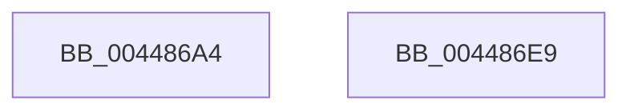

# EtwpFinalizePendingApc

- RVA: `0x004486A4`–`0x004486EA` (길이 `70` bytes)
- VA: `0x00000001404486A4`
- 실행 섹션: `.text`
- PDB 이름 있음: `예`; PDB Function 태그: `아니요`
- unwind 정보 RVA: `0x0005CF00`
- 디코드: `18`개 명령, `70/70` bytes 표시
- 미해석 바이트: `0` (있으면 어셈블리에 `.byte`로 보존)

> 이 문서는 커널 이미지의 기계어와 PDB 기호를 분석해 생성했습니다. 4번과 5번은 함수 원형과 자료형을 바이너리 사용 방식에서 추정한 C 해석이며 원본 소스 복구 결과는 아닙니다.

## 1. Dependencies

- 직접 호출 지점: **2**; 고유 호출 대상: **2**
- 직접 호출자로 확인된 함수: **2**
- RIP 상대 이미지 참조: **0**

### Outgoing calls
- `0x004486BC` → [ExpInterlockedPushEntrySList](../6B/ExpInterlockedPushEntrySList_function_006BA5B0.md) (function, `0x006BA5B0`)
- `0x004486DE` → [ExReleaseRundownProtectionCacheAwareEx](../25/ExReleaseRundownProtectionCacheAwareEx_function_0025F050.md) (function, `0x0025F050`)

### Direct callers
- [EtwpCancelPendingApcs](../49/EtwpCancelPendingApcs_function_00497D88.md) at `0x00497E42`
- [EtwpCancelApcThunk](../65/EtwpCancelApcThunk_function_00652CD0.md) at `0x00652D0A`

### Static image references
- 디코드된 RIP-relative 메모리 참조가 없습니다.

## 2. Other-region calls and transfers

- 다른 실행 섹션으로 향하는 call: **0**
- 별도 외부 분기/꼬리 이동을 확인하지 못했습니다.

## 3. Assembly (complete function range)

```asm
004486A4  40 53                           push rbx
004486A6  48 83 EC 20                     sub rsp, 0x20
004486AA  F0 FF 89 B0 00 00 00            lock dec dword ptr [rcx + 0xb0]
004486B1  48 8B D9                        mov rbx, rcx
004486B4  48 83 C1 20                     add rcx, 0x20
004486B8  48 83 C2 70                     add rdx, 0x70
004486BC  E8 EF 1E 27 00                  call 0x1406ba5b0
004486C1  48 8B 03                        mov rax, qword ptr [rbx]
004486C4  48 8B 90 50 05 00 00            mov rdx, qword ptr [rax + 0x550]
004486CB  44 8B 00                        mov r8d, dword ptr [rax]
004486CE  48 8B 8A C0 02 00 00            mov rcx, qword ptr [rdx + 0x2c0]
004486D5  BA 01 00 00 00                  mov edx, 1
004486DA  4A 8B 0C C1                     mov rcx, qword ptr [rcx + r8*8]
004486DE  E8 6D 69 E1 FF                  call 0x14025f050
004486E3  48 83 C4 20                     add rsp, 0x20
004486E7  5B                              pop rbx
004486E8  C3                              ret
004486E9  CC                              int3
```

## 4. C-style interpretation (structured pseudocode)

```c
__int64 __fastcall EtwpFinalizePendingApc(__int64 a1, __int64 a2)
{
    __int64 result;
    __int64 v_rsp;

    v_rsp = (v_rsp) - (32);
    a1 = (a1) + (32);
    a2 = (a2) + (112);
    result = ExpInterlockedPushEntrySList(a1, a2, a3, a4);
    result = ExReleaseRundownProtectionCacheAwareEx(*(unsigned __int64 *)(*(unsigned __int64 *)(*(unsigned __int64 *)(*(unsigned __int64 *)(a1) + 1360) + 704) + (unsigned int)(*(unsigned int *)(*(unsigned __int64 *)(a1))) * 8), 1, (unsigned int)(*(unsigned int *)(*(unsigned __int64 *)(a1))), a4);
    v_rsp = (v_rsp) + (32);
    return result;
}
```

## 5. (Beta) C Style

```c
int64_t EtwpFinalizePendingApc(void *Arg1, int64_t Arg2)
{
    uint8_t *arg1 = (uint8_t *)Arg1;

    int64_t result;
    int64_t local_rsp;

    local_rsp = (local_rsp) - (32);
    Arg1 = (Arg1) + (32);
    Arg2 = (Arg2) + (112);
    result = ExpInterlockedPushEntrySList(Arg1, Arg2, a3, a4);
    result = ExReleaseRundownProtectionCacheAwareEx(*(uint64_t *)(*(uint64_t *)(*(uint64_t *)(*(uint64_t *)(arg1) + 0x550) + 0x2C0) + (uint32_t)(*(uint32_t *)(*(uint64_t *)(arg1))) * 8), 1, (uint32_t)(*(uint32_t *)(*(uint64_t *)(arg1))), a4);
    local_rsp = (local_rsp) + (32);
    return result;
}
```

### 관측된 메모리 오프셋

구조체 형식이 확인되지 않은 접근은 인자 기준의 오프셋으로만 기록했습니다.

| 기준 인자 | 오프셋 표현 | 폭 (bit) | 접근 |
|---|---:|---:|---|
| `Arg1` | `+ 0x0` | `64` | `R` |
| `Arg1` | `+ 0xB0` | `32` | `R/W` |

## 6. Execution-region graph

[열기: 2D/3D 그래프와 함수 탐색 컨트롤 패널](../../../control-panel.html?section=text&rva=0x004486A4&view=graph)

- 2D 그래프는 위에서 아래로 흐르고, 3D 그래프는 빈 공간을 드래그해 회전합니다. Shift+드래그는 이동, 휠은 확대·축소, 함수 노드 선택은 대상 보고서 이동입니다.

### Static fallback


