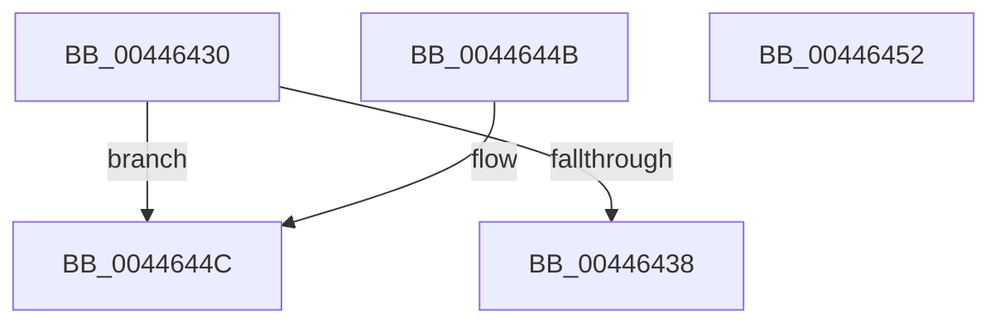

# EtwpGetReserveTraceBufferStatus

- RVA: `0x00446430`–`0x00446453` (길이 `35` bytes)
- VA: `0x0000000140446430`
- 실행 섹션: `.text`
- PDB 이름 있음: `예`; PDB Function 태그: `아니요`
- unwind 정보 RVA: `0x000DB714`
- 디코드: `11`개 명령, `35/35` bytes 표시
- 미해석 바이트: `0` (있으면 어셈블리에 `.byte`로 보존)

> 이 문서는 커널 이미지의 기계어와 PDB 기호를 분석해 생성했습니다. 4번과 5번은 함수 원형과 자료형을 바이너리 사용 방식에서 추정한 C 해석이며 원본 소스 복구 결과는 아닙니다.

## 1. Dependencies

- 직접 호출 지점: **0**; 고유 호출 대상: **0**
- 직접 호출자로 확인된 함수: **3**
- RIP 상대 이미지 참조: **0**

### Outgoing calls
- 직접 디코드된 call 명령이 없습니다.

### Direct callers
- [EtwpEventWriteFull](../22/EtwpEventWriteFull_function_00225C10.md) at `0x00226942`
- [EtwTraceRaw](../65/EtwTraceRaw_function_006516CC.md) at `0x00651814`
- [EtwpWriteUserEvent](../../page/AF/EtwpWriteUserEvent_function_00AF2FEC.md) at `0x00AF3B2F`

### Static image references
- 디코드된 RIP-relative 메모리 참조가 없습니다.

## 2. Other-region calls and transfers

- 다른 실행 섹션으로 향하는 call: **0**
- 별도 외부 분기/꼬리 이동을 확인하지 못했습니다.

## 3. Assembly (complete function range)

```asm
00446430  81 FA F8 FF 00 00               cmp edx, 0xfff8
00446436  77 14                           ja 0x14044644c
00446438  3B 51 08                        cmp edx, dword ptr [rcx + 8]
0044643B  B8 17 00 00 C0                  mov eax, 0xc0000017
00446440  41 B8 05 00 00 80               mov r8d, 0x80000005
00446446  41 0F 47 C0                     cmova eax, r8d
0044644A  C3                              ret
0044644B  CC                              int3
0044644C  B8 95 00 00 C0                  mov eax, 0xc0000095
00446451  C3                              ret
00446452  CC                              int3
```

## 4. C-style interpretation (structured pseudocode)

```c
__int64 __fastcall EtwpGetReserveTraceBufferStatus(__int64 a1, int a2)
{
    __int64 result;

    if (a2 > 0xFFF8ULL) goto loc_0044644C;
    result = (unsigned int)(0xC0000017ULL);
    if (a2 > (*(unsigned int *)(a1 + 8))) { result = (unsigned int)((unsigned int)(0x80000005ULL)); }
    return result;
loc_0044644C:
    return (unsigned int)(0xC0000095ULL);
}
```

## 5. (Beta) C Style

```c
int64_t EtwpGetReserveTraceBufferStatus(void *Arg1, int32_t Arg2)
{
    uint8_t *arg1 = (uint8_t *)Arg1;

    int64_t result;

    if (Arg2 > 0xFFF8ULL) goto loc_0044644C;
    result = (uint32_t)(0xC0000017ULL);
    if (Arg2 > (*(uint32_t *)(arg1 + 0x8))) { result = (uint32_t)((uint32_t)(0x80000005ULL)); }
    return result;
loc_0044644C:
    return (uint32_t)(0xC0000095ULL);
}
```

### 관측된 메모리 오프셋

구조체 형식이 확인되지 않은 접근은 인자 기준의 오프셋으로만 기록했습니다.

| 기준 인자 | 오프셋 표현 | 폭 (bit) | 접근 |
|---|---:|---:|---|
| `Arg1` | `+ 0x8` | `32` | `R` |

## 6. Execution-region graph

[열기: 2D/3D 그래프와 함수 탐색 컨트롤 패널](../../../control-panel.html?section=text&rva=0x00446430&view=graph)

- 2D 그래프는 위에서 아래로 흐르고, 3D 그래프는 빈 공간을 드래그해 회전합니다. Shift+드래그는 이동, 휠은 확대·축소, 함수 노드 선택은 대상 보고서 이동입니다.

### Static fallback


