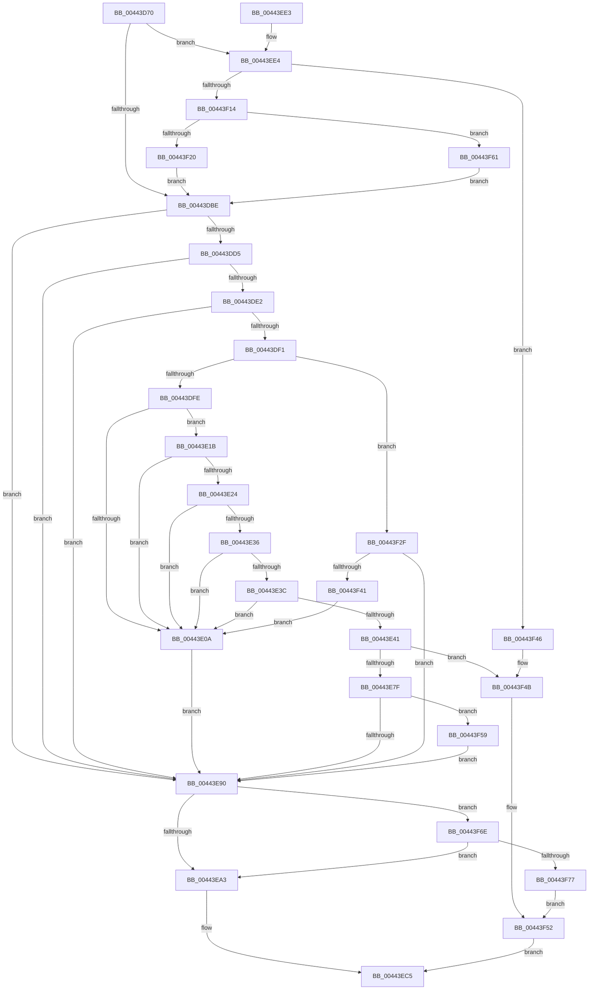

# EtwpGetStackExtendedHeaderItem

- RVA: `0x00443D70`–`0x00443F79` (길이 `521` bytes)
- VA: `0x0000000140443D70`
- 실행 섹션: `.text`
- PDB 이름 있음: `예`; PDB Function 태그: `아니요`
- unwind 정보 RVA: `0x000A563C`
- 디코드: `122`개 명령, `521/521` bytes 표시
- 미해석 바이트: `0` (있으면 어셈블리에 `.byte`로 보존)

> 이 문서는 커널 이미지의 기계어와 PDB 기호를 분석해 생성했습니다. 4번과 5번은 함수 원형과 자료형을 바이너리 사용 방식에서 추정한 C 해석이며 원본 소스 복구 결과는 아닙니다.

## 1. Dependencies

- 직접 호출 지점: **4**; 고유 호출 대상: **3**
- 직접 호출자로 확인된 함수: **2**
- RIP 상대 이미지 참조: **1**

### Outgoing calls
- `0x00443DF1` → [KeGetEffectiveIrql](../2F/KeGetEffectiveIrql_function_002F8030.md) (function, `0x002F8030`)
- `0x00443DFE` → [MmCanThreadFault](../2F/MmCanThreadFault_function_002F86B0.md) (function, `0x002F86B0`)
- `0x00443E72` → [EtwpExpandStackAndWalkFrameChain](EtwpExpandStackAndWalkFrameChain_function_00443F80.md) (function, `0x00443F80`)
- `0x00443F08` → [EtwpExpandStackAndWalkFrameChain](EtwpExpandStackAndWalkFrameChain_function_00443F80.md) (function, `0x00443F80`)

### Direct callers
- [EtwpEventWriteFull](../22/EtwpEventWriteFull_function_00225C10.md) at `0x0022662A`
- [EtwpWriteUserEvent](../../page/AF/EtwpWriteUserEvent_function_00AF2FEC.md) at `0x00AF3672`

### Static image references
- `0x00443E0D` → RVA `0x00E0EB20` (`.data`; read/write)

## 2. Other-region calls and transfers

- 다른 실행 섹션으로 향하는 call: **0**
- 별도 외부 분기/꼬리 이동을 확인하지 못했습니다.

## 3. Assembly (complete function range)

```asm
00443D70  48 8B C4                        mov rax, rsp
00443D73  48 89 58 08                     mov qword ptr [rax + 8], rbx
00443D77  48 89 68 10                     mov qword ptr [rax + 0x10], rbp
00443D7B  48 89 70 18                     mov qword ptr [rax + 0x18], rsi
00443D7F  57                              push rdi
00443D80  41 54                           push r12
00443D82  41 55                           push r13
00443D84  41 56                           push r14
00443D86  41 57                           push r15
00443D88  48 83 EC 40                     sub rsp, 0x40
00443D8C  45 8B E0                        mov r12d, r8d
00443D8F  4D 8D 71 20                     lea r14, [r9 + 0x20]
00443D93  45 33 C0                        xor r8d, r8d
00443D96  4D 8B E9                        mov r13, r9
00443D99  48 8B EA                        mov rbp, rdx
00443D9C  48 8B F1                        mov rsi, rcx
00443D9F  41 8B D8                        mov ebx, r8d
00443DA2  44 89 40 20                     mov dword ptr [rax + 0x20], r8d
00443DA6  41 BF 00 01 00 00               mov r15d, 0x100
00443DAC  44 89 40 C8                     mov dword ptr [rax - 0x38], r8d
00443DB0  44 38 84 24 90 00 00 00         cmp byte ptr [rsp + 0x90], r8b
00443DB8  0F 85 26 01 00 00               jne 0x140443ee4
00443DBE  65 48 8B 3C 25 88 01 00 00      mov rdi, qword ptr gs:[0x188]
00443DC7  48 3B FD                        cmp rdi, rbp
00443DCA  BD 01 00 00 00                  mov ebp, 1
00443DCF  0F 85 BB 00 00 00               jne 0x140443e90
00443DD5  F7 47 74 00 04 00 00            test dword ptr [rdi + 0x74], 0x400
00443DDC  0F 85 AE 00 00 00               jne 0x140443e90
00443DE2  8B 87 A0 05 00 00               mov eax, dword ptr [rdi + 0x5a0]
00443DE8  40 84 C5                        test bpl, al
00443DEB  0F 85 9F 00 00 00               jne 0x140443e90
00443DF1  E8 3A 42 EB FF                  call 0x1402f8030
00443DF6  3C 02                           cmp al, 2
00443DF8  0F 83 31 01 00 00               jae 0x140443f2f
00443DFE  E8 AD 48 EB FF                  call 0x1402f86b0
00443E03  45 33 C0                        xor r8d, r8d
00443E06  85 C0                           test eax, eax
00443E08  75 11                           jne 0x140443e1b
00443E0A  48 8B DD                        mov rbx, rbp
00443E0D  F0 48 0F C1 1D 0A AD 9C 00      lock xadd qword ptr [rip + 0x9cad0a], rbx
00443E16  48 03 DD                        add rbx, rbp
00443E19  EB 75                           jmp 0x140443e90
00443E1B  44 38 87 AE 05 00 00            cmp byte ptr [rdi + 0x5ae], r8b
00443E22  75 E6                           jne 0x140443e0a
00443E24  65 48 8B 04 25 88 01 00 00      mov rax, qword ptr gs:[0x188]
00443E2D  40 38 A8 4A 02 00 00            cmp byte ptr [rax + 0x24a], bpl
00443E34  74 D4                           je 0x140443e0a
00443E36  F6 47 7D 04                     test byte ptr [rdi + 0x7d], 4
00443E3A  75 CE                           jne 0x140443e0a
00443E3C  44 84 E5                        test bpl, r12b
00443E3F  75 C9                           jne 0x140443e0a
00443E41  F0 01 AE 00 04 00 00            lock add dword ptr [rsi + 0x400], ebp
00443E48  8B 84 24 88 00 00 00            mov eax, dword ptr [rsp + 0x88]
00443E4F  44 8B CD                        mov r9d, ebp
00443E52  44 2B BC 24 88 00 00 00         sub r15d, dword ptr [rsp + 0x88]
00443E5A  48 83 C0 02                     add rax, 2
00443E5E  4D 8B C5                        mov r8, r13
00443E61  41 8B D7                        mov edx, r15d
00443E64  49 8D 0C C6                     lea rcx, [r14 + rax*8]
00443E68  48 8D 44 24 30                  lea rax, [rsp + 0x30]
00443E6D  48 89 44 24 20                  mov qword ptr [rsp + 0x20], rax
00443E72  E8 09 01 00 00                  call 0x140443f80
00443E77  85 C0                           test eax, eax
00443E79  0F 88 CC 00 00 00               js 0x140443f4b
00443E7F  48 8B 84 24 98 00 00 00         mov rax, qword ptr [rsp + 0x98]
00443E87  48 85 C0                        test rax, rax
00443E8A  0F 85 C9 00 00 00               jne 0x140443f59
00443E90  0F B7 84 24 88 00 00 00         movzx eax, word ptr [rsp + 0x88]
00443E98  66 03 44 24 30                  add ax, word ptr [rsp + 0x30]
00443E9D  0F 84 CB 00 00 00               je 0x140443f6e
00443EA3  66 03 C5                        add ax, bp
00443EA6  49 89 5E 08                     mov qword ptr [r14 + 8], rbx
00443EAA  66 C1 E0 03                     shl ax, 3
00443EAE  66 41 89 46 06                  mov word ptr [r14 + 6], ax
00443EB3  41 C7 46 02 06 00 00 00         mov dword ptr [r14 + 2], 6
00443EBB  8D 50 08                        lea edx, [rax + 8]
00443EBE  40 8A C5                        mov al, bpl
00443EC1  66 41 89 16                     mov word ptr [r14], dx
00443EC5  4C 8D 5C 24 40                  lea r11, [rsp + 0x40]
00443ECA  49 8B 5B 30                     mov rbx, qword ptr [r11 + 0x30]
00443ECE  49 8B 6B 38                     mov rbp, qword ptr [r11 + 0x38]
00443ED2  49 8B 73 40                     mov rsi, qword ptr [r11 + 0x40]
00443ED6  49 8B E3                        mov rsp, r11
00443ED9  41 5F                           pop r15
00443EDB  41 5E                           pop r14
00443EDD  41 5D                           pop r13
00443EDF  41 5C                           pop r12
00443EE1  5F                              pop rdi
00443EE2  C3                              ret
00443EE3  CC                              int3
00443EE4  F0 FF 81 00 04 00 00            lock inc dword ptr [rcx + 0x400]
00443EEB  48 8D 8C 24 88 00 00 00         lea rcx, [rsp + 0x88]
00443EF3  41 B9 00 04 00 00               mov r9d, 0x400
00443EF9  48 89 4C 24 20                  mov qword ptr [rsp + 0x20], rcx
00443EFE  4D 8B C5                        mov r8, r13
00443F01  49 8D 4E 10                     lea rcx, [r14 + 0x10]
00443F05  41 8B D7                        mov edx, r15d
00443F08  E8 73 00 00 00                  call 0x140443f80
00443F0D  45 33 C0                        xor r8d, r8d
00443F10  85 C0                           test eax, eax
00443F12  78 32                           js 0x140443f46
00443F14  8B 84 24 88 00 00 00            mov eax, dword ptr [rsp + 0x88]
00443F1B  83 F8 04                        cmp eax, 4
00443F1E  76 41                           jbe 0x140443f61
00443F20  83 C0 FC                        add eax, -4
00443F23  89 84 24 88 00 00 00            mov dword ptr [rsp + 0x88], eax
00443F2A  E9 8F FE FF FF                  jmp 0x140443dbe
00443F2F  65 48 8B 04 25 20 00 00 00      mov rax, qword ptr gs:[0x20]
00443F38  38 58 20                        cmp byte ptr [rax + 0x20], bl
00443F3B  0F 85 4F FF FF FF               jne 0x140443e90
00443F41  E9 C4 FE FF FF                  jmp 0x140443e0a
00443F46  BD 01 00 00 00                  mov ebp, 1
00443F4B  F0 01 AE 04 04 00 00            lock add dword ptr [rsi + 0x404], ebp
00443F52  32 C0                           xor al, al
00443F54  E9 6C FF FF FF                  jmp 0x140443ec5
00443F59  48 8B 18                        mov rbx, qword ptr [rax]
00443F5C  E9 2F FF FF FF                  jmp 0x140443e90
00443F61  44 89 84 24 88 00 00 00         mov dword ptr [rsp + 0x88], r8d
00443F69  E9 50 FE FF FF                  jmp 0x140443dbe
00443F6E  48 85 DB                        test rbx, rbx
00443F71  0F 85 2C FF FF FF               jne 0x140443ea3
00443F77  EB D9                           jmp 0x140443f52
```

## 4. C-style interpretation (structured pseudocode)

```c
__int64 __fastcall EtwpGetStackExtendedHeaderItem(__int64 a1, __int64 a2, int a3, __int64 a4, unsigned __int8 a5, __int64 a6)
{
    __int64 result;
    __int64 v_r15;
    __int64 v_rbx;
    __int64 v_rsp;
    unsigned __int64 v_stack_m20;
    unsigned __int64 v_stack_m28;
    unsigned __int64 v_stack_m38;
    unsigned __int64 v_stack_m48;
    unsigned int v_stack_p20;
    unsigned __int64 v_stack_p48;

    *(unsigned __int64 *)(v_rsp + 8) = v_rbx;
    *(unsigned __int64 *)(v_rsp + 16) = v_rbp;
    *(unsigned __int64 *)(v_rsp + 24) = v_rsi;
    v_rsp = (v_rsp) - (64);
    a3 = 0;
    *(unsigned int *)(v_rsp + 32) = 0;
    *(unsigned int *)(v_rsp - 56) = 0;
    if (a5 != 0) goto loc_00443EE4;
loc_00443DBE:
    if ((*(unsigned __int64 *)(gs_base + (0 + 392))) != a2) goto loc_00443E90;
    if (((*(unsigned int *)(*(unsigned __int64 *)(gs_base + (0 + 392)) + 116)) & (0x400ULL)) != 0) goto loc_00443E90;
    if (((1) & ((unsigned __int8)((unsigned int)(*(unsigned int *)(*(unsigned __int64 *)(gs_base + (0 + 392)) + 1440))))) != 0) goto loc_00443E90;
    result = KeGetEffectiveIrql(a1, a2, a3, a4);
    if (((unsigned __int8)(result)) >= 2) goto loc_00443F2F;
    result = MmCanThreadFault(a1, a2, a3, a4);
    a3 = 0;
    if ((unsigned int)(result) != 0) goto loc_00443E1B;
loc_00443E0A:
    v_rbx = (1) + (1);
    goto loc_00443E90;
loc_00443E1B:
    if ((*(unsigned __int8 *)(*(unsigned __int64 *)(gs_base + (0 + 392)) + 1454)) != 0) goto loc_00443E0A;
    if ((*(unsigned __int8 *)(*(unsigned __int64 *)(gs_base + (0 + 392)) + 586)) == 1) goto loc_00443E0A;
    if (((*(unsigned __int8 *)(*(unsigned __int64 *)(gs_base + (0 + 392)) + 125)) & (4)) != 0) goto loc_00443E0A;
    if (((1) & ((unsigned __int8)((unsigned int)(a3)))) != 0) goto loc_00443E0A;
    v_r15 = (unsigned int)((256) - (v_stack_p20));
    result = ((unsigned int)(v_stack_p20)) + (2);
    v_stack_m48 = v_stack_m38;
    result = EtwpExpandStackAndWalkFrameChain(a4 + 32 + result * 8, (unsigned int)((unsigned int)(v_r15)), a4, 1);
    if (sign_flag) goto loc_00443F4B;
    if (a6 != 0) goto loc_00443F59;
loc_00443E90:
    result = (unsigned __int16)((v_stack_p20) + (v_stack_m38));
    if (condition_is_equal) goto loc_00443F6E;
loc_00443EA3:
    result = (unsigned __int16)((result) + (1));
    *(unsigned __int64 *)(a4 + 32 + 8) = v_rbx;
    result = (unsigned __int16)((result) << (3));
    *(unsigned __int16 *)(a4 + 32 + 6) = (unsigned __int16)(result);
    *(unsigned int *)(a4 + 32 + 2) = 6;
    *(unsigned __int16 *)(a4 + 32) = (unsigned __int16)(result + 8);
loc_00443EC5:
    return 1;
loc_00443EE4:
    v_stack_m20 = v_stack_p48;
    result = EtwpExpandStackAndWalkFrameChain(a4 + 32 + 16, (unsigned int)((unsigned int)(v_r15)), a4, (unsigned int)(0x400ULL));
    a3 = 0;
    if (sign_flag) goto loc_00443F46;
    if (((unsigned int)((unsigned int)(v_stack_p48))) <= 4) goto loc_00443F61;
    result = (unsigned int)(((unsigned int)(v_stack_p48)) + (-4));
    v_stack_p48 = (unsigned int)(result);
    goto loc_00443DBE;
loc_00443F2F:
    if ((*(unsigned __int8 *)(*(unsigned __int64 *)(gs_base + (0 + 32)) + 32)) != ((unsigned __int8)(*(unsigned __int64 *)(v_stack_m28 + 48)))) goto loc_00443E90;
    goto loc_00443E0A;
loc_00443F46:
loc_00443F4B:
loc_00443F52:
    result = 0;
    goto loc_00443EC5;
loc_00443F59:
    goto loc_00443E90;
loc_00443F61:
    v_stack_p48 = 0;
    goto loc_00443DBE;
loc_00443F6E:
    if (*(unsigned __int64 *)(result) != 0) goto loc_00443EA3;
    goto loc_00443F52;
}
```

## 5. (Beta) C Style

```c
int64_t EtwpGetStackExtendedHeaderItem(void *Arg1, int64_t Arg2, int32_t Arg3, void *Arg4, uint8_t Arg5, int64_t Arg6)
{
    uint8_t *arg1 = (uint8_t *)Arg1;
    uint8_t *arg4 = (uint8_t *)Arg4;

    int64_t result;
    int64_t local_r15;
    int64_t local_rbx;
    int64_t local_rsp;
    uint64_t v_stack_m20;
    uint64_t v_stack_m28;
    uint64_t v_stack_m38;
    uint64_t v_stack_m48;
    uint32_t v_stack_p20;
    uint64_t v_stack_p48;

    *(uint64_t *)(local_rsp + 0x8) = local_rbx;
    *(uint64_t *)(local_rsp + 0x10) = local_rbp;
    *(uint64_t *)(local_rsp + 0x18) = local_rsi;
    local_rsp = (local_rsp) - (64);
    Arg3 = 0;
    *(uint32_t *)(local_rsp + 0x20) = 0;
    *(uint32_t *)(local_rsp - 0x38) = 0;
    if (Arg5 != 0) goto loc_00443EE4;
loc_00443DBE:
    if ((*(uint64_t *)(gs_base + (0 + 0x188))) != Arg2) goto loc_00443E90;
    if (((*(uint32_t *)(*(uint64_t *)(gs_base + (0 + 0x188)) + 0x74)) & (0x400ULL)) != 0) goto loc_00443E90;
    if (((1) & ((uint8_t)((uint32_t)(*(uint32_t *)(*(uint64_t *)(gs_base + (0 + 0x188)) + 0x5A0))))) != 0) goto loc_00443E90;
    result = KeGetEffectiveIrql(Arg1, Arg2, Arg3, Arg4);
    if (((uint8_t)(result)) >= 2) goto loc_00443F2F;
    result = MmCanThreadFault(Arg1, Arg2, Arg3, Arg4);
    Arg3 = 0;
    if ((uint32_t)(result) != 0) goto loc_00443E1B;
loc_00443E0A:
    local_rbx = (1) + (1);
    goto loc_00443E90;
loc_00443E1B:
    if ((*(uint8_t *)(*(uint64_t *)(gs_base + (0 + 0x188)) + 0x5AE)) != 0) goto loc_00443E0A;
    if ((*(uint8_t *)(*(uint64_t *)(gs_base + (0 + 0x188)) + 0x24A)) == 1) goto loc_00443E0A;
    if (((*(uint8_t *)(*(uint64_t *)(gs_base + (0 + 0x188)) + 0x7D)) & (4)) != 0) goto loc_00443E0A;
    if (((1) & ((uint8_t)((uint32_t)(Arg3)))) != 0) goto loc_00443E0A;
    local_r15 = (uint32_t)((256) - (v_stack_p20));
    result = ((uint32_t)(v_stack_p20)) + (2);
    v_stack_m48 = v_stack_m38;
    result = EtwpExpandStackAndWalkFrameChain(Arg4 + 32 + result * 8, (uint32_t)((uint32_t)(local_r15)), Arg4, 1);
    if (sign_flag) goto loc_00443F4B;
    if (Arg6 != 0) goto loc_00443F59;
loc_00443E90:
    result = (uint16_t)((v_stack_p20) + (v_stack_m38));
    if (condition_is_equal) goto loc_00443F6E;
loc_00443EA3:
    result = (uint16_t)((result) + (1));
    *(uint64_t *)(arg4 + 0x20 + 0x8) = local_rbx;
    result = (uint16_t)((result) << (3));
    *(uint16_t *)(arg4 + 0x20 + 0x6) = (uint16_t)(result);
    *(uint32_t *)(arg4 + 0x20 + 0x2) = 6;
    *(uint16_t *)(arg4 + 0x20) = (uint16_t)(result + 8);
loc_00443EC5:
    return 1;
loc_00443EE4:
    v_stack_m20 = v_stack_p48;
    result = EtwpExpandStackAndWalkFrameChain(Arg4 + 32 + 16, (uint32_t)((uint32_t)(local_r15)), Arg4, (uint32_t)(0x400ULL));
    Arg3 = 0;
    if (sign_flag) goto loc_00443F46;
    if (((uint32_t)((uint32_t)(v_stack_p48))) <= 4) goto loc_00443F61;
    result = (uint32_t)(((uint32_t)(v_stack_p48)) + (-4));
    v_stack_p48 = (uint32_t)(result);
    goto loc_00443DBE;
loc_00443F2F:
    if ((*(uint8_t *)(*(uint64_t *)(gs_base + (0 + 0x20)) + 0x20)) != ((uint8_t)(*(uint64_t *)(v_stack_m28 + 0x30)))) goto loc_00443E90;
    goto loc_00443E0A;
loc_00443F46:
loc_00443F4B:
loc_00443F52:
    result = 0;
    goto loc_00443EC5;
loc_00443F59:
    goto loc_00443E90;
loc_00443F61:
    v_stack_p48 = 0;
    goto loc_00443DBE;
loc_00443F6E:
    if (*(uint64_t *)(result) != 0) goto loc_00443EA3;
    goto loc_00443F52;
}
```

### 관측된 메모리 오프셋

구조체 형식이 확인되지 않은 접근은 인자 기준의 오프셋으로만 기록했습니다.

| 기준 인자 | 오프셋 표현 | 폭 (bit) | 접근 |
|---|---:|---:|---|
| `Arg1` | `+ 0x400` | `32` | `R/W` |
| `Arg1` | `+ 0x404` | `32` | `R/W` |
| `Arg4` | `+ 0x0` | `16` | `W` |
| `Arg4` | `+ 0x0 + rax*8` | `64` | `R` |
| `Arg4` | `+ 0x2` | `32` | `W` |
| `Arg4` | `+ 0x6` | `16` | `W` |
| `Arg4` | `+ 0x8` | `64` | `W` |
| `Arg4` | `+ 0x10` | `64` | `R` |
| `Arg4` | `+ 0x20` | `64` | `R` |

## 6. Execution-region graph

[열기: 2D/3D 그래프와 함수 탐색 컨트롤 패널](../../../control-panel.html?section=text&rva=0x00443D70&view=graph)

- 2D 그래프는 위에서 아래로 흐르고, 3D 그래프는 빈 공간을 드래그해 회전합니다. Shift+드래그는 이동, 휠은 확대·축소, 함수 노드 선택은 대상 보고서 이동입니다.

### Static fallback


