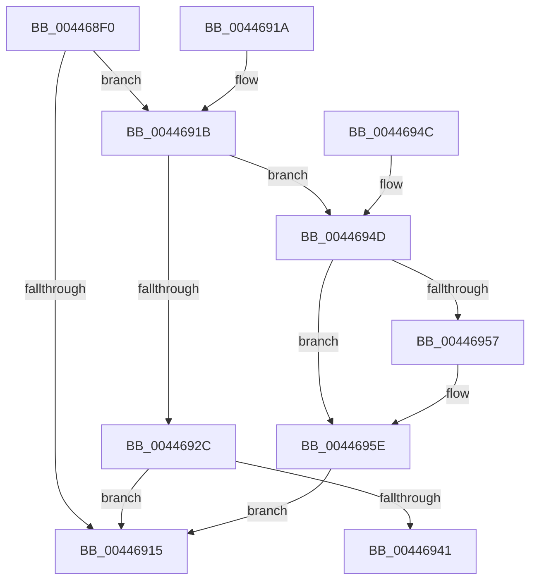

# EtwpGetStackLookasideListEntry

- RVA: `0x004468F0`–`0x00446962` (길이 `114` bytes)
- VA: `0x00000001404468F0`
- 실행 섹션: `.text`
- PDB 이름 있음: `예`; PDB Function 태그: `아니요`
- unwind 정보 RVA: `0x000A5A6C`
- 디코드: `28`개 명령, `114/114` bytes 표시
- 미해석 바이트: `0` (있으면 어셈블리에 `.byte`로 보존)

> 이 문서는 커널 이미지의 기계어와 PDB 기호를 분석해 생성했습니다. 4번과 5번은 함수 원형과 자료형을 바이너리 사용 방식에서 추정한 C 해석이며 원본 소스 복구 결과는 아닙니다.

## 1. Dependencies

- 직접 호출 지점: **2**; 고유 호출 대상: **1**
- 직접 호출자로 확인된 함수: **2**
- RIP 상대 이미지 참조: **7**

### Outgoing calls
- `0x0044690B` → [ExpInterlockedPopEntrySList](../6B/ExpInterlockedPopEntrySList_function_006BA570.md) (function, `0x006BA570`)
- `0x00446922` → [ExpInterlockedPopEntrySList](../6B/ExpInterlockedPopEntrySList_function_006BA570.md) (function, `0x006BA570`)

### Direct callers
- [EtwpEventWriteFull](../22/EtwpEventWriteFull_function_00225C10.md) at `0x00226587`
- [EtwpWriteUserEvent](../../page/AF/EtwpWriteUserEvent_function_00AF2FEC.md) at `0x00AF3635`

### Static image references
- `0x0044691B` → RVA `0x00E28F80` (`.data`; read)
- `0x0044692C` → RVA `0x00E28F9C` (`.data`; read/write)
- `0x00446933` → RVA `0x00E28F9C` (`.data`; read)
- `0x00446939` → RVA `0x00E28FA0` (`.data`; read)
- `0x00446941` → RVA `0x00E28FA0` (`.data`; read/write)
- `0x0044694D` → RVA `0x00E28F90` (`.data`; read)
- `0x00446957` → RVA `0x00E28FA4` (`.data`; read/write)

## 2. Other-region calls and transfers

- 다른 실행 섹션으로 향하는 call: **0**
- 별도 외부 분기/꼬리 이동을 확인하지 못했습니다.

## 3. Assembly (complete function range)

```asm
004468F0  48 83 EC 28                     sub rsp, 0x28
004468F4  65 48 8B 04 25 20 00 00 00      mov rax, qword ptr gs:[0x20]
004468FD  48 8B 88 A8 8B 00 00            mov rcx, qword ptr [rax + 0x8ba8]
00446904  48 81 C1 80 01 00 00            add rcx, 0x180
0044690B  E8 60 3C 27 00                  call 0x1406ba570
00446910  48 85 C0                        test rax, rax
00446913  74 06                           je 0x14044691b
00446915  48 83 C4 28                     add rsp, 0x28
00446919  C3                              ret
0044691A  CC                              int3
0044691B  48 8D 0D 5E 26 9E 00            lea rcx, [rip + 0x9e265e]
00446922  E8 49 3C 27 00                  call 0x1406ba570
00446927  48 85 C0                        test rax, rax
0044692A  74 21                           je 0x14044694d
0044692C  F0 FF 05 69 26 9E 00            lock inc dword ptr [rip + 0x9e2669]
00446933  8B 0D 63 26 9E 00               mov ecx, dword ptr [rip + 0x9e2663]
00446939  3B 0D 61 26 9E 00               cmp ecx, dword ptr [rip + 0x9e2661]
0044693F  7E D4                           jle 0x140446915
00446941  87 0D 59 26 9E 00               xchg dword ptr [rip + 0x9e2659], ecx
00446947  48 83 C4 28                     add rsp, 0x28
0044694B  C3                              ret
0044694C  CC                              int3
0044694D  8B 05 3D 26 9E 00               mov eax, dword ptr [rip + 0x9e263d]
00446953  85 C0                           test eax, eax
00446955  7E 07                           jle 0x14044695e
00446957  F0 FF 05 46 26 9E 00            lock inc dword ptr [rip + 0x9e2646]
0044695E  33 C0                           xor eax, eax
00446960  EB B3                           jmp 0x140446915
```

## 4. C-style interpretation (structured pseudocode)

```c
__int64 __fastcall EtwpGetStackLookasideListEntry(void)
{
    __int64 result;
    __int64 v_rsp;

    v_rsp = (v_rsp) - (40);
    a1 = (*(unsigned __int64 *)(*(unsigned __int64 *)(gs_base + (0 + 32)) + 35752)) + (384);
    result = ExpInterlockedPopEntrySList(a1, a2, a3, a4);
    if (result == 0) goto loc_0044691B;
loc_00446915:
    v_rsp = (v_rsp) + (40);
    return result;
loc_0044691B:
    result = ExpInterlockedPopEntrySList(v_rip + 10364510, a2, a3, a4);
    if (result == 0) goto loc_0044694D;
    if (((unsigned int)((unsigned int)(*(unsigned int *)(v_rip + 10364515)))) <= (*(unsigned int *)(v_rip + 10364513))) goto loc_00446915;
    v_rsp = (v_rsp) + (40);
    return result;
loc_0044694D:
    if (!(condition_is_less_or_equal)) {
    }
    result = 0;
    goto loc_00446915;
}
```

## 5. (Beta) C Style

```c
void EtwpGetStackLookasideListEntry(void)
{
    int64_t result;
    int64_t local_rsp;

    local_rsp = (local_rsp) - (40);
    a1 = (*(uint64_t *)(*(uint64_t *)(gs_base + (0 + 0x20)) + 0x8BA8)) + (384);
    result = ExpInterlockedPopEntrySList(a1, a2, a3, a4);
    if (result == 0) goto loc_0044691B;
loc_00446915:
    local_rsp = (local_rsp) + (40);
    return result;
loc_0044691B:
    result = ExpInterlockedPopEntrySList(v_rip + 10364510, a2, a3, a4);
    if (result == 0) goto loc_0044694D;
    if (((uint32_t)((uint32_t)(*(uint32_t *)(v_rip + 0x9E2663)))) <= (*(uint32_t *)(v_rip + 0x9E2661))) goto loc_00446915;
    local_rsp = (local_rsp) + (40);
    return result;
loc_0044694D:
    if (!(condition_is_less_or_equal)) {
    }
    result = 0;
    goto loc_00446915;
}
```

## 6. Execution-region graph

[열기: 2D/3D 그래프와 함수 탐색 컨트롤 패널](../../../control-panel.html?section=text&rva=0x004468F0&view=graph)

- 2D 그래프는 위에서 아래로 흐르고, 3D 그래프는 빈 공간을 드래그해 회전합니다. Shift+드래그는 이동, 휠은 확대·축소, 함수 노드 선택은 대상 보고서 이동입니다.

### Static fallback


