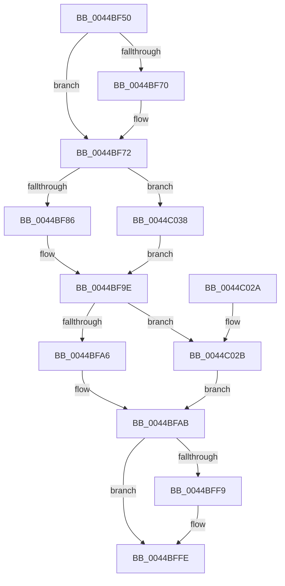

# EtwpTraceImageUnloadApc

- RVA: `0x0044BF50`–`0x0044C042` (길이 `242` bytes)
- VA: `0x000000014044BF50`
- 실행 섹션: `.text`
- PDB 이름 있음: `예`; PDB Function 태그: `아니요`
- unwind 정보 RVA: `0x000A6800`
- 디코드: `59`개 명령, `242/242` bytes 표시
- 미해석 바이트: `0` (있으면 어셈블리에 `.byte`로 보존)

> 이 문서는 커널 이미지의 기계어와 PDB 기호를 분석해 생성했습니다. 4번과 5번은 함수 원형과 자료형을 바이너리 사용 방식에서 추정한 C 해석이며 원본 소스 복구 결과는 아닙니다.

## 1. Dependencies

- 직접 호출 지점: **7**; 고유 호출 대상: **6**
- 직접 호출자로 확인된 함수: **1**
- RIP 상대 이미지 참조: **1**

### Outgoing calls
- `0x0044BF67` → [KeAreAllApcsDisabled](../2F/KeAreAllApcsDisabled_function_002F7AC0.md) (function, `0x002F7AC0`)
- `0x0044BF99` → [guard_dispatch_icall](../6B/guard_dispatch_icall_function_006BAAD0.md) (function, `0x006BAAD0`)
- `0x0044BFEA` → [EtwpTraceImageUnload](EtwpTraceImageUnload_function_0044C048.md) (function, `0x0044C048`)
- `0x0044BFF9` → [FsRtlReleaseFileNameInformation](../../page/97/FsRtlReleaseFileNameInformation_function_0097DB90.md) (function, `0x0097DB90`)
- `0x0044C007` → [ObfDereferenceObjectWithTag](../2F/ObfDereferenceObjectWithTag_function_002F78E0.md) (function, `0x002F78E0`)
- `0x0044C015` → [ObfDereferenceObjectWithTag](../2F/ObfDereferenceObjectWithTag_function_002F78E0.md) (function, `0x002F78E0`)
- `0x0044C01F` → [ExFreePoolWithTag](../../poolcode/B8/ExFreePoolWithTag_function_00B82870.md) (function, `0x00B82870`)

### Direct callers
- [sub_00251225](../25/Unknown_function_00251225.md) at `0x0025146E`

### Static image references
- `0x0044BF72` → RVA `0x00E65BF0` (`.data`; read)

## 2. Other-region calls and transfers

- 다른 실행 섹션으로 향하는 call: **2**
  - `0x0044BFF9` → [FsRtlReleaseFileNameInformation](../../page/97/FsRtlReleaseFileNameInformation_function_0097DB90.md) (`.text` → `PAGE`)
  - `0x0044C01F` → [ExFreePoolWithTag](../../poolcode/B8/ExFreePoolWithTag_function_00B82870.md) (`.text` → `POOLCODE`)
- 별도 외부 분기/꼬리 이동을 확인하지 못했습니다.

## 3. Assembly (complete function range)

```asm
0044BF50  40 53                           push rbx
0044BF52  48 83 EC 60                     sub rsp, 0x60
0044BF56  48 83 64 24 70 00               and qword ptr [rsp + 0x70], 0
0044BF5C  0F 57 C0                        xorps xmm0, xmm0
0044BF5F  0F 11 44 24 50                  movups xmmword ptr [rsp + 0x50], xmm0
0044BF64  48 8B D9                        mov rbx, rcx
0044BF67  E8 54 BB EA FF                  call 0x1402f7ac0
0044BF6C  84 C0                           test al, al
0044BF6E  74 02                           je 0x14044bf72
0044BF70  CD 2C                           int 0x2c
0044BF72  48 8B 05 77 9C A1 00            mov rax, qword ptr [rip + 0xa19c77]
0044BF79  48 8B 4B 58                     mov rcx, qword ptr [rbx + 0x58]
0044BF7D  48 85 C0                        test rax, rax
0044BF80  0F 84 B2 00 00 00               je 0x14044c038
0044BF86  48 8B 40 18                     mov rax, qword ptr [rax + 0x18]
0044BF8A  4C 8D 4C 24 70                  lea r9, [rsp + 0x70]
0044BF8F  4C 8D 44 24 50                  lea r8, [rsp + 0x50]
0044BF94  BA 00 04 00 00                  mov edx, 0x400
0044BF99  E8 32 EB 26 00                  call 0x1406baad0
0044BF9E  85 C0                           test eax, eax
0044BFA0  0F 88 85 00 00 00               js 0x14044c02b
0044BFA6  48 8D 4C 24 50                  lea rcx, [rsp + 0x50]
0044BFAB  83 64 24 48 00                  and dword ptr [rsp + 0x48], 0
0044BFB0  48 8B 83 88 00 00 00            mov rax, qword ptr [rbx + 0x88]
0044BFB7  4C 8B 4B 70                     mov r9, qword ptr [rbx + 0x70]
0044BFBB  4C 8B 43 68                     mov r8, qword ptr [rbx + 0x68]
0044BFBF  48 8B 53 60                     mov rdx, qword ptr [rbx + 0x60]
0044BFC3  48 89 44 24 40                  mov qword ptr [rsp + 0x40], rax
0044BFC8  8B 83 84 00 00 00               mov eax, dword ptr [rbx + 0x84]
0044BFCE  89 44 24 38                     mov dword ptr [rsp + 0x38], eax
0044BFD2  8B 83 80 00 00 00               mov eax, dword ptr [rbx + 0x80]
0044BFD8  89 44 24 30                     mov dword ptr [rsp + 0x30], eax
0044BFDC  8B 43 7C                        mov eax, dword ptr [rbx + 0x7c]
0044BFDF  89 44 24 28                     mov dword ptr [rsp + 0x28], eax
0044BFE3  8B 43 78                        mov eax, dword ptr [rbx + 0x78]
0044BFE6  89 44 24 20                     mov dword ptr [rsp + 0x20], eax
0044BFEA  E8 59 00 00 00                  call 0x14044c048
0044BFEF  48 8B 4C 24 70                  mov rcx, qword ptr [rsp + 0x70]
0044BFF4  48 85 C9                        test rcx, rcx
0044BFF7  74 05                           je 0x14044bffe
0044BFF9  E8 92 1B 53 00                  call 0x14097db90
0044BFFE  48 8B 4B 58                     mov rcx, qword ptr [rbx + 0x58]
0044C002  BA 44 66 6C 74                  mov edx, 0x746c6644
0044C007  E8 D4 B8 EA FF                  call 0x1402f78e0
0044C00C  48 8B 4B 60                     mov rcx, qword ptr [rbx + 0x60]
0044C010  BA 44 66 6C 74                  mov edx, 0x746c6644
0044C015  E8 C6 B8 EA FF                  call 0x1402f78e0
0044C01A  33 D2                           xor edx, edx
0044C01C  48 8B CB                        mov rcx, rbx
0044C01F  E8 4C 68 73 00                  call 0x140b82870
0044C024  48 83 C4 60                     add rsp, 0x60
0044C028  5B                              pop rbx
0044C029  C3                              ret
0044C02A  CC                              int3
0044C02B  48 8B 4B 58                     mov rcx, qword ptr [rbx + 0x58]
0044C02F  48 83 C1 58                     add rcx, 0x58
0044C033  E9 73 FF FF FF                  jmp 0x14044bfab
0044C038  B8 BB 00 00 C0                  mov eax, 0xc00000bb
0044C03D  E9 5C FF FF FF                  jmp 0x14044bf9e
```

## 4. C-style interpretation (structured pseudocode)

```c
__int64 __fastcall EtwpTraceImageUnloadApc(__int64 a1)
{
    __int64 result;
    __int64 v_rsp;
    unsigned __int64 v_stack_m18;
    unsigned int v_stack_m20;
    unsigned __int64 v_stack_m28;
    unsigned int v_stack_m30;
    unsigned int v_stack_m38;
    unsigned int v_stack_m40;
    unsigned int v_stack_m48;
    unsigned __int64 v_stack_p8;

    v_rsp = (v_rsp) - (96);
    v_stack_m18 = v_xmm0;
    result = KeAreAllApcsDisabled(a1, a2, a3, a4);
    if ((unsigned __int8)(result) != 0) {
    }
    if (*(unsigned __int64 *)(v_rip + 10591351) == 0) goto loc_0044C038;
    result = guard_dispatch_icall(*(unsigned __int64 *)(a1 + 88), (unsigned int)(0x400ULL), v_stack_m18, v_stack_p8);
loc_0044BF9E:
    if (sign_flag) goto loc_0044C02B;
loc_0044BFAB:
    v_stack_m28 = *(unsigned __int64 *)(a1 + 136);
    v_stack_m30 = (unsigned int)((unsigned int)(*(unsigned int *)(a1 + 132)));
    v_stack_m38 = (unsigned int)((unsigned int)(*(unsigned int *)(a1 + 128)));
    v_stack_m40 = (unsigned int)((unsigned int)(*(unsigned int *)(a1 + 124)));
    v_stack_m48 = (unsigned int)((unsigned int)(*(unsigned int *)(a1 + 120)));
    result = EtwpTraceImageUnload(v_stack_m18, *(unsigned __int64 *)(a1 + 96), *(unsigned __int64 *)(a1 + 104), *(unsigned __int64 *)(a1 + 112));
    if (v_stack_p8 != 0) {
        result = FsRtlReleaseFileNameInformation(v_stack_p8, *(unsigned __int64 *)(a1 + 96), *(unsigned __int64 *)(a1 + 104), *(unsigned __int64 *)(a1 + 112));
    }
    result = ObfDereferenceObjectWithTag(*(unsigned __int64 *)(a1 + 88), (unsigned int)(0x746C6644ULL), *(unsigned __int64 *)(a1 + 104), *(unsigned __int64 *)(a1 + 112));
    result = ObfDereferenceObjectWithTag(*(unsigned __int64 *)(a1 + 96), (unsigned int)(0x746C6644ULL), *(unsigned __int64 *)(a1 + 104), *(unsigned __int64 *)(a1 + 112));
    a2 = 0;
    result = ExFreePoolWithTag(a1, a2, *(unsigned __int64 *)(a1 + 104), *(unsigned __int64 *)(a1 + 112));
    v_rsp = (v_rsp) + (96);
    return result;
loc_0044C02B:
    a1 = (*(unsigned __int64 *)(a1 + 88)) + (88);
    goto loc_0044BFAB;
loc_0044C038:
    goto loc_0044BF9E;
}
```

## 5. (Beta) C Style

```c
int64_t EtwpTraceImageUnloadApc(void *Arg1)
{
    uint8_t *arg1 = (uint8_t *)Arg1;

    int64_t result;
    int64_t local_rsp;
    uint64_t v_stack_m18;
    uint32_t v_stack_m20;
    uint64_t v_stack_m28;
    uint32_t v_stack_m30;
    uint32_t v_stack_m38;
    uint32_t v_stack_m40;
    uint32_t v_stack_m48;
    uint64_t v_stack_p8;

    local_rsp = (local_rsp) - (96);
    v_stack_m18 = v_xmm0;
    result = KeAreAllApcsDisabled(Arg1, a2, a3, a4);
    if ((uint8_t)(result) != 0) {
    }
    if (*(uint64_t *)(v_rip + 0xA19C77) == 0) goto loc_0044C038;
    result = guard_dispatch_icall(*(uint64_t *)(arg1 + 0x58), (uint32_t)(0x400ULL), v_stack_m18, v_stack_p8);
loc_0044BF9E:
    if (sign_flag) goto loc_0044C02B;
loc_0044BFAB:
    v_stack_m28 = *(uint64_t *)(arg1 + 0x88);
    v_stack_m30 = (uint32_t)((uint32_t)(*(uint32_t *)(arg1 + 0x84)));
    v_stack_m38 = (uint32_t)((uint32_t)(*(uint32_t *)(arg1 + 0x80)));
    v_stack_m40 = (uint32_t)((uint32_t)(*(uint32_t *)(arg1 + 0x7C)));
    v_stack_m48 = (uint32_t)((uint32_t)(*(uint32_t *)(arg1 + 0x78)));
    result = EtwpTraceImageUnload(v_stack_m18, *(uint64_t *)(arg1 + 0x60), *(uint64_t *)(arg1 + 0x68), *(uint64_t *)(arg1 + 0x70));
    if (v_stack_p8 != 0) {
        result = FsRtlReleaseFileNameInformation(v_stack_p8, *(uint64_t *)(arg1 + 0x60), *(uint64_t *)(arg1 + 0x68), *(uint64_t *)(arg1 + 0x70));
    }
    result = ObfDereferenceObjectWithTag(*(uint64_t *)(arg1 + 0x58), (uint32_t)(0x746C6644ULL), *(uint64_t *)(arg1 + 0x68), *(uint64_t *)(arg1 + 0x70));
    result = ObfDereferenceObjectWithTag(*(uint64_t *)(arg1 + 0x60), (uint32_t)(0x746C6644ULL), *(uint64_t *)(arg1 + 0x68), *(uint64_t *)(arg1 + 0x70));
    a2 = 0;
    result = ExFreePoolWithTag(Arg1, a2, *(uint64_t *)(arg1 + 0x68), *(uint64_t *)(arg1 + 0x70));
    local_rsp = (local_rsp) + (96);
    return result;
loc_0044C02B:
    Arg1 = (*(uint64_t *)(arg1 + 0x58)) + (88);
    goto loc_0044BFAB;
loc_0044C038:
    goto loc_0044BF9E;
}
```

### 관측된 메모리 오프셋

구조체 형식이 확인되지 않은 접근은 인자 기준의 오프셋으로만 기록했습니다.

| 기준 인자 | 오프셋 표현 | 폭 (bit) | 접근 |
|---|---:|---:|---|
| `Arg1` | `+ 0x58` | `64` | `R` |
| `Arg1` | `+ 0x60` | `64` | `R` |
| `Arg1` | `+ 0x68` | `64` | `R` |
| `Arg1` | `+ 0x70` | `64` | `R` |
| `Arg1` | `+ 0x78` | `32` | `R` |
| `Arg1` | `+ 0x7C` | `32` | `R` |
| `Arg1` | `+ 0x80` | `32` | `R` |
| `Arg1` | `+ 0x84` | `32` | `R` |
| `Arg1` | `+ 0x88` | `64` | `R` |

## 6. Execution-region graph

[열기: 2D/3D 그래프와 함수 탐색 컨트롤 패널](../../../control-panel.html?section=text&rva=0x0044BF50&view=graph)

- 2D 그래프는 위에서 아래로 흐르고, 3D 그래프는 빈 공간을 드래그해 회전합니다. Shift+드래그는 이동, 휠은 확대·축소, 함수 노드 선택은 대상 보고서 이동입니다.

### Static fallback


