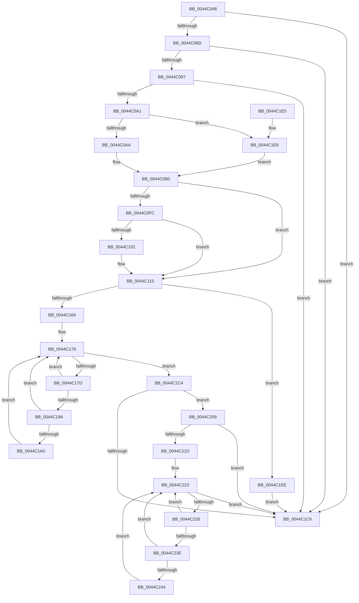

# EtwpTraceImageUnload

- RVA: `0x0044C048`–`0x0044C26B` (길이 `547` bytes)
- VA: `0x000000014044C048`
- 실행 섹션: `.text`
- PDB 이름 있음: `예`; PDB Function 태그: `아니요`
- unwind 정보 RVA: `0x000A680C`
- 디코드: `143`개 명령, `547/547` bytes 표시
- 미해석 바이트: `0` (있으면 어셈블리에 `.byte`로 보존)

> 이 문서는 커널 이미지의 기계어와 PDB 기호를 분석해 생성했습니다. 4번과 5번은 함수 원형과 자료형을 바이너리 사용 방식에서 추정한 C 해석이며 원본 소스 복구 결과는 아닙니다.

## 1. Dependencies

- 직접 호출 지점: **6**; 고유 호출 대상: **5**
- 직접 호출자로 확인된 함수: **4**
- RIP 상대 이미지 참조: **3**

### Outgoing calls
- `0x0044C110` → [EtwpPsProvTraceImage](../../page/A1/EtwpPsProvTraceImage_function_00A167E8.md) (function, `0x00A167E8`)
- `0x0044C1BD` → [EtwpLogKernelEvent](../25/EtwpLogKernelEvent_function_0025CC00.md) (function, `0x0025CC00`)
- `0x0044C1D0` → [_security_check_cookie](../6A/_security_check_cookie_function_006AC640.md) (function, `0x006AC640`)
- `0x0044C202` → [EtwTraceKernelEvent](../23/EtwTraceKernelEvent_function_00235350.md) (function, `0x00235350`)
- `0x0044C20C` → [PsGetServerSiloGlobals](../22/PsGetServerSiloGlobals_function_002250A0.md) (function, `0x002250A0`)
- `0x0044C264` → [EtwpLogKernelEvent](../25/EtwpLogKernelEvent_function_0025CC00.md) (function, `0x0025CC00`)

### Direct callers
- [EtwpTraceImageUnloadApc](EtwpTraceImageUnloadApc_function_0044BF50.md) at `0x0044BFEA`
- [EtwpCancelTraceImageUnloadApc](../65/EtwpCancelTraceImageUnloadApc_function_00650810.md) at `0x0065088F`
- [EtwpEnumerateAddressSpace](../../page/8A/EtwpEnumerateAddressSpace_function_008A7590.md) at `0x008A7C14`
- [PerfLogImageUnload](../../page/A2/PerfLogImageUnload_function_00A2216C.md) at `0x00A223C5`

### Static image references
- `0x0044C05D` → RVA `0x00E0A740` (`.data`; read)
- `0x0044C0D7` → RVA `0x00FC6AA8` (`ALMOSTRO`; read)
- `0x0044C148` → RVA `0x000105E0` (`.rdata`; read)

## 2. Other-region calls and transfers

- 다른 실행 섹션으로 향하는 call: **1**
  - `0x0044C110` → [EtwpPsProvTraceImage](../../page/A1/EtwpPsProvTraceImage_function_00A167E8.md) (`.text` → `PAGE`)
- 별도 외부 분기/꼬리 이동을 확인하지 못했습니다.

## 3. Assembly (complete function range)

```asm
0044C048  40 55                           push rbp
0044C04A  53                              push rbx
0044C04B  56                              push rsi
0044C04C  57                              push rdi
0044C04D  41 54                           push r12
0044C04F  41 56                           push r14
0044C051  48 8D 6C 24 F9                  lea rbp, [rsp - 7]
0044C056  48 81 EC C8 00 00 00            sub rsp, 0xc8
0044C05D  48 8B 05 DC E6 9B 00            mov rax, qword ptr [rip + 0x9be6dc]
0044C064  48 33 C4                        xor rax, rsp
0044C067  48 89 45 EF                     mov qword ptr [rbp - 0x11], rax
0044C06B  48 8B D9                        mov rbx, rcx
0044C06E  45 33 F6                        xor r14d, r14d
0044C071  48 8B 4D 7F                     mov rcx, qword ptr [rbp + 0x7f]
0044C075  0F 57 C0                        xorps xmm0, xmm0
0044C078  4C 89 75 A7                     mov qword ptr [rbp - 0x59], r14
0044C07C  48 8B FA                        mov rdi, rdx
0044C07F  66 0F 7F 45 AF                  movdqa xmmword ptr [rbp - 0x51], xmm0
0044C084  48 85 DB                        test rbx, rbx
0044C087  0F 84 3C 01 00 00               je 0x14044c1c9
0044C08D  66 44 39 33                     cmp word ptr [rbx], r14w
0044C091  0F 84 32 01 00 00               je 0x14044c1c9
0044C097  4C 39 73 08                     cmp qword ptr [rbx + 8], r14
0044C09B  0F 84 28 01 00 00               je 0x14044c1c9
0044C0A1  48 85 D2                        test rdx, rdx
0044C0A4  0F 84 3C 01 00 00               je 0x14044c1e6
0044C0AA  8B 82 D0 01 00 00               mov eax, dword ptr [rdx + 0x1d0]
0044C0B0  8B B5 87 00 00 00               mov esi, dword ptr [rbp + 0x87]
0044C0B6  41 BC 02 14 00 00               mov r12d, 0x1402
0044C0BC  89 45 8F                        mov dword ptr [rbp - 0x71], eax
0044C0BF  8B 45 5F                        mov eax, dword ptr [rbp + 0x5f]
0044C0C2  89 45 93                        mov dword ptr [rbp - 0x6d], eax
0044C0C5  8B 45 67                        mov eax, dword ptr [rbp + 0x67]
0044C0C8  89 45 97                        mov dword ptr [rbp - 0x69], eax
0044C0CB  8A 45 6F                        mov al, byte ptr [rbp + 0x6f]
0044C0CE  88 45 9B                        mov byte ptr [rbp - 0x65], al
0044C0D1  8A 45 77                        mov al, byte ptr [rbp + 0x77]
0044C0D4  88 45 9C                        mov byte ptr [rbp - 0x64], al
0044C0D7  48 8B 05 CA A9 B7 00            mov rax, qword ptr [rip + 0xb7a9ca]
0044C0DE  4C 89 44 24 40                  mov qword ptr [rsp + 0x40], r8
0044C0E3  4C 89 4D 87                     mov qword ptr [rbp - 0x79], r9
0044C0E7  66 44 89 75 9D                  mov word ptr [rbp - 0x63], r14w
0044C0EC  48 89 4D 9F                     mov qword ptr [rbp - 0x61], rcx
0044C0F0  0F 11 45 A7                     movups xmmword ptr [rbp - 0x59], xmm0
0044C0F4  48 05 CC 12 00 00               add rax, 0x12cc
0044C0FA  74 19                           je 0x14044c115
0044C0FC  8B 00                           mov eax, dword ptr [rax]
0044C0FE  A8 04                           test al, 4
0044C100  74 13                           je 0x14044c115
0044C102  45 8B C4                        mov r8d, r12d
0044C105  48 8D 54 24 40                  lea rdx, [rsp + 0x40]
0044C10A  44 8B CE                        mov r9d, esi
0044C10D  48 8B CB                        mov rcx, rbx
0044C110  E8 D3 A6 5C 00                  call 0x140a167e8
0044C115  F7 DE                           neg esi
0044C117  48 C7 45 C7 38 00 00 00         mov qword ptr [rbp - 0x39], 0x38
0044C11F  48 8D 44 24 40                  lea rax, [rsp + 0x40]
0044C124  44 89 75 DB                     mov dword ptr [rbp - 0x25], r14d
0044C128  48 89 45 BF                     mov qword ptr [rbp - 0x41], rax
0044C12C  1B F6                           sbb esi, esi
0044C12E  48 8B 43 08                     mov rax, qword ptr [rbx + 8]
0044C132  81 E6 00 00 00 01               and esi, 0x1000000
0044C138  48 89 45 CF                     mov qword ptr [rbp - 0x31], rax
0044C13C  81 C6 03 19 50 00               add esi, 0x501903
0044C142  0F B7 03                        movzx eax, word ptr [rbx]
0044C145  89 45 D7                        mov dword ptr [rbp - 0x29], eax
0044C148  48 8D 05 91 44 BC FF            lea rax, [rip - 0x43bb6f]
0044C14F  48 89 45 DF                     mov qword ptr [rbp - 0x21], rax
0044C153  48 C7 45 E7 02 00 00 00         mov qword ptr [rbp - 0x19], 2
0044C15B  48 85 FF                        test rdi, rdi
0044C15E  0F 84 8A 00 00 00               je 0x14044c1ee
0044C164  48 8B 05 3D A9 B7 00            mov rax, qword ptr [rip + 0xb7a93d]
0044C16B  48 8B BF F0 05 00 00            mov rdi, qword ptr [rdi + 0x5f0]
0044C172  8B 98 A8 11 00 00               mov ebx, dword ptr [rax + 0x11a8]
0044C178  0F BC CB                        bsf ecx, ebx
0044C17B  74 47                           je 0x14044c1c4
0044C17D  48 8B 15 24 A9 B7 00            mov rdx, qword ptr [rip + 0xb7a924]
0044C184  8D 43 FF                        lea eax, [rbx - 1]
0044C187  23 D8                           and ebx, eax
0044C189  8B C1                           mov eax, ecx
0044C18B  48 C1 E0 05                     shl rax, 5
0044C18F  48 05 CC 11 00 00               add rax, 0x11cc
0044C195  48 03 C2                        add rax, rdx
0044C198  74 DE                           je 0x14044c178
0044C19A  8B 00                           mov eax, dword ptr [rax]
0044C19C  A8 04                           test al, 4
0044C19E  74 D8                           je 0x14044c178
0044C1A0  44 0F B6 84 4A 98 11 00 00      movzx r8d, byte ptr [rdx + rcx*2 + 0x1198]
0044C1A9  41 B9 03 00 00 00               mov r9d, 3
0044C1AF  48 8D 4D BF                     lea rcx, [rbp - 0x41]
0044C1B3  89 74 24 28                     mov dword ptr [rsp + 0x28], esi
0044C1B7  66 44 89 64 24 20               mov word ptr [rsp + 0x20], r12w
0044C1BD  E8 3E 0A E1 FF                  call 0x14025cc00
0044C1C2  EB B4                           jmp 0x14044c178
0044C1C4  48 85 FF                        test rdi, rdi
0044C1C7  75 40                           jne 0x14044c209
0044C1C9  48 8B 4D EF                     mov rcx, qword ptr [rbp - 0x11]
0044C1CD  48 33 CC                        xor rcx, rsp
0044C1D0  E8 6B 04 26 00                  call 0x1406ac640
0044C1D5  48 81 C4 C8 00 00 00            add rsp, 0xc8
0044C1DC  41 5E                           pop r14
0044C1DE  41 5C                           pop r12
0044C1E0  5F                              pop rdi
0044C1E1  5E                              pop rsi
0044C1E2  5B                              pop rbx
0044C1E3  5D                              pop rbp
0044C1E4  C3                              ret
0044C1E5  CC                              int3
0044C1E6  41 8B C6                        mov eax, r14d
0044C1E9  E9 C2 FE FF FF                  jmp 0x14044c0b0
0044C1EE  BA 03 00 00 00                  mov edx, 3
0044C1F3  89 74 24 20                     mov dword ptr [rsp + 0x20], esi
0044C1F7  45 8B CC                        mov r9d, r12d
0044C1FA  48 8D 4D BF                     lea rcx, [rbp - 0x41]
0044C1FE  44 8D 42 01                     lea r8d, [rdx + 1]
0044C202  E8 49 91 DE FF                  call 0x140235350
0044C207  EB C0                           jmp 0x14044c1c9
0044C209  48 8B CF                        mov rcx, rdi
0044C20C  E8 8F 8E DD FF                  call 0x1402250a0
0044C211  48 8B B8 40 03 00 00            mov rdi, qword ptr [rax + 0x340]
0044C218  48 85 FF                        test rdi, rdi
0044C21B  74 AC                           je 0x14044c1c9
0044C21D  8B 9F A8 11 00 00               mov ebx, dword ptr [rdi + 0x11a8]
0044C223  0F BC CB                        bsf ecx, ebx
0044C226  74 A1                           je 0x14044c1c9
0044C228  8D 43 FF                        lea eax, [rbx - 1]
0044C22B  23 D8                           and ebx, eax
0044C22D  8B C1                           mov eax, ecx
0044C22F  48 C1 E0 05                     shl rax, 5
0044C233  48 05 CC 11 00 00               add rax, 0x11cc
0044C239  48 03 C7                        add rax, rdi
0044C23C  74 E5                           je 0x14044c223
0044C23E  8B 00                           mov eax, dword ptr [rax]
0044C240  A8 04                           test al, 4
0044C242  74 DF                           je 0x14044c223
0044C244  44 0F B6 84 4F 98 11 00 00      movzx r8d, byte ptr [rdi + rcx*2 + 0x1198]
0044C24D  41 B9 03 00 00 00               mov r9d, 3
0044C253  48 8D 4D BF                     lea rcx, [rbp - 0x41]
0044C257  89 74 24 28                     mov dword ptr [rsp + 0x28], esi
0044C25B  48 8B D7                        mov rdx, rdi
0044C25E  66 44 89 64 24 20               mov word ptr [rsp + 0x20], r12w
0044C264  E8 97 09 E1 FF                  call 0x14025cc00
0044C269  EB B8                           jmp 0x14044c223
```

## 4. C-style interpretation (structured pseudocode)

```c
__int64 __fastcall EtwpTraceImageUnload(__int64 a1, __int64 a2, __int64 a3, __int64 a4, unsigned int a5, unsigned int a6, unsigned __int8 a7, unsigned __int8 a8, __int64 a9, unsigned int a10)
{
    __int64 result;
    __int64 v_r14;
    __int64 v_rbx;
    __int64 v_rsi;
    __int64 v_rsp;
    unsigned __int64 v_stack_m37;
    unsigned __int64 v_stack_m48;
    unsigned __int64 v_stack_m50;
    unsigned __int64 v_stack_m58;
    unsigned int v_stack_m5C;
    unsigned int v_stack_m60;
    unsigned __int64 v_stack_m68;
    unsigned __int64 v_stack_m70;
    unsigned __int64 v_stack_m78;
    unsigned __int64 v_stack_m88;
    unsigned __int64 v_stack_m90;
    unsigned __int64 v_stack_m98;
    unsigned __int16 v_stack_m9A;
    unsigned __int8 v_stack_m9B;
    unsigned __int8 v_stack_m9C;
    unsigned int v_stack_mA0;
    unsigned int v_stack_mA4;
    unsigned int v_stack_mA8;
    unsigned __int64 v_stack_mB0;
    unsigned __int64 v_stack_mB8;
    unsigned int v_stack_mD0;
    unsigned __int16 v_stack_mD8;
    unsigned int v_stack_p20;
    unsigned int v_stack_p28;

    v_rsp = (v_rsp) - (200);
    result = (*(unsigned __int64 *)(v_rip + 10217180)) ^ (v_rsp);
    v_stack_m48 = result;
    v_r14 = 0;
    v_stack_m90 = 0;
    v_stack_m88 = v_xmm0;
    if (a1 == 0) goto loc_0044C1C9;
    if ((*(unsigned __int16 *)(a1)) == 0) goto loc_0044C1C9;
    if ((*(unsigned __int64 *)(a1 + 8)) == 0) goto loc_0044C1C9;
    if (a2 == 0) goto loc_0044C1E6;
loc_0044C0B0:
    v_stack_mA8 = (unsigned int)((unsigned int)(*(unsigned int *)(a2 + 464)));
    v_stack_mA4 = (unsigned int)((unsigned int)(a5));
    v_stack_mA0 = (unsigned int)((unsigned int)(a6));
    v_stack_m9C = a7;
    v_stack_m9B = a8;
    v_stack_mB8 = a3;
    v_stack_mB0 = a4;
    v_stack_m9A = 0;
    v_stack_m98 = a9;
    v_stack_m90 = v_xmm0;
    result = (*(unsigned __int64 *)(v_rip + 12036554)) + (0x12CCULL);
    if (condition_is_equal) goto loc_0044C115;
    result = (unsigned int)(*(unsigned int *)(result));
    if ((((unsigned __int8)((unsigned int)(*(unsigned int *)(result)))) & (4)) != 0) {
        a3 = (unsigned int)((unsigned int)(0x1402ULL));
        a2 = v_stack_mB8;
        a4 = (unsigned int)((unsigned int)(a10));
        a1 = a1;
        result = EtwpPsProvTraceImage(a1, a2, a3, a4);
    }
    v_rsi = (unsigned int)(-((unsigned int)(a10)));
    v_stack_m70 = 56;
    v_stack_m5C = 0;
    v_stack_m78 = v_stack_mB8;
    v_rsi = (unsigned int)((v_rsi) & (0x1000000ULL));
    v_stack_m68 = *(unsigned __int64 *)(a1 + 8);
    v_rsi = (unsigned int)((v_rsi) + (0x501903ULL));
    v_stack_m60 = (unsigned int)(*(unsigned __int16 *)(a1));
    v_stack_m58 = v_rip - 4438895;
    v_stack_m50 = 2;
    if (a2 == 0) goto loc_0044C1EE;
loc_0044C178:
    if (a2 == 0) goto loc_0044C1C4;
    v_rbx = (unsigned int)(((unsigned int)(*(unsigned int *)(*(unsigned __int64 *)(v_rip + 12036413) + 4520))) & ((unsigned int)((unsigned int)(*(unsigned int *)(*(unsigned __int64 *)(v_rip + 12036413) + 4520)) - 1)));
    result = ((unsigned int)((unsigned int)(a1))) << (5);
    result = (result) + (0x11CCULL);
    result = (result) + (*(unsigned __int64 *)(v_rip + 12036388));
    if (condition_is_equal) goto loc_0044C178;
    if ((((unsigned __int8)((unsigned int)(*(unsigned int *)(result)))) & (4)) == 0) goto loc_0044C178;
    v_stack_mD0 = (unsigned int)(v_rsi);
    v_stack_mD8 = (unsigned __int16)((unsigned int)(0x1402ULL));
    result = EtwpLogKernelEvent(v_stack_m78, *(unsigned __int64 *)(v_rip + 12036388), *(unsigned __int8 *)(*(unsigned __int64 *)(v_rip + 12036388) + a1 * 2 + 4504), 3);
    goto loc_0044C178;
loc_0044C1C4:
    if (*(unsigned __int64 *)(a2 + 1520) != 0) goto loc_0044C209;
loc_0044C1C9:
    a1 = (v_stack_m48) ^ (v_rsp);
    result = _security_check_cookie(a1, *(unsigned __int64 *)(v_rip + 12036388), *(unsigned __int8 *)(*(unsigned __int64 *)(v_rip + 12036388) + a1 * 2 + 4504), 3);
    v_rsp = (v_rsp) + (200);
    return result;
loc_0044C1E6:
    goto loc_0044C0B0;
loc_0044C1EE:
    v_stack_p20 = (unsigned int)(v_rsi);
    result = EtwTraceKernelEvent(v_stack_m78, 3, 3 + 1, (unsigned int)((unsigned int)((unsigned int)(0x1402ULL))));
    goto loc_0044C1C9;
loc_0044C209:
    result = PsGetServerSiloGlobals(*(unsigned __int64 *)(a2 + 1520), 3, 3 + 1, (unsigned int)((unsigned int)((unsigned int)(0x1402ULL))));
    if (*(unsigned __int64 *)(result + 832) == 0) goto loc_0044C1C9;
loc_0044C223:
    if (*(unsigned __int64 *)(result + 832) == 0) goto loc_0044C1C9;
    v_rbx = (unsigned int)(((unsigned int)(*(unsigned int *)(*(unsigned __int64 *)(result + 832) + 4520))) & ((unsigned int)((unsigned int)(*(unsigned int *)(*(unsigned __int64 *)(result + 832) + 4520)) - 1)));
    result = ((unsigned int)((unsigned int)(*(unsigned __int64 *)(a2 + 1520)))) << (5);
    result = (result) + (0x11CCULL);
    result = (result) + (*(unsigned __int64 *)(result + 832));
    if (condition_is_equal) goto loc_0044C223;
    if ((((unsigned __int8)((unsigned int)(*(unsigned int *)(result)))) & (4)) == 0) goto loc_0044C223;
    v_stack_p28 = (unsigned int)(v_rsi);
    v_stack_p20 = (unsigned __int16)((unsigned int)(0x1402ULL));
    result = EtwpLogKernelEvent(v_stack_m78, *(unsigned __int64 *)(result + 832), *(unsigned __int8 *)(*(unsigned __int64 *)(result + 832) + *(unsigned __int64 *)(a2 + 1520) * 2 + 4504), 3);
    goto loc_0044C223;
}
```

## 5. (Beta) C Style

```c
int64_t EtwpTraceImageUnload(int64_t Arg1, int64_t Arg2, int64_t Arg3, int64_t Arg4, uint32_t Arg5, uint32_t Arg6, uint8_t Arg7, uint8_t Arg8, int64_t Arg9, uint32_t Arg10)
{
    int64_t result;
    int64_t local_r14;
    int64_t local_rbx;
    int64_t local_rsi;
    int64_t local_rsp;
    uint64_t v_stack_m37;
    uint64_t v_stack_m48;
    uint64_t v_stack_m50;
    uint64_t v_stack_m58;
    uint32_t v_stack_m5C;
    uint32_t v_stack_m60;
    uint64_t v_stack_m68;
    uint64_t v_stack_m70;
    uint64_t v_stack_m78;
    uint64_t v_stack_m88;
    uint64_t v_stack_m90;
    uint64_t v_stack_m98;
    uint16_t v_stack_m9A;
    uint8_t v_stack_m9B;
    uint8_t v_stack_m9C;
    uint32_t v_stack_mA0;
    uint32_t v_stack_mA4;
    uint32_t v_stack_mA8;
    uint64_t v_stack_mB0;
    uint64_t v_stack_mB8;
    uint32_t v_stack_mD0;
    uint16_t v_stack_mD8;
    uint32_t v_stack_p20;
    uint32_t v_stack_p28;

    local_rsp = (local_rsp) - (200);
    result = (*(uint64_t *)(v_rip + 0x9BE6DC)) ^ (local_rsp);
    v_stack_m48 = result;
    local_r14 = 0;
    v_stack_m90 = 0;
    v_stack_m88 = v_xmm0;
    if (Arg1 == 0) goto loc_0044C1C9;
    if ((*(uint16_t *)(Arg1)) == 0) goto loc_0044C1C9;
    if ((*(uint64_t *)(Arg1 + 0x8)) == 0) goto loc_0044C1C9;
    if (Arg2 == 0) goto loc_0044C1E6;
loc_0044C0B0:
    v_stack_mA8 = (uint32_t)((uint32_t)(*(uint32_t *)(Arg2 + 0x1D0)));
    v_stack_mA4 = (uint32_t)((uint32_t)(Arg5));
    v_stack_mA0 = (uint32_t)((uint32_t)(Arg6));
    v_stack_m9C = Arg7;
    v_stack_m9B = Arg8;
    v_stack_mB8 = Arg3;
    v_stack_mB0 = Arg4;
    v_stack_m9A = 0;
    v_stack_m98 = Arg9;
    v_stack_m90 = v_xmm0;
    result = (*(uint64_t *)(v_rip + 0xB7A9CA)) + (0x12CCULL);
    if (condition_is_equal) goto loc_0044C115;
    result = (uint32_t)(*(uint32_t *)(result));
    if ((((uint8_t)((uint32_t)(*(uint32_t *)(result)))) & (4)) != 0) {
        Arg3 = (uint32_t)((uint32_t)(0x1402ULL));
        Arg2 = v_stack_mB8;
        Arg4 = (uint32_t)((uint32_t)(Arg10));
        Arg1 = Arg1;
        result = EtwpPsProvTraceImage(Arg1, Arg2, Arg3, Arg4);
    }
    local_rsi = (uint32_t)(-((uint32_t)(Arg10)));
    v_stack_m70 = 56;
    v_stack_m5C = 0;
    v_stack_m78 = v_stack_mB8;
    local_rsi = (uint32_t)((local_rsi) & (0x1000000ULL));
    v_stack_m68 = *(uint64_t *)(Arg1 + 0x8);
    local_rsi = (uint32_t)((local_rsi) + (0x501903ULL));
    v_stack_m60 = (uint32_t)(*(uint16_t *)(Arg1));
    v_stack_m58 = v_rip - 4438895;
    v_stack_m50 = 2;
    if (Arg2 == 0) goto loc_0044C1EE;
loc_0044C178:
    if (Arg2 == 0) goto loc_0044C1C4;
    local_rbx = (uint32_t)(((uint32_t)(*(uint32_t *)(*(uint64_t *)(v_rip + 0xB7A93D) + 0x11A8))) & ((uint32_t)((uint32_t)(*(uint32_t *)(*(uint64_t *)(v_rip + 0xB7A93D) + 0x11A8)) - 1)));
    result = ((uint32_t)((uint32_t)(Arg1))) << (5);
    result = (result) + (0x11CCULL);
    result = (result) + (*(uint64_t *)(v_rip + 0xB7A924));
    if (condition_is_equal) goto loc_0044C178;
    if ((((uint8_t)((uint32_t)(*(uint32_t *)(result)))) & (4)) == 0) goto loc_0044C178;
    v_stack_mD0 = (uint32_t)(local_rsi);
    v_stack_mD8 = (uint16_t)((uint32_t)(0x1402ULL));
    result = EtwpLogKernelEvent(v_stack_m78, *(uint64_t *)(v_rip + 0xB7A924), *(uint8_t *)(*(uint64_t *)(v_rip + 0xB7A924) + Arg1 * 2 + 0x1198), 3);
    goto loc_0044C178;
loc_0044C1C4:
    if (*(uint64_t *)(Arg2 + 0x5F0) != 0) goto loc_0044C209;
loc_0044C1C9:
    Arg1 = (v_stack_m48) ^ (local_rsp);
    result = _security_check_cookie(Arg1, *(uint64_t *)(v_rip + 0xB7A924), *(uint8_t *)(*(uint64_t *)(v_rip + 0xB7A924) + Arg1 * 2 + 0x1198), 3);
    local_rsp = (local_rsp) + (200);
    return result;
loc_0044C1E6:
    goto loc_0044C0B0;
loc_0044C1EE:
    v_stack_p20 = (uint32_t)(local_rsi);
    result = EtwTraceKernelEvent(v_stack_m78, 3, 3 + 1, (uint32_t)((uint32_t)((uint32_t)(0x1402ULL))));
    goto loc_0044C1C9;
loc_0044C209:
    result = PsGetServerSiloGlobals(*(uint64_t *)(Arg2 + 0x5F0), 3, 3 + 1, (uint32_t)((uint32_t)((uint32_t)(0x1402ULL))));
    if (*(uint64_t *)(result + 0x340) == 0) goto loc_0044C1C9;
loc_0044C223:
    if (*(uint64_t *)(result + 0x340) == 0) goto loc_0044C1C9;
    local_rbx = (uint32_t)(((uint32_t)(*(uint32_t *)(*(uint64_t *)(result + 0x340) + 0x11A8))) & ((uint32_t)((uint32_t)(*(uint32_t *)(*(uint64_t *)(result + 0x340) + 0x11A8)) - 1)));
    result = ((uint32_t)((uint32_t)(*(uint64_t *)(Arg2 + 0x5F0)))) << (5);
    result = (result) + (0x11CCULL);
    result = (result) + (*(uint64_t *)(result + 0x340));
    if (condition_is_equal) goto loc_0044C223;
    if ((((uint8_t)((uint32_t)(*(uint32_t *)(result)))) & (4)) == 0) goto loc_0044C223;
    v_stack_p28 = (uint32_t)(local_rsi);
    v_stack_p20 = (uint16_t)((uint32_t)(0x1402ULL));
    result = EtwpLogKernelEvent(v_stack_m78, *(uint64_t *)(result + 0x340), *(uint8_t *)(*(uint64_t *)(result + 0x340) + *(uint64_t *)(Arg2 + 0x5F0) * 2 + 0x1198), 3);
    goto loc_0044C223;
}
```

## 6. Execution-region graph

[열기: 2D/3D 그래프와 함수 탐색 컨트롤 패널](../../../control-panel.html?section=text&rva=0x0044C048&view=graph)

- 2D 그래프는 위에서 아래로 흐르고, 3D 그래프는 빈 공간을 드래그해 회전합니다. Shift+드래그는 이동, 휠은 확대·축소, 함수 노드 선택은 대상 보고서 이동입니다.

### Static fallback


