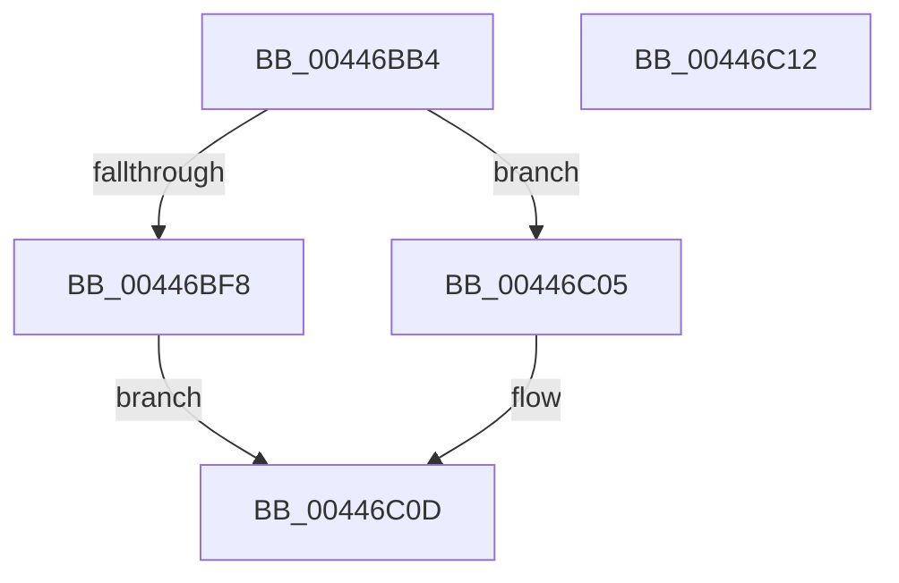

# ExAllocateHeapPages

- RVA: `0x00446BB4`–`0x00446C13` (길이 `95` bytes)
- VA: `0x0000000140446BB4`
- 실행 섹션: `.text`
- PDB 이름 있음: `예`; PDB Function 태그: `아니요`
- unwind 정보 RVA: `0x0005C788`
- 디코드: `23`개 명령, `95/95` bytes 표시
- 미해석 바이트: `0` (있으면 어셈블리에 `.byte`로 보존)

> 이 문서는 커널 이미지의 기계어와 PDB 기호를 분석해 생성했습니다. 4번과 5번은 함수 원형과 자료형을 바이너리 사용 방식에서 추정한 C 해석이며 원본 소스 복구 결과는 아닙니다.

## 1. Dependencies

- 직접 호출 지점: **2**; 고유 호출 대상: **2**
- 직접 호출자로 확인된 함수: **4**
- RIP 상대 이미지 참조: **2**

### Outgoing calls
- `0x00446BFE` → [RtlpHpAllocateHeapBackend](../32/RtlpHpAllocateHeapBackend_function_00326580.md) (function, `0x00326580`)
- `0x00446C08` → [RtlpHpAllocateHeap](../2E/RtlpHpAllocateHeap_function_002E98B0.md) (function, `0x002E98B0`)

### Direct callers
- [ExpResizeBigPageTable](../2E/ExpResizeBigPageTable_function_002EE1B4.md) at `0x002EE1FF`
- [ExGetBigPoolInfo](ExGetBigPoolInfo_function_00446970.md) at `0x00446B2D`
- [ExpInitializePoolTrackerTable](../65/ExpInitializePoolTrackerTable_function_00656860.md) at `0x006568E0`
- [sub_006DEB9E](../6D/Unknown_function_006DEB9E.md) at `0x006DEC37`

### Static image references
- `0x00446BCF` → RVA `0x00E6BF10` (`.data`; read)
- `0x00446BE2` → RVA `0x00E6BF48` (`.data`; read)

## 2. Other-region calls and transfers

- 다른 실행 섹션으로 향하는 call: **0**
- 별도 외부 분기/꼬리 이동을 확인하지 못했습니다.

## 3. Assembly (complete function range)

```asm
00446BB4  48 83 EC 28                     sub rsp, 0x28
00446BB8  65 48 8B 04 25 20 00 00 00      mov rax, qword ptr gs:[0x20]
00446BC1  48 8B 88 C0 00 00 00            mov rcx, qword ptr [rax + 0xc0]
00446BC8  0F B7 81 8A 00 00 00            movzx eax, word ptr [rcx + 0x8a]
00446BCF  3B 05 3B 53 A2 00               cmp eax, dword ptr [rip + 0xa2533b]
00446BD5  8B C8                           mov ecx, eax
00446BD7  1B C0                           sbb eax, eax
00446BD9  23 C1                           and eax, ecx
00446BDB  48 69 C8 C0 20 00 00            imul rcx, rax, 0x20c0
00446BE2  48 8D 05 5F 53 A2 00            lea rax, [rip + 0xa2535f]
00446BE9  48 8B 0C 01                     mov rcx, qword ptr [rcx + rax]
00446BED  8B 81 10 02 00 00               mov eax, dword ptr [rcx + 0x210]
00446BF3  48 3B D0                        cmp rdx, rax
00446BF6  73 0D                           jae 0x140446c05
00446BF8  45 33 C9                        xor r9d, r9d
00446BFB  4C 8B C2                        mov r8, rdx
00446BFE  E8 7D F9 ED FF                  call 0x140326580
00446C03  EB 08                           jmp 0x140446c0d
00446C05  45 33 C0                        xor r8d, r8d
00446C08  E8 A3 2C EA FF                  call 0x1402e98b0
00446C0D  48 83 C4 28                     add rsp, 0x28
00446C11  C3                              ret
00446C12  CC                              int3
```

## 4. C-style interpretation (structured pseudocode)

```c
__int64 __fastcall ExAllocateHeapPages(__int64 a1, __int64 a2, __int64 a3, int a4)
{
    __int64 result;
    __int64 v_rsp;

    v_rsp = (v_rsp) - (40);
    result = (unsigned int)((*(unsigned __int16 *)(*(unsigned __int64 *)(*(unsigned __int64 *)(gs_base + (0 + 32)) + 192) + 138)) & ((unsigned int)((unsigned int)((unsigned int)(*(unsigned __int16 *)(*(unsigned __int64 *)(*(unsigned __int64 *)(gs_base + (0 + 32)) + 192) + 138))))));
    a1 = ((unsigned int)((unsigned int)(*(unsigned __int16 *)(*(unsigned __int64 *)(*(unsigned __int64 *)(gs_base + (0 + 32)) + 192) + 138)))) * (result);
    if (a2 >= ((unsigned int)(*(unsigned int *)(*(unsigned __int64 *)(a1 + v_rip + 10638175 * 1) + 528)))) goto loc_00446C05;
    a4 = 0;
    result = RtlpHpAllocateHeapBackend(*(unsigned __int64 *)(a1 + v_rip + 10638175 * 1), a2, a2, a4);
    goto loc_00446C0D;
loc_00446C05:
    a3 = 0;
    result = RtlpHpAllocateHeap(*(unsigned __int64 *)(a1 + v_rip + 10638175 * 1), a2, a3, a4);
loc_00446C0D:
    v_rsp = (v_rsp) + (40);
    return result;
}
```

## 5. (Beta) C Style

```c
int64_t ExAllocateHeapPages(int64_t Arg1, int64_t Arg2, int64_t Arg3, int32_t Arg4)
{
    int64_t result;
    int64_t local_rsp;

    local_rsp = (local_rsp) - (40);
    result = (uint32_t)((*(uint16_t *)(*(uint64_t *)(*(uint64_t *)(gs_base + (0 + 0x20)) + 0xC0) + 0x8A)) & ((uint32_t)((uint32_t)((uint32_t)(*(uint16_t *)(*(uint64_t *)(*(uint64_t *)(gs_base + (0 + 0x20)) + 0xC0) + 0x8A))))));
    Arg1 = ((uint32_t)((uint32_t)(*(uint16_t *)(*(uint64_t *)(*(uint64_t *)(gs_base + (0 + 0x20)) + 0xC0) + 0x8A)))) * (result);
    if (Arg2 >= ((uint32_t)(*(uint32_t *)(*(uint64_t *)(Arg1 + v_rip + 0xA2535F * 1) + 0x210)))) goto loc_00446C05;
    Arg4 = 0;
    result = RtlpHpAllocateHeapBackend(*(uint64_t *)(Arg1 + v_rip + 0xA2535F * 1), Arg2, Arg2, Arg4);
    goto loc_00446C0D;
loc_00446C05:
    Arg3 = 0;
    result = RtlpHpAllocateHeap(*(uint64_t *)(Arg1 + v_rip + 0xA2535F * 1), Arg2, Arg3, Arg4);
loc_00446C0D:
    local_rsp = (local_rsp) + (40);
    return result;
}
```

## 6. Execution-region graph

[열기: 2D/3D 그래프와 함수 탐색 컨트롤 패널](../../../control-panel.html?section=text&rva=0x00446BB4&view=graph)

- 2D 그래프는 위에서 아래로 흐르고, 3D 그래프는 빈 공간을 드래그해 회전합니다. Shift+드래그는 이동, 휠은 확대·축소, 함수 노드 선택은 대상 보고서 이동입니다.

### Static fallback


