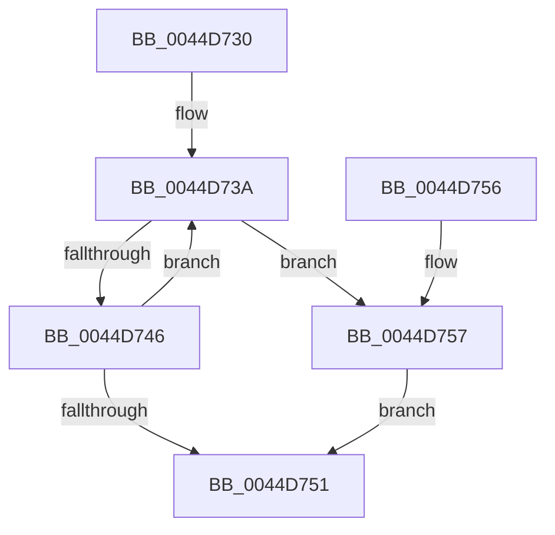

# ExDereferenceCallBackBlock

- RVA: `0x0044D730`–`0x0044D761` (길이 `49` bytes)
- VA: `0x000000014044D730`
- 실행 섹션: `.text`
- PDB 이름 있음: `예`; PDB Function 태그: `아니요`
- unwind 정보 RVA: `0x0005F758`
- 디코드: `16`개 명령, `49/49` bytes 표시
- 미해석 바이트: `0` (있으면 어셈블리에 `.byte`로 보존)

> 이 문서는 커널 이미지의 기계어와 PDB 기호를 분석해 생성했습니다. 4번과 5번은 함수 원형과 자료형을 바이너리 사용 방식에서 추정한 C 해석이며 원본 소스 복구 결과는 아닙니다.

## 1. Dependencies

- 직접 호출 지점: **1**; 고유 호출 대상: **1**
- 직접 호출자로 확인된 함수: **20**
- RIP 상대 이미지 참조: **0**

### Outgoing calls
- `0x0044D75A` → [ExReleaseRundownProtection](../34/ExReleaseRundownProtection_function_00349E80.md) (function, `0x00349E80`)

### Direct callers
- [PoIssueCoalescingNotification](PoIssueCoalescingNotification_function_0044D670.md) at `0x0044D6F7`
- [KiEnumerateCallback](../4D/KiEnumerateCallback_function_004DFE00.md) at `0x004DFE46`
- [IoUnregisterPriorityCallback](../59/IoUnregisterPriorityCallback_function_00597D40.md) at `0x00597DC5`
- [IoUnregisterPriorityCallback](../59/IoUnregisterPriorityCallback_function_00597D40.md) at `0x00597DEC`
- [KeDeregisterBoundCallback](../5B/KeDeregisterBoundCallback_function_005B1770.md) at `0x005B17D8`
- [KiHandleBound](../5B/KiHandleBound_function_005B1FB0.md) at `0x005B1FF6`
- [DbgkLkmdRegisterCallback](../../page/71/DbgkLkmdRegisterCallback_function_00711570.md) at `0x007115D5`
- [DbgkLkmdRegisterCallback](../../page/71/DbgkLkmdRegisterCallback_function_00711570.md) at `0x007115DE`
- [DbgkLkmdUnregisterCallback](../../page/71/DbgkLkmdUnregisterCallback_function_00711660.md) at `0x007116BB`
- [DbgkLkmdUnregisterCallback](../../page/71/DbgkLkmdUnregisterCallback_function_00711660.md) at `0x007116CA`
- [DbgkpLkmdFireCallbacks](../../page/71/DbgkpLkmdFireCallbacks_function_00711708.md) at `0x007117E4`
- [PoUnregisterCoalescingCallback](../../page/75/PoUnregisterCoalescingCallback_function_0075C000.md) at `0x0075C04E`
- [PoUnregisterCoalescingCallback](../../page/75/PoUnregisterCoalescingCallback_function_0075C000.md) at `0x0075C0AB`
- [PspInitializeThunkContext](../../page/8D/PspInitializeThunkContext_function_008D5418.md) at `0x008D577E`
- [sub_008D6D7D](../../page/8D/Unknown_function_008D6D7D.md) at `0x008D6DA8`
- [sub_008D6D7D](../../page/8D/Unknown_function_008D6D7D.md) at `0x008D6DBD`
- [KeUserModeCallback](../../page/8E/KeUserModeCallback_function_008E8A00.md) at `0x008E8D66`
- [PspCallProcessNotifyRoutines](../../page/90/PspCallProcessNotifyRoutines_function_00904928.md) at `0x00904A80`
- [ExCallCallBack](../../page/90/ExCallCallBack_function_009054B4.md) at `0x009054F9`
- [PspCallThreadNotifyRoutines](../../page/90/PspCallThreadNotifyRoutines_function_00905530.md) at `0x009055C0`
- [PspCallThreadNotifyRoutines](../../page/90/PspCallThreadNotifyRoutines_function_00905530.md) at `0x00905657`
- [PspCallThreadNotifyRoutines](../../page/90/PspCallThreadNotifyRoutines_function_00905530.md) at `0x009056C1`
- [sub_009133FC](../../page/91/Unknown_function_009133FC.md) at `0x00913439`
- [PsRemoveCreateThreadNotifyRoutine](../../page/AA/PsRemoveCreateThreadNotifyRoutine_function_00AA3870.md) at `0x00AA38FF`
- [PsRemoveCreateThreadNotifyRoutine](../../page/AA/PsRemoveCreateThreadNotifyRoutine_function_00AA3870.md) at `0x00AA3940`
- [PspSetCreateProcessNotifyRoutine](../../page/AA/PspSetCreateProcessNotifyRoutine_function_00AA75EC.md) at `0x00AA766D`
- [PsRemoveLoadImageNotifyRoutine](../../page/AC/PsRemoveLoadImageNotifyRoutine_function_00AC30F0.md) at `0x00AC3160`
- [PsRemoveLoadImageNotifyRoutine](../../page/AC/PsRemoveLoadImageNotifyRoutine_function_00AC30F0.md) at `0x00AC3177`
- [sub_00B49F04](../../page/B4/Unknown_function_00B49F04.md) at `0x00B49F3F`

### Static image references
- 디코드된 RIP-relative 메모리 참조가 없습니다.

## 2. Other-region calls and transfers

- 다른 실행 섹션으로 향하는 call: **0**
- 별도 외부 분기/꼬리 이동을 확인하지 못했습니다.

## 3. Assembly (complete function range)

```asm
0044D730  48 83 EC 28                     sub rsp, 0x28
0044D734  0F 0D 09                        prefetchw byte ptr [rcx]
0044D737  48 8B 01                        mov rax, qword ptr [rcx]
0044D73A  4C 8B C0                        mov r8, rax
0044D73D  4C 33 C2                        xor r8, rdx
0044D740  49 83 F8 0F                     cmp r8, 0xf
0044D744  73 11                           jae 0x14044d757
0044D746  4C 8D 40 01                     lea r8, [rax + 1]
0044D74A  F0 4C 0F B1 01                  lock cmpxchg qword ptr [rcx], r8
0044D74F  75 E9                           jne 0x14044d73a
0044D751  48 83 C4 28                     add rsp, 0x28
0044D755  C3                              ret
0044D756  CC                              int3
0044D757  48 8B CA                        mov rcx, rdx
0044D75A  E8 21 C7 EF FF                  call 0x140349e80
0044D75F  EB F0                           jmp 0x14044d751
```

## 4. C-style interpretation (structured pseudocode)

```c
__int64 __fastcall ExDereferenceCallBackBlock(__int64 a1, __int64 a2)
{
    __int64 result;
    __int64 v_rsp;

    v_rsp = (v_rsp) - (40);
loc_0044D73A:
    a3 = (*(unsigned __int64 *)(a1)) ^ (a2);
    if (a3 >= 15) goto loc_0044D757;
    if (a3 != 15) goto loc_0044D73A;
loc_0044D751:
    v_rsp = (v_rsp) + (40);
    return *(unsigned __int64 *)(a1);
loc_0044D757:
    result = ExReleaseRundownProtection(a2, a2, *(unsigned __int64 *)(a1) + 1, a4);
    goto loc_0044D751;
}
```

## 5. (Beta) C Style

```c
int64_t ExDereferenceCallBackBlock(void *Arg1, int64_t Arg2)
{
    uint8_t *arg1 = (uint8_t *)Arg1;

    int64_t result;
    int64_t local_rsp;

    local_rsp = (local_rsp) - (40);
loc_0044D73A:
    a3 = (*(uint64_t *)(arg1)) ^ (Arg2);
    if (a3 >= 15) goto loc_0044D757;
    if (a3 != 15) goto loc_0044D73A;
loc_0044D751:
    local_rsp = (local_rsp) + (40);
    return *(uint64_t *)(arg1);
loc_0044D757:
    result = ExReleaseRundownProtection(Arg2, Arg2, *(uint64_t *)(arg1) + 1, a4);
    goto loc_0044D751;
}
```

### 관측된 메모리 오프셋

구조체 형식이 확인되지 않은 접근은 인자 기준의 오프셋으로만 기록했습니다.

| 기준 인자 | 오프셋 표현 | 폭 (bit) | 접근 |
|---|---:|---:|---|
| `Arg1` | `+ 0x0` | `8` | `R` |
| `Arg1` | `+ 0x0` | `64` | `R` |

## 6. Execution-region graph

[열기: 2D/3D 그래프와 함수 탐색 컨트롤 패널](../../../control-panel.html?section=text&rva=0x0044D730&view=graph)

- 2D 그래프는 위에서 아래로 흐르고, 3D 그래프는 빈 공간을 드래그해 회전합니다. Shift+드래그는 이동, 휠은 확대·축소, 함수 노드 선택은 대상 보고서 이동입니다.

### Static fallback


