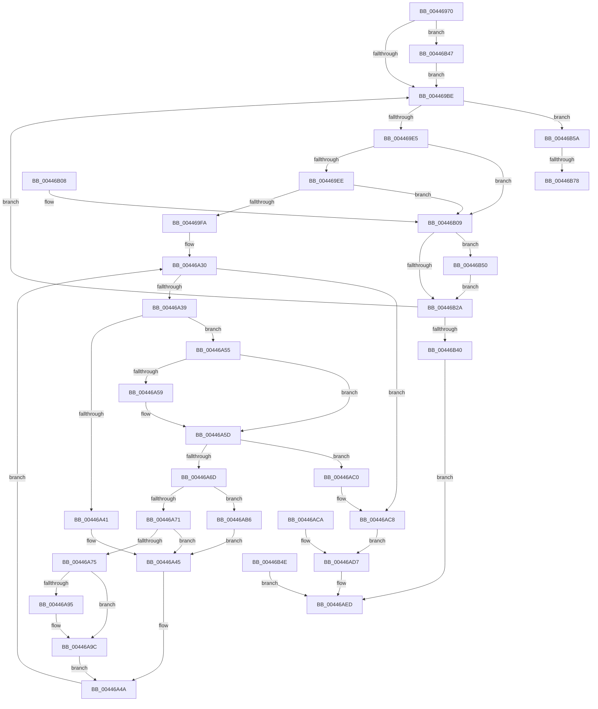

# ExGetBigPoolInfo

- RVA: `0x00446970`–`0x00446B86` (길이 `534` bytes)
- VA: `0x0000000140446970`
- 실행 섹션: `.text`
- PDB 이름 있음: `예`; PDB Function 태그: `예`
- unwind 정보 RVA: `0x000A5A7C`
- 디코드: `137`개 명령, `534/534` bytes 표시
- 미해석 바이트: `0` (있으면 어셈블리에 `.byte`로 보존)

> 이 문서는 커널 이미지의 기계어와 PDB 기호를 분석해 생성했습니다. 4번과 5번은 함수 원형과 자료형을 바이너리 사용 방식에서 추정한 C 해석이며 원본 소스 복구 결과는 아닙니다.

## 1. Dependencies

- 직접 호출 지점: **9**; 고유 호출 대상: **5**
- 직접 호출자로 확인된 함수: **2**
- RIP 상대 이미지 참조: **3**

### Outgoing calls
- `0x004469C5` → [ExAcquireSpinLockExclusive](../24/ExAcquireSpinLockExclusive_function_00248690.md) (function, `0x00248690`)
- `0x00446A09` → [memcpy](../6C/memcpy_function_006C6840.md) (function, `0x006C6840`)
- `0x00446A19` → [ExReleaseSpinLockExclusive](../2C/ExReleaseSpinLockExclusive_function_002C0EF0.md) (function, `0x002C0EF0`)
- `0x00446ADA` → [ExFreeHeapPages](ExFreeHeapPages_function_00446B8C.md) (function, `0x00446B8C`)
- `0x00446B17` → [ExReleaseSpinLockExclusive](../2C/ExReleaseSpinLockExclusive_function_002C0EF0.md) (function, `0x002C0EF0`)
- `0x00446B2D` → [ExAllocateHeapPages](ExAllocateHeapPages_function_00446BB4.md) (function, `0x00446BB4`)
- `0x00446B53` → [ExFreeHeapPages](ExFreeHeapPages_function_00446B8C.md) (function, `0x00446B8C`)
- `0x00446B65` → [ExReleaseSpinLockExclusive](../2C/ExReleaseSpinLockExclusive_function_002C0EF0.md) (function, `0x002C0EF0`)
- `0x00446B7B` → [ExFreeHeapPages](ExFreeHeapPages_function_00446B8C.md) (function, `0x00446B8C`)

### Direct callers
- [EtwpPoolRunDown](../../page/7C/EtwpPoolRunDown_function_007C0650.md) at `0x007C07B9`
- [ExpQuerySystemInformation](../../page/A5/ExpQuerySystemInformation_function_00A57858.md) at `0x00A58C4E`

### Static image references
- `0x004469BE` → RVA `0x00EFACF8` (`.data`; read)
- `0x004469CE` → RVA `0x00EFED30` (`.data`; read)
- `0x004469D5` → RVA `0x00EFED38` (`.data`; read)

## 2. Other-region calls and transfers

- 다른 실행 섹션으로 향하는 call: **0**
- call이 아닌 외부 분기/꼬리 이동: **2**
  - `0x00446B72` → [sub_006F01A8](../6F/Unknown_function_006F01A8.md) (`tail-transfer`)
  - `0x00446B81` → [sub_006F01A8](../6F/Unknown_function_006F01A8.md) (`tail-transfer`)

## 3. Assembly (complete function range)

```asm
00446970  48 89 5C 24 08                  mov qword ptr [rsp + 8], rbx
00446975  48 89 74 24 18                  mov qword ptr [rsp + 0x18], rsi
0044697A  4C 89 4C 24 20                  mov qword ptr [rsp + 0x20], r9
0044697F  57                              push rdi
00446980  41 54                           push r12
00446982  41 55                           push r13
00446984  41 56                           push r14
00446986  41 57                           push r15
00446988  48 83 EC 40                     sub rsp, 0x40
0044698C  41 8B F8                        mov edi, r8d
0044698F  4C 8B E2                        mov r12, rdx
00446992  44 8B E9                        mov r13d, ecx
00446995  33 C9                           xor ecx, ecx
00446997  48 89 4C 24 78                  mov qword ptr [rsp + 0x78], rcx
0044699C  89 4C 24 24                     mov dword ptr [rsp + 0x24], ecx
004469A0  44 8B F1                        mov r14d, ecx
004469A3  BB 08 00 00 00                  mov ebx, 8
004469A8  89 5C 24 20                     mov dword ptr [rsp + 0x20], ebx
004469AC  48 8D 42 08                     lea rax, [rdx + 8]
004469B0  48 89 44 24 30                  mov qword ptr [rsp + 0x30], rax
004469B5  45 85 C0                        test r8d, r8d
004469B8  0F 85 89 01 00 00               jne 0x140446b47
004469BE  48 8D 0D 33 43 AB 00            lea rcx, [rip + 0xab4333]
004469C5  E8 C6 1C E0 FF                  call 0x140248690
004469CA  44 0F B6 F8                     movzx r15d, al
004469CE  48 8B 15 5B 83 AB 00            mov rdx, qword ptr [rip + 0xab835b]
004469D5  48 8B 35 5C 83 AB 00            mov rsi, qword ptr [rip + 0xab835c]
004469DC  48 85 D2                        test rdx, rdx
004469DF  0F 84 75 01 00 00               je 0x140446b5a
004469E5  4C 3B F6                        cmp r14, rsi
004469E8  0F 82 1B 01 00 00               jb 0x140446b09
004469EE  48 83 7C 24 78 00               cmp qword ptr [rsp + 0x78], 0
004469F4  0F 84 0F 01 00 00               je 0x140446b09
004469FA  48 C1 E6 05                     shl rsi, 5
004469FE  4C 8B C6                        mov r8, rsi
00446A01  4C 8B 74 24 78                  mov r14, qword ptr [rsp + 0x78]
00446A06  49 8B CE                        mov rcx, r14
00446A09  E8 32 FE 27 00                  call 0x1406c6840
00446A0E  41 0F B6 D7                     movzx edx, r15b
00446A12  48 8D 0D DF 42 AB 00            lea rcx, [rip + 0xab42df]
00446A19  E8 D2 A4 E7 FF                  call 0x1402c0ef0
00446A1E  49 8B D6                        mov rdx, r14
00446A21  48 89 54 24 28                  mov qword ptr [rsp + 0x28], rdx
00446A26  4A 8D 04 36                     lea rax, [rsi + r14]
00446A2A  66 0F 1F 44 00 00               nop word ptr [rax + rax]
00446A30  48 3B D0                        cmp rdx, rax
00446A33  0F 83 8F 00 00 00               jae 0x140446ac8
00446A39  48 8B 0A                        mov rcx, qword ptr [rdx]
00446A3C  F6 C1 01                        test cl, 1
00446A3F  74 14                           je 0x140446a55
00446A41  8B 5C 24 20                     mov ebx, dword ptr [rsp + 0x20]
00446A45  48 8B 54 24 28                  mov rdx, qword ptr [rsp + 0x28]
00446A4A  48 83 C2 20                     add rdx, 0x20
00446A4E  48 89 54 24 28                  mov qword ptr [rsp + 0x28], rdx
00446A53  EB DB                           jmp 0x140446a30
00446A55  85 FF                           test edi, edi
00446A57  74 04                           je 0x140446a5d
00446A59  41 FF 04 24                     inc dword ptr [r12]
00446A5D  8B 5C 24 20                     mov ebx, dword ptr [rsp + 0x20]
00446A61  83 C3 18                        add ebx, 0x18
00446A64  89 5C 24 20                     mov dword ptr [rsp + 0x20], ebx
00446A68  83 FB 18                        cmp ebx, 0x18
00446A6B  72 53                           jb 0x140446ac0
00446A6D  3B DF                           cmp ebx, edi
00446A6F  77 45                           ja 0x140446ab6
00446A71  85 FF                           test edi, edi
00446A73  74 D0                           je 0x140446a45
00446A75  45 33 C9                        xor r9d, r9d
00446A78  45 85 ED                        test r13d, r13d
00446A7B  4C 0F 44 C9                     cmove r9, rcx
00446A7F  4C 8B 44 24 30                  mov r8, qword ptr [rsp + 0x30]
00446A84  4D 89 08                        mov qword ptr [r8], r9
00446A87  48 8B 54 24 28                  mov rdx, qword ptr [rsp + 0x28]
00446A8C  F7 42 0C 00 00 01 00            test dword ptr [rdx + 0xc], 0x10000
00446A93  75 07                           jne 0x140446a9c
00446A95  49 83 C9 01                     or r9, 1
00446A99  4D 89 08                        mov qword ptr [r8], r9
00446A9C  8B 4A 08                        mov ecx, dword ptr [rdx + 8]
00446A9F  41 89 48 10                     mov dword ptr [r8 + 0x10], ecx
00446AA3  48 8B 4A 10                     mov rcx, qword ptr [rdx + 0x10]
00446AA7  49 89 48 08                     mov qword ptr [r8 + 8], rcx
00446AAB  49 83 C0 18                     add r8, 0x18
00446AAF  4C 89 44 24 30                  mov qword ptr [rsp + 0x30], r8
00446AB4  EB 94                           jmp 0x140446a4a
00446AB6  C7 44 24 24 04 00 00 C0         mov dword ptr [rsp + 0x24], 0xc0000004
00446ABE  EB 85                           jmp 0x140446a45
00446AC0  C7 44 24 24 95 00 00 C0         mov dword ptr [rsp + 0x24], 0xc0000095
00446AC8  EB 0D                           jmp 0x140446ad7
00446ACA  89 44 24 24                     mov dword ptr [rsp + 0x24], eax
00446ACE  8B 5C 24 20                     mov ebx, dword ptr [rsp + 0x20]
00446AD2  4C 8B 74 24 78                  mov r14, qword ptr [rsp + 0x78]
00446AD7  49 8B CE                        mov rcx, r14
00446ADA  E8 AD 00 00 00                  call 0x140446b8c
00446ADF  48 8B 84 24 88 00 00 00         mov rax, qword ptr [rsp + 0x88]
00446AE7  89 18                           mov dword ptr [rax], ebx
00446AE9  8B 44 24 24                     mov eax, dword ptr [rsp + 0x24]
00446AED  48 8B 5C 24 70                  mov rbx, qword ptr [rsp + 0x70]
00446AF2  48 8B B4 24 80 00 00 00         mov rsi, qword ptr [rsp + 0x80]
00446AFA  48 83 C4 40                     add rsp, 0x40
00446AFE  41 5F                           pop r15
00446B00  41 5E                           pop r14
00446B02  41 5D                           pop r13
00446B04  41 5C                           pop r12
00446B06  5F                              pop rdi
00446B07  C3                              ret
00446B08  CC                              int3
00446B09  4C 8B F6                        mov r14, rsi
00446B0C  41 0F B6 D7                     movzx edx, r15b
00446B10  48 8D 0D E1 41 AB 00            lea rcx, [rip + 0xab41e1]
00446B17  E8 D4 A3 E7 FF                  call 0x1402c0ef0
00446B1C  48 C1 E6 05                     shl rsi, 5
00446B20  48 8B 44 24 78                  mov rax, qword ptr [rsp + 0x78]
00446B25  48 85 C0                        test rax, rax
00446B28  75 26                           jne 0x140446b50
00446B2A  48 8B D6                        mov rdx, rsi
00446B2D  E8 82 00 00 00                  call 0x140446bb4
00446B32  48 89 44 24 78                  mov qword ptr [rsp + 0x78], rax
00446B37  48 85 C0                        test rax, rax
00446B3A  0F 85 7E FE FF FF               jne 0x1404469be
00446B40  B8 9A 00 00 C0                  mov eax, 0xc000009a
00446B45  EB A6                           jmp 0x140446aed
00446B47  89 0A                           mov dword ptr [rdx], ecx
00446B49  E9 70 FE FF FF                  jmp 0x1404469be
00446B4E  EB 9D                           jmp 0x140446aed
00446B50  48 8B C8                        mov rcx, rax
00446B53  E8 34 00 00 00                  call 0x140446b8c
00446B58  EB D0                           jmp 0x140446b2a
00446B5A  41 0F B6 D7                     movzx edx, r15b
00446B5E  48 8D 0D 93 41 AB 00            lea rcx, [rip + 0xab4193]
00446B65  E8 86 A3 E7 FF                  call 0x1402c0ef0
00446B6A  48 8B 44 24 78                  mov rax, qword ptr [rsp + 0x78]
00446B6F  48 85 C0                        test rax, rax
00446B72  0F 84 30 96 2A 00               je 0x1406f01a8
00446B78  48 8B C8                        mov rcx, rax
00446B7B  E8 0C 00 00 00                  call 0x140446b8c
00446B80  90                              nop
00446B81  E9 22 96 2A 00                  jmp 0x1406f01a8
```

## 4. C-style interpretation (structured pseudocode)

```c
__int64 __fastcall ExGetBigPoolInfo(int a1, __int64 a2, int a3, __int64 a4)
{
    __int64 result;
    __int64 v_rbx;
    __int64 v_rsi;
    __int64 v_rsp;
    unsigned __int64 v_stack_m38;
    unsigned __int64 v_stack_m40;
    unsigned int v_stack_m44;
    unsigned int v_stack_m48;
    unsigned __int64 v_stack_p10;
    unsigned __int64 v_stack_p18;
    unsigned __int64 v_stack_p20;
    unsigned __int64 v_stack_p78;
    unsigned __int64 v_stack_p8;

    v_stack_p8 = v_rbx;
    v_stack_p18 = v_rsi;
    v_stack_p20 = a4;
    v_rsp = (v_rsp) - (64);
    a1 = 0;
    v_stack_p10 = 0;
    v_stack_m44 = 0;
    v_stack_m48 = 8;
    v_stack_m38 = a2 + 8;
    if (a3 != 0) goto loc_00446B47;
loc_004469BE:
    result = ExAcquireSpinLockExclusive(v_rip + 11223859, a2, a3, a4);
    if (*(unsigned __int64 *)(v_rip + 11240283) == 0) goto loc_00446B5A;
    if (0 < (*(unsigned __int64 *)(v_rip + 11240284))) goto loc_00446B09;
    if (v_stack_p10 == 0) goto loc_00446B09;
    v_rsi = (*(unsigned __int64 *)(v_rip + 11240284)) << (5);
    result = memcpy(v_stack_p10, *(unsigned __int64 *)(v_rip + 11240283), v_rsi, a4);
    result = ExReleaseSpinLockExclusive(v_rip + 11223775, (unsigned __int8)((unsigned __int8)(result)), v_rsi, a4);
    v_stack_m40 = v_stack_p10;
loc_00446A30:
    if (v_stack_p10 >= (v_rsi + v_stack_p10 * 1)) goto loc_00446AC8;
    if ((((unsigned __int8)(*(unsigned __int64 *)(v_stack_p10))) & (1)) == 0) goto loc_00446A55;
loc_00446A45:
loc_00446A4A:
    a2 = (v_stack_m40) + (32);
    v_stack_m40 = a2;
    goto loc_00446A30;
loc_00446A55:
    if ((unsigned int)((unsigned int)(a3)) != 0) {
    }
    v_rbx = (unsigned int)(((unsigned int)(v_stack_m48)) + (24));
    v_stack_m48 = (unsigned int)(v_rbx);
    if (((unsigned int)(v_rbx)) < 24) goto loc_00446AC0;
    if (((unsigned int)(v_rbx)) > ((unsigned int)((unsigned int)(a3)))) goto loc_00446AB6;
    if ((unsigned int)((unsigned int)(a3)) == 0) goto loc_00446A45;
    a4 = 0;
    if ((unsigned int)((unsigned int)(a1)) == 0) { a4 = *(unsigned __int64 *)(v_stack_p10); }
    *(unsigned __int64 *)(v_stack_m38) = a4;
    if (((*(unsigned int *)(v_stack_m40 + 12)) & (0x10000ULL)) == 0) {
        a4 = (a4) | (1);
        *(unsigned __int64 *)(v_stack_m38) = a4;
    }
    *(unsigned int *)(v_stack_m38 + 16) = (unsigned int)((unsigned int)(*(unsigned int *)(v_stack_m40 + 8)));
    *(unsigned __int64 *)(v_stack_m38 + 8) = *(unsigned __int64 *)(v_stack_m40 + 16);
    a3 = (v_stack_m38) + (24);
    v_stack_m38 = a3;
    goto loc_00446A4A;
loc_00446AB6:
    v_stack_m44 = 0xC0000004ULL;
    goto loc_00446A45;
loc_00446AC0:
    v_stack_m44 = 0xC0000095ULL;
loc_00446AC8:
    goto loc_00446AD7;
loc_00446AD7:
    result = ExFreeHeapPages(v_stack_p10, v_stack_m40, a3, a4);
    *(unsigned int *)(v_stack_p20) = (unsigned int)(v_rbx);
loc_00446AED:
    v_rsp = (v_rsp) + (64);
    return (unsigned int)(v_stack_m44);
loc_00446B09:
    result = ExReleaseSpinLockExclusive(v_rip + 11223521, (unsigned __int8)((unsigned __int8)(result)), a3, a4);
    v_rsi = (v_stack_p18) << (5);
    if (v_stack_p78 != 0) goto loc_00446B50;
loc_00446B2A:
    result = ExAllocateHeapPages(v_rip + 11223521, v_rsi, a3, a4);
    v_stack_p78 = result;
    if (result != 0) goto loc_004469BE;
    goto loc_00446AED;
loc_00446B47:
    *(unsigned int *)(v_rsi) = (unsigned int)(v_rip + 11223521);
    goto loc_004469BE;
loc_00446B50:
    result = ExFreeHeapPages((unsigned int)(0xC000009AULL), v_rsi, a3, a4);
    goto loc_00446B2A;
loc_00446B5A:
    result = ExReleaseSpinLockExclusive(v_rip + 11223443, (unsigned __int8)((unsigned __int8)(result)), a3, a4);
    result = ExFreeHeapPages(v_stack_p78, (unsigned __int8)((unsigned __int8)(result)), a3, a4);
}
```

## 5. (Beta) C Style

```c
int64_t ExGetBigPoolInfo(int32_t Arg1, void *Arg2, int32_t Arg3, int64_t Arg4)
{
    uint8_t *arg2 = (uint8_t *)Arg2;

    int64_t result;
    int64_t local_rbx;
    int64_t local_rsi;
    int64_t local_rsp;
    uint64_t v_stack_m38;
    uint64_t v_stack_m40;
    uint32_t v_stack_m44;
    uint32_t v_stack_m48;
    uint64_t v_stack_p10;
    uint64_t v_stack_p18;
    uint64_t v_stack_p20;
    uint64_t v_stack_p78;
    uint64_t v_stack_p8;

    v_stack_p8 = local_rbx;
    v_stack_p18 = local_rsi;
    v_stack_p20 = Arg4;
    local_rsp = (local_rsp) - (64);
    Arg1 = 0;
    v_stack_p10 = 0;
    v_stack_m44 = 0;
    v_stack_m48 = 8;
    v_stack_m38 = Arg2 + 8;
    if (Arg3 != 0) goto loc_00446B47;
loc_004469BE:
    result = ExAcquireSpinLockExclusive(v_rip + 11223859, Arg2, Arg3, Arg4);
    if (*(uint64_t *)(v_rip + 0xAB835B) == 0) goto loc_00446B5A;
    if (0 < (*(uint64_t *)(v_rip + 0xAB835C))) goto loc_00446B09;
    if (v_stack_p10 == 0) goto loc_00446B09;
    local_rsi = (*(uint64_t *)(v_rip + 0xAB835C)) << (5);
    result = memcpy(v_stack_p10, *(uint64_t *)(v_rip + 0xAB835B), local_rsi, Arg4);
    result = ExReleaseSpinLockExclusive(v_rip + 11223775, (uint8_t)((uint8_t)(result)), local_rsi, Arg4);
    v_stack_m40 = v_stack_p10;
loc_00446A30:
    if (v_stack_p10 >= (local_rsi + v_stack_p10 * 1)) goto loc_00446AC8;
    if ((((uint8_t)(*(uint64_t *)(v_stack_p10))) & (1)) == 0) goto loc_00446A55;
loc_00446A45:
loc_00446A4A:
    Arg2 = (v_stack_m40) + (32);
    v_stack_m40 = Arg2;
    goto loc_00446A30;
loc_00446A55:
    if ((uint32_t)((uint32_t)(Arg3)) != 0) {
    }
    local_rbx = (uint32_t)(((uint32_t)(v_stack_m48)) + (24));
    v_stack_m48 = (uint32_t)(local_rbx);
    if (((uint32_t)(local_rbx)) < 24) goto loc_00446AC0;
    if (((uint32_t)(local_rbx)) > ((uint32_t)((uint32_t)(Arg3)))) goto loc_00446AB6;
    if ((uint32_t)((uint32_t)(Arg3)) == 0) goto loc_00446A45;
    Arg4 = 0;
    if ((uint32_t)((uint32_t)(Arg1)) == 0) { Arg4 = *(uint64_t *)(v_stack_p10); }
    *(uint64_t *)(v_stack_m38) = Arg4;
    if (((*(uint32_t *)(v_stack_m40 + 0xC)) & (0x10000ULL)) == 0) {
        Arg4 = (Arg4) | (1);
        *(uint64_t *)(v_stack_m38) = Arg4;
    }
    *(uint32_t *)(v_stack_m38 + 0x10) = (uint32_t)((uint32_t)(*(uint32_t *)(v_stack_m40 + 0x8)));
    *(uint64_t *)(v_stack_m38 + 0x8) = *(uint64_t *)(v_stack_m40 + 0x10);
    Arg3 = (v_stack_m38) + (24);
    v_stack_m38 = Arg3;
    goto loc_00446A4A;
loc_00446AB6:
    v_stack_m44 = 0xC0000004ULL;
    goto loc_00446A45;
loc_00446AC0:
    v_stack_m44 = 0xC0000095ULL;
loc_00446AC8:
    goto loc_00446AD7;
loc_00446AD7:
    result = ExFreeHeapPages(v_stack_p10, v_stack_m40, Arg3, Arg4);
    *(uint32_t *)(v_stack_p20) = (uint32_t)(local_rbx);
loc_00446AED:
    local_rsp = (local_rsp) + (64);
    return (uint32_t)(v_stack_m44);
loc_00446B09:
    result = ExReleaseSpinLockExclusive(v_rip + 11223521, (uint8_t)((uint8_t)(result)), Arg3, Arg4);
    local_rsi = (v_stack_p18) << (5);
    if (v_stack_p78 != 0) goto loc_00446B50;
loc_00446B2A:
    result = ExAllocateHeapPages(v_rip + 11223521, local_rsi, Arg3, Arg4);
    v_stack_p78 = result;
    if (result != 0) goto loc_004469BE;
    goto loc_00446AED;
loc_00446B47:
    *(uint32_t *)(local_rsi) = (uint32_t)(v_rip + 11223521);
    goto loc_004469BE;
loc_00446B50:
    result = ExFreeHeapPages((uint32_t)(0xC000009AULL), local_rsi, Arg3, Arg4);
    goto loc_00446B2A;
loc_00446B5A:
    result = ExReleaseSpinLockExclusive(v_rip + 11223443, (uint8_t)((uint8_t)(result)), Arg3, Arg4);
    result = ExFreeHeapPages(v_stack_p78, (uint8_t)((uint8_t)(result)), Arg3, Arg4);
}
```

### 관측된 메모리 오프셋

구조체 형식이 확인되지 않은 접근은 인자 기준의 오프셋으로만 기록했습니다.

| 기준 인자 | 오프셋 표현 | 폭 (bit) | 접근 |
|---|---:|---:|---|
| `Arg2` | `+ 0x0` | `32` | `R/W` |
| `Arg2` | `+ 0x0` | `32` | `W` |
| `Arg2` | `+ 0x8` | `64` | `R` |

## 6. Execution-region graph

[열기: 2D/3D 그래프와 함수 탐색 컨트롤 패널](../../../control-panel.html?section=text&rva=0x00446970&view=graph)

- 2D 그래프는 위에서 아래로 흐르고, 3D 그래프는 빈 공간을 드래그해 회전합니다. Shift+드래그는 이동, 휠은 확대·축소, 함수 노드 선택은 대상 보고서 이동입니다.

### Static fallback


