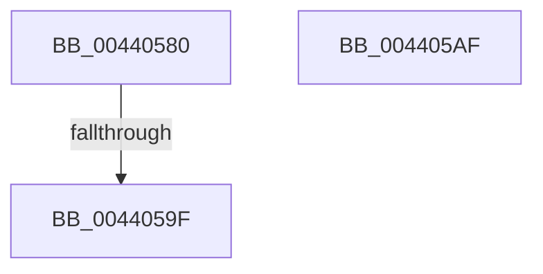

# ExHandleLogBadReference

- RVA: `0x00440580`–`0x004405B0` (길이 `48` bytes)
- VA: `0x0000000140440580`
- 실행 섹션: `.text`
- PDB 이름 있음: `예`; PDB Function 태그: `예`
- unwind 정보 RVA: `0x000A4EAC`
- 디코드: `15`개 명령, `48/48` bytes 표시
- 미해석 바이트: `0` (있으면 어셈블리에 `.byte`로 보존)

> 이 문서는 커널 이미지의 기계어와 PDB 기호를 분석해 생성했습니다. 4번과 5번은 함수 원형과 자료형을 바이너리 사용 방식에서 추정한 C 해석이며 원본 소스 복구 결과는 아닙니다.

## 1. Dependencies

- 직접 호출 지점: **0**; 고유 호출 대상: **0**
- 직접 호출자로 확인된 함수: **10**
- RIP 상대 이미지 참조: **0**

### Outgoing calls
- 직접 디코드된 call 명령이 없습니다.

### Direct callers
- [ObpCloseHandle](../../page/86/ObpCloseHandle_function_008685B0.md) at `0x008687E5`
- [NtClose](../../page/86/NtClose_function_00868870.md) at `0x00868B4D`
- [ObWaitForMultipleObjects](../../page/86/ObWaitForMultipleObjects_function_00868DF0.md) at `0x0086930E`
- [ObpReferenceObjectByHandleWithTag](../../page/86/ObpReferenceObjectByHandleWithTag_function_00869650.md) at `0x00869D9C`
- [ExMapHandleToPointerEx](../../page/88/ExMapHandleToPointerEx_function_00889390.md) at `0x00889412`
- [AlpcpSendMessage](../../page/88/AlpcpSendMessage_function_0088BD40.md) at `0x0088C81E`
- [sub_00895B6D](../../page/89/Unknown_function_00895B6D.md) at `0x00895C5F`
- [NtAlpcImpersonateClientOfPort](../../page/89/NtAlpcImpersonateClientOfPort_function_008961A0.md) at `0x00896591`
- [NtWriteFile](../../page/8E/NtWriteFile_function_008E92D0.md) at `0x008E96A0`
- [sub_0094C011](../../page/94/Unknown_function_0094C011.md) at `0x0094C0D9`

### Static image references
- 디코드된 RIP-relative 메모리 참조가 없습니다.

## 2. Other-region calls and transfers

- 다른 실행 섹션으로 향하는 call: **0**
- call이 아닌 외부 분기/꼬리 이동: **1**
  - `0x0044059D` → [sub_004405B0](Unknown_function_004405B0.md) (`tail-transfer`)

## 3. Assembly (complete function range)

```asm
00440580  48 89 5C 24 10                  mov qword ptr [rsp + 0x10], rbx
00440585  48 89 74 24 18                  mov qword ptr [rsp + 0x18], rsi
0044058A  57                              push rdi
0044058B  48 83 EC 50                     sub rsp, 0x50
0044058F  F6 41 2C 02                     test byte ptr [rcx + 0x2c], 2
00440593  41 0F B6 F0                     movzx esi, r8b
00440597  48 8B FA                        mov rdi, rdx
0044059A  48 8B D9                        mov rbx, rcx
0044059D  75 11                           jne 0x1404405b0
0044059F  48 8B 5C 24 68                  mov rbx, qword ptr [rsp + 0x68]
004405A4  48 8B 74 24 70                  mov rsi, qword ptr [rsp + 0x70]
004405A9  48 83 C4 50                     add rsp, 0x50
004405AD  5F                              pop rdi
004405AE  C3                              ret
004405AF  CC                              int3
```

## 4. C-style interpretation (structured pseudocode)

```c
void __fastcall ExHandleLogBadReference(__int64 a1, __int64 a2, unsigned __int8 a3)
{
    __int64 v_rsp;
    unsigned __int64 v_stack_p10;
    unsigned __int64 v_stack_p18;

    v_stack_p10 = v_rbx;
    v_stack_p18 = v_rsi;
    v_rsp = (v_rsp) - (80);
    v_rsp = (v_rsp) + (80);
    return;
}
```

## 5. (Beta) C Style

```c
void ExHandleLogBadReference(void *Arg1, int64_t Arg2, uint8_t Arg3)
{
    uint8_t *arg1 = (uint8_t *)Arg1;

    int64_t local_rsp;
    uint64_t v_stack_p10;
    uint64_t v_stack_p18;

    v_stack_p10 = local_rbx;
    v_stack_p18 = local_rsi;
    local_rsp = (local_rsp) - (80);
    local_rsp = (local_rsp) + (80);
    return;
}
```

### 관측된 메모리 오프셋

구조체 형식이 확인되지 않은 접근은 인자 기준의 오프셋으로만 기록했습니다.

| 기준 인자 | 오프셋 표현 | 폭 (bit) | 접근 |
|---|---:|---:|---|
| `Arg1` | `+ 0x2C` | `8` | `R` |

## 6. Execution-region graph

[열기: 2D/3D 그래프와 함수 탐색 컨트롤 패널](../../../control-panel.html?section=text&rva=0x00440580&view=graph)

- 2D 그래프는 위에서 아래로 흐르고, 3D 그래프는 빈 공간을 드래그해 회전합니다. Shift+드래그는 이동, 휠은 확대·축소, 함수 노드 선택은 대상 보고서 이동입니다.

### Static fallback


