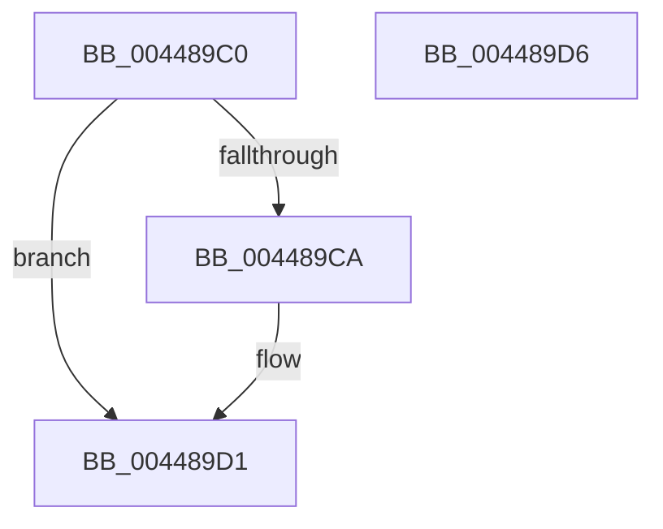

# ExInitializeAutoExpandPushLock

- RVA: `0x004489C0`–`0x004489D7` (길이 `23` bytes)
- VA: `0x00000001404489C0`
- 실행 섹션: `.text`
- PDB 이름 있음: `예`; PDB Function 태그: `아니요`
- unwind 정보 RVA: `0x000DB714`
- 디코드: `7`개 명령, `23/23` bytes 표시
- 미해석 바이트: `0` (있으면 어셈블리에 `.byte`로 보존)

> 이 문서는 커널 이미지의 기계어와 PDB 기호를 분석해 생성했습니다. 4번과 5번은 함수 원형과 자료형을 바이너리 사용 방식에서 추정한 C 해석이며 원본 소스 복구 결과는 아닙니다.

## 1. Dependencies

- 직접 호출 지점: **0**; 고유 호출 대상: **0**
- 직접 호출자로 확인된 함수: **3**
- RIP 상대 이미지 참조: **0**

### Outgoing calls
- 직접 디코드된 call 명령이 없습니다.

### Direct callers
- [MmInitializeHandBuiltProcess](../../page/7F/MmInitializeHandBuiltProcess_function_007F83EC.md) at `0x007F84B5`
- [MiAllocateAweInfo](../../page/80/MiAllocateAweInfo_function_00809518.md) at `0x0080967A`
- [MmInitializeProcessAddressSpace](../../page/8C/MmInitializeProcessAddressSpace_function_008CF6B0.md) at `0x008CF72C`

### Static image references
- 디코드된 RIP-relative 메모리 참조가 없습니다.

## 2. Other-region calls and transfers

- 다른 실행 섹션으로 향하는 call: **0**
- 별도 외부 분기/꼬리 이동을 확인하지 못했습니다.

## 3. Assembly (complete function range)

```asm
004489C0  48 83 61 08 00                  and qword ptr [rcx + 8], 0
004489C5  F6 C2 01                        test dl, 1
004489C8  75 07                           jne 0x1404489d1
004489CA  C7 41 08 04 00 00 00            mov dword ptr [rcx + 8], 4
004489D1  48 83 21 00                     and qword ptr [rcx], 0
004489D5  C3                              ret
004489D6  CC                              int3
```

## 4. C-style interpretation (structured pseudocode)

```c
void __fastcall ExInitializeAutoExpandPushLock(__int64 a1, unsigned __int8 a2)
{
    if (((a2) & (1)) == 0) {
        *(unsigned int *)(a1 + 8) = 4;
    }
    return;
}
```

## 5. (Beta) C Style

```c
void ExInitializeAutoExpandPushLock(void *AutoExpandPushLock, uint8_t Arg2)
{
    uint8_t *autoExpandPushLock = (uint8_t *)AutoExpandPushLock;

    if (((Arg2) & (1)) == 0) {
        *(uint32_t *)(autoExpandPushLock + 0x8) = 4;
    }
    return;
}
```

### 관측된 메모리 오프셋

구조체 형식이 확인되지 않은 접근은 인자 기준의 오프셋으로만 기록했습니다.

| 기준 인자 | 오프셋 표현 | 폭 (bit) | 접근 |
|---|---:|---:|---|
| `AutoExpandPushLock` | `+ 0x0` | `64` | `R/W` |
| `AutoExpandPushLock` | `+ 0x8` | `32` | `W` |
| `AutoExpandPushLock` | `+ 0x8` | `64` | `R/W` |

## 6. Execution-region graph

[열기: 2D/3D 그래프와 함수 탐색 컨트롤 패널](../../../control-panel.html?section=text&rva=0x004489C0&view=graph)

- 2D 그래프는 위에서 아래로 흐르고, 3D 그래프는 빈 공간을 드래그해 회전합니다. Shift+드래그는 이동, 휠은 확대·축소, 함수 노드 선택은 대상 보고서 이동입니다.

### Static fallback


