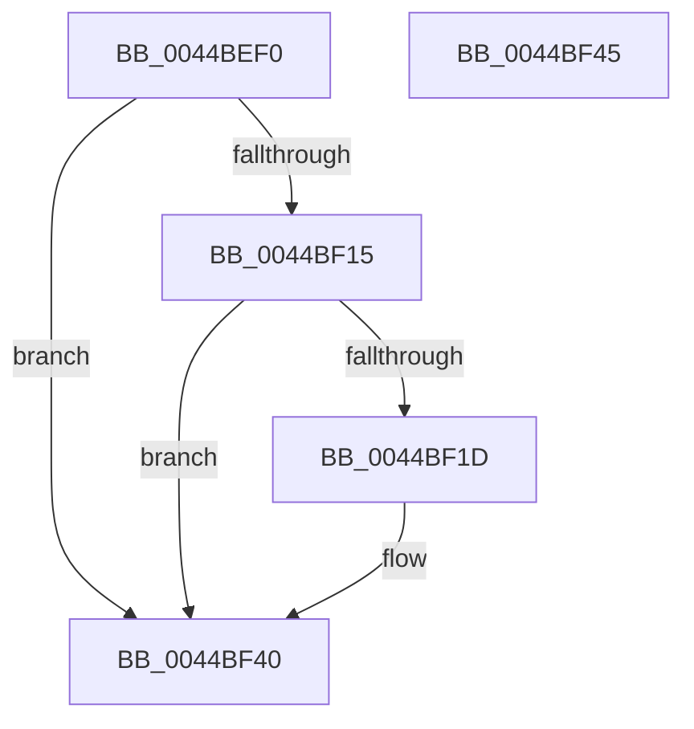

# ExSlowReplenishHandleTableEntry

- RVA: `0x0044BEF0`–`0x0044BF46` (길이 `86` bytes)
- VA: `0x000000014044BEF0`
- 실행 섹션: `.text`
- PDB 이름 있음: `예`; PDB Function 태그: `아니요`
- unwind 정보 RVA: `0x000A67F4`
- 디코드: `24`개 명령, `86/86` bytes 표시
- 미해석 바이트: `0` (있으면 어셈블리에 `.byte`로 보존)

> 이 문서는 커널 이미지의 기계어와 PDB 기호를 분석해 생성했습니다. 4번과 5번은 함수 원형과 자료형을 바이너리 사용 방식에서 추정한 C 해석이며 원본 소스 복구 결과는 아닙니다.

## 1. Dependencies

- 직접 호출 지점: **0**; 고유 호출 대상: **0**
- 직접 호출자로 확인된 함수: **8**
- RIP 상대 이미지 참조: **1**

### Outgoing calls
- 직접 디코드된 call 명령이 없습니다.

### Direct callers
- [sub_00868496](../../page/86/Unknown_function_00868496.md) at `0x008684E7`
- [ObWaitForMultipleObjects](../../page/86/ObWaitForMultipleObjects_function_00868DF0.md) at `0x008691F2`
- [ObpReferenceObjectByHandleWithTag](../../page/86/ObpReferenceObjectByHandleWithTag_function_00869650.md) at `0x00869980`
- [sub_008A2C2F](../../page/8A/Unknown_function_008A2C2F.md) at `0x008A2C83`
- [sub_008CBB8C](../../page/8C/Unknown_function_008CBB8C.md) at `0x008CBBDB`
- [NtWriteFile](../../page/8E/NtWriteFile_function_008E92D0.md) at `0x008E95E0`
- [sub_0094C011](../../page/94/Unknown_function_0094C011.md) at `0x0094C041`
- [sub_009A7932](../../page/9A/Unknown_function_009A7932.md) at `0x009A7981`

### Static image references
- `0x0044BF15` → RVA `0x00FC6E9C` (`ALMOSTRO`; read)

## 2. Other-region calls and transfers

- 다른 실행 섹션으로 향하는 call: **0**
- 별도 외부 분기/꼬리 이동을 확인하지 못했습니다.

## 3. Assembly (complete function range)

```asm
0044BEF0  48 83 EC 18                     sub rsp, 0x18
0044BEF4  4C 8B 01                        mov r8, qword ptr [rcx]
0044BEF7  33 C0                           xor eax, eax
0044BEF9  49 8B D0                        mov rdx, r8
0044BEFC  0F 57 C0                        xorps xmm0, xmm0
0044BEFF  81 E2 FE FF 01 00               and edx, 0x1fffe
0044BF05  4C 8B C9                        mov r9, rcx
0044BF08  0F 11 04 24                     movups xmmword ptr [rsp], xmm0
0044BF0C  48 81 FA FE FF 00 00            cmp rdx, 0xfffe
0044BF13  73 2B                           jae 0x14044bf40
0044BF15  39 05 81 AF B7 00               cmp dword ptr [rip + 0xb7af81], eax
0044BF1B  75 23                           jne 0x14044bf40
0044BF1D  49 8B C0                        mov rax, r8
0044BF20  49 0F BA F0 10                  btr r8, 0x10
0044BF25  48 D1 E8                        shr rax, 1
0044BF28  0F B7 C8                        movzx ecx, ax
0044BF2B  B8 FF 7F 00 00                  mov eax, 0x7fff
0044BF30  2B C1                           sub eax, ecx
0044BF32  49 81 C8 FE FF 00 00            or r8, 0xfffe
0044BF39  4C 89 04 24                     mov qword ptr [rsp], r8
0044BF3D  4D 89 01                        mov qword ptr [r9], r8
0044BF40  48 83 C4 18                     add rsp, 0x18
0044BF44  C3                              ret
0044BF45  CC                              int3
```

## 4. C-style interpretation (structured pseudocode)

```c
__int64 __fastcall ExSlowReplenishHandleTableEntry(__int64 a1)
{
    __int64 result;
    __int64 v_rsp;
    unsigned __int64 v_stack_m18;

    v_rsp = (v_rsp) - (24);
    result = 0;
    a2 = (unsigned int)((*(unsigned __int64 *)(a1)) & (0x1FFFEULL));
    v_stack_m18 = v_xmm0;
    if (a2 >= 0xFFFEULL) goto loc_0044BF40;
    if ((*(unsigned int *)(v_rip + 12038017)) == 0) {
        result = *(unsigned __int64 *)(a1);
        result = (result) >> (1);
        a1 = (unsigned __int16)(result);
        result = 0x7FFFULL;
        result = (unsigned int)((result) - ((unsigned int)(a1)));
        a3 = (*(unsigned __int64 *)(a1)) | (0xFFFEULL);
        v_stack_m18 = a3;
        *(unsigned __int64 *)(a1) = a3;
    }
    v_rsp = (v_rsp) + (24);
    return result;
}
```

## 5. (Beta) C Style

```c
int64_t ExSlowReplenishHandleTableEntry(void *Arg1)
{
    uint8_t *arg1 = (uint8_t *)Arg1;

    int64_t result;
    int64_t local_rsp;
    uint64_t v_stack_m18;

    local_rsp = (local_rsp) - (24);
    result = 0;
    a2 = (uint32_t)((*(uint64_t *)(arg1)) & (0x1FFFEULL));
    v_stack_m18 = v_xmm0;
    if (a2 >= 0xFFFEULL) goto loc_0044BF40;
    if ((*(uint32_t *)(v_rip + 0xB7AF81)) == 0) {
        result = *(uint64_t *)(arg1);
        result = (result) >> (1);
        Arg1 = (uint16_t)(result);
        result = 0x7FFFULL;
        result = (uint32_t)((result) - ((uint32_t)(Arg1)));
        a3 = (*(uint64_t *)(arg1)) | (0xFFFEULL);
        v_stack_m18 = a3;
        *(uint64_t *)(arg1) = a3;
    }
    local_rsp = (local_rsp) + (24);
    return result;
}
```

### 관측된 메모리 오프셋

구조체 형식이 확인되지 않은 접근은 인자 기준의 오프셋으로만 기록했습니다.

| 기준 인자 | 오프셋 표현 | 폭 (bit) | 접근 |
|---|---:|---:|---|
| `Arg1` | `+ 0x0` | `64` | `R` |
| `Arg1` | `+ 0x0` | `64` | `W` |

## 6. Execution-region graph

[열기: 2D/3D 그래프와 함수 탐색 컨트롤 패널](../../../control-panel.html?section=text&rva=0x0044BEF0&view=graph)

- 2D 그래프는 위에서 아래로 흐르고, 3D 그래프는 빈 공간을 드래그해 회전합니다. Shift+드래그는 이동, 휠은 확대·축소, 함수 노드 선택은 대상 보고서 이동입니다.

### Static fallback


