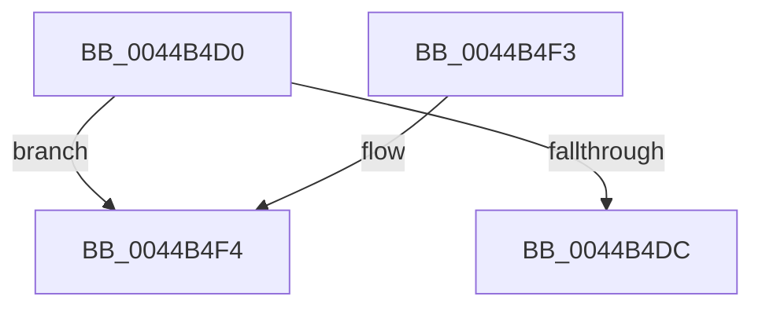

# ExTryConvertPushLockSharedToExclusiveEx

- RVA: `0x0044B4D0`–`0x0044B510` (길이 `64` bytes)
- VA: `0x000000014044B4D0`
- 실행 섹션: `.text`
- PDB 이름 있음: `예`; PDB Function 태그: `아니요`
- unwind 정보 RVA: `0x00068878`
- 디코드: `17`개 명령, `64/64` bytes 표시
- 미해석 바이트: `0` (있으면 어셈블리에 `.byte`로 보존)

> 이 문서는 커널 이미지의 기계어와 PDB 기호를 분석해 생성했습니다. 4번과 5번은 함수 원형과 자료형을 바이너리 사용 방식에서 추정한 C 해석이며 원본 소스 복구 결과는 아닙니다.

## 1. Dependencies

- 직접 호출 지점: **1**; 고유 호출 대상: **1**
- 직접 호출자로 확인된 함수: **0**
- RIP 상대 이미지 참조: **0**

### Outgoing calls
- `0x0044B50A` → [KeBugCheckEx](../4F/KeBugCheckEx_function_004FD660.md) (function, `0x004FD660`)

### Direct callers
- 이 함수 시작 RVA로 연결되는 직접 call은 확인되지 않았습니다. 간접 호출은 완전히 역산할 수 없습니다.

### Static image references
- 디코드된 RIP-relative 메모리 참조가 없습니다.

## 2. Other-region calls and transfers

- 다른 실행 섹션으로 향하는 call: **0**
- 별도 외부 분기/꼬리 이동을 확인하지 못했습니다.

## 3. Assembly (complete function range)

```asm
0044B4D0  48 83 EC 38                     sub rsp, 0x38
0044B4D4  F7 C2 F8 FF FF FF               test edx, 0xfffffff8
0044B4DA  75 18                           jne 0x14044b4f4
0044B4DC  BA 01 00 00 00                  mov edx, 1
0044B4E1  B8 11 00 00 00                  mov eax, 0x11
0044B4E6  F0 48 0F B1 11                  lock cmpxchg qword ptr [rcx], rdx
0044B4EB  0F 94 C0                        sete al
0044B4EE  48 83 C4 38                     add rsp, 0x38
0044B4F2  C3                              ret
0044B4F3  CC                              int3
0044B4F4  4C 8B C1                        mov r8, rcx
0044B4F7  8B D2                           mov edx, edx
0044B4F9  B9 52 01 00 00                  mov ecx, 0x152
0044B4FE  48 C7 44 24 20 00 00 00 00      mov qword ptr [rsp + 0x20], 0
0044B507  45 33 C9                        xor r9d, r9d
0044B50A  E8 51 21 0B 00                  call 0x1404fd660
0044B50F  CC                              int3
```

## 4. C-style interpretation (structured pseudocode)

```c
__int64 __fastcall ExTryConvertPushLockSharedToExclusiveEx(__int64 a1, int a2, __int64 a3, int a4)
{
    __int64 result;
    __int64 v_rsp;
    unsigned __int64 v_stack_p20;

    v_rsp = (v_rsp) - (56);
    if (((a2) & (0xFFFFFFF8ULL)) != 0) goto loc_0044B4F4;
    result = (((a2) & (0xFFFFFFF8ULL)) == 0) ? 1 : 0;
    v_rsp = (v_rsp) + (56);
    return result;
loc_0044B4F4:
    v_stack_p20 = 0;
    a4 = 0;
    result = KeBugCheckEx(338, 1, a1, a4);
    return result;
}
```

## 5. (Beta) C Style

```c
int64_t ExTryConvertPushLockSharedToExclusiveEx(void *Arg1, int32_t Arg2, int64_t Arg3, int32_t Arg4)
{
    uint8_t *arg1 = (uint8_t *)Arg1;

    int64_t result;
    int64_t local_rsp;
    uint64_t v_stack_p20;

    local_rsp = (local_rsp) - (56);
    if (((Arg2) & (0xFFFFFFF8ULL)) != 0) goto loc_0044B4F4;
    result = (((Arg2) & (0xFFFFFFF8ULL)) == 0) ? 1 : 0;
    local_rsp = (local_rsp) + (56);
    return result;
loc_0044B4F4:
    v_stack_p20 = 0;
    Arg4 = 0;
    result = KeBugCheckEx(338, 1, Arg1, Arg4);
    return result;
}
```

### 관측된 메모리 오프셋

구조체 형식이 확인되지 않은 접근은 인자 기준의 오프셋으로만 기록했습니다.

| 기준 인자 | 오프셋 표현 | 폭 (bit) | 접근 |
|---|---:|---:|---|
| `Arg1` | `+ 0x0` | `64` | `R` |

## 6. Execution-region graph

[열기: 2D/3D 그래프와 함수 탐색 컨트롤 패널](../../../control-panel.html?section=text&rva=0x0044B4D0&view=graph)

- 2D 그래프는 위에서 아래로 흐르고, 3D 그래프는 빈 공간을 드래그해 회전합니다. Shift+드래그는 이동, 휠은 확대·축소, 함수 노드 선택은 대상 보고서 이동입니다.

### Static fallback


