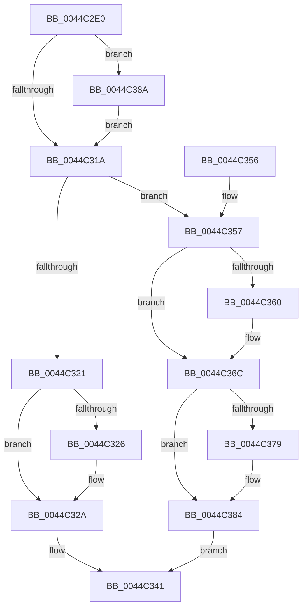

# ExTryToAcquireFastMutex

- RVA: `0x0044C2E0`–`0x0044C397` (길이 `183` bytes)
- VA: `0x000000014044C2E0`
- 실행 섹션: `.text`
- PDB 이름 있음: `예`; PDB Function 태그: `아니요`
- unwind 정보 RVA: `0x000676D8`
- 디코드: `51`개 명령, `183/183` bytes 표시
- 미해석 바이트: `0` (있으면 어셈블리에 `.byte`로 보존)

> 이 문서는 커널 이미지의 기계어와 PDB 기호를 분석해 생성했습니다. 4번과 5번은 함수 원형과 자료형을 바이너리 사용 방식에서 추정한 C 해석이며 원본 소스 복구 결과는 아닙니다.

## 1. Dependencies

- 직접 호출 지점: **4**; 고유 호출 대상: **4**
- 직접 호출자로 확인된 함수: **7**
- RIP 상대 이미지 참조: **1**

### Outgoing calls
- `0x0044C301` → [KeAbPreAcquire](../21/KeAbPreAcquire_function_00210230.md) (function, `0x00210230`)
- `0x0044C367` → [KiLowerIrqlProcessIrqlFlags](../4F/KiLowerIrqlProcessIrqlFlags_function_004F5698.md) (function, `0x004F5698`)
- `0x0044C37F` → [KeAbPostReleaseEx](../26/KeAbPostReleaseEx_function_00262210.md) (function, `0x00262210`)
- `0x0044C390` → [KiRaiseIrqlProcessIrqlFlags](../4F/KiRaiseIrqlProcessIrqlFlags_function_004F56FC.md) (function, `0x004F56FC`)

### Direct callers
- [FsRtlTryToAcquireHeaderMutex](FsRtlTryToAcquireHeaderMutex_function_0044C280.md) at `0x0044C291`
- [KeTryToAcquireGuardedMutex](KeTryToAcquireGuardedMutex_function_0044C2C0.md) at `0x0044C2C4`
- [DifExTryToAcquireFastMutexWrapper](../62/DifExTryToAcquireFastMutexWrapper_function_00623250.md) at `0x0062331D`
- [DifKeTryToAcquireGuardedMutexWrapper](../63/DifKeTryToAcquireGuardedMutexWrapper_function_00632F40.md) at `0x0063300D`
- [sub_00B2D5A6](../../page/B2/Unknown_function_00B2D5A6.md) at `0x00B2D5BA`
- [PopFlushVolumeBlameResolverCallback](../../pagelk/B7/PopFlushVolumeBlameResolverCallback_function_00B70830.md) at `0x00B7084F`
- [CreateMiniNtBootKey](../../init/C1/CreateMiniNtBootKey_function_00C1A840.md) at `0x00C1A9AD`

### Static image references
- `0x0044C311` → RVA `0x00FC6D20` (`ALMOSTRO`; read)

## 2. Other-region calls and transfers

- 다른 실행 섹션으로 향하는 call: **0**
- 별도 외부 분기/꼬리 이동을 확인하지 못했습니다.

## 3. Assembly (complete function range)

```asm
0044C2E0  48 89 5C 24 08                  mov qword ptr [rsp + 8], rbx
0044C2E5  48 89 6C 24 10                  mov qword ptr [rsp + 0x10], rbp
0044C2EA  48 89 74 24 18                  mov qword ptr [rsp + 0x18], rsi
0044C2EF  57                              push rdi
0044C2F0  48 83 EC 20                     sub rsp, 0x20
0044C2F4  BD 01 00 00 00                  mov ebp, 1
0044C2F9  33 D2                           xor edx, edx
0044C2FB  44 8B C5                        mov r8d, ebp
0044C2FE  48 8B D9                        mov rbx, rcx
0044C301  E8 2A 3F DC FF                  call 0x140210230
0044C306  48 8B F8                        mov rdi, rax
0044C309  44 0F 20 C6                     mov rsi, cr8
0044C30D  44 0F 22 C5                     mov cr8, rbp
0044C311  83 3D 08 AA B7 00 00            cmp dword ptr [rip + 0xb7aa08], 0
0044C318  75 70                           jne 0x14044c38a
0044C31A  F0 0F BA 33 00                  lock btr dword ptr [rbx], 0
0044C31F  73 36                           jae 0x14044c357
0044C321  48 85 FF                        test rdi, rdi
0044C324  74 04                           je 0x14044c32a
0044C326  40 88 6F 0A                     mov byte ptr [rdi + 0xa], bpl
0044C32A  65 48 8B 0C 25 88 01 00 00      mov rcx, qword ptr gs:[0x188]
0044C333  40 8A C5                        mov al, bpl
0044C336  48 89 4B 08                     mov qword ptr [rbx + 8], rcx
0044C33A  40 0F B6 CE                     movzx ecx, sil
0044C33E  89 4B 30                        mov dword ptr [rbx + 0x30], ecx
0044C341  48 8B 5C 24 30                  mov rbx, qword ptr [rsp + 0x30]
0044C346  48 8B 6C 24 38                  mov rbp, qword ptr [rsp + 0x38]
0044C34B  48 8B 74 24 40                  mov rsi, qword ptr [rsp + 0x40]
0044C350  48 83 C4 20                     add rsp, 0x20
0044C354  5F                              pop rdi
0044C355  C3                              ret
0044C356  CC                              int3
0044C357  83 3D C2 A9 B7 00 00            cmp dword ptr [rip + 0xb7a9c2], 0
0044C35E  74 0C                           je 0x14044c36c
0044C360  44 0F 20 C1                     mov rcx, cr8
0044C364  40 8A D6                        mov dl, sil
0044C367  E8 2C 93 0A 00                  call 0x1404f5698
0044C36C  40 0F B6 C6                     movzx eax, sil
0044C370  44 0F 22 C0                     mov cr8, rax
0044C374  48 85 FF                        test rdi, rdi
0044C377  74 0B                           je 0x14044c384
0044C379  48 8B D7                        mov rdx, rdi
0044C37C  48 8B CB                        mov rcx, rbx
0044C37F  E8 8C 5E E1 FF                  call 0x140262210
0044C384  F3 90                           pause
0044C386  32 C0                           xor al, al
0044C388  EB B7                           jmp 0x14044c341
0044C38A  40 8A D5                        mov dl, bpl
0044C38D  40 8A CE                        mov cl, sil
0044C390  E8 67 93 0A 00                  call 0x1404f56fc
0044C395  EB 83                           jmp 0x14044c31a
```

## 4. C-style interpretation (structured pseudocode)

```c
__int64 __fastcall ExTryToAcquireFastMutex(__int64 a1, int a2)
{
    __int64 result;
    __int64 v_rsp;
    unsigned __int64 v_stack_p10;
    unsigned __int64 v_stack_p18;
    unsigned __int64 v_stack_p8;

    v_stack_p8 = v_rbx;
    v_stack_p10 = v_rbp;
    v_stack_p18 = v_rsi;
    v_rsp = (v_rsp) - (32);
    a2 = 0;
    result = KeAbPreAcquire(a1, a2, 1, a4);
    if ((*(unsigned int *)(v_rip + 12036616)) != 0) goto loc_0044C38A;
loc_0044C31A:
    if ((*(unsigned int *)(v_rip + 12036616)) >= 0) goto loc_0044C357;
    if (result != 0) {
        *(unsigned __int8 *)(result + 10) = 1;
    }
    *(unsigned __int64 *)(a1 + 8) = *(unsigned __int64 *)(gs_base + (0 + 392));
    *(unsigned int *)(a1 + 48) = (unsigned int)((unsigned __int8)(v_cr8));
loc_0044C341:
    v_rsp = (v_rsp) + (32);
    return 1;
loc_0044C357:
    result = 1;
    if ((*(unsigned int *)(v_rip + 12036546)) != 0) {
        a1 = 1;
        a2 = (unsigned __int8)(v_stack_p18);
        result = KiLowerIrqlProcessIrqlFlags(a1, a2, 1, a4);
    }
    result = (unsigned __int8)(v_stack_p18);
    if (result != 0) {
        a2 = result;
        a1 = v_stack_p8;
        result = KeAbPostReleaseEx(a1, a2, 1, a4);
    }
    result = 0;
    goto loc_0044C341;
loc_0044C38A:
    result = KiRaiseIrqlProcessIrqlFlags((unsigned __int8)(v_stack_p18), (unsigned __int8)(v_stack_p10), 1, a4);
    goto loc_0044C31A;
}
```

## 5. (Beta) C Style

```c
int64_t ExTryToAcquireFastMutex(void *Arg1, int32_t Arg2)
{
    uint8_t *arg1 = (uint8_t *)Arg1;

    int64_t result;
    int64_t local_rsp;
    uint64_t v_stack_p10;
    uint64_t v_stack_p18;
    uint64_t v_stack_p8;

    v_stack_p8 = local_rbx;
    v_stack_p10 = local_rbp;
    v_stack_p18 = local_rsi;
    local_rsp = (local_rsp) - (32);
    Arg2 = 0;
    result = KeAbPreAcquire(Arg1, Arg2, 1, a4);
    if ((*(uint32_t *)(v_rip + 0xB7AA08)) != 0) goto loc_0044C38A;
loc_0044C31A:
    if ((*(uint32_t *)(v_rip + 0xB7AA08)) >= 0) goto loc_0044C357;
    if (result != 0) {
        *(uint8_t *)(result + 0xA) = 1;
    }
    *(uint64_t *)(arg1 + 0x8) = *(uint64_t *)(gs_base + (0 + 0x188));
    *(uint32_t *)(arg1 + 0x30) = (uint32_t)((uint8_t)(v_cr8));
loc_0044C341:
    local_rsp = (local_rsp) + (32);
    return 1;
loc_0044C357:
    result = 1;
    if ((*(uint32_t *)(v_rip + 0xB7A9C2)) != 0) {
        Arg1 = 1;
        Arg2 = (uint8_t)(v_stack_p18);
        result = KiLowerIrqlProcessIrqlFlags(Arg1, Arg2, 1, a4);
    }
    result = (uint8_t)(v_stack_p18);
    if (result != 0) {
        Arg2 = result;
        Arg1 = v_stack_p8;
        result = KeAbPostReleaseEx(Arg1, Arg2, 1, a4);
    }
    result = 0;
    goto loc_0044C341;
loc_0044C38A:
    result = KiRaiseIrqlProcessIrqlFlags((uint8_t)(v_stack_p18), (uint8_t)(v_stack_p10), 1, a4);
    goto loc_0044C31A;
}
```

### 관측된 메모리 오프셋

구조체 형식이 확인되지 않은 접근은 인자 기준의 오프셋으로만 기록했습니다.

| 기준 인자 | 오프셋 표현 | 폭 (bit) | 접근 |
|---|---:|---:|---|
| `Arg1` | `+ 0x0` | `32` | `R/W` |
| `Arg1` | `+ 0x8` | `64` | `W` |
| `Arg1` | `+ 0x30` | `32` | `W` |

## 6. Execution-region graph

[열기: 2D/3D 그래프와 함수 탐색 컨트롤 패널](../../../control-panel.html?section=text&rva=0x0044C2E0&view=graph)

- 2D 그래프는 위에서 아래로 흐르고, 3D 그래프는 빈 공간을 드래그해 회전합니다. Shift+드래그는 이동, 휠은 확대·축소, 함수 노드 선택은 대상 보고서 이동입니다.

### Static fallback


