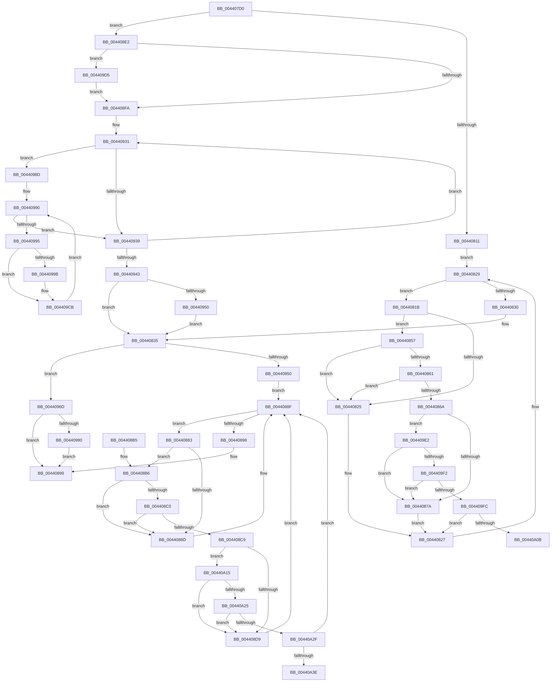

# ExpGetPoolTagInfoTarget

- RVA: `0x004407D0`–`0x00440A48` (길이 `632` bytes)
- VA: `0x00000001404407D0`
- 실행 섹션: `.text`
- PDB 이름 있음: `예`; PDB Function 태그: `예`
- unwind 정보 RVA: `0x000A504C`
- 디코드: `180`개 명령, `632/632` bytes 표시
- 미해석 바이트: `0` (있으면 어셈블리에 `.byte`로 보존)

> 이 문서는 커널 이미지의 기계어와 PDB 기호를 분석해 생성했습니다. 4번과 5번은 함수 원형과 자료형을 바이너리 사용 방식에서 추정한 C 해석이며 원본 소스 복구 결과는 아닙니다.

## 1. Dependencies

- 직접 호출 지점: **10**; 고유 호출 대상: **5**
- 직접 호출자로 확인된 함수: **0**
- RIP 상대 이미지 참조: **6**

### Outgoing calls
- `0x00440861` → [KiCheckVpBackingLongSpinWaitHypercall](../30/KiCheckVpBackingLongSpinWaitHypercall_function_0030F490.md) (function, `0x0030F490`)
- `0x0044086D` → [KeCanUseHaltOnAddress](../4F/KeCanUseHaltOnAddress_function_004FC22C.md) (function, `0x004FC22C`)
- `0x0044087C` → [HvlNotifyLongSpinWait](../30/HvlNotifyLongSpinWait_function_0030F460.md) (function, `0x0030F460`)
- `0x004408C0` → [KiCheckVpBackingLongSpinWaitHypercall](../30/KiCheckVpBackingLongSpinWaitHypercall_function_0030F490.md) (function, `0x0030F490`)
- `0x004408CC` → [KeCanUseHaltOnAddress](../4F/KeCanUseHaltOnAddress_function_004FC22C.md) (function, `0x004FC22C`)
- `0x004408DB` → [HvlNotifyLongSpinWait](../30/HvlNotifyLongSpinWait_function_0030F460.md) (function, `0x0030F460`)
- `0x00440910` → [memcpy](../6C/memcpy_function_006C6840.md) (function, `0x006C6840`)
- `0x00440963` → [memcpy](../6C/memcpy_function_006C6840.md) (function, `0x006C6840`)
- `0x00440983` → [KeWakeAddressAll](../21/KeWakeAddressAll_function_00217C20.md) (function, `0x00217C20`)
- `0x004409D8` → [KeWakeAddressAll](../21/KeWakeAddressAll_function_00217C20.md) (function, `0x00217C20`)

### Direct callers
- 이 함수 시작 RVA로 연결되는 직접 call은 확인되지 않았습니다. 간접 호출은 완전히 역산할 수 없습니다.

### Static image references
- `0x0044081D` → RVA `0x00FC52AC` (`ALMOSTRO`; reference)
- `0x00440857` → RVA `0x00FC6AB8` (`ALMOSTRO`; read)
- `0x004408FE` → RVA `0x00EFAD20` (`.data`; read)
- `0x00440919` → RVA `0x00EFAD28` (`.data`; read)
- `0x00440950` → RVA `0x00EFED40` (`.data`; read)
- `0x004409E2` → RVA `0x00FC6B38` (`ALMOSTRO`; read)

## 2. Other-region calls and transfers

- 다른 실행 섹션으로 향하는 call: **0**
- call이 아닌 외부 분기/꼬리 이동: **2**
  - `0x00440A10` → [sub_006EFA4E](../6E/Unknown_function_006EFA4E.md) (`tail-transfer`)
  - `0x00440A43` → [sub_006EFA4E + 0x43](../6E/Unknown_function_006EFA4E.md) (`tail-transfer`)

## 3. Assembly (complete function range)

```asm
004407D0  48 89 5C 24 08                  mov qword ptr [rsp + 8], rbx
004407D5  48 89 6C 24 18                  mov qword ptr [rsp + 0x18], rbp
004407DA  56                              push rsi
004407DB  57                              push rdi
004407DC  41 54                           push r12
004407DE  41 55                           push r13
004407E0  41 56                           push r14
004407E2  48 83 EC 20                     sub rsp, 0x20
004407E6  49 8B D9                        mov rbx, r9
004407E9  4D 8B E0                        mov r12, r8
004407EC  48 8B F2                        mov rsi, rdx
004407EF  83 C8 FF                        or eax, 0xffffffff
004407F2  F0 41 0F C1 01                  lock xadd dword ptr [r9], eax
004407F7  FF C8                           dec eax
004407F9  41 BD 00 00 00 80               mov r13d, 0x80000000
004407FF  8B F8                           mov edi, eax
00440801  F7 D7                           not edi
00440803  41 23 FD                        and edi, r13d
00440806  A9 FF FF FF 3F                  test eax, 0x3fffffff
0044080B  0F 84 D1 00 00 00               je 0x1404408e2
00440811  41 8B 01                        mov eax, dword ptr [r9]
00440814  33 ED                           xor ebp, ebp
00440816  45 33 F6                        xor r14d, r14d
00440819  EB 0E                           jmp 0x140440829
0044081B  FF C5                           inc ebp
0044081D  85 2D 89 4A B8 00               test dword ptr [rip + 0xb84a89], ebp
00440823  74 32                           je 0x140440857
00440825  F3 90                           pause
00440827  8B 03                           mov eax, dword ptr [rbx]
00440829  41 23 C5                        and eax, r13d
0044082C  3B C7                           cmp eax, edi
0044082E  75 EB                           jne 0x14044081b
00440830  90                              nop
00440831  48 8D 6B 04                     lea rbp, [rbx + 4]
00440835  83 C8 FF                        or eax, 0xffffffff
00440838  F0 0F C1 03                     lock xadd dword ptr [rbx], eax
0044083C  FF C8                           dec eax
0044083E  8B F8                           mov edi, eax
00440840  F7 D7                           not edi
00440842  41 23 FD                        and edi, r13d
00440845  A9 FF FF FF 3F                  test eax, 0x3fffffff
0044084A  0F 84 1D 01 00 00               je 0x14044096d
00440850  33 F6                           xor esi, esi
00440852  45 33 F6                        xor r14d, r14d
00440855  EB 38                           jmp 0x14044088f
00440857  8B 05 5B 62 B8 00               mov eax, dword ptr [rip + 0xb8625b]
0044085D  A8 40                           test al, 0x40
0044085F  74 C4                           je 0x140440825
00440861  E8 2A EC EC FF                  call 0x14030f490
00440866  84 C0                           test al, al
00440868  74 BB                           je 0x140440825
0044086A  41 FF C6                        inc r14d
0044086D  E8 BA B9 0B 00                  call 0x1404fc22c
00440872  84 C0                           test al, al
00440874  0F 85 68 01 00 00               jne 0x1404409e2
0044087A  8B CD                           mov ecx, ebp
0044087C  E8 DF EB EC FF                  call 0x14030f460
00440881  EB A4                           jmp 0x140440827
00440883  FF C6                           inc esi
00440885  85 35 21 4A B8 00               test dword ptr [rip + 0xb84a21], esi
0044088B  74 29                           je 0x1404408b6
0044088D  F3 90                           pause
0044088F  8B 03                           mov eax, dword ptr [rbx]
00440891  41 23 C5                        and eax, r13d
00440894  3B C7                           cmp eax, edi
00440896  75 EB                           jne 0x140440883
00440898  90                              nop
00440899  F0 41 FF 0C 24                  lock dec dword ptr [r12]
0044089E  48 8B 5C 24 50                  mov rbx, qword ptr [rsp + 0x50]
004408A3  48 8B 6C 24 60                  mov rbp, qword ptr [rsp + 0x60]
004408A8  48 83 C4 20                     add rsp, 0x20
004408AC  41 5E                           pop r14
004408AE  41 5D                           pop r13
004408B0  41 5C                           pop r12
004408B2  5F                              pop rdi
004408B3  5E                              pop rsi
004408B4  C3                              ret
004408B5  CC                              int3
004408B6  8B 05 FC 61 B8 00               mov eax, dword ptr [rip + 0xb861fc]
004408BC  A8 40                           test al, 0x40
004408BE  74 CD                           je 0x14044088d
004408C0  E8 CB EB EC FF                  call 0x14030f490
004408C5  84 C0                           test al, al
004408C7  74 C4                           je 0x14044088d
004408C9  41 FF C6                        inc r14d
004408CC  E8 5B B9 0B 00                  call 0x1404fc22c
004408D1  84 C0                           test al, al
004408D3  0F 85 3C 01 00 00               jne 0x140440a15
004408D9  8B CE                           mov ecx, esi
004408DB  E8 80 EB EC FF                  call 0x14030f460
004408E0  EB AD                           jmp 0x14044088f
004408E2  49 8D 69 04                     lea rbp, [r9 + 4]
004408E6  0B 7D 00                        or edi, dword ptr [rbp]
004408E9  41 87 39                        xchg dword ptr [r9], edi
004408EC  89 7C 24 58                     mov dword ptr [rsp + 0x58], edi
004408F0  0F BA E7 1E                     bt edi, 0x1e
004408F4  0F 82 DB 00 00 00               jb 0x1404409d5
004408FA  48 8B 46 08                     mov rax, qword ptr [rsi + 8]
004408FE  48 8B 15 1B A4 AB 00            mov rdx, qword ptr [rip + 0xaba41b]
00440905  48 8B 0E                        mov rcx, qword ptr [rsi]
00440908  4C 8D 04 80                     lea r8, [rax + rax*4]
0044090C  49 C1 E0 04                     shl r8, 4
00440910  E8 2B 5F 28 00                  call 0x1406c6840
00440915  48 8B 46 08                     mov rax, qword ptr [rsi + 8]
00440919  4C 8D 0D 08 A4 AB 00            lea r9, [rip + 0xaba408]
00440920  41 BA FF 07 00 00               mov r10d, 0x7ff
00440926  4C 8D 04 80                     lea r8, [rax + rax*4]
0044092A  49 C1 E0 04                     shl r8, 4
0044092E  4C 03 06                        add r8, qword ptr [rsi]
00440931  49 8B 11                        mov rdx, qword ptr [r9]
00440934  48 85 D2                        test rdx, rdx
00440937  75 54                           jne 0x14044098d
00440939  49 83 C1 08                     add r9, 8
0044093D  49 83 EA 01                     sub r10, 1
00440941  75 EE                           jne 0x140440931
00440943  48 8B 46 18                     mov rax, qword ptr [rsi + 0x18]
00440947  48 85 C0                        test rax, rax
0044094A  0F 84 E5 FE FF FF               je 0x140440835
00440950  48 8B 15 E9 E3 AB 00            mov rdx, qword ptr [rip + 0xabe3e9]
00440957  4C 8D 04 80                     lea r8, [rax + rax*4]
0044095B  48 8B 4E 10                     mov rcx, qword ptr [rsi + 0x10]
0044095F  49 C1 E0 04                     shl r8, 4
00440963  E8 D8 5E 28 00                  call 0x1406c6840
00440968  E9 C8 FE FF FF                  jmp 0x140440835
0044096D  0B 7D 00                        or edi, dword ptr [rbp]
00440970  87 3B                           xchg dword ptr [rbx], edi
00440972  89 7C 24 68                     mov dword ptr [rsp + 0x68], edi
00440976  0F BA E7 1E                     bt edi, 0x1e
0044097A  0F 83 19 FF FF FF               jae 0x140440899
00440980  48 8B CB                        mov rcx, rbx
00440983  E8 98 72 DD FF                  call 0x140217c20
00440988  E9 0C FF FF FF                  jmp 0x140440899
0044098D  48 8B 0E                        mov rcx, qword ptr [rsi]
00440990  49 3B C8                        cmp rcx, r8
00440993  74 A4                           je 0x140440939
00440995  8B 02                           mov eax, dword ptr [rdx]
00440997  85 C0                           test eax, eax
00440999  74 30                           je 0x1404409cb
0044099B  48 8B 42 10                     mov rax, qword ptr [rdx + 0x10]
0044099F  48 01 41 10                     add qword ptr [rcx + 0x10], rax
004409A3  48 8B 42 18                     mov rax, qword ptr [rdx + 0x18]
004409A7  48 01 41 18                     add qword ptr [rcx + 0x18], rax
004409AB  48 8B 42 08                     mov rax, qword ptr [rdx + 8]
004409AF  48 01 41 08                     add qword ptr [rcx + 8], rax
004409B3  48 8B 42 28                     mov rax, qword ptr [rdx + 0x28]
004409B7  48 01 41 28                     add qword ptr [rcx + 0x28], rax
004409BB  48 8B 42 30                     mov rax, qword ptr [rdx + 0x30]
004409BF  48 01 41 30                     add qword ptr [rcx + 0x30], rax
004409C3  48 8B 42 20                     mov rax, qword ptr [rdx + 0x20]
004409C7  48 01 41 20                     add qword ptr [rcx + 0x20], rax
004409CB  48 83 C1 50                     add rcx, 0x50
004409CF  48 83 C2 50                     add rdx, 0x50
004409D3  EB BB                           jmp 0x140440990
004409D5  48 8B CB                        mov rcx, rbx
004409D8  E8 43 72 DD FF                  call 0x140217c20
004409DD  E9 18 FF FF FF                  jmp 0x1404408fa
004409E2  F7 05 4C 61 B8 00 00 00 02 00   test dword ptr [rip + 0xb8614c], 0x20000
004409EC  0F 84 88 FE FF FF               je 0x14044087a
004409F2  41 F6 C6 07                     test r14b, 7
004409F6  0F 85 7E FE FF FF               jne 0x14044087a
004409FC  8B 0B                           mov ecx, dword ptr [rbx]
004409FE  8B C1                           mov eax, ecx
00440A00  41 23 C5                        and eax, r13d
00440A03  3B C7                           cmp eax, edi
00440A05  0F 84 1C FE FF FF               je 0x140440827
00440A0B  8B D1                           mov edx, ecx
00440A0D  44 8B C1                        mov r8d, ecx
00440A10  E9 39 F0 2A 00                  jmp 0x1406efa4e
00440A15  F7 05 19 61 B8 00 00 00 02 00   test dword ptr [rip + 0xb86119], 0x20000
00440A1F  0F 84 B4 FE FF FF               je 0x1404408d9
00440A25  41 F6 C6 07                     test r14b, 7
00440A29  0F 85 AA FE FF FF               jne 0x1404408d9
00440A2F  8B 0B                           mov ecx, dword ptr [rbx]
00440A31  8B C1                           mov eax, ecx
00440A33  41 23 C5                        and eax, r13d
00440A36  3B C7                           cmp eax, edi
00440A38  0F 84 51 FE FF FF               je 0x14044088f
00440A3E  8B D1                           mov edx, ecx
00440A40  44 8B C1                        mov r8d, ecx
00440A43  E9 49 F0 2A 00                  jmp 0x1406efa91
```

## 4. C-style interpretation (structured pseudocode)

```c
__int64 __fastcall ExpGetPoolTagInfoTarget(__int64 a1, __int64 a2, __int64 a3, __int64 a4)
{
    __int64 result;
    __int64 v_r10;
    __int64 v_r14;
    __int64 v_rbp;
    __int64 v_rdi;
    __int64 v_rsi;
    __int64 v_rsp;
    unsigned __int64 v_stack_p18;
    unsigned int v_stack_p58;
    unsigned int v_stack_p68;
    unsigned __int64 v_stack_p8;

    v_stack_p8 = v_rbx;
    v_stack_p18 = v_rbp;
    v_rsp = (v_rsp) - (32);
    result = (unsigned int)((result) | (0xFFFFFFFFULL));
    result = (unsigned int)((result) - 1);
    v_rdi = (unsigned int)(~((unsigned int)((unsigned int)(result))));
    v_rdi = (unsigned int)((v_rdi) & ((unsigned int)((unsigned int)(0x80000000ULL))));
    if ((((unsigned int)(result)) & (0x3FFFFFFFULL)) == 0) goto loc_004408E2;
    v_rbp = 0;
    v_r14 = 0;
    goto loc_00440829;
loc_0044081B:
    v_rbp = (unsigned int)((v_rbp) + 1);
    if (((*(unsigned int *)(v_rip + 12077705)) & ((unsigned int)(v_rbp))) == 0) goto loc_00440857;
loc_00440825:
loc_00440827:
loc_00440829:
    result = (unsigned int)(((unsigned int)(*(unsigned int *)(a4))) & ((unsigned int)((unsigned int)(0x80000000ULL))));
    if (((unsigned int)(result)) != ((unsigned int)(v_rdi))) goto loc_0044081B;
loc_00440835:
    result = (unsigned int)((result) | (0xFFFFFFFFULL));
    result = (unsigned int)((result) - 1);
    v_rdi = (unsigned int)(~((unsigned int)((unsigned int)(result))));
    v_rdi = (unsigned int)((v_rdi) & ((unsigned int)((unsigned int)(0x80000000ULL))));
    if ((((unsigned int)(result)) & (0x3FFFFFFFULL)) == 0) goto loc_0044096D;
    v_rsi = 0;
    v_r14 = 0;
    goto loc_0044088F;
loc_00440857:
    if ((((unsigned __int8)((unsigned int)(*(unsigned int *)(v_rip + 12083803)))) & (64)) == 0) goto loc_00440825;
    result = KiCheckVpBackingLongSpinWaitHypercall(a1, a2, a3, a4);
    if ((unsigned __int8)(result) == 0) goto loc_00440825;
    v_r14 = (unsigned int)((v_r14) + 1);
    result = KeCanUseHaltOnAddress(a1, a2, a3, a4);
    if ((unsigned __int8)(result) != 0) goto loc_004409E2;
loc_0044087A:
    result = HvlNotifyLongSpinWait((unsigned int)((unsigned int)(a4 + 4)), a2, a3, a4);
    goto loc_00440827;
loc_00440883:
    v_rsi = (unsigned int)((v_rsi) + 1);
    if (((*(unsigned int *)(v_rip + 12077601)) & ((unsigned int)(v_rsi))) == 0) goto loc_004408B6;
loc_0044088D:
loc_0044088F:
    result = (unsigned int)(((unsigned int)(*(unsigned int *)(a4))) & ((unsigned int)((unsigned int)(0x80000000ULL))));
    if (((unsigned int)(result)) != ((unsigned int)(v_rdi))) goto loc_00440883;
loc_00440899:
    v_rsp = (v_rsp) + (32);
    return result;
loc_004408B6:
    if ((((unsigned __int8)((unsigned int)(*(unsigned int *)(v_rip + 12083708)))) & (64)) == 0) goto loc_0044088D;
    result = KiCheckVpBackingLongSpinWaitHypercall((unsigned int)((unsigned int)(a4 + 4)), a2, a3, a4);
    if ((unsigned __int8)(result) == 0) goto loc_0044088D;
    v_r14 = (unsigned int)((v_r14) + 1);
    result = KeCanUseHaltOnAddress((unsigned int)((unsigned int)(a4 + 4)), a2, a3, a4);
    if ((unsigned __int8)(result) != 0) goto loc_00440A15;
loc_004408D9:
    result = HvlNotifyLongSpinWait((unsigned int)((unsigned int)(v_rsi)), a2, a3, a4);
    goto loc_0044088F;
loc_004408E2:
    v_rdi = (unsigned int)((v_rdi) | (*(unsigned int *)(a4 + 4)));
    v_stack_p58 = (unsigned int)(v_rdi);
    if (condition_is_below) goto loc_004409D5;
loc_004408FA:
    a3 = (*(unsigned __int64 *)(v_rsi + 8) + *(unsigned __int64 *)(v_rsi + 8) * 4) << (4);
    result = memcpy(*(unsigned __int64 *)(v_rsi), *(unsigned __int64 *)(v_rip + 11248667), a3, a4);
    a3 = (*(unsigned __int64 *)(v_rsi + 8) + *(unsigned __int64 *)(v_rsi + 8) * 4) << (4);
    a3 = (a3) + (*(unsigned __int64 *)(v_rsi));
loc_00440931:
    if (*(unsigned __int64 *)(v_rip + 11248648) != 0) goto loc_0044098D;
loc_00440939:
    a4 = (v_rip + 11248648) + (8);
    v_r10 = ((unsigned int)(0x7FFULL)) - (1);
    if (condition_is_not_equal) goto loc_00440931;
    if (*(unsigned __int64 *)(v_rsi + 24) == 0) goto loc_00440835;
    a3 = (*(unsigned __int64 *)(v_rsi + 24) + *(unsigned __int64 *)(v_rsi + 24) * 4) << (4);
    result = memcpy(*(unsigned __int64 *)(v_rsi + 16), *(unsigned __int64 *)(v_rip + 11265001), a3, a4);
    goto loc_00440835;
loc_0044096D:
    v_rdi = (unsigned int)((v_rdi) | (*(unsigned int *)(a4 + 4)));
    v_stack_p68 = (unsigned int)(v_rdi);
    if (condition_is_above_or_equal) goto loc_00440899;
    result = KeWakeAddressAll(v_stack_p8, *(unsigned __int64 *)(v_rip + 11265001), a3, a4);
    goto loc_00440899;
loc_0044098D:
loc_00440990:
    if ((*(unsigned __int64 *)(v_rsi)) == a3) goto loc_00440939;
    result = (unsigned int)(*(unsigned int *)(*(unsigned __int64 *)(v_rip + 11265001)));
    if ((unsigned int)((unsigned int)(*(unsigned int *)(*(unsigned __int64 *)(v_rip + 11265001)))) != 0) {
        result = *(unsigned __int64 *)(*(unsigned __int64 *)(v_rip + 11265001) + 16);
        result = *(unsigned __int64 *)(*(unsigned __int64 *)(v_rip + 11265001) + 24);
        result = *(unsigned __int64 *)(*(unsigned __int64 *)(v_rip + 11265001) + 8);
        result = *(unsigned __int64 *)(*(unsigned __int64 *)(v_rip + 11265001) + 40);
        result = *(unsigned __int64 *)(*(unsigned __int64 *)(v_rip + 11265001) + 48);
        result = *(unsigned __int64 *)(*(unsigned __int64 *)(v_rip + 11265001) + 32);
    }
    a1 = (*(unsigned __int64 *)(v_rsi)) + (80);
    a2 = (*(unsigned __int64 *)(v_rip + 11265001)) + (80);
    goto loc_00440990;
loc_004409D5:
    result = KeWakeAddressAll(v_stack_p8, a2, a3, a4);
    goto loc_004408FA;
loc_004409E2:
    if (((*(unsigned int *)(v_rip + 12083532)) & (0x20000ULL)) == 0) goto loc_0044087A;
    if ((((unsigned __int8)(v_r14)) & (7)) != 0) goto loc_0044087A;
    result = (unsigned int)(((unsigned int)((unsigned int)((unsigned int)(*(unsigned int *)(v_stack_p8))))) & ((unsigned int)((unsigned int)(0x80000000ULL))));
    if (((unsigned int)(result)) == ((unsigned int)(v_rdi))) goto loc_00440827;
loc_00440A15:
    if (((*(unsigned int *)(v_rip + 12083481)) & (0x20000ULL)) == 0) goto loc_004408D9;
    if ((((unsigned __int8)(v_r14)) & (7)) != 0) goto loc_004408D9;
    result = (unsigned int)(((unsigned int)((unsigned int)((unsigned int)(*(unsigned int *)(v_stack_p8))))) & ((unsigned int)((unsigned int)(0x80000000ULL))));
    if (((unsigned int)(result)) == ((unsigned int)(v_rdi))) goto loc_0044088F;
}
```

## 5. (Beta) C Style

```c
int64_t ExpGetPoolTagInfoTarget(int64_t Arg1, void *Arg2, void *Arg3, void *Arg4)
{
    uint8_t *arg2 = (uint8_t *)Arg2;
    uint8_t *arg3 = (uint8_t *)Arg3;
    uint8_t *arg4 = (uint8_t *)Arg4;

    int64_t result;
    int64_t local_r10;
    int64_t local_r14;
    int64_t local_rbp;
    int64_t local_rdi;
    int64_t local_rsi;
    int64_t local_rsp;
    uint64_t v_stack_p18;
    uint32_t v_stack_p58;
    uint32_t v_stack_p68;
    uint64_t v_stack_p8;

    v_stack_p8 = local_rbx;
    v_stack_p18 = local_rbp;
    local_rsp = (local_rsp) - (32);
    result = (uint32_t)((result) | (0xFFFFFFFFULL));
    result = (uint32_t)((result) - 1);
    local_rdi = (uint32_t)(~((uint32_t)((uint32_t)(result))));
    local_rdi = (uint32_t)((local_rdi) & ((uint32_t)((uint32_t)(0x80000000ULL))));
    if ((((uint32_t)(result)) & (0x3FFFFFFFULL)) == 0) goto loc_004408E2;
    local_rbp = 0;
    local_r14 = 0;
    goto loc_00440829;
loc_0044081B:
    local_rbp = (uint32_t)((local_rbp) + 1);
    if (((*(uint32_t *)(v_rip + 0xB84A89)) & ((uint32_t)(local_rbp))) == 0) goto loc_00440857;
loc_00440825:
loc_00440827:
loc_00440829:
    result = (uint32_t)(((uint32_t)(*(uint32_t *)(arg4))) & ((uint32_t)((uint32_t)(0x80000000ULL))));
    if (((uint32_t)(result)) != ((uint32_t)(local_rdi))) goto loc_0044081B;
loc_00440835:
    result = (uint32_t)((result) | (0xFFFFFFFFULL));
    result = (uint32_t)((result) - 1);
    local_rdi = (uint32_t)(~((uint32_t)((uint32_t)(result))));
    local_rdi = (uint32_t)((local_rdi) & ((uint32_t)((uint32_t)(0x80000000ULL))));
    if ((((uint32_t)(result)) & (0x3FFFFFFFULL)) == 0) goto loc_0044096D;
    local_rsi = 0;
    local_r14 = 0;
    goto loc_0044088F;
loc_00440857:
    if ((((uint8_t)((uint32_t)(*(uint32_t *)(v_rip + 0xB8625B)))) & (64)) == 0) goto loc_00440825;
    result = KiCheckVpBackingLongSpinWaitHypercall(Arg1, Arg2, Arg3, Arg4);
    if ((uint8_t)(result) == 0) goto loc_00440825;
    local_r14 = (uint32_t)((local_r14) + 1);
    result = KeCanUseHaltOnAddress(Arg1, Arg2, Arg3, Arg4);
    if ((uint8_t)(result) != 0) goto loc_004409E2;
loc_0044087A:
    result = HvlNotifyLongSpinWait((uint32_t)((uint32_t)(Arg4 + 4)), Arg2, Arg3, Arg4);
    goto loc_00440827;
loc_00440883:
    local_rsi = (uint32_t)((local_rsi) + 1);
    if (((*(uint32_t *)(v_rip + 0xB84A21)) & ((uint32_t)(local_rsi))) == 0) goto loc_004408B6;
loc_0044088D:
loc_0044088F:
    result = (uint32_t)(((uint32_t)(*(uint32_t *)(arg4))) & ((uint32_t)((uint32_t)(0x80000000ULL))));
    if (((uint32_t)(result)) != ((uint32_t)(local_rdi))) goto loc_00440883;
loc_00440899:
    local_rsp = (local_rsp) + (32);
    return result;
loc_004408B6:
    if ((((uint8_t)((uint32_t)(*(uint32_t *)(v_rip + 0xB861FC)))) & (64)) == 0) goto loc_0044088D;
    result = KiCheckVpBackingLongSpinWaitHypercall((uint32_t)((uint32_t)(Arg4 + 4)), Arg2, Arg3, Arg4);
    if ((uint8_t)(result) == 0) goto loc_0044088D;
    local_r14 = (uint32_t)((local_r14) + 1);
    result = KeCanUseHaltOnAddress((uint32_t)((uint32_t)(Arg4 + 4)), Arg2, Arg3, Arg4);
    if ((uint8_t)(result) != 0) goto loc_00440A15;
loc_004408D9:
    result = HvlNotifyLongSpinWait((uint32_t)((uint32_t)(local_rsi)), Arg2, Arg3, Arg4);
    goto loc_0044088F;
loc_004408E2:
    local_rdi = (uint32_t)((local_rdi) | (*(uint32_t *)(arg4 + 0x4)));
    v_stack_p58 = (uint32_t)(local_rdi);
    if (condition_is_below) goto loc_004409D5;
loc_004408FA:
    Arg3 = (*(uint64_t *)(local_rsi + 0x8) + *(uint64_t *)(local_rsi + 0x8) * 4) << (4);
    result = memcpy(*(uint64_t *)(local_rsi), *(uint64_t *)(v_rip + 0xABA41B), Arg3, Arg4);
    Arg3 = (*(uint64_t *)(local_rsi + 0x8) + *(uint64_t *)(local_rsi + 0x8) * 4) << (4);
    Arg3 = (Arg3) + (*(uint64_t *)(local_rsi));
loc_00440931:
    if (*(uint64_t *)(v_rip + 0xABA408) != 0) goto loc_0044098D;
loc_00440939:
    Arg4 = (v_rip + 11248648) + (8);
    local_r10 = ((uint32_t)(0x7FFULL)) - (1);
    if (condition_is_not_equal) goto loc_00440931;
    if (*(uint64_t *)(local_rsi + 0x18) == 0) goto loc_00440835;
    Arg3 = (*(uint64_t *)(local_rsi + 0x18) + *(uint64_t *)(local_rsi + 0x18) * 4) << (4);
    result = memcpy(*(uint64_t *)(local_rsi + 0x10), *(uint64_t *)(v_rip + 0xABE3E9), Arg3, Arg4);
    goto loc_00440835;
loc_0044096D:
    local_rdi = (uint32_t)((local_rdi) | (*(uint32_t *)(arg4 + 0x4)));
    v_stack_p68 = (uint32_t)(local_rdi);
    if (condition_is_above_or_equal) goto loc_00440899;
    result = KeWakeAddressAll(v_stack_p8, *(uint64_t *)(v_rip + 0xABE3E9), Arg3, Arg4);
    goto loc_00440899;
loc_0044098D:
loc_00440990:
    if ((*(uint64_t *)(local_rsi)) == Arg3) goto loc_00440939;
    result = (uint32_t)(*(uint32_t *)(*(uint64_t *)(v_rip + 0xABE3E9)));
    if ((uint32_t)((uint32_t)(*(uint32_t *)(*(uint64_t *)(v_rip + 0xABE3E9)))) != 0) {
        result = *(uint64_t *)(*(uint64_t *)(v_rip + 0xABE3E9) + 0x10);
        result = *(uint64_t *)(*(uint64_t *)(v_rip + 0xABE3E9) + 0x18);
        result = *(uint64_t *)(*(uint64_t *)(v_rip + 0xABE3E9) + 0x8);
        result = *(uint64_t *)(*(uint64_t *)(v_rip + 0xABE3E9) + 0x28);
        result = *(uint64_t *)(*(uint64_t *)(v_rip + 0xABE3E9) + 0x30);
        result = *(uint64_t *)(*(uint64_t *)(v_rip + 0xABE3E9) + 0x20);
    }
    Arg1 = (*(uint64_t *)(local_rsi)) + (80);
    Arg2 = (*(uint64_t *)(v_rip + 0xABE3E9)) + (80);
    goto loc_00440990;
loc_004409D5:
    result = KeWakeAddressAll(v_stack_p8, Arg2, Arg3, Arg4);
    goto loc_004408FA;
loc_004409E2:
    if (((*(uint32_t *)(v_rip + 0xB8614C)) & (0x20000ULL)) == 0) goto loc_0044087A;
    if ((((uint8_t)(local_r14)) & (7)) != 0) goto loc_0044087A;
    result = (uint32_t)(((uint32_t)((uint32_t)((uint32_t)(*(uint32_t *)(v_stack_p8))))) & ((uint32_t)((uint32_t)(0x80000000ULL))));
    if (((uint32_t)(result)) == ((uint32_t)(local_rdi))) goto loc_00440827;
loc_00440A15:
    if (((*(uint32_t *)(v_rip + 0xB86119)) & (0x20000ULL)) == 0) goto loc_004408D9;
    if ((((uint8_t)(local_r14)) & (7)) != 0) goto loc_004408D9;
    result = (uint32_t)(((uint32_t)((uint32_t)((uint32_t)(*(uint32_t *)(v_stack_p8))))) & ((uint32_t)((uint32_t)(0x80000000ULL))));
    if (((uint32_t)(result)) == ((uint32_t)(local_rdi))) goto loc_0044088F;
}
```

### 관측된 메모리 오프셋

구조체 형식이 확인되지 않은 접근은 인자 기준의 오프셋으로만 기록했습니다.

| 기준 인자 | 오프셋 표현 | 폭 (bit) | 접근 |
|---|---:|---:|---|
| `Arg2` | `+ 0x0` | `64` | `R` |
| `Arg2` | `+ 0x8` | `64` | `R` |
| `Arg2` | `+ 0x10` | `64` | `R` |
| `Arg2` | `+ 0x18` | `64` | `R` |
| `Arg3` | `+ 0x0` | `32` | `R/W` |
| `Arg4` | `+ 0x0` | `32` | `R` |
| `Arg4` | `+ 0x0` | `32` | `R/W` |
| `Arg4` | `+ 0x4` | `64` | `R` |

## 6. Execution-region graph

[열기: 2D/3D 그래프와 함수 탐색 컨트롤 패널](../../../control-panel.html?section=text&rva=0x004407D0&view=graph)

- 2D 그래프는 위에서 아래로 흐르고, 3D 그래프는 빈 공간을 드래그해 회전합니다. Shift+드래그는 이동, 휠은 확대·축소, 함수 노드 선택은 대상 보고서 이동입니다.

### Static fallback


