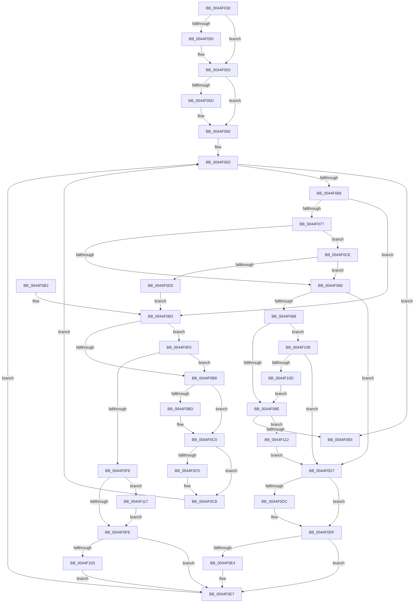

# FsRtlFindFirstOverlappingExclusiveNode

- RVA: `0x0044F030`–`0x0044F11C` (길이 `236` bytes)
- VA: `0x000000014044F030`
- 실행 섹션: `.text`
- PDB 이름 있음: `예`; PDB Function 태그: `아니요`
- unwind 정보 RVA: `0x00098A3C`
- 디코드: `79`개 명령, `236/236` bytes 표시
- 미해석 바이트: `0` (있으면 어셈블리에 `.byte`로 보존)

> 이 문서는 커널 이미지의 기계어와 PDB 기호를 분석해 생성했습니다. 4번과 5번은 함수 원형과 자료형을 바이너리 사용 방식에서 추정한 C 해석이며 원본 소스 복구 결과는 아닙니다.

## 1. Dependencies

- 직접 호출 지점: **0**; 고유 호출 대상: **0**
- 직접 호출자로 확인된 함수: **1**
- RIP 상대 이미지 참조: **0**

### Outgoing calls
- 직접 디코드된 call 명령이 없습니다.

### Direct callers
- [FsRtlGetNextFileLock](../58/FsRtlGetNextFileLock_function_00581850.md) at `0x00581901`

### Static image references
- 디코드된 RIP-relative 메모리 참조가 없습니다.

## 2. Other-region calls and transfers

- 다른 실행 섹션으로 향하는 call: **0**
- 별도 외부 분기/꼬리 이동을 확인하지 못했습니다.

## 3. Assembly (complete function range)

```asm
0044F030  48 8B C4                        mov rax, rsp
0044F033  48 89 58 08                     mov qword ptr [rax + 8], rbx
0044F037  48 89 70 10                     mov qword ptr [rax + 0x10], rsi
0044F03B  48 89 78 18                     mov qword ptr [rax + 0x18], rdi
0044F03F  4C 89 70 20                     mov qword ptr [rax + 0x20], r14
0044F043  33 FF                           xor edi, edi
0044F045  49 8B F0                        mov rsi, r8
0044F048  4C 8B F2                        mov r14, rdx
0044F04B  4D 85 C9                        test r9, r9
0044F04E  74 03                           je 0x14044f053
0044F050  49 21 39                        and qword ptr [r9], rdi
0044F053  48 8B 44 24 28                  mov rax, qword ptr [rsp + 0x28]
0044F058  48 85 C0                        test rax, rax
0044F05B  74 03                           je 0x14044f060
0044F05D  40 88 38                        mov byte ptr [rax], dil
0044F060  45 33 D2                        xor r10d, r10d
0044F063  48 85 C9                        test rcx, rcx
0044F066  74 2B                           je 0x14044f093
0044F068  48 8B 59 40                     mov rbx, qword ptr [rcx + 0x40]
0044F06C  48 8B F9                        mov rdi, rcx
0044F06F  49 8B 16                        mov rdx, qword ptr [r14]
0044F072  48 3B DA                        cmp rbx, rdx
0044F075  72 3C                           jb 0x14044f0b3
0044F077  4C 8B 59 18                     mov r11, qword ptr [rcx + 0x18]
0044F07B  4D 85 DB                        test r11, r11
0044F07E  74 4E                           je 0x14044f0ce
0044F080  4C 8B 06                        mov r8, qword ptr [rsi]
0044F083  4D 3B D8                        cmp r11, r8
0044F086  77 4F                           ja 0x14044f0d7
0044F088  49 83 F8 FF                     cmp r8, -1
0044F08C  74 7A                           je 0x14044f108
0044F08E  4C 3B DA                        cmp r11, rdx
0044F091  77 7F                           ja 0x14044f112
0044F093  48 8B 5C 24 08                  mov rbx, qword ptr [rsp + 8]
0044F098  48 85 C9                        test rcx, rcx
0044F09B  48 8B 74 24 10                  mov rsi, qword ptr [rsp + 0x10]
0044F0A0  4C 8B 74 24 20                  mov r14, qword ptr [rsp + 0x20]
0044F0A5  4C 0F 45 D7                     cmovne r10, rdi
0044F0A9  48 8B 7C 24 18                  mov rdi, qword ptr [rsp + 0x18]
0044F0AE  49 8B C2                        mov rax, r10
0044F0B1  C3                              ret
0044F0B2  CC                              int3
0044F0B3  48 3B 1E                        cmp rbx, qword ptr [rsi]
0044F0B6  74 38                           je 0x14044f0f0
0044F0B8  4D 85 C9                        test r9, r9
0044F0BB  74 03                           je 0x14044f0c0
0044F0BD  49 89 09                        mov qword ptr [r9], rcx
0044F0C0  48 85 C0                        test rax, rax
0044F0C3  74 03                           je 0x14044f0c8
0044F0C5  C6 00 00                        mov byte ptr [rax], 0
0044F0C8  48 8B 49 10                     mov rcx, qword ptr [rcx + 0x10]
0044F0CC  EB 95                           jmp 0x14044f063
0044F0CE  48 83 79 20 00                  cmp qword ptr [rcx + 0x20], 0
0044F0D3  75 AB                           jne 0x14044f080
0044F0D5  EB DC                           jmp 0x14044f0b3
0044F0D7  4D 85 C9                        test r9, r9
0044F0DA  74 03                           je 0x14044f0df
0044F0DC  49 89 09                        mov qword ptr [r9], rcx
0044F0DF  48 85 C0                        test rax, rax
0044F0E2  74 03                           je 0x14044f0e7
0044F0E4  C6 00 01                        mov byte ptr [rax], 1
0044F0E7  48 8B 49 08                     mov rcx, qword ptr [rcx + 8]
0044F0EB  E9 73 FF FF FF                  jmp 0x14044f063
0044F0F0  48 39 51 18                     cmp qword ptr [rcx + 0x18], rdx
0044F0F4  75 C2                           jne 0x14044f0b8
0044F0F6  4C 8B D1                        mov r10, rcx
0044F0F9  4D 85 C9                        test r9, r9
0044F0FC  75 19                           jne 0x14044f117
0044F0FE  48 85 C0                        test rax, rax
0044F101  74 E4                           je 0x14044f0e7
0044F103  C6 00 00                        mov byte ptr [rax], 0
0044F106  EB DF                           jmp 0x14044f0e7
0044F108  48 85 D2                        test rdx, rdx
0044F10B  74 CA                           je 0x14044f0d7
0044F10D  E9 7C FF FF FF                  jmp 0x14044f08e
0044F112  4C 8B D1                        mov r10, rcx
0044F115  EB C0                           jmp 0x14044f0d7
0044F117  49 89 09                        mov qword ptr [r9], rcx
0044F11A  EB E2                           jmp 0x14044f0fe
```

## 4. C-style interpretation (structured pseudocode)

```c
__int64 __fastcall FsRtlFindFirstOverlappingExclusiveNode(__int64 a1, __int64 a2, __int64 a3, __int64 a4, __int64 a5)
{
    __int64 v_r10;
    __int64 v_rdi;
    unsigned __int64 v_stack_p10;
    unsigned __int64 v_stack_p18;
    unsigned __int64 v_stack_p20;
    unsigned __int64 v_stack_p8;

    *(unsigned __int64 *)(v_rsp + 8) = v_rbx;
    *(unsigned __int64 *)(v_rsp + 16) = v_rsi;
    *(unsigned __int64 *)(v_rsp + 24) = v_rdi;
    *(unsigned __int64 *)(v_rsp + 32) = v_r14;
    v_rdi = 0;
    if (a4 != 0) {
    }
    if (a5 != 0) {
        *(unsigned __int8 *)(a5) = 0;
    }
    v_r10 = 0;
loc_0044F063:
    if (a1 == 0) goto loc_0044F093;
    if ((*(unsigned __int64 *)(a1 + 64)) < (*(unsigned __int64 *)(a2))) goto loc_0044F0B3;
    if (*(unsigned __int64 *)(a1 + 24) == 0) goto loc_0044F0CE;
loc_0044F080:
    if ((*(unsigned __int64 *)(a1 + 24)) > (*(unsigned __int64 *)(a3))) goto loc_0044F0D7;
    if ((*(unsigned __int64 *)(a3)) == -1) goto loc_0044F108;
loc_0044F08E:
    if ((*(unsigned __int64 *)(a1 + 24)) > (*(unsigned __int64 *)(a2))) goto loc_0044F112;
loc_0044F093:
    if (a1 != 0) { v_r10 = a1; }
    return v_r10;
loc_0044F0B3:
    if (v_stack_p8 == (*(unsigned __int64 *)(v_stack_p10))) goto loc_0044F0F0;
loc_0044F0B8:
    if (a4 != 0) {
        *(unsigned __int64 *)(a4) = a1;
    }
    if (v_r10 != 0) {
        *(unsigned __int8 *)(v_r10) = 0;
    }
    goto loc_0044F063;
loc_0044F0CE:
    if ((*(unsigned __int64 *)(*(unsigned __int64 *)(a1 + 16) + 32)) != 0) goto loc_0044F080;
    goto loc_0044F0B3;
loc_0044F0D7:
    if (a4 != 0) {
        *(unsigned __int64 *)(a4) = *(unsigned __int64 *)(a1 + 16);
    }
    if (v_r10 != 0) {
        *(unsigned __int8 *)(v_r10) = 1;
    }
    goto loc_0044F063;
loc_0044F0F0:
    if ((*(unsigned __int64 *)(*(unsigned __int64 *)(*(unsigned __int64 *)(a1 + 16) + 8) + 24)) != (*(unsigned __int64 *)(a2))) goto loc_0044F0B8;
    if (a4 != 0) goto loc_0044F117;
loc_0044F0FE:
    if (v_r10 == 0) goto loc_0044F0E7;
    *(unsigned __int8 *)(v_r10) = 0;
    goto loc_0044F0E7;
loc_0044F108:
    if (*(unsigned __int64 *)(a2) == 0) goto loc_0044F0D7;
    goto loc_0044F08E;
loc_0044F112:
    goto loc_0044F0D7;
loc_0044F117:
    *(unsigned __int64 *)(a4) = *(unsigned __int64 *)(*(unsigned __int64 *)(a1 + 16) + 8);
    goto loc_0044F0FE;
}
```

## 5. (Beta) C Style

```c
int64_t FsRtlFindFirstOverlappingExclusiveNode(int64_t Arg1, void *Arg2, void *Arg3, int64_t Arg4, int64_t Arg5)
{
    uint8_t *arg2 = (uint8_t *)Arg2;
    uint8_t *arg3 = (uint8_t *)Arg3;

    int64_t local_r10;
    int64_t local_rdi;
    uint64_t v_stack_p10;
    uint64_t v_stack_p18;
    uint64_t v_stack_p20;
    uint64_t v_stack_p8;

    *(uint64_t *)(local_rsp + 0x8) = local_rbx;
    *(uint64_t *)(local_rsp + 0x10) = local_rsi;
    *(uint64_t *)(local_rsp + 0x18) = local_rdi;
    *(uint64_t *)(local_rsp + 0x20) = local_r14;
    local_rdi = 0;
    if (Arg4 != 0) {
    }
    if (Arg5 != 0) {
        *(uint8_t *)(Arg5) = 0;
    }
    local_r10 = 0;
loc_0044F063:
    if (Arg1 == 0) goto loc_0044F093;
    if ((*(uint64_t *)(Arg1 + 0x40)) < (*(uint64_t *)(arg2))) goto loc_0044F0B3;
    if (*(uint64_t *)(Arg1 + 0x18) == 0) goto loc_0044F0CE;
loc_0044F080:
    if ((*(uint64_t *)(Arg1 + 0x18)) > (*(uint64_t *)(arg3))) goto loc_0044F0D7;
    if ((*(uint64_t *)(arg3)) == -1) goto loc_0044F108;
loc_0044F08E:
    if ((*(uint64_t *)(Arg1 + 0x18)) > (*(uint64_t *)(arg2))) goto loc_0044F112;
loc_0044F093:
    if (Arg1 != 0) { local_r10 = Arg1; }
    return local_r10;
loc_0044F0B3:
    if (v_stack_p8 == (*(uint64_t *)(v_stack_p10))) goto loc_0044F0F0;
loc_0044F0B8:
    if (Arg4 != 0) {
        *(uint64_t *)(Arg4) = Arg1;
    }
    if (local_r10 != 0) {
        *(uint8_t *)(local_r10) = 0;
    }
    goto loc_0044F063;
loc_0044F0CE:
    if ((*(uint64_t *)(*(uint64_t *)(Arg1 + 0x10) + 0x20)) != 0) goto loc_0044F080;
    goto loc_0044F0B3;
loc_0044F0D7:
    if (Arg4 != 0) {
        *(uint64_t *)(Arg4) = *(uint64_t *)(Arg1 + 0x10);
    }
    if (local_r10 != 0) {
        *(uint8_t *)(local_r10) = 1;
    }
    goto loc_0044F063;
loc_0044F0F0:
    if ((*(uint64_t *)(*(uint64_t *)(*(uint64_t *)(Arg1 + 0x10) + 0x8) + 0x18)) != (*(uint64_t *)(arg2))) goto loc_0044F0B8;
    if (Arg4 != 0) goto loc_0044F117;
loc_0044F0FE:
    if (local_r10 == 0) goto loc_0044F0E7;
    *(uint8_t *)(local_r10) = 0;
    goto loc_0044F0E7;
loc_0044F108:
    if (*(uint64_t *)(arg2) == 0) goto loc_0044F0D7;
    goto loc_0044F08E;
loc_0044F112:
    goto loc_0044F0D7;
loc_0044F117:
    *(uint64_t *)(Arg4) = *(uint64_t *)(*(uint64_t *)(Arg1 + 0x10) + 0x8);
    goto loc_0044F0FE;
}
```

### 관측된 메모리 오프셋

구조체 형식이 확인되지 않은 접근은 인자 기준의 오프셋으로만 기록했습니다.

| 기준 인자 | 오프셋 표현 | 폭 (bit) | 접근 |
|---|---:|---:|---|
| `Arg2` | `+ 0x0` | `64` | `R` |
| `Arg3` | `+ 0x0` | `64` | `R` |

## 6. Execution-region graph

[열기: 2D/3D 그래프와 함수 탐색 컨트롤 패널](../../../control-panel.html?section=text&rva=0x0044F030&view=graph)

- 2D 그래프는 위에서 아래로 흐르고, 3D 그래프는 빈 공간을 드래그해 회전합니다. Shift+드래그는 이동, 휠은 확대·축소, 함수 노드 선택은 대상 보고서 이동입니다.

### Static fallback


