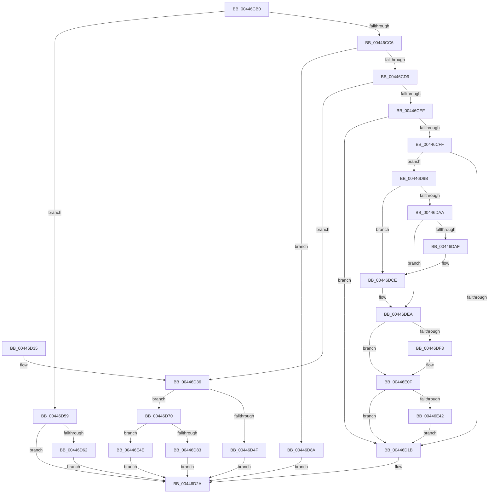

# FsRtlUninitializeBaseMcb

- RVA: `0x00446CB0`–`0x00446E58` (길이 `424` bytes)
- VA: `0x0000000140446CB0`
- 실행 섹션: `.text`
- PDB 이름 있음: `예`; PDB Function 태그: `아니요`
- unwind 정보 RVA: `0x000A5E48`
- 디코드: `100`개 명령, `424/424` bytes 표시
- 미해석 바이트: `0` (있으면 어셈블리에 `.byte`로 보존)

> 이 문서는 커널 이미지의 기계어와 PDB 기호를 분석해 생성했습니다. 4번과 5번은 함수 원형과 자료형을 바이너리 사용 방식에서 추정한 C 해석이며 원본 소스 복구 결과는 아닙니다.

## 1. Dependencies

- 직접 호출 지점: **10**; 고유 호출 대상: **8**
- 직접 호출자로 확인된 함수: **1**
- RIP 상대 이미지 참조: **12**

### Outgoing calls
- `0x00446D25` → [ExpInterlockedPushEntrySList](../6B/ExpInterlockedPushEntrySList_function_006BA5B0.md) (function, `0x006BA5B0`)
- `0x00446D52` → [ExFreePool](../../poolcode/B8/ExFreePool_function_00B82850.md) (function, `0x00B82850`)
- `0x00446D64` → [ExFreePoolWithTag](../../poolcode/B8/ExFreePoolWithTag_function_00B82870.md) (function, `0x00B82870`)
- `0x00446D83` → [AlpcpFreeMessageFunction](../../page/88/AlpcpFreeMessageFunction_function_0088A060.md) (function, `0x0088A060`)
- `0x00446D94` → [ExFreeToNPagedLookasideList](../38/ExFreeToNPagedLookasideList_function_0038D9D0.md) (function, `0x0038D9D0`)
- `0x00446DC8` → [KeBugCheckEx](../4F/KeBugCheckEx_function_004FD660.md) (function, `0x004FD660`)
- `0x00446DE4` → [KeBugCheckEx](../4F/KeBugCheckEx_function_004FD660.md) (function, `0x004FD660`)
- `0x00446E09` → [KeBugCheckEx](../4F/KeBugCheckEx_function_004FD660.md) (function, `0x004FD660`)
- `0x00446E44` → [memset](../6C/memset_function_006C6C40.md) (function, `0x006C6C40`)
- `0x00446E4E` → [guard_dispatch_icall](../6B/guard_dispatch_icall_function_006BAAD0.md) (function, `0x006BAAD0`)

### Direct callers
- [FsRtlUninitializeLargeMcb](FsRtlUninitializeLargeMcb_function_00446C70.md) at `0x00446C95`

### Static image references
- `0x00446CD9` → RVA `0x00E11E1C` (`.data`; read/write)
- `0x00446CDF` → RVA `0x00E11E10` (`.data`; read)
- `0x00446CE6` → RVA `0x00E11E00` (`.data`; read)
- `0x00446CEF` → RVA `0x00475D80` (`CmSiFreeMemory`; read)
- `0x00446CF6` → RVA `0x00E11E38` (`.data`; read)
- `0x00446CFF` → RVA `0x00E11E2C` (`.data`; read)
- `0x00446D0E` → RVA `0x00FCEC68` (`ALMOSTRO`; read)
- `0x00446D36` → RVA `0x00E11E20` (`.data`; read/write)
- `0x00446D3C` → RVA `0x00B82850` (`ExFreePool`; read)
- `0x00446D70` → RVA `0x0088A060` (`AlpcpFreeMessageFunction`; read)
- `0x00446D8D` → RVA `0x00E11D80` (`.data`; read)
- `0x00446E2E` → RVA `0x00FC6ED8` (`ALMOSTRO`; read)

## 2. Other-region calls and transfers

- 다른 실행 섹션으로 향하는 call: **3**
  - `0x00446D52` → [ExFreePool](../../poolcode/B8/ExFreePool_function_00B82850.md) (`.text` → `POOLCODE`)
  - `0x00446D64` → [ExFreePoolWithTag](../../poolcode/B8/ExFreePoolWithTag_function_00B82870.md) (`.text` → `POOLCODE`)
  - `0x00446D83` → [AlpcpFreeMessageFunction](../../page/88/AlpcpFreeMessageFunction_function_0088A060.md) (`.text` → `PAGE`)
- 별도 외부 분기/꼬리 이동을 확인하지 못했습니다.

## 3. Assembly (complete function range)

```asm
00446CB0  48 89 5C 24 08                  mov qword ptr [rsp + 8], rbx
00446CB5  57                              push rdi
00446CB6  48 83 EC 30                     sub rsp, 0x30
00446CBA  83 39 0F                        cmp dword ptr [rcx], 0xf
00446CBD  48 8B F9                        mov rdi, rcx
00446CC0  0F 85 93 00 00 00               jne 0x140446d59
00446CC6  48 8B 59 10                     mov rbx, qword ptr [rcx + 0x10]
00446CCA  BA 01 00 00 00                  mov edx, 1
00446CCF  66 39 51 08                     cmp word ptr [rcx + 8], dx
00446CD3  0F 85 B1 00 00 00               jne 0x140446d8a
00446CD9  01 15 3D B1 9C 00               add dword ptr [rip + 0x9cb13d], edx
00446CDF  0F B7 05 2A B1 9C 00            movzx eax, word ptr [rip + 0x9cb12a]
00446CE6  66 39 05 13 B1 9C 00            cmp word ptr [rip + 0x9cb113], ax
00446CED  73 47                           jae 0x140446d36
00446CEF  48 8D 05 8A F0 02 00            lea rax, [rip + 0x2f08a]
00446CF6  48 39 05 3B B1 9C 00            cmp qword ptr [rip + 0x9cb13b], rax
00446CFD  75 1C                           jne 0x140446d1b
00446CFF  44 8B 05 26 B1 9C 00            mov r8d, dword ptr [rip + 0x9cb126]
00446D06  48 8D 4B 08                     lea rcx, [rbx + 8]
00446D0A  49 83 E8 08                     sub r8, 8
00446D0E  80 3D 53 7F B8 00 00            cmp byte ptr [rip + 0xb87f53], 0
00446D15  0F 85 80 00 00 00               jne 0x140446d9b
00446D1B  48 8B D3                        mov rdx, rbx
00446D1E  48 8D 0D DB B0 9C 00            lea rcx, [rip + 0x9cb0db]
00446D25  E8 86 38 27 00                  call 0x1406ba5b0
00446D2A  48 8B 5C 24 40                  mov rbx, qword ptr [rsp + 0x40]
00446D2F  48 83 C4 30                     add rsp, 0x30
00446D33  5F                              pop rdi
00446D34  C3                              ret
00446D35  CC                              int3
00446D36  01 15 E4 B0 9C 00               add dword ptr [rip + 0x9cb0e4], edx
00446D3C  48 8D 0D 0D BB 73 00            lea rcx, [rip + 0x73bb0d]
00446D43  48 8B 05 EE B0 9C 00            mov rax, qword ptr [rip + 0x9cb0ee]
00446D4A  48 3B C1                        cmp rax, rcx
00446D4D  75 21                           jne 0x140446d70
00446D4F  48 8B CB                        mov rcx, rbx
00446D52  E8 F9 BA 73 00                  call 0x140b82850
00446D57  EB D1                           jmp 0x140446d2a
00446D59  48 8B 49 10                     mov rcx, qword ptr [rcx + 0x10]
00446D5D  48 85 C9                        test rcx, rcx
00446D60  74 C8                           je 0x140446d2a
00446D62  33 D2                           xor edx, edx
00446D64  E8 07 BB 73 00                  call 0x140b82870
00446D69  48 83 67 10 00                  and qword ptr [rdi + 0x10], 0
00446D6E  EB BA                           jmp 0x140446d2a
00446D70  48 8D 0D E9 32 44 00            lea rcx, [rip + 0x4432e9]
00446D77  48 3B C1                        cmp rax, rcx
00446D7A  48 8B CB                        mov rcx, rbx
00446D7D  0F 85 CB 00 00 00               jne 0x140446e4e
00446D83  E8 D8 32 44 00                  call 0x14088a060
00446D88  EB A0                           jmp 0x140446d2a
00446D8A  48 8B D3                        mov rdx, rbx
00446D8D  48 8D 0D EC AF 9C 00            lea rcx, [rip + 0x9cafec]
00446D94  E8 37 6C F4 FF                  call 0x14038d9d0
00446D99  EB 8F                           jmp 0x140446d2a
00446D9B  48 B8 00 00 00 00 00 80 FF FF   movabs rax, 0xffff800000000000
00446DA5  48 3B C8                        cmp rcx, rax
00446DA8  72 24                           jb 0x140446dce
00446DAA  F6 C1 07                        test cl, 7
00446DAD  74 3B                           je 0x140446dea
00446DAF  BA 02 00 00 00                  mov edx, 2
00446DB4  48 C7 44 24 20 08 00 00 00      mov qword ptr [rsp + 0x20], 8
00446DBD  4C 8B C9                        mov r9, rcx
00446DC0  44 8B C2                        mov r8d, edx
00446DC3  B9 F1 01 00 00                  mov ecx, 0x1f1
00446DC8  E8 93 68 0B 00                  call 0x1404fd660
00446DCD  CC                              int3
00446DCE  48 83 64 24 20 00               and qword ptr [rsp + 0x20], 0
00446DD4  4C 8B C9                        mov r9, rcx
00446DD7  4C 8B C2                        mov r8, rdx
00446DDA  B9 F1 01 00 00                  mov ecx, 0x1f1
00446DDF  BA 02 00 00 00                  mov edx, 2
00446DE4  E8 77 68 0B 00                  call 0x1404fd660
00446DE9  CC                              int3
00446DEA  4A 8D 04 01                     lea rax, [rcx + r8]
00446DEE  48 3B C1                        cmp rax, rcx
00446DF1  73 1C                           jae 0x140446e0f
00446DF3  BA 02 00 00 00                  mov edx, 2
00446DF8  4C 89 44 24 20                  mov qword ptr [rsp + 0x20], r8
00446DFD  4C 8B C9                        mov r9, rcx
00446E00  B9 F1 01 00 00                  mov ecx, 0x1f1
00446E05  44 8D 42 01                     lea r8d, [rdx + 1]
00446E09  E8 52 68 0B 00                  call 0x1404fd660
00446E0E  CC                              int3
00446E0F  49 8D 40 FF                     lea rax, [r8 - 1]
00446E13  83 E0 07                        and eax, 7
00446E16  4C 2B C0                        sub r8, rax
00446E19  48 B8 00 00 00 00 00 80 00 00   movabs rax, 0x800000000000
00446E23  48 03 C8                        add rcx, rax
00446E26  49 83 C0 07                     add r8, 7
00446E2A  48 C1 E9 03                     shr rcx, 3
00446E2E  48 03 0D A3 00 B8 00            add rcx, qword ptr [rip + 0xb800a3]
00446E35  49 C1 E8 03                     shr r8, 3
00446E39  4D 85 C0                        test r8, r8
00446E3C  0F 84 D9 FE FF FF               je 0x140446d1b
00446E42  B2 8C                           mov dl, 0x8c
00446E44  E8 F7 FD 27 00                  call 0x1406c6c40
00446E49  E9 CD FE FF FF                  jmp 0x140446d1b
00446E4E  E8 7D 3C 27 00                  call 0x1406baad0
00446E53  E9 D2 FE FF FF                  jmp 0x140446d2a
```

## 4. C-style interpretation (structured pseudocode)

```c
__int64 __fastcall FsRtlUninitializeBaseMcb(__int64 a1)
{
    __int64 result;
    __int64 v_rsp;
    unsigned __int64 v_stack_p20;
    unsigned __int64 v_stack_p8;

    v_stack_p8 = v_rbx;
    v_rsp = (v_rsp) - (48);
    if ((*(unsigned int *)(a1)) != 15) goto loc_00446D59;
    if ((*(unsigned __int16 *)(a1 + 8)) != 1) goto loc_00446D8A;
    if ((*(unsigned __int16 *)(v_rip + 10268947)) >= ((unsigned __int16)(*(unsigned __int16 *)(v_rip + 10268970)))) goto loc_00446D36;
    if ((*(unsigned __int64 *)(v_rip + 10268987)) != (v_rip + 192650)) goto loc_00446D1B;
    a3 = ((unsigned int)(*(unsigned int *)(v_rip + 10268966))) - (8);
    if ((*(unsigned __int8 *)(v_rip + 12091219)) != 0) goto loc_00446D9B;
loc_00446D1B:
    result = ExpInterlockedPushEntrySList(v_rip + 10268891, *(unsigned __int64 *)(a1 + 16), a3, a4);
loc_00446D2A:
    v_rsp = (v_rsp) + (48);
    return result;
loc_00446D36:
    if ((*(unsigned __int64 *)(v_rip + 10268910)) != (v_rip + 7584525)) goto loc_00446D70;
    result = ExFreePool(v_stack_p8, *(unsigned __int64 *)(a1 + 16), a3, a4);
    goto loc_00446D2A;
loc_00446D59:
    if (*(unsigned __int64 *)(v_stack_p8 + 16) == 0) goto loc_00446D2A;
    a2 = 0;
    result = ExFreePoolWithTag(*(unsigned __int64 *)(v_stack_p8 + 16), a2, a3, a4);
    goto loc_00446D2A;
loc_00446D70:
    if (result != (v_rip + 4469481)) goto loc_00446E4E;
    result = AlpcpFreeMessageFunction(v_stack_p8, a2, a3, a4);
    goto loc_00446D2A;
loc_00446D8A:
    result = ExFreeToNPagedLookasideList(v_rip + 10268652, v_stack_p8, a3, a4);
    goto loc_00446D2A;
loc_00446D9B:
    if ((v_rip + 10268652) < result) goto loc_00446DCE;
    if ((((unsigned __int8)(v_rip + 10268652)) & (7)) == 0) goto loc_00446DEA;
    v_stack_p20 = 8;
    result = KeBugCheckEx(497, 2, 2, v_rip + 10268652);
loc_00446DCE:
    result = KeBugCheckEx(497, 2, 2, 497);
loc_00446DEA:
    result = 497 + 2 * 1;
    if ((497 + 2 * 1) < 497) {
        a2 = 2;
        v_stack_p20 = 2;
        a4 = 497;
        a1 = 497;
        a3 = a2 + 1;
        result = KeBugCheckEx(a1, a2, a3, a4);
    }
    result = (unsigned int)((a3 - 1) & (7));
    a3 = (a3) - (result);
    a1 = (a1) + (result);
    a3 = (a3) + (7);
    a1 = (a1) >> (3);
    a1 = (a1) + (*(unsigned __int64 *)(v_rip + 12058787));
    a3 = (a3) >> (3);
    if (a3 == 0) goto loc_00446D1B;
    result = memset(a1, 140, a3, a4);
    goto loc_00446D1B;
loc_00446E4E:
    result = guard_dispatch_icall(a1, 140, a3, a4);
    goto loc_00446D2A;
}
```

## 5. (Beta) C Style

```c
int64_t FsRtlUninitializeBaseMcb(void *Arg1)
{
    uint8_t *arg1 = (uint8_t *)Arg1;

    int64_t result;
    int64_t local_rsp;
    uint64_t v_stack_p20;
    uint64_t v_stack_p8;

    v_stack_p8 = local_rbx;
    local_rsp = (local_rsp) - (48);
    if ((*(uint32_t *)(arg1)) != 15) goto loc_00446D59;
    if ((*(uint16_t *)(arg1 + 0x8)) != 1) goto loc_00446D8A;
    if ((*(uint16_t *)(v_rip + 0x9CB113)) >= ((uint16_t)(*(uint16_t *)(v_rip + 0x9CB12A)))) goto loc_00446D36;
    if ((*(uint64_t *)(v_rip + 0x9CB13B)) != (v_rip + 192650)) goto loc_00446D1B;
    a3 = ((uint32_t)(*(uint32_t *)(v_rip + 0x9CB126))) - (8);
    if ((*(uint8_t *)(v_rip + 0xB87F53)) != 0) goto loc_00446D9B;
loc_00446D1B:
    result = ExpInterlockedPushEntrySList(v_rip + 10268891, *(uint64_t *)(arg1 + 0x10), a3, a4);
loc_00446D2A:
    local_rsp = (local_rsp) + (48);
    return result;
loc_00446D36:
    if ((*(uint64_t *)(v_rip + 0x9CB0EE)) != (v_rip + 7584525)) goto loc_00446D70;
    result = ExFreePool(v_stack_p8, *(uint64_t *)(arg1 + 0x10), a3, a4);
    goto loc_00446D2A;
loc_00446D59:
    if (*(uint64_t *)(v_stack_p8 + 0x10) == 0) goto loc_00446D2A;
    a2 = 0;
    result = ExFreePoolWithTag(*(uint64_t *)(v_stack_p8 + 0x10), a2, a3, a4);
    goto loc_00446D2A;
loc_00446D70:
    if (result != (v_rip + 4469481)) goto loc_00446E4E;
    result = AlpcpFreeMessageFunction(v_stack_p8, a2, a3, a4);
    goto loc_00446D2A;
loc_00446D8A:
    result = ExFreeToNPagedLookasideList(v_rip + 10268652, v_stack_p8, a3, a4);
    goto loc_00446D2A;
loc_00446D9B:
    if ((v_rip + 10268652) < result) goto loc_00446DCE;
    if ((((uint8_t)(v_rip + 10268652)) & (7)) == 0) goto loc_00446DEA;
    v_stack_p20 = 8;
    result = KeBugCheckEx(497, 2, 2, v_rip + 10268652);
loc_00446DCE:
    result = KeBugCheckEx(497, 2, 2, 497);
loc_00446DEA:
    result = 497 + 2 * 1;
    if ((497 + 2 * 1) < 497) {
        a2 = 2;
        v_stack_p20 = 2;
        a4 = 497;
        Arg1 = 497;
        a3 = a2 + 1;
        result = KeBugCheckEx(Arg1, a2, a3, a4);
    }
    result = (uint32_t)((a3 - 1) & (7));
    a3 = (a3) - (result);
    Arg1 = (Arg1) + (result);
    a3 = (a3) + (7);
    Arg1 = (Arg1) >> (3);
    Arg1 = (Arg1) + (*(uint64_t *)(v_rip + 0xB800A3));
    a3 = (a3) >> (3);
    if (a3 == 0) goto loc_00446D1B;
    result = memset(Arg1, 140, a3, a4);
    goto loc_00446D1B;
loc_00446E4E:
    result = guard_dispatch_icall(Arg1, 140, a3, a4);
    goto loc_00446D2A;
}
```

### 관측된 메모리 오프셋

구조체 형식이 확인되지 않은 접근은 인자 기준의 오프셋으로만 기록했습니다.

| 기준 인자 | 오프셋 표현 | 폭 (bit) | 접근 |
|---|---:|---:|---|
| `Arg1` | `+ 0x0` | `32` | `R` |
| `Arg1` | `+ 0x8` | `16` | `R` |
| `Arg1` | `+ 0x10` | `64` | `R` |
| `Arg1` | `+ 0x10` | `64` | `R/W` |

## 6. Execution-region graph

[열기: 2D/3D 그래프와 함수 탐색 컨트롤 패널](../../../control-panel.html?section=text&rva=0x00446CB0&view=graph)

- 2D 그래프는 위에서 아래로 흐르고, 3D 그래프는 빈 공간을 드래그해 회전합니다. Shift+드래그는 이동, 휠은 확대·축소, 함수 노드 선택은 대상 보고서 이동입니다.

### Static fallback


