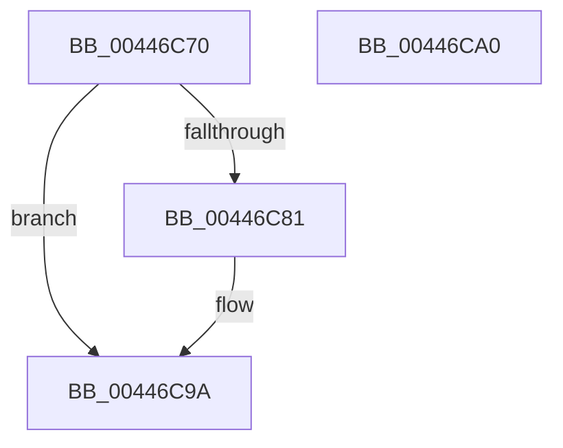

# FsRtlUninitializeLargeMcb

- RVA: `0x00446C70`–`0x00446CA1` (길이 `49` bytes)
- VA: `0x0000000140446C70`
- 실행 섹션: `.text`
- PDB 이름 있음: `예`; PDB Function 태그: `아니요`
- unwind 정보 RVA: `0x0005CF00`
- 디코드: `15`개 명령, `49/49` bytes 표시
- 미해석 바이트: `0` (있으면 어셈블리에 `.byte`로 보존)

> 이 문서는 커널 이미지의 기계어와 PDB 기호를 분석해 생성했습니다. 4번과 5번은 함수 원형과 자료형을 바이너리 사용 방식에서 추정한 C 해석이며 원본 소스 복구 결과는 아닙니다.

## 1. Dependencies

- 직접 호출 지점: **2**; 고유 호출 대상: **2**
- 직접 호출자로 확인된 함수: **1**
- RIP 상대 이미지 참조: **1**

### Outgoing calls
- `0x00446C88` → [ExFreeToNPagedLookasideList](../38/ExFreeToNPagedLookasideList_function_0038D9D0.md) (function, `0x0038D9D0`)
- `0x00446C95` → [FsRtlUninitializeBaseMcb](FsRtlUninitializeBaseMcb_function_00446CB0.md) (function, `0x00446CB0`)

### Direct callers
- [FsRtlUninitializeMcb](../../page/71/FsRtlUninitializeMcb_function_00713F90.md) at `0x00713F94`

### Static image references
- `0x00446C81` → RVA `0x00E11E80` (`.data`; read)

## 2. Other-region calls and transfers

- 다른 실행 섹션으로 향하는 call: **0**
- 별도 외부 분기/꼬리 이동을 확인하지 못했습니다.

## 3. Assembly (complete function range)

```asm
00446C70  40 53                           push rbx
00446C72  48 83 EC 20                     sub rsp, 0x20
00446C76  48 8B 11                        mov rdx, qword ptr [rcx]
00446C79  48 8B D9                        mov rbx, rcx
00446C7C  48 85 D2                        test rdx, rdx
00446C7F  74 19                           je 0x140446c9a
00446C81  48 8D 0D F8 B1 9C 00            lea rcx, [rip + 0x9cb1f8]
00446C88  E8 43 6D F4 FF                  call 0x14038d9d0
00446C8D  48 83 23 00                     and qword ptr [rbx], 0
00446C91  48 8D 4B 08                     lea rcx, [rbx + 8]
00446C95  E8 16 00 00 00                  call 0x140446cb0
00446C9A  48 83 C4 20                     add rsp, 0x20
00446C9E  5B                              pop rbx
00446C9F  C3                              ret
00446CA0  CC                              int3
```

## 4. C-style interpretation (structured pseudocode)

```c
__int64 __fastcall FsRtlUninitializeLargeMcb(__int64 a1)
{
    __int64 result;
    __int64 v_rsp;

    v_rsp = (v_rsp) - (32);
    if (*(unsigned __int64 *)(a1) != 0) {
        a1 = v_rip + 10269176;
        result = ExFreeToNPagedLookasideList(a1, *(unsigned __int64 *)(a1), a3, a4);
        a1 = a1 + 8;
        result = FsRtlUninitializeBaseMcb(a1, *(unsigned __int64 *)(a1), a3, a4);
    }
    v_rsp = (v_rsp) + (32);
    return result;
}
```

## 5. (Beta) C Style

```c
int64_t FsRtlUninitializeLargeMcb(void *Arg1)
{
    uint8_t *arg1 = (uint8_t *)Arg1;

    int64_t result;
    int64_t local_rsp;

    local_rsp = (local_rsp) - (32);
    if (*(uint64_t *)(arg1) != 0) {
        Arg1 = v_rip + 10269176;
        result = ExFreeToNPagedLookasideList(Arg1, *(uint64_t *)(arg1), a3, a4);
        Arg1 = Arg1 + 8;
        result = FsRtlUninitializeBaseMcb(Arg1, *(uint64_t *)(arg1), a3, a4);
    }
    local_rsp = (local_rsp) + (32);
    return result;
}
```

### 관측된 메모리 오프셋

구조체 형식이 확인되지 않은 접근은 인자 기준의 오프셋으로만 기록했습니다.

| 기준 인자 | 오프셋 표현 | 폭 (bit) | 접근 |
|---|---:|---:|---|
| `Arg1` | `+ 0x0` | `64` | `R` |
| `Arg1` | `+ 0x0` | `64` | `R/W` |
| `Arg1` | `+ 0x8` | `64` | `R` |

## 6. Execution-region graph

[열기: 2D/3D 그래프와 함수 탐색 컨트롤 패널](../../../control-panel.html?section=text&rva=0x00446C70&view=graph)

- 2D 그래프는 위에서 아래로 흐르고, 3D 그래프는 빈 공간을 드래그해 회전합니다. Shift+드래그는 이동, 휠은 확대·축소, 함수 노드 선택은 대상 보고서 이동입니다.

### Static fallback


