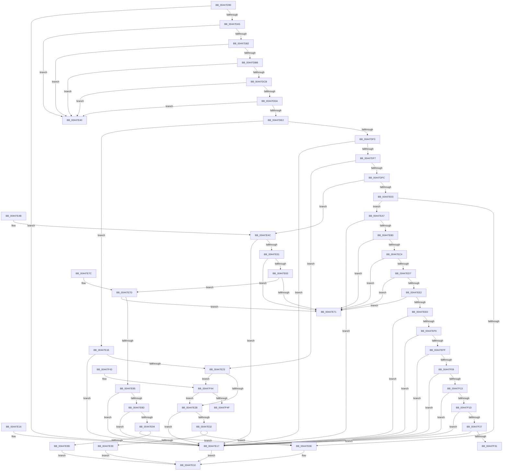

# FsRtlValidateReparsePointBuffer

- RVA: `0x00447D90`–`0x00447F54` (길이 `452` bytes)
- VA: `0x0000000140447D90`
- 실행 섹션: `.text`
- PDB 이름 있음: `예`; PDB Function 태그: `예`
- unwind 정보 RVA: `0x000A5FB0`
- 디코드: `124`개 명령, `452/452` bytes 표시
- 미해석 바이트: `0` (있으면 어셈블리에 `.byte`로 보존)

> 이 문서는 커널 이미지의 기계어와 PDB 기호를 분석해 생성했습니다. 4번과 5번은 함수 원형과 자료형을 바이너리 사용 방식에서 추정한 C 해석이며 원본 소스 복구 결과는 아닙니다.

## 1. Dependencies

- 직접 호출 지점: **0**; 고유 호출 대상: **0**
- 직접 호출자로 확인된 함수: **1**
- RIP 상대 이미지 참조: **0**

### Outgoing calls
- 직접 디코드된 call 명령이 없습니다.

### Direct callers
- [IopValidateJunctionTarget](../../page/71/IopValidateJunctionTarget_function_0071C808.md) at `0x0071C94E`

### Static image references
- 디코드된 RIP-relative 메모리 참조가 없습니다.

## 2. Other-region calls and transfers

- 다른 실행 섹션으로 향하는 call: **0**
- call이 아닌 외부 분기/꼬리 이동: **1**
  - `0x00447F4F` → [sub_006F01F6](../6F/Unknown_function_006F01F6.md) (`tail-transfer`)

## 3. Assembly (complete function range)

```asm
00447D90  48 89 5C 24 08                  mov qword ptr [rsp + 8], rbx
00447D95  8D 41 F8                        lea eax, [rcx - 8]
00447D98  4C 8B CA                        mov r9, rdx
00447D9B  44 8B C1                        mov r8d, ecx
00447D9E  3D F8 3F 00 00                  cmp eax, 0x3ff8
00447DA3  77 72                           ja 0x140447e17
00447DA5  8B 02                           mov eax, dword ptr [rdx]
00447DA7  A9 00 00 FF 0F                  test eax, 0xfff0000
00447DAC  0F 85 8E 00 00 00               jne 0x140447e40
00447DB2  83 F8 02                        cmp eax, 2
00447DB5  0F 86 85 00 00 00               jbe 0x140447e40
00447DBB  8B D0                           mov edx, eax
00447DBD  81 E2 00 00 00 C0               and edx, 0xc0000000
00447DC3  81 FA 00 00 00 40               cmp edx, 0x40000000
00447DC9  74 75                           je 0x140447e40
00447DCB  8B C8                           mov ecx, eax
00447DCD  81 E1 00 00 00 30               and ecx, 0x30000000
00447DD3  3D 19 00 00 A0                  cmp eax, 0xa0000019
00447DD8  74 66                           je 0x140447e40
00447DDA  81 F9 00 00 00 30               cmp ecx, 0x30000000
00447DE0  74 5E                           je 0x140447e40
00447DE2  41 0F B7 49 04                  movzx ecx, word ptr [r9 + 4]
00447DE7  44 8D 51 08                     lea r10d, [rcx + 8]
00447DEB  8D 51 18                        lea edx, [rcx + 0x18]
00447DEE  45 3B D0                        cmp r10d, r8d
00447DF1  75 2B                           jne 0x140447e1e
00447DF3  85 C0                           test eax, eax
00447DF5  79 20                           jns 0x140447e17
00447DF7  41 3B D0                        cmp edx, r8d
00447DFA  74 27                           je 0x140447e23
00447DFC  3D 03 00 00 A0                  cmp eax, 0xa0000003
00447E01  74 49                           je 0x140447e4c
00447E03  3D 0C 00 00 A0                  cmp eax, 0xa000000c
00447E08  0F 84 99 00 00 00               je 0x140447ea7
00447E0E  33 C0                           xor eax, eax
00447E10  48 8B 5C 24 08                  mov rbx, qword ptr [rsp + 8]
00447E15  C3                              ret
00447E16  CC                              int3
00447E17  B8 78 02 00 C0                  mov eax, 0xc0000278
00447E1C  EB F2                           jmp 0x140447e10
00447E1E  41 3B D0                        cmp edx, r8d
00447E21  75 F4                           jne 0x140447e17
00447E23  85 C0                           test eax, eax
00447E25  0F 89 19 01 00 00               jns 0x140447f44
00447E2B  3D 03 00 00 A0                  cmp eax, 0xa0000003
00447E30  74 E5                           je 0x140447e17
00447E32  3D 0C 00 00 A0                  cmp eax, 0xa000000c
00447E37  75 D5                           jne 0x140447e0e
00447E39  B8 78 02 00 C0                  mov eax, 0xc0000278
00447E3E  EB D0                           jmp 0x140447e10
00447E40  B8 76 02 00 C0                  mov eax, 0xc0000276
00447E45  48 8B 5C 24 08                  mov rbx, qword ptr [rsp + 8]
00447E4A  C3                              ret
00447E4B  CC                              int3
00447E4C  83 F9 08                        cmp ecx, 8
00447E4F  72 C6                           jb 0x140447e17
00447E51  41 0F B7 51 0A                  movzx edx, word ptr [r9 + 0xa]
00447E56  0F B7 C2                        movzx eax, dx
00447E59  66 41 03 41 0E                  add ax, word ptr [r9 + 0xe]
00447E5E  66 3B C2                        cmp ax, dx
00447E61  72 0E                           jb 0x140447e71
00447E63  44 0F B7 C0                     movzx r8d, ax
00447E67  41 83 C0 0C                     add r8d, 0xc
00447E6B  41 83 F8 0C                     cmp r8d, 0xc
00447E6F  73 0C                           jae 0x140447e7d
00447E71  B8 95 00 00 C0                  mov eax, 0xc0000095
00447E76  48 8B 5C 24 08                  mov rbx, qword ptr [rsp + 8]
00447E7B  C3                              ret
00447E7C  CC                              int3
00447E7D  8D 42 02                        lea eax, [rdx + 2]
00447E80  66 3B C2                        cmp ax, dx
00447E83  72 EC                           jb 0x140447e71
00447E85  66 41 83 79 08 00               cmp word ptr [r9 + 8], 0
00447E8B  75 8A                           jne 0x140447e17
00447E8D  66 41 39 41 0C                  cmp word ptr [r9 + 0xc], ax
00447E92  75 83                           jne 0x140447e17
00447E94  41 3B C8                        cmp ecx, r8d
00447E97  0F 84 71 FF FF FF               je 0x140447e0e
00447E9D  B8 78 02 00 C0                  mov eax, 0xc0000278
00447EA2  E9 69 FF FF FF                  jmp 0x140447e10
00447EA7  83 F9 0C                        cmp ecx, 0xc
00447EAA  0F 82 67 FF FF FF               jb 0x140447e17
00447EB0  45 0F B7 59 08                  movzx r11d, word ptr [r9 + 8]
00447EB5  45 0F B7 41 0A                  movzx r8d, word ptr [r9 + 0xa]
00447EBA  43 8D 14 03                     lea edx, [r11 + r8]
00447EBE  66 41 3B D3                     cmp dx, r11w
00447EC2  72 AD                           jb 0x140447e71
00447EC4  41 0F B7 49 0C                  movzx ecx, word ptr [r9 + 0xc]
00447EC9  45 0F B7 49 0E                  movzx r9d, word ptr [r9 + 0xe]
00447ECE  42 8D 04 09                     lea eax, [rcx + r9]
00447ED2  66 3B C1                        cmp ax, cx
00447ED5  72 9A                           jb 0x140447e71
00447ED7  0F B7 D8                        movzx ebx, ax
00447EDA  83 C3 14                        add ebx, 0x14
00447EDD  83 FB 14                        cmp ebx, 0x14
00447EE0  72 8F                           jb 0x140447e71
00447EE2  0F B7 C2                        movzx eax, dx
00447EE5  83 C0 14                        add eax, 0x14
00447EE8  83 F8 14                        cmp eax, 0x14
00447EEB  72 84                           jb 0x140447e71
00447EED  44 3B D3                        cmp r10d, ebx
00447EF0  0F 82 21 FF FF FF               jb 0x140447e17
00447EF6  44 3B D0                        cmp r10d, eax
00447EF9  0F 82 18 FF FF FF               jb 0x140447e17
00447EFF  66 45 85 C0                     test r8w, r8w
00447F03  0F 84 0E FF FF FF               je 0x140447e17
00447F09  66 45 85 C9                     test r9w, r9w
00447F0D  0F 84 04 FF FF FF               je 0x140447e17
00447F13  41 F6 C0 01                     test r8b, 1
00447F17  0F 85 FA FE FF FF               jne 0x140447e17
00447F1D  41 F6 C1 01                     test r9b, 1
00447F21  0F 85 F0 FE FF FF               jne 0x140447e17
00447F27  41 F6 C3 01                     test r11b, 1
00447F2B  0F 85 E6 FE FF FF               jne 0x140447e17
00447F31  48 8B 5C 24 08                  mov rbx, qword ptr [rsp + 8]
00447F36  80 E1 01                        and cl, 1
00447F39  F6 D9                           neg cl
00447F3B  1B C0                           sbb eax, eax
00447F3D  25 78 02 00 C0                  and eax, 0xc0000278
00447F42  C3                              ret
00447F43  CC                              int3
00447F44  41 83 79 08 00                  cmp dword ptr [r9 + 8], 0
00447F49  0F 85 DC FE FF FF               jne 0x140447e2b
00447F4F  E9 A2 82 2A 00                  jmp 0x1406f01f6
```

## 4. C-style interpretation (structured pseudocode)

```c
__int64 __fastcall FsRtlValidateReparsePointBuffer(__int64 a1, __int64 a2)
{
    __int64 result;
    __int64 v_rbx;
    unsigned __int64 v_stack_p8;

    v_stack_p8 = v_rbx;
    if (((unsigned int)(a1 - 8)) > 0x3FF8ULL) goto loc_00447E17;
    if ((((unsigned int)((unsigned int)(*(unsigned int *)(a2)))) & (0xFFF0000ULL)) != 0) goto loc_00447E40;
    if (((unsigned int)((unsigned int)(*(unsigned int *)(a2)))) <= 2) goto loc_00447E40;
    a2 = (unsigned int)(((unsigned int)((unsigned int)((unsigned int)(*(unsigned int *)(a2))))) & (0xC0000000ULL));
    if (((unsigned int)(a2)) == 0x40000000ULL) goto loc_00447E40;
    a1 = (unsigned int)(((unsigned int)((unsigned int)((unsigned int)(*(unsigned int *)(a2))))) & (0x30000000ULL));
    if (((unsigned int)((unsigned int)(*(unsigned int *)(a2)))) == 0xA0000019ULL) goto loc_00447E40;
    if (((unsigned int)(a1)) == 0x30000000ULL) goto loc_00447E40;
    if (((unsigned int)(*(unsigned __int16 *)(a2 + 4) + 8)) != ((unsigned int)((unsigned int)((unsigned int)(a1))))) goto loc_00447E1E;
    if (!sign_flag) goto loc_00447E17;
    if (((unsigned int)(*(unsigned __int16 *)(a2 + 4) + 24)) == ((unsigned int)((unsigned int)((unsigned int)(a1))))) goto loc_00447E23;
    if (((unsigned int)((unsigned int)(*(unsigned int *)(a2)))) == 0xA0000003ULL) goto loc_00447E4C;
    if (((unsigned int)((unsigned int)(*(unsigned int *)(a2)))) == 0xA000000CULL) goto loc_00447EA7;
loc_00447E0E:
    result = 0;
loc_00447E10:
    return result;
loc_00447E17:
    goto loc_00447E10;
loc_00447E1E:
    if (((unsigned int)(*(unsigned __int16 *)(a2 + 4) + 24)) != ((unsigned int)((unsigned int)((unsigned int)(a1))))) goto loc_00447E17;
loc_00447E23:
    if (!sign_flag) goto loc_00447F44;
loc_00447E2B:
    if (((unsigned int)((unsigned int)(0xC0000278ULL))) == 0xA0000003ULL) goto loc_00447E17;
    if (((unsigned int)((unsigned int)(0xC0000278ULL))) != 0xA000000CULL) goto loc_00447E0E;
    goto loc_00447E10;
loc_00447E40:
    return (unsigned int)(0xC0000276ULL);
loc_00447E4C:
    if (((unsigned int)(*(unsigned __int16 *)(a2 + 4))) < 8) goto loc_00447E17;
    result = (unsigned __int16)(((unsigned __int16)(*(unsigned __int16 *)(a2 + 10))) + (*(unsigned __int16 *)(a2 + 14)));
    if (((unsigned __int16)(result)) < ((unsigned __int16)(*(unsigned __int16 *)(a2 + 10)))) goto loc_00447E71;
    a3 = (unsigned int)(((unsigned __int16)(result)) + (12));
    if (((unsigned int)(a3)) >= 12) goto loc_00447E7D;
loc_00447E71:
    return (unsigned int)(0xC0000095ULL);
loc_00447E7D:
    if (((unsigned __int16)(*(unsigned __int16 *)(a2 + 10) + 2)) < ((unsigned __int16)(*(unsigned __int16 *)(a2 + 10)))) goto loc_00447E71;
    if ((*(unsigned __int16 *)(a2 + 8)) != 0) goto loc_00447E17;
    if ((*(unsigned __int16 *)(a2 + 12)) != ((unsigned __int16)(*(unsigned __int16 *)(a2 + 10) + 2))) goto loc_00447E17;
    if (((unsigned int)(*(unsigned __int16 *)(a2 + 4))) == ((unsigned int)(a3))) goto loc_00447E0E;
    goto loc_00447E10;
loc_00447EA7:
    if (((unsigned int)(*(unsigned __int16 *)(a2 + 4))) < 12) goto loc_00447E17;
    if (((unsigned __int16)(*(unsigned __int16 *)(a2 + 8) + *(unsigned __int16 *)(a2 + 10) * 1)) < ((unsigned __int16)(*(unsigned __int16 *)(a2 + 8)))) goto loc_00447E71;
    if (((unsigned __int16)(*(unsigned __int16 *)(a2 + 12) + *(unsigned __int16 *)(a2 + 14) * 1)) < ((unsigned __int16)(*(unsigned __int16 *)(a2 + 12)))) goto loc_00447E71;
    v_rbx = (unsigned int)(((unsigned __int16)(*(unsigned __int16 *)(a2 + 12) + *(unsigned __int16 *)(a2 + 14) * 1)) + (20));
    if (((unsigned int)(v_rbx)) < 20) goto loc_00447E71;
    result = (unsigned int)(((unsigned __int16)(*(unsigned __int16 *)(a2 + 8) + *(unsigned __int16 *)(a2 + 10) * 1)) + (20));
    if (((unsigned int)(result)) < 20) goto loc_00447E71;
    if (((unsigned int)(*(unsigned __int16 *)(a2 + 4) + 8)) < ((unsigned int)(v_rbx))) goto loc_00447E17;
    if (((unsigned int)(*(unsigned __int16 *)(a2 + 4) + 8)) < ((unsigned int)(result))) goto loc_00447E17;
    if ((unsigned __int16)(*(unsigned __int16 *)(a2 + 10)) == 0) goto loc_00447E17;
    if ((unsigned __int16)(*(unsigned __int16 *)(a2 + 14)) == 0) goto loc_00447E17;
    if ((((unsigned __int8)(*(unsigned __int16 *)(a2 + 10))) & (1)) != 0) goto loc_00447E17;
    if ((((unsigned __int8)(*(unsigned __int16 *)(a2 + 14))) & (1)) != 0) goto loc_00447E17;
    if ((((unsigned __int8)(*(unsigned __int16 *)(a2 + 8))) & (1)) != 0) goto loc_00447E17;
    a1 = (unsigned __int8)((*(unsigned __int16 *)(a2 + 12)) & (1));
    a1 = (unsigned __int8)(-(a1));
    result = (unsigned int)((result) & (0xC0000278ULL));
    return result;
loc_00447F44:
    if ((*(unsigned int *)(*(unsigned __int16 *)(a2 + 14) + 8)) != 0) goto loc_00447E2B;
}
```

## 5. (Beta) C Style

```c
int64_t FsRtlValidateReparsePointBuffer(void *Arg1, void *Arg2)
{
    uint8_t *arg1 = (uint8_t *)Arg1;
    uint8_t *arg2 = (uint8_t *)Arg2;

    int64_t result;
    int64_t local_rbx;
    uint64_t v_stack_p8;

    v_stack_p8 = local_rbx;
    if (((uint32_t)(Arg1 - 8)) > 0x3FF8ULL) goto loc_00447E17;
    if ((((uint32_t)((uint32_t)(*(uint32_t *)(arg2)))) & (0xFFF0000ULL)) != 0) goto loc_00447E40;
    if (((uint32_t)((uint32_t)(*(uint32_t *)(arg2)))) <= 2) goto loc_00447E40;
    Arg2 = (uint32_t)(((uint32_t)((uint32_t)((uint32_t)(*(uint32_t *)(arg2))))) & (0xC0000000ULL));
    if (((uint32_t)(Arg2)) == 0x40000000ULL) goto loc_00447E40;
    Arg1 = (uint32_t)(((uint32_t)((uint32_t)((uint32_t)(*(uint32_t *)(arg2))))) & (0x30000000ULL));
    if (((uint32_t)((uint32_t)(*(uint32_t *)(arg2)))) == 0xA0000019ULL) goto loc_00447E40;
    if (((uint32_t)(Arg1)) == 0x30000000ULL) goto loc_00447E40;
    if (((uint32_t)(*(uint16_t *)(arg2 + 0x4) + 8)) != ((uint32_t)((uint32_t)((uint32_t)(Arg1))))) goto loc_00447E1E;
    if (!sign_flag) goto loc_00447E17;
    if (((uint32_t)(*(uint16_t *)(arg2 + 0x4) + 24)) == ((uint32_t)((uint32_t)((uint32_t)(Arg1))))) goto loc_00447E23;
    if (((uint32_t)((uint32_t)(*(uint32_t *)(arg2)))) == 0xA0000003ULL) goto loc_00447E4C;
    if (((uint32_t)((uint32_t)(*(uint32_t *)(arg2)))) == 0xA000000CULL) goto loc_00447EA7;
loc_00447E0E:
    result = 0;
loc_00447E10:
    return result;
loc_00447E17:
    goto loc_00447E10;
loc_00447E1E:
    if (((uint32_t)(*(uint16_t *)(arg2 + 0x4) + 24)) != ((uint32_t)((uint32_t)((uint32_t)(Arg1))))) goto loc_00447E17;
loc_00447E23:
    if (!sign_flag) goto loc_00447F44;
loc_00447E2B:
    if (((uint32_t)((uint32_t)(0xC0000278ULL))) == 0xA0000003ULL) goto loc_00447E17;
    if (((uint32_t)((uint32_t)(0xC0000278ULL))) != 0xA000000CULL) goto loc_00447E0E;
    goto loc_00447E10;
loc_00447E40:
    return (uint32_t)(0xC0000276ULL);
loc_00447E4C:
    if (((uint32_t)(*(uint16_t *)(arg2 + 0x4))) < 8) goto loc_00447E17;
    result = (uint16_t)(((uint16_t)(*(uint16_t *)(arg2 + 0xA))) + (*(uint16_t *)(arg2 + 0xE)));
    if (((uint16_t)(result)) < ((uint16_t)(*(uint16_t *)(arg2 + 0xA)))) goto loc_00447E71;
    a3 = (uint32_t)(((uint16_t)(result)) + (12));
    if (((uint32_t)(a3)) >= 12) goto loc_00447E7D;
loc_00447E71:
    return (uint32_t)(0xC0000095ULL);
loc_00447E7D:
    if (((uint16_t)(*(uint16_t *)(arg2 + 0xA) + 2)) < ((uint16_t)(*(uint16_t *)(arg2 + 0xA)))) goto loc_00447E71;
    if ((*(uint16_t *)(arg2 + 0x8)) != 0) goto loc_00447E17;
    if ((*(uint16_t *)(arg2 + 0xC)) != ((uint16_t)(*(uint16_t *)(arg2 + 0xA) + 2))) goto loc_00447E17;
    if (((uint32_t)(*(uint16_t *)(arg2 + 0x4))) == ((uint32_t)(a3))) goto loc_00447E0E;
    goto loc_00447E10;
loc_00447EA7:
    if (((uint32_t)(*(uint16_t *)(arg2 + 0x4))) < 12) goto loc_00447E17;
    if (((uint16_t)(*(uint16_t *)(arg2 + 0x8) + *(uint16_t *)(arg2 + 0xA) * 1)) < ((uint16_t)(*(uint16_t *)(arg2 + 0x8)))) goto loc_00447E71;
    if (((uint16_t)(*(uint16_t *)(arg2 + 0xC) + *(uint16_t *)(arg2 + 0xE) * 1)) < ((uint16_t)(*(uint16_t *)(arg2 + 0xC)))) goto loc_00447E71;
    local_rbx = (uint32_t)(((uint16_t)(*(uint16_t *)(arg2 + 0xC) + *(uint16_t *)(arg2 + 0xE) * 1)) + (20));
    if (((uint32_t)(local_rbx)) < 20) goto loc_00447E71;
    result = (uint32_t)(((uint16_t)(*(uint16_t *)(arg2 + 0x8) + *(uint16_t *)(arg2 + 0xA) * 1)) + (20));
    if (((uint32_t)(result)) < 20) goto loc_00447E71;
    if (((uint32_t)(*(uint16_t *)(arg2 + 0x4) + 8)) < ((uint32_t)(local_rbx))) goto loc_00447E17;
    if (((uint32_t)(*(uint16_t *)(arg2 + 0x4) + 8)) < ((uint32_t)(result))) goto loc_00447E17;
    if ((uint16_t)(*(uint16_t *)(arg2 + 0xA)) == 0) goto loc_00447E17;
    if ((uint16_t)(*(uint16_t *)(arg2 + 0xE)) == 0) goto loc_00447E17;
    if ((((uint8_t)(*(uint16_t *)(arg2 + 0xA))) & (1)) != 0) goto loc_00447E17;
    if ((((uint8_t)(*(uint16_t *)(arg2 + 0xE))) & (1)) != 0) goto loc_00447E17;
    if ((((uint8_t)(*(uint16_t *)(arg2 + 0x8))) & (1)) != 0) goto loc_00447E17;
    Arg1 = (uint8_t)((*(uint16_t *)(arg2 + 0xC)) & (1));
    Arg1 = (uint8_t)(-(Arg1));
    result = (uint32_t)((result) & (0xC0000278ULL));
    return result;
loc_00447F44:
    if ((*(uint32_t *)(*(uint16_t *)(arg2 + 0xE) + 0x8)) != 0) goto loc_00447E2B;
}
```

### 관측된 메모리 오프셋

구조체 형식이 확인되지 않은 접근은 인자 기준의 오프셋으로만 기록했습니다.

| 기준 인자 | 오프셋 표현 | 폭 (bit) | 접근 |
|---|---:|---:|---|
| `Arg1` | `- 0x8` | `32` | `R` |
| `Arg2` | `+ 0x0` | `32` | `R` |
| `Arg2` | `+ 0x4` | `16` | `R` |
| `Arg2` | `+ 0x8` | `16` | `R` |
| `Arg2` | `+ 0x8` | `32` | `R` |
| `Arg2` | `+ 0xA` | `16` | `R` |
| `Arg2` | `+ 0xC` | `16` | `R` |
| `Arg2` | `+ 0xE` | `16` | `R` |

## 6. Execution-region graph

[열기: 2D/3D 그래프와 함수 탐색 컨트롤 패널](../../../control-panel.html?section=text&rva=0x00447D90&view=graph)

- 2D 그래프는 위에서 아래로 흐르고, 3D 그래프는 빈 공간을 드래그해 회전합니다. Shift+드래그는 이동, 휠은 확대·축소, 함수 노드 선택은 대상 보고서 이동입니다.

### Static fallback


