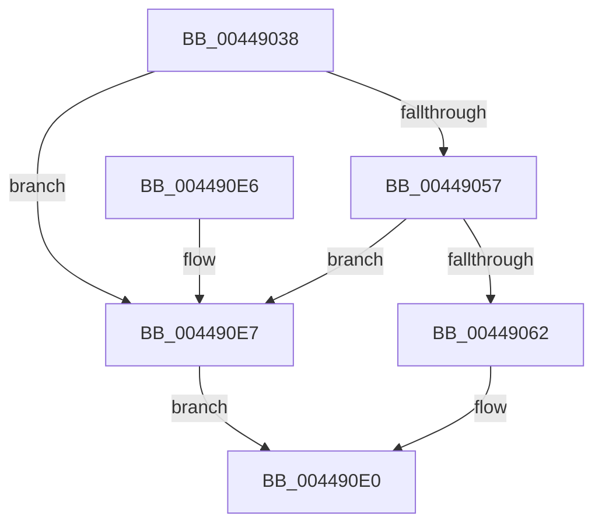

# HalEfiSetEnvironmentVariable

- RVA: `0x00449038`–`0x004490EE` (길이 `182` bytes)
- VA: `0x0000000140449038`
- 실행 섹션: `.text`
- PDB 이름 있음: `예`; PDB Function 태그: `아니요`
- unwind 정보 RVA: `0x0008474C`
- 디코드: `39`개 명령, `182/182` bytes 표시
- 미해석 바이트: `0` (있으면 어셈블리에 `.byte`로 보존)

> 이 문서는 커널 이미지의 기계어와 PDB 기호를 분석해 생성했습니다. 4번과 5번은 함수 원형과 자료형을 바이너리 사용 방식에서 추정한 C 해석이며 원본 소스 복구 결과는 아닙니다.

## 1. Dependencies

- 직접 호출 지점: **3**; 고유 호출 대상: **3**
- 직접 호출자로 확인된 함수: **1**
- RIP 상대 이미지 참조: **4**

### Outgoing calls
- `0x00449083` → [HalpEfiStartRuntimeCode](HalpEfiStartRuntimeCode_function_00449714.md) (function, `0x00449714`)
- `0x004490A6` → `indirect target` (indirect, 간접 대상)
- `0x004490DB` → [HalpConvertEfiToNtStatus](HalpConvertEfiToNtStatus_function_0044976C.md) (function, `0x0044976C`)

### Direct callers
- [HalSetEnvironmentVariableEx](HalSetEnvironmentVariableEx_function_00448EB0.md) at `0x00448FC1`
- [HalSetEnvironmentVariableEx](HalSetEnvironmentVariableEx_function_00448EB0.md) at `0x00448FDE`

### Static image references
- `0x0044903E` → RVA `0x01200010` (`CFGRO`; read)
- `0x00449062` → RVA `0x00FC1C30` (`.data`; read/write)
- `0x00449069` → RVA `0x00FC1C3C` (`.data`; read/write)
- `0x00449077` → RVA `0x00FC1C24` (`.data`; read/write)

## 2. Other-region calls and transfers

- 다른 실행 섹션으로 향하는 call: **0**
- 별도 외부 분기/꼬리 이동을 확인하지 못했습니다.

## 3. Assembly (complete function range)

```asm
00449038  40 53                           push rbx
0044903A  48 83 EC 30                     sub rsp, 0x30
0044903E  48 8B 05 CB 6F DB 00            mov rax, qword ptr [rip + 0xdb6fcb]
00449045  45 8B D0                        mov r10d, r8d
00449048  4C 8B DA                        mov r11, rdx
0044904B  48 8B D9                        mov rbx, rcx
0044904E  48 85 C0                        test rax, rax
00449051  0F 84 90 00 00 00               je 0x1404490e7
00449057  48 83 78 28 00                  cmp qword ptr [rax + 0x28], 0
0044905C  0F 84 85 00 00 00               je 0x1404490e7
00449062  F0 FF 05 C7 8B B7 00            lock inc dword ptr [rip + 0xb78bc7]
00449069  F0 FF 05 CC 8B B7 00            lock inc dword ptr [rip + 0xb78bcc]
00449070  F0 FF 05 B9 8B B7 00            lock inc dword ptr [rip + 0xb78bb9]
00449077  F0 FF 05 A6 8B B7 00            lock inc dword ptr [rip + 0xb78ba6]
0044907E  B9 20 00 00 00                  mov ecx, 0x20
00449083  E8 8C 06 00 00                  call 0x140449714
00449088  48 8B 05 81 6F DB 00            mov rax, qword ptr [rip + 0xdb6f81]
0044908F  45 8B C2                        mov r8d, r10d
00449092  48 8B 4C 24 60                  mov rcx, qword ptr [rsp + 0x60]
00449097  49 8B D3                        mov rdx, r11
0044909A  48 89 4C 24 20                  mov qword ptr [rsp + 0x20], rcx
0044909F  48 8B CB                        mov rcx, rbx
004490A2  48 8B 40 28                     mov rax, qword ptr [rax + 0x28]
004490A6  FF D0                           call rax
004490A8  0F 1F 00                        nop dword ptr [rax]
004490AB  65 48 8B 0C 25 18 00 00 00      mov rcx, qword ptr gs:[0x18]
004490B4  F0 83 A1 E0 00 00 00 DF         lock and dword ptr [rcx + 0xe0], 0xffffffdf
004490BC  F0 FF 0D 6D 8B B7 00            lock dec dword ptr [rip + 0xb78b6d]
004490C3  48 8B C8                        mov rcx, rax
004490C6  F0 FF 0D 57 8B B7 00            lock dec dword ptr [rip + 0xb78b57]
004490CD  F0 FF 0D 5C 8B B7 00            lock dec dword ptr [rip + 0xb78b5c]
004490D4  F0 FF 0D 61 8B B7 00            lock dec dword ptr [rip + 0xb78b61]
004490DB  E8 8C 06 00 00                  call 0x14044976c
004490E0  48 83 C4 30                     add rsp, 0x30
004490E4  5B                              pop rbx
004490E5  C3                              ret
004490E6  CC                              int3
004490E7  B8 02 00 00 C0                  mov eax, 0xc0000002
004490EC  EB F2                           jmp 0x1404490e0
```

## 4. C-style interpretation (structured pseudocode)

```c
__int64 __fastcall HalEfiSetEnvironmentVariable(__int64 a1, __int64 a2, int a3, __int64 a4, __int64 a5)
{
    __int64 result;
    __int64 v_rsp;
    unsigned __int64 v_stack_m18;

    v_rsp = (v_rsp) - (48);
    if (*(unsigned __int64 *)(v_rip + 14381003) == 0) goto loc_004490E7;
    if ((*(unsigned __int64 *)(*(unsigned __int64 *)(v_rip + 14381003) + 40)) == 0) goto loc_004490E7;
    result = HalpEfiStartRuntimeCode(32, a2, a3, a4);
    v_stack_m18 = a5;
    result = kernel_indirect_call(a1, a2, (unsigned int)((unsigned int)((unsigned int)(a3))), a4);
    result = HalpConvertEfiToNtStatus(result, a2, (unsigned int)((unsigned int)((unsigned int)(a3))), a4);
loc_004490E0:
    v_rsp = (v_rsp) + (48);
    return result;
loc_004490E7:
    goto loc_004490E0;
}
```

## 5. (Beta) C Style

```c
int64_t HalEfiSetEnvironmentVariable(int64_t Arg1, int64_t Arg2, int32_t Arg3, int64_t Arg4, int64_t Arg5)
{
    int64_t result;
    int64_t local_rsp;
    uint64_t v_stack_m18;

    local_rsp = (local_rsp) - (48);
    if (*(uint64_t *)(v_rip + 0xDB6FCB) == 0) goto loc_004490E7;
    if ((*(uint64_t *)(*(uint64_t *)(v_rip + 0xDB6FCB) + 0x28)) == 0) goto loc_004490E7;
    result = HalpEfiStartRuntimeCode(32, Arg2, Arg3, Arg4);
    v_stack_m18 = Arg5;
    result = kernel_indirect_call(Arg1, Arg2, (uint32_t)((uint32_t)((uint32_t)(Arg3))), Arg4);
    result = HalpConvertEfiToNtStatus(result, Arg2, (uint32_t)((uint32_t)((uint32_t)(Arg3))), Arg4);
loc_004490E0:
    local_rsp = (local_rsp) + (48);
    return result;
loc_004490E7:
    goto loc_004490E0;
}
```

## 6. Execution-region graph

[열기: 2D/3D 그래프와 함수 탐색 컨트롤 패널](../../../control-panel.html?section=text&rva=0x00449038&view=graph)

- 2D 그래프는 위에서 아래로 흐르고, 3D 그래프는 빈 공간을 드래그해 회전합니다. Shift+드래그는 이동, 휠은 확대·축소, 함수 노드 선택은 대상 보고서 이동입니다.

### Static fallback


