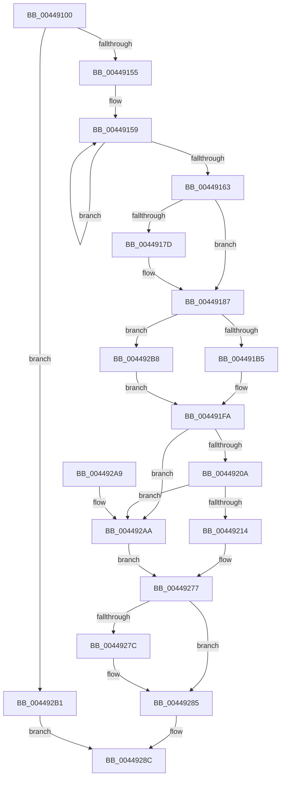

# HalGetEnvironmentVariableEx

- RVA: `0x00449100`–`0x004492C0` (길이 `448` bytes)
- VA: `0x0000000140449100`
- 실행 섹션: `.text`
- PDB 이름 있음: `예`; PDB Function 태그: `아니요`
- unwind 정보 RVA: `0x000A6334`
- 디코드: `121`개 명령, `448/448` bytes 표시
- 미해석 바이트: `0` (있으면 어셈블리에 `.byte`로 보존)

> 이 문서는 커널 이미지의 기계어와 PDB 기호를 분석해 생성했습니다. 4번과 5번은 함수 원형과 자료형을 바이너리 사용 방식에서 추정한 C 해석이며 원본 소스 복구 결과는 아닙니다.

## 1. Dependencies

- 직접 호출 지점: **8**; 고유 호출 대상: **8**
- 직접 호출자로 확인된 함수: **5**
- RIP 상대 이미지 참조: **6**

### Outgoing calls
- `0x0044918E` → [_chkstk](../6B/_chkstk_function_006BA960.md) (function, `0x006BA960`)
- `0x0044919E` → [wcscpy_s](../50/wcscpy_s_function_005064B0.md) (function, `0x005064B0`)
- `0x004491F5` → [KeSetSystemGroupAffinityThread](../39/KeSetSystemGroupAffinityThread_function_00399140.md) (function, `0x00399140`)
- `0x00449227` → [HalpEfiStartRuntimeCode](HalpEfiStartRuntimeCode_function_00449714.md) (function, `0x00449714`)
- `0x00449249` → `indirect target` (indirect, 간접 대상)
- `0x00449270` → [HalpConvertEfiToNtStatus](HalpConvertEfiToNtStatus_function_0044976C.md) (function, `0x0044976C`)
- `0x00449280` → [KeRevertToUserGroupAffinityThread](../39/KeRevertToUserGroupAffinityThread_function_00398EC0.md) (function, `0x00398EC0`)
- `0x00449293` → [_security_check_cookie](../6A/_security_check_cookie_function_006AC640.md) (function, `0x006AC640`)

### Direct callers
- [IoSaveInitialBugCheckProgress](../59/IoSaveInitialBugCheckProgress_function_00593020.md) at `0x005930F4`
- [WheapProcessEfiBadMemoryPage](../65/WheapProcessEfiBadMemoryPage_function_0065DEAC.md) at `0x0065DEDB`
- [NtQueryDriverEntryOrder](../../page/7C/NtQueryDriverEntryOrder_function_007CDCE0.md) at `0x007CDE48`
- [IopGetEnvironmentVariableHal](../../page/A7/IopGetEnvironmentVariableHal_function_00A77350.md) at `0x00A7736E`
- [PopSetMemoryOverwriteRequestAction](../../pagelk/B6/PopSetMemoryOverwriteRequestAction_function_00B6BE14.md) at `0x00B6BE7B`

### Static image references
- `0x00449116` → RVA `0x00E0A740` (`.data`; read)
- `0x0044912E` → RVA `0x00FC1A28` (`.data`; read)
- `0x004491C6` → RVA `0x00F231B0` (`.data`; read)
- `0x004491FA` → RVA `0x01200010` (`CFGRO`; read)
- `0x00449214` → RVA `0x00FC1C30` (`.data`; read/write)
- `0x0044921B` → RVA `0x00FC1C3C` (`.data`; read/write)

## 2. Other-region calls and transfers

- 다른 실행 섹션으로 향하는 call: **0**
- 별도 외부 분기/꼬리 이동을 확인하지 못했습니다.

## 3. Assembly (complete function range)

```asm
00449100  40 55                           push rbp
00449102  53                              push rbx
00449103  56                              push rsi
00449104  57                              push rdi
00449105  41 54                           push r12
00449107  41 55                           push r13
00449109  41 56                           push r14
0044910B  41 57                           push r15
0044910D  48 83 EC 68                     sub rsp, 0x68
00449111  48 8D 6C 24 30                  lea rbp, [rsp + 0x30]
00449116  48 8B 05 23 16 9C 00            mov rax, qword ptr [rip + 0x9c1623]
0044911D  48 33 C5                        xor rax, rbp
00449120  48 89 45 28                     mov qword ptr [rbp + 0x28], rax
00449124  4C 8B A5 A0 00 00 00            mov r12, qword ptr [rbp + 0xa0]
0044912B  45 33 ED                        xor r13d, r13d
0044912E  44 38 2D F3 88 B7 00            cmp byte ptr [rip + 0xb788f3], r13b
00449135  0F 57 C0                        xorps xmm0, xmm0
00449138  0F 57 C9                        xorps xmm1, xmm1
0044913B  4D 8B F8                        mov r15, r8
0044913E  49 8B F1                        mov rsi, r9
00449141  4C 8B F2                        mov r14, rdx
00449144  4C 8B C1                        mov r8, rcx
00449147  0F 11 45 08                     movups xmmword ptr [rbp + 8], xmm0
0044914B  0F 11 4D 18                     movups xmmword ptr [rbp + 0x18], xmm1
0044914F  0F 84 5C 01 00 00               je 0x1404492b1
00449155  48 83 C8 FF                     or rax, 0xffffffffffffffff
00449159  48 FF C0                        inc rax
0044915C  66 44 39 2C 41                  cmp word ptr [rcx + rax*2], r13w
00449161  75 F6                           jne 0x140449159
00449163  FF C0                           inc eax
00449165  B9 00 01 00 00                  mov ecx, 0x100
0044916A  3B C1                           cmp eax, ecx
0044916C  0F 43 C1                        cmovae eax, ecx
0044916F  8B D0                           mov edx, eax
00449171  48 03 C0                        add rax, rax
00449174  48 8D 48 0F                     lea rcx, [rax + 0xf]
00449178  48 3B C8                        cmp rcx, rax
0044917B  77 0A                           ja 0x140449187
0044917D  48 B9 F0 FF FF FF FF FF FF 0F   movabs rcx, 0xffffffffffffff0
00449187  48 83 E1 F0                     and rcx, 0xfffffffffffffff0
0044918B  48 8B C1                        mov rax, rcx
0044918E  E8 CD 17 27 00                  call 0x1406ba960
00449193  48 2B E1                        sub rsp, rcx
00449196  48 8D 5C 24 30                  lea rbx, [rsp + 0x30]
0044919B  48 8B CB                        mov rcx, rbx
0044919E  E8 0D D3 0B 00                  call 0x1405064b0
004491A3  8B 06                           mov eax, dword ptr [rsi]
004491A5  48 89 45 00                     mov qword ptr [rbp], rax
004491A9  44 0F 20 C0                     mov rax, cr8
004491AD  3C 02                           cmp al, 2
004491AF  0F 83 03 01 00 00               jae 0x1404492b8
004491B5  65 8B 04 25 A4 01 00 00         mov eax, dword ptr gs:[0x1a4]
004491BD  48 8D 55 18                     lea rdx, [rbp + 0x18]
004491C1  8B C8                           mov ecx, eax
004491C3  40 B7 01                        mov dil, 1
004491C6  48 8B 05 E3 9F AD 00            mov rax, qword ptr [rip + 0xad9fe3]
004491CD  8B 0C 88                        mov ecx, dword ptr [rax + rcx*4]
004491D0  33 C0                           xor eax, eax
004491D2  89 45 12                        mov dword ptr [rbp + 0x12], eax
004491D5  66 89 45 16                     mov word ptr [rbp + 0x16], ax
004491D9  8B C1                           mov eax, ecx
004491DB  C1 E8 06                        shr eax, 6
004491DE  83 E1 3F                        and ecx, 0x3f
004491E1  66 89 45 10                     mov word ptr [rbp + 0x10], ax
004491E5  B8 01 00 00 00                  mov eax, 1
004491EA  48 D3 E0                        shl rax, cl
004491ED  48 8D 4D 08                     lea rcx, [rbp + 8]
004491F1  48 89 45 08                     mov qword ptr [rbp + 8], rax
004491F5  E8 46 FF F4 FF                  call 0x140399140
004491FA  48 8B 05 0F 6E DB 00            mov rax, qword ptr [rip + 0xdb6e0f]
00449201  48 85 C0                        test rax, rax
00449204  0F 84 A0 00 00 00               je 0x1404492aa
0044920A  4C 39 68 18                     cmp qword ptr [rax + 0x18], r13
0044920E  0F 84 96 00 00 00               je 0x1404492aa
00449214  F0 FF 05 15 8A B7 00            lock inc dword ptr [rip + 0xb78a15]
0044921B  F0 FF 05 1A 8A B7 00            lock inc dword ptr [rip + 0xb78a1a]
00449222  B9 08 00 00 00                  mov ecx, 8
00449227  E8 E8 04 00 00                  call 0x140449714
0044922C  48 8B 05 DD 6D DB 00            mov rax, qword ptr [rip + 0xdb6ddd]
00449233  4C 8D 4D 00                     lea r9, [rbp]
00449237  4D 8B C4                        mov r8, r12
0044923A  4C 89 7C 24 20                  mov qword ptr [rsp + 0x20], r15
0044923F  49 8B D6                        mov rdx, r14
00449242  48 8B CB                        mov rcx, rbx
00449245  48 8B 40 18                     mov rax, qword ptr [rax + 0x18]
00449249  FF D0                           call rax
0044924B  0F 1F 00                        nop dword ptr [rax]
0044924E  65 48 8B 0C 25 18 00 00 00      mov rcx, qword ptr gs:[0x18]
00449257  F0 83 A1 E0 00 00 00 F7         lock and dword ptr [rcx + 0xe0], 0xfffffff7
0044925F  F0 FF 0D CA 89 B7 00            lock dec dword ptr [rip + 0xb789ca]
00449266  48 8B C8                        mov rcx, rax
00449269  F0 FF 0D CC 89 B7 00            lock dec dword ptr [rip + 0xb789cc]
00449270  E8 F7 04 00 00                  call 0x14044976c
00449275  8B D8                           mov ebx, eax
00449277  40 84 FF                        test dil, dil
0044927A  74 09                           je 0x140449285
0044927C  48 8D 4D 18                     lea rcx, [rbp + 0x18]
00449280  E8 3B FC F4 FF                  call 0x140398ec0
00449285  8B 45 00                        mov eax, dword ptr [rbp]
00449288  89 06                           mov dword ptr [rsi], eax
0044928A  8B C3                           mov eax, ebx
0044928C  48 8B 4D 28                     mov rcx, qword ptr [rbp + 0x28]
00449290  48 33 CD                        xor rcx, rbp
00449293  E8 A8 33 26 00                  call 0x1406ac640
00449298  48 8D 65 38                     lea rsp, [rbp + 0x38]
0044929C  41 5F                           pop r15
0044929E  41 5E                           pop r14
004492A0  41 5D                           pop r13
004492A2  41 5C                           pop r12
004492A4  5F                              pop rdi
004492A5  5E                              pop rsi
004492A6  5B                              pop rbx
004492A7  5D                              pop rbp
004492A8  C3                              ret
004492A9  CC                              int3
004492AA  BB 02 00 00 C0                  mov ebx, 0xc0000002
004492AF  EB C6                           jmp 0x140449277
004492B1  B8 02 00 00 C0                  mov eax, 0xc0000002
004492B6  EB D4                           jmp 0x14044928c
004492B8  41 8A FD                        mov dil, r13b
004492BB  E9 3A FF FF FF                  jmp 0x1404491fa
```

## 4. C-style interpretation (structured pseudocode)

```c
__int64 __fastcall HalGetEnvironmentVariableEx(__int64 a1, __int64 a2, __int64 a3, __int64 a4, __int64 a5)
{
    __int64 result;
    __int64 v_r13;
    __int64 v_rsp;
    unsigned __int64 v_stack_m40;
    unsigned __int64 v_stack_m50;
    unsigned __int64 v_stack_m60;
    unsigned __int16 v_stack_m62;
    unsigned int v_stack_m66;
    unsigned __int16 v_stack_m68;
    unsigned __int64 v_stack_m70;
    unsigned __int64 v_stack_m78;
    unsigned __int64 v_stack_m88;

    v_rsp = (v_rsp) - (104);
    result = (*(unsigned __int64 *)(v_rip + 10229283)) ^ (v_stack_m78);
    v_stack_m50 = result;
    v_r13 = 0;
    v_stack_m70 = v_xmm0;
    v_stack_m60 = v_xmm1;
    if ((*(unsigned __int8 *)(v_rip + 12028147)) == 0) goto loc_004492B1;
    result = (result) | (-1);
loc_00449159:
    result = (result) + 1;
    if ((*(unsigned __int16 *)(a1 + result * 2)) != 0) goto loc_00449159;
    result = (unsigned int)((result) + 1);
    if (((unsigned int)(result)) >= 256) { result = 256; }
    result = (result) + (result);
    if ((result + 15) <= result) {
    }
    a1 = (result + 15) & (-16);
    result = _chkstk(a1, (unsigned int)((unsigned int)(result)), a1, a4);
    v_rsp = (v_rsp) - (a1);
    result = wcscpy_s(v_stack_m78, (unsigned int)((unsigned int)(result)), a1, a4);
    v_stack_m78 = (unsigned int)(*(unsigned int *)(a4));
    if (((unsigned __int8)(v_cr8)) >= 2) goto loc_004492B8;
    result = 0;
    v_stack_m66 = 0;
    v_stack_m62 = 0;
    result = (unsigned int)(((unsigned int)((unsigned int)((unsigned int)(*(unsigned int *)(*(unsigned __int64 *)(v_rip + 11378659) + (unsigned int)((unsigned int)((unsigned int)(*(unsigned int *)(gs_base + (0 + 420))))) * 4))))) >> (6));
    a1 = (unsigned int)(((unsigned int)(*(unsigned int *)(*(unsigned __int64 *)(v_rip + 11378659) + (unsigned int)((unsigned int)((unsigned int)(*(unsigned int *)(gs_base + (0 + 420))))) * 4))) & (63));
    v_stack_m68 = (unsigned __int16)(result);
    result = (1) << ((unsigned __int8)(a1));
    v_stack_m70 = result;
    result = KeSetSystemGroupAffinityThread(v_stack_m70, v_stack_m60, a1, a4);
loc_004491FA:
    if (*(unsigned __int64 *)(v_rip + 14380559) == 0) goto loc_004492AA;
    if ((*(unsigned __int64 *)(*(unsigned __int64 *)(v_rip + 14380559) + 24)) == 0) goto loc_004492AA;
    result = HalpEfiStartRuntimeCode(8, v_stack_m60, a1, a4);
    v_stack_m88 = a3;
    result = kernel_indirect_call(v_stack_m78, a2, a5, v_stack_m78);
    result = HalpConvertEfiToNtStatus(result, a2, a5, v_stack_m78);
loc_00449277:
    if (1 != 0) {
        a1 = v_stack_m60;
        result = KeRevertToUserGroupAffinityThread(a1, a2, a5, v_stack_m78);
    }
    *(unsigned int *)(a4) = (unsigned int)((unsigned int)(v_stack_m78));
loc_0044928C:
    a1 = (v_stack_m50) ^ (v_stack_m78);
    result = _security_check_cookie(a1, a2, a5, v_stack_m78);
    return result;
loc_004492AA:
    goto loc_00449277;
loc_004492B1:
    goto loc_0044928C;
loc_004492B8:
    goto loc_004491FA;
}
```

## 5. (Beta) C Style

```c
int64_t HalGetEnvironmentVariableEx(void *Arg1, int64_t Arg2, int64_t Arg3, void *Arg4, int64_t Arg5)
{
    uint8_t *arg1 = (uint8_t *)Arg1;
    uint8_t *arg4 = (uint8_t *)Arg4;

    int64_t result;
    int64_t local_r13;
    int64_t local_rsp;
    uint64_t v_stack_m40;
    uint64_t v_stack_m50;
    uint64_t v_stack_m60;
    uint16_t v_stack_m62;
    uint32_t v_stack_m66;
    uint16_t v_stack_m68;
    uint64_t v_stack_m70;
    uint64_t v_stack_m78;
    uint64_t v_stack_m88;

    local_rsp = (local_rsp) - (104);
    result = (*(uint64_t *)(v_rip + 0x9C1623)) ^ (v_stack_m78);
    v_stack_m50 = result;
    local_r13 = 0;
    v_stack_m70 = v_xmm0;
    v_stack_m60 = v_xmm1;
    if ((*(uint8_t *)(v_rip + 0xB788F3)) == 0) goto loc_004492B1;
    result = (result) | (-1);
loc_00449159:
    result = (result) + 1;
    if ((*(uint16_t *)(arg1 + result * 2)) != 0) goto loc_00449159;
    result = (uint32_t)((result) + 1);
    if (((uint32_t)(result)) >= 256) { result = 256; }
    result = (result) + (result);
    if ((result + 15) <= result) {
    }
    Arg1 = (result + 15) & (-16);
    result = _chkstk(Arg1, (uint32_t)((uint32_t)(result)), Arg1, Arg4);
    local_rsp = (local_rsp) - (Arg1);
    result = wcscpy_s(v_stack_m78, (uint32_t)((uint32_t)(result)), Arg1, Arg4);
    v_stack_m78 = (uint32_t)(*(uint32_t *)(arg4));
    if (((uint8_t)(v_cr8)) >= 2) goto loc_004492B8;
    result = 0;
    v_stack_m66 = 0;
    v_stack_m62 = 0;
    result = (uint32_t)(((uint32_t)((uint32_t)((uint32_t)(*(uint32_t *)(*(uint64_t *)(v_rip + 0xAD9FE3) + (uint32_t)((uint32_t)((uint32_t)(*(uint32_t *)(gs_base + (0 + 0x1A4))))) * 4))))) >> (6));
    Arg1 = (uint32_t)(((uint32_t)(*(uint32_t *)(*(uint64_t *)(v_rip + 0xAD9FE3) + (uint32_t)((uint32_t)((uint32_t)(*(uint32_t *)(gs_base + (0 + 0x1A4))))) * 4))) & (63));
    v_stack_m68 = (uint16_t)(result);
    result = (1) << ((uint8_t)(Arg1));
    v_stack_m70 = result;
    result = KeSetSystemGroupAffinityThread(v_stack_m70, v_stack_m60, Arg1, Arg4);
loc_004491FA:
    if (*(uint64_t *)(v_rip + 0xDB6E0F) == 0) goto loc_004492AA;
    if ((*(uint64_t *)(*(uint64_t *)(v_rip + 0xDB6E0F) + 0x18)) == 0) goto loc_004492AA;
    result = HalpEfiStartRuntimeCode(8, v_stack_m60, Arg1, Arg4);
    v_stack_m88 = Arg3;
    result = kernel_indirect_call(v_stack_m78, Arg2, Arg5, v_stack_m78);
    result = HalpConvertEfiToNtStatus(result, Arg2, Arg5, v_stack_m78);
loc_00449277:
    if (1 != 0) {
        Arg1 = v_stack_m60;
        result = KeRevertToUserGroupAffinityThread(Arg1, Arg2, Arg5, v_stack_m78);
    }
    *(uint32_t *)(arg4) = (uint32_t)((uint32_t)(v_stack_m78));
loc_0044928C:
    Arg1 = (v_stack_m50) ^ (v_stack_m78);
    result = _security_check_cookie(Arg1, Arg2, Arg5, v_stack_m78);
    return result;
loc_004492AA:
    goto loc_00449277;
loc_004492B1:
    goto loc_0044928C;
loc_004492B8:
    goto loc_004491FA;
}
```

### 관측된 메모리 오프셋

구조체 형식이 확인되지 않은 접근은 인자 기준의 오프셋으로만 기록했습니다.

| 기준 인자 | 오프셋 표현 | 폭 (bit) | 접근 |
|---|---:|---:|---|
| `Arg1` | `+ 0x0 + rax*2` | `16` | `R` |
| `Arg4` | `+ 0x0` | `32` | `R` |
| `Arg4` | `+ 0x0` | `32` | `W` |

## 6. Execution-region graph

[열기: 2D/3D 그래프와 함수 탐색 컨트롤 패널](../../../control-panel.html?section=text&rva=0x00449100&view=graph)

- 2D 그래프는 위에서 아래로 흐르고, 3D 그래프는 빈 공간을 드래그해 회전합니다. Shift+드래그는 이동, 휠은 확대·축소, 함수 노드 선택은 대상 보고서 이동입니다.

### Static fallback


