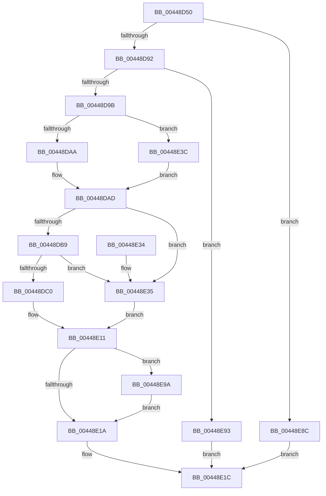

# HalQueryEnvironmentVariableInfoEx

- RVA: `0x00448D50`–`0x00448EA9` (길이 `345` bytes)
- VA: `0x0000000140448D50`
- 실행 섹션: `.text`
- PDB 이름 있음: `예`; PDB Function 태그: `아니요`
- unwind 정보 RVA: `0x000A62F4`
- 디코드: `90`개 명령, `345/345` bytes 표시
- 미해석 바이트: `0` (있으면 어셈블리에 `.byte`로 보존)

> 이 문서는 커널 이미지의 기계어와 PDB 기호를 분석해 생성했습니다. 4번과 5번은 함수 원형과 자료형을 바이너리 사용 방식에서 추정한 C 해석이며 원본 소스 복구 결과는 아닙니다.

## 1. Dependencies

- 직접 호출 지점: **6**; 고유 호출 대상: **6**
- 직접 호출자로 확인된 함수: **1**
- RIP 상대 이미지 참조: **5**

### Outgoing calls
- `0x00448DCC` → [HalpEfiStartRuntimeCode](HalpEfiStartRuntimeCode_function_00449714.md) (function, `0x00449714`)
- `0x00448DE7` → `indirect target` (indirect, 간접 대상)
- `0x00448E0A` → [HalpConvertEfiToNtStatus](HalpConvertEfiToNtStatus_function_0044976C.md) (function, `0x0044976C`)
- `0x00448E24` → [_security_check_cookie](../6A/_security_check_cookie_function_006AC640.md) (function, `0x006AC640`)
- `0x00448E82` → [KeSetSystemGroupAffinityThread](../39/KeSetSystemGroupAffinityThread_function_00399140.md) (function, `0x00399140`)
- `0x00448E9F` → [KeRevertToUserGroupAffinityThread](../39/KeRevertToUserGroupAffinityThread_function_00398EC0.md) (function, `0x00398EC0`)

### Direct callers
- [IopQueryEnvironmentVariableInfoHal](../../page/72/IopQueryEnvironmentVariableInfoHal_function_007229C0.md) at `0x007229D4`

### Static image references
- `0x00448D5B` → RVA `0x00E0A740` (`.data`; read)
- `0x00448D6A` → RVA `0x00FC1A28` (`.data`; read)
- `0x00448DAD` → RVA `0x01200010` (`CFGRO`; read)
- `0x00448DC0` → RVA `0x00FC1C30` (`.data`; read/write)
- `0x00448E4E` → RVA `0x00F231B0` (`.data`; read)

## 2. Other-region calls and transfers

- 다른 실행 섹션으로 향하는 call: **0**
- 별도 외부 분기/꼬리 이동을 확인하지 못했습니다.

## 3. Assembly (complete function range)

```asm
00448D50  40 53                           push rbx
00448D52  55                              push rbp
00448D53  56                              push rsi
00448D54  57                              push rdi
00448D55  41 56                           push r14
00448D57  48 83 EC 50                     sub rsp, 0x50
00448D5B  48 8B 05 DE 19 9C 00            mov rax, qword ptr [rip + 0x9c19de]
00448D62  48 33 C4                        xor rax, rsp
00448D65  48 89 44 24 40                  mov qword ptr [rsp + 0x40], rax
00448D6A  80 3D B7 8C B7 00 00            cmp byte ptr [rip + 0xb78cb7], 0
00448D71  0F 57 C0                        xorps xmm0, xmm0
00448D74  0F 57 C9                        xorps xmm1, xmm1
00448D77  4D 8B F1                        mov r14, r9
00448D7A  0F 11 44 24 20                  movups xmmword ptr [rsp + 0x20], xmm0
00448D7F  49 8B E8                        mov rbp, r8
00448D82  48 8B F2                        mov rsi, rdx
00448D85  0F 11 4C 24 30                  movups xmmword ptr [rsp + 0x30], xmm1
00448D8A  8B D9                           mov ebx, ecx
00448D8C  0F 84 FA 00 00 00               je 0x140448e8c
00448D92  F6 C3 01                        test bl, 1
00448D95  0F 84 F8 00 00 00               je 0x140448e93
00448D9B  83 CB 06                        or ebx, 6
00448D9E  44 0F 20 C0                     mov rax, cr8
00448DA2  3C 02                           cmp al, 2
00448DA4  0F 82 92 00 00 00               jb 0x140448e3c
00448DAA  40 32 FF                        xor dil, dil
00448DAD  48 8B 05 5C 72 DB 00            mov rax, qword ptr [rip + 0xdb725c]
00448DB4  48 85 C0                        test rax, rax
00448DB7  74 7C                           je 0x140448e35
00448DB9  48 83 78 40 00                  cmp qword ptr [rax + 0x40], 0
00448DBE  74 75                           je 0x140448e35
00448DC0  F0 FF 05 69 8E B7 00            lock inc dword ptr [rip + 0xb78e69]
00448DC7  B9 00 01 00 00                  mov ecx, 0x100
00448DCC  E8 43 09 00 00                  call 0x140449714
00448DD1  48 8B 05 38 72 DB 00            mov rax, qword ptr [rip + 0xdb7238]
00448DD8  4D 8B CE                        mov r9, r14
00448DDB  4C 8B C5                        mov r8, rbp
00448DDE  48 8B D6                        mov rdx, rsi
00448DE1  8B CB                           mov ecx, ebx
00448DE3  48 8B 40 40                     mov rax, qword ptr [rax + 0x40]
00448DE7  FF D0                           call rax
00448DE9  0F 1F 00                        nop dword ptr [rax]
00448DEC  65 48 8B 0C 25 18 00 00 00      mov rcx, qword ptr gs:[0x18]
00448DF5  F0 81 A1 E0 00 00 00 FF FE FF FF  lock and dword ptr [rcx + 0xe0], 0xfffffeff
00448E00  F0 FF 0D 29 8E B7 00            lock dec dword ptr [rip + 0xb78e29]
00448E07  48 8B C8                        mov rcx, rax
00448E0A  E8 5D 09 00 00                  call 0x14044976c
00448E0F  8B D8                           mov ebx, eax
00448E11  40 84 FF                        test dil, dil
00448E14  0F 85 80 00 00 00               jne 0x140448e9a
00448E1A  8B C3                           mov eax, ebx
00448E1C  48 8B 4C 24 40                  mov rcx, qword ptr [rsp + 0x40]
00448E21  48 33 CC                        xor rcx, rsp
00448E24  E8 17 38 26 00                  call 0x1406ac640
00448E29  48 83 C4 50                     add rsp, 0x50
00448E2D  41 5E                           pop r14
00448E2F  5F                              pop rdi
00448E30  5E                              pop rsi
00448E31  5D                              pop rbp
00448E32  5B                              pop rbx
00448E33  C3                              ret
00448E34  CC                              int3
00448E35  BB 02 00 00 C0                  mov ebx, 0xc0000002
00448E3A  EB D5                           jmp 0x140448e11
00448E3C  65 8B 04 25 A4 01 00 00         mov eax, dword ptr gs:[0x1a4]
00448E44  48 8D 54 24 30                  lea rdx, [rsp + 0x30]
00448E49  8B C8                           mov ecx, eax
00448E4B  40 B7 01                        mov dil, 1
00448E4E  48 8B 05 5B A3 AD 00            mov rax, qword ptr [rip + 0xada35b]
00448E55  8B 0C 88                        mov ecx, dword ptr [rax + rcx*4]
00448E58  33 C0                           xor eax, eax
00448E5A  89 44 24 2A                     mov dword ptr [rsp + 0x2a], eax
00448E5E  66 89 44 24 2E                  mov word ptr [rsp + 0x2e], ax
00448E63  8B C1                           mov eax, ecx
00448E65  C1 E8 06                        shr eax, 6
00448E68  83 E1 3F                        and ecx, 0x3f
00448E6B  66 89 44 24 28                  mov word ptr [rsp + 0x28], ax
00448E70  B8 01 00 00 00                  mov eax, 1
00448E75  48 D3 E0                        shl rax, cl
00448E78  48 8D 4C 24 20                  lea rcx, [rsp + 0x20]
00448E7D  48 89 44 24 20                  mov qword ptr [rsp + 0x20], rax
00448E82  E8 B9 02 F5 FF                  call 0x140399140
00448E87  E9 21 FF FF FF                  jmp 0x140448dad
00448E8C  B8 02 00 00 C0                  mov eax, 0xc0000002
00448E91  EB 89                           jmp 0x140448e1c
00448E93  B8 0D 00 00 C0                  mov eax, 0xc000000d
00448E98  EB 82                           jmp 0x140448e1c
00448E9A  48 8D 4C 24 30                  lea rcx, [rsp + 0x30]
00448E9F  E8 1C 00 F5 FF                  call 0x140398ec0
00448EA4  E9 71 FF FF FF                  jmp 0x140448e1a
```

## 4. C-style interpretation (structured pseudocode)

```c
__int64 __fastcall HalQueryEnvironmentVariableInfoEx(int a1, __int64 a2, __int64 a3, __int64 a4)
{
    __int64 result;
    __int64 v_rbx;
    __int64 v_rdi;
    __int64 v_rsp;
    unsigned __int64 v_stack_m38;
    unsigned __int64 v_stack_m48;
    unsigned __int64 v_stack_m58;
    unsigned __int64 v_stack_p20;
    unsigned __int16 v_stack_p28;
    unsigned int v_stack_p2A;
    unsigned __int16 v_stack_p2E;
    unsigned __int64 v_stack_p30;

    v_rsp = (v_rsp) - (80);
    result = (*(unsigned __int64 *)(v_rip + 10230238)) ^ (v_rsp);
    v_stack_m38 = result;
    v_stack_m58 = v_xmm0;
    v_stack_m48 = v_xmm1;
    if ((*(unsigned __int8 *)(v_rip + 12029111)) == 0) goto loc_00448E8C;
    if ((((unsigned __int8)((unsigned int)(a1))) & (1)) == 0) goto loc_00448E93;
    v_rbx = (unsigned int)(((unsigned int)(a1)) | (6));
    if (((unsigned __int8)(v_cr8)) < 2) goto loc_00448E3C;
    v_rdi = 0;
loc_00448DAD:
    if (*(unsigned __int64 *)(v_rip + 14381660) == 0) goto loc_00448E35;
    if ((*(unsigned __int64 *)(*(unsigned __int64 *)(v_rip + 14381660) + 64)) == 0) goto loc_00448E35;
    result = HalpEfiStartRuntimeCode(256, a2, a3, a4);
    result = kernel_indirect_call((unsigned int)((unsigned int)(v_rbx)), a2, a3, a4);
    result = HalpConvertEfiToNtStatus(result, a2, a3, a4);
loc_00448E11:
    if (0 != 0) goto loc_00448E9A;
loc_00448E1A:
loc_00448E1C:
    a1 = (v_stack_m38) ^ (v_rsp);
    result = _security_check_cookie(a1, a2, a3, a4);
    v_rsp = (v_rsp) + (80);
    return result;
loc_00448E35:
    goto loc_00448E11;
loc_00448E3C:
    result = 0;
    v_stack_p2A = 0;
    v_stack_p2E = 0;
    result = (unsigned int)(((unsigned int)((unsigned int)((unsigned int)(*(unsigned int *)(*(unsigned __int64 *)(v_rip + 11379547) + (unsigned int)((unsigned int)((unsigned int)(*(unsigned int *)(gs_base + (0 + 420))))) * 4))))) >> (6));
    a1 = (unsigned int)(((unsigned int)(*(unsigned int *)(*(unsigned __int64 *)(v_rip + 11379547) + (unsigned int)((unsigned int)((unsigned int)(*(unsigned int *)(gs_base + (0 + 420))))) * 4))) & (63));
    v_stack_p28 = (unsigned __int16)(result);
    result = (1) << ((unsigned __int8)(a1));
    v_stack_p20 = result;
    result = KeSetSystemGroupAffinityThread(v_stack_p20, v_stack_p30, a3, a4);
    goto loc_00448DAD;
loc_00448E8C:
    goto loc_00448E1C;
loc_00448E93:
    goto loc_00448E1C;
loc_00448E9A:
    result = KeRevertToUserGroupAffinityThread(v_stack_p30, v_stack_p30, a3, a4);
    goto loc_00448E1A;
}
```

## 5. (Beta) C Style

```c
int64_t HalQueryEnvironmentVariableInfoEx(int32_t Arg1, int64_t Arg2, int64_t Arg3, int64_t Arg4)
{
    int64_t result;
    int64_t local_rbx;
    int64_t local_rdi;
    int64_t local_rsp;
    uint64_t v_stack_m38;
    uint64_t v_stack_m48;
    uint64_t v_stack_m58;
    uint64_t v_stack_p20;
    uint16_t v_stack_p28;
    uint32_t v_stack_p2A;
    uint16_t v_stack_p2E;
    uint64_t v_stack_p30;

    local_rsp = (local_rsp) - (80);
    result = (*(uint64_t *)(v_rip + 0x9C19DE)) ^ (local_rsp);
    v_stack_m38 = result;
    v_stack_m58 = v_xmm0;
    v_stack_m48 = v_xmm1;
    if ((*(uint8_t *)(v_rip + 0xB78CB7)) == 0) goto loc_00448E8C;
    if ((((uint8_t)((uint32_t)(Arg1))) & (1)) == 0) goto loc_00448E93;
    local_rbx = (uint32_t)(((uint32_t)(Arg1)) | (6));
    if (((uint8_t)(v_cr8)) < 2) goto loc_00448E3C;
    local_rdi = 0;
loc_00448DAD:
    if (*(uint64_t *)(v_rip + 0xDB725C) == 0) goto loc_00448E35;
    if ((*(uint64_t *)(*(uint64_t *)(v_rip + 0xDB725C) + 0x40)) == 0) goto loc_00448E35;
    result = HalpEfiStartRuntimeCode(256, Arg2, Arg3, Arg4);
    result = kernel_indirect_call((uint32_t)((uint32_t)(local_rbx)), Arg2, Arg3, Arg4);
    result = HalpConvertEfiToNtStatus(result, Arg2, Arg3, Arg4);
loc_00448E11:
    if (0 != 0) goto loc_00448E9A;
loc_00448E1A:
loc_00448E1C:
    Arg1 = (v_stack_m38) ^ (local_rsp);
    result = _security_check_cookie(Arg1, Arg2, Arg3, Arg4);
    local_rsp = (local_rsp) + (80);
    return result;
loc_00448E35:
    goto loc_00448E11;
loc_00448E3C:
    result = 0;
    v_stack_p2A = 0;
    v_stack_p2E = 0;
    result = (uint32_t)(((uint32_t)((uint32_t)((uint32_t)(*(uint32_t *)(*(uint64_t *)(v_rip + 0xADA35B) + (uint32_t)((uint32_t)((uint32_t)(*(uint32_t *)(gs_base + (0 + 0x1A4))))) * 4))))) >> (6));
    Arg1 = (uint32_t)(((uint32_t)(*(uint32_t *)(*(uint64_t *)(v_rip + 0xADA35B) + (uint32_t)((uint32_t)((uint32_t)(*(uint32_t *)(gs_base + (0 + 0x1A4))))) * 4))) & (63));
    v_stack_p28 = (uint16_t)(result);
    result = (1) << ((uint8_t)(Arg1));
    v_stack_p20 = result;
    result = KeSetSystemGroupAffinityThread(v_stack_p20, v_stack_p30, Arg3, Arg4);
    goto loc_00448DAD;
loc_00448E8C:
    goto loc_00448E1C;
loc_00448E93:
    goto loc_00448E1C;
loc_00448E9A:
    result = KeRevertToUserGroupAffinityThread(v_stack_p30, v_stack_p30, Arg3, Arg4);
    goto loc_00448E1A;
}
```

## 6. Execution-region graph

[열기: 2D/3D 그래프와 함수 탐색 컨트롤 패널](../../../control-panel.html?section=text&rva=0x00448D50&view=graph)

- 2D 그래프는 위에서 아래로 흐르고, 3D 그래프는 빈 공간을 드래그해 회전합니다. Shift+드래그는 이동, 휠은 확대·축소, 함수 노드 선택은 대상 보고서 이동입니다.

### Static fallback


