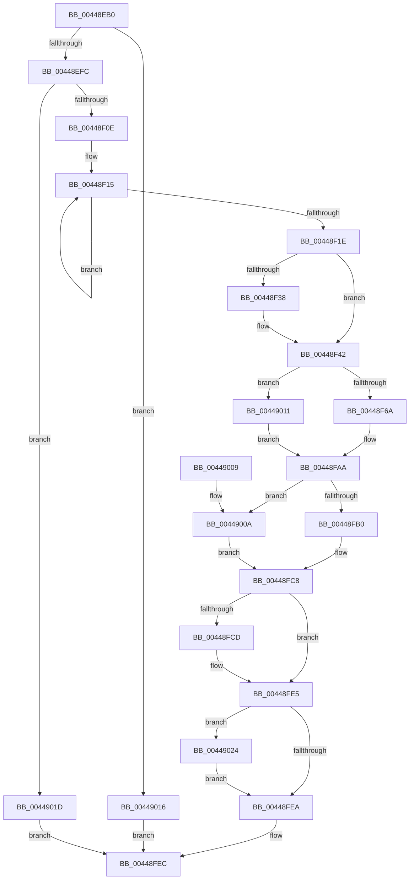

# HalSetEnvironmentVariableEx

- RVA: `0x00448EB0`–`0x0044902F` (길이 `383` bytes)
- VA: `0x0000000140448EB0`
- 실행 섹션: `.text`
- PDB 이름 있음: `예`; PDB Function 태그: `아니요`
- unwind 정보 RVA: `0x000A6310`
- 디코드: `116`개 명령, `383/383` bytes 표시
- 미해석 바이트: `0` (있으면 어셈블리에 `.byte`로 보존)

> 이 문서는 커널 이미지의 기계어와 PDB 기호를 분석해 생성했습니다. 4번과 5번은 함수 원형과 자료형을 바이너리 사용 방식에서 추정한 C 해석이며 원본 소스 복구 결과는 아닙니다.

## 1. Dependencies

- 직접 호출 지점: **7**; 고유 호출 대상: **6**
- 직접 호출자로 확인된 함수: **6**
- RIP 상대 이미지 참조: **3**

### Outgoing calls
- `0x00448F49` → [_chkstk](../6B/_chkstk_function_006BA960.md) (function, `0x006BA960`)
- `0x00448F59` → [wcscpy_s](../50/wcscpy_s_function_005064B0.md) (function, `0x005064B0`)
- `0x00448FA5` → [KeSetSystemGroupAffinityThread](../39/KeSetSystemGroupAffinityThread_function_00399140.md) (function, `0x00399140`)
- `0x00448FC1` → [HalEfiSetEnvironmentVariable](HalEfiSetEnvironmentVariable_function_00449038.md) (function, `0x00449038`)
- `0x00448FDE` → [HalEfiSetEnvironmentVariable](HalEfiSetEnvironmentVariable_function_00449038.md) (function, `0x00449038`)
- `0x00448FF3` → [_security_check_cookie](../6A/_security_check_cookie_function_006AC640.md) (function, `0x006AC640`)
- `0x00449028` → [KeRevertToUserGroupAffinityThread](../39/KeRevertToUserGroupAffinityThread_function_00398EC0.md) (function, `0x00398EC0`)

### Direct callers
- [HaliAcpiSleep](../56/HaliAcpiSleep_function_0056AD60.md) at `0x0056B01B`
- [HaliAcpiSleep](../56/HaliAcpiSleep_function_0056AD60.md) at `0x0056B241`
- [WheapProcessEfiBadMemoryPage](../65/WheapProcessEfiBadMemoryPage_function_0065DEAC.md) at `0x0065DF41`
- [WheapPersistPageForMemoryError](../65/WheapPersistPageForMemoryError_function_0065E388.md) at `0x0065E43B`
- [IopSetEnvironmentVariableHal](../../page/72/IopSetEnvironmentVariableHal_function_00722B90.md) at `0x00722BAC`
- [PopSetMemoryOverwriteRequestAction](../../pagelk/B6/PopSetMemoryOverwriteRequestAction_function_00B6BE14.md) at `0x00B6BEAA`
- [PopCheckpointSystemSleepUnsafe](../../pagelk/B7/PopCheckpointSystemSleepUnsafe_function_00B71950.md) at `0x00B7199D`

### Static image references
- `0x00448EC6` → RVA `0x00E0A740` (`.data`; read)
- `0x00448ED9` → RVA `0x00FC1A28` (`.data`; read)
- `0x00448F78` → RVA `0x00F231B0` (`.data`; read)

## 2. Other-region calls and transfers

- 다른 실행 섹션으로 향하는 call: **0**
- 별도 외부 분기/꼬리 이동을 확인하지 못했습니다.

## 3. Assembly (complete function range)

```asm
00448EB0  40 55                           push rbp
00448EB2  53                              push rbx
00448EB3  56                              push rsi
00448EB4  57                              push rdi
00448EB5  41 54                           push r12
00448EB7  41 55                           push r13
00448EB9  41 56                           push r14
00448EBB  41 57                           push r15
00448EBD  48 83 EC 68                     sub rsp, 0x68
00448EC1  48 8D 6C 24 30                  lea rbp, [rsp + 0x30]
00448EC6  48 8B 05 73 18 9C 00            mov rax, qword ptr [rip + 0x9c1873]
00448ECD  48 33 C5                        xor rax, rbp
00448ED0  48 89 45 20                     mov qword ptr [rbp + 0x20], rax
00448ED4  33 DB                           xor ebx, ebx
00448ED6  45 8B F9                        mov r15d, r9d
00448ED9  38 1D 49 8B B7 00               cmp byte ptr [rip + 0xb78b49], bl
00448EDF  0F 57 C0                        xorps xmm0, xmm0
00448EE2  0F 57 C9                        xorps xmm1, xmm1
00448EE5  4D 8B E8                        mov r13, r8
00448EE8  4C 8B E2                        mov r12, rdx
00448EEB  4C 8B C1                        mov r8, rcx
00448EEE  0F 11 45 00                     movups xmmword ptr [rbp], xmm0
00448EF2  0F 11 4D 10                     movups xmmword ptr [rbp + 0x10], xmm1
00448EF6  0F 84 1A 01 00 00               je 0x140449016
00448EFC  8B BD A0 00 00 00               mov edi, dword ptr [rbp + 0xa0]
00448F02  8D 73 01                        lea esi, [rbx + 1]
00448F05  40 84 FE                        test sil, dil
00448F08  0F 84 0F 01 00 00               je 0x14044901d
00448F0E  83 CF 06                        or edi, 6
00448F11  48 83 C8 FF                     or rax, 0xffffffffffffffff
00448F15  48 FF C0                        inc rax
00448F18  66 39 1C 41                     cmp word ptr [rcx + rax*2], bx
00448F1C  75 F7                           jne 0x140448f15
00448F1E  03 C6                           add eax, esi
00448F20  B9 00 01 00 00                  mov ecx, 0x100
00448F25  3B C1                           cmp eax, ecx
00448F27  0F 43 C1                        cmovae eax, ecx
00448F2A  8B D0                           mov edx, eax
00448F2C  48 03 C0                        add rax, rax
00448F2F  48 8D 48 0F                     lea rcx, [rax + 0xf]
00448F33  48 3B C8                        cmp rcx, rax
00448F36  77 0A                           ja 0x140448f42
00448F38  48 B9 F0 FF FF FF FF FF FF 0F   movabs rcx, 0xffffffffffffff0
00448F42  48 83 E1 F0                     and rcx, 0xfffffffffffffff0
00448F46  48 8B C1                        mov rax, rcx
00448F49  E8 12 1A 27 00                  call 0x1406ba960
00448F4E  48 2B E1                        sub rsp, rcx
00448F51  4C 8D 74 24 30                  lea r14, [rsp + 0x30]
00448F56  49 8B CE                        mov rcx, r14
00448F59  E8 52 D5 0B 00                  call 0x1405064b0
00448F5E  44 0F 20 C0                     mov rax, cr8
00448F62  3C 02                           cmp al, 2
00448F64  0F 83 A7 00 00 00               jae 0x140449011
00448F6A  65 8B 04 25 A4 01 00 00         mov eax, dword ptr gs:[0x1a4]
00448F72  48 8D 55 10                     lea rdx, [rbp + 0x10]
00448F76  8B C8                           mov ecx, eax
00448F78  48 8B 05 31 A2 AD 00            mov rax, qword ptr [rip + 0xada231]
00448F7F  8B 0C 88                        mov ecx, dword ptr [rax + rcx*4]
00448F82  33 C0                           xor eax, eax
00448F84  89 45 0A                        mov dword ptr [rbp + 0xa], eax
00448F87  66 89 45 0E                     mov word ptr [rbp + 0xe], ax
00448F8B  8B C1                           mov eax, ecx
00448F8D  C1 E8 06                        shr eax, 6
00448F90  83 E1 3F                        and ecx, 0x3f
00448F93  66 89 45 08                     mov word ptr [rbp + 8], ax
00448F97  48 8B C6                        mov rax, rsi
00448F9A  48 D3 E0                        shl rax, cl
00448F9D  48 8D 4D 00                     lea rcx, [rbp]
00448FA1  48 89 45 00                     mov qword ptr [rbp], rax
00448FA5  E8 96 01 F5 FF                  call 0x140399140
00448FAA  40 F6 C7 40                     test dil, 0x40
00448FAE  75 5A                           jne 0x14044900a
00448FB0  45 33 C9                        xor r9d, r9d
00448FB3  48 89 5C 24 20                  mov qword ptr [rsp + 0x20], rbx
00448FB8  45 33 C0                        xor r8d, r8d
00448FBB  49 8B D4                        mov rdx, r12
00448FBE  49 8B CE                        mov rcx, r14
00448FC1  E8 72 00 00 00                  call 0x140449038
00448FC6  8B D8                           mov ebx, eax
00448FC8  45 85 FF                        test r15d, r15d
00448FCB  74 18                           je 0x140448fe5
00448FCD  4D 8B CF                        mov r9, r15
00448FD0  4C 89 6C 24 20                  mov qword ptr [rsp + 0x20], r13
00448FD5  44 8B C7                        mov r8d, edi
00448FD8  49 8B D4                        mov rdx, r12
00448FDB  49 8B CE                        mov rcx, r14
00448FDE  E8 55 00 00 00                  call 0x140449038
00448FE3  8B D8                           mov ebx, eax
00448FE5  40 84 F6                        test sil, sil
00448FE8  75 3A                           jne 0x140449024
00448FEA  8B C3                           mov eax, ebx
00448FEC  48 8B 4D 20                     mov rcx, qword ptr [rbp + 0x20]
00448FF0  48 33 CD                        xor rcx, rbp
00448FF3  E8 48 36 26 00                  call 0x1406ac640
00448FF8  48 8D 65 38                     lea rsp, [rbp + 0x38]
00448FFC  41 5F                           pop r15
00448FFE  41 5E                           pop r14
00449000  41 5D                           pop r13
00449002  41 5C                           pop r12
00449004  5F                              pop rdi
00449005  5E                              pop rsi
00449006  5B                              pop rbx
00449007  5D                              pop rbp
00449008  C3                              ret
00449009  CC                              int3
0044900A  BB 0D 00 00 C0                  mov ebx, 0xc000000d
0044900F  EB B7                           jmp 0x140448fc8
00449011  40 8A F3                        mov sil, bl
00449014  EB 94                           jmp 0x140448faa
00449016  B8 02 00 00 C0                  mov eax, 0xc0000002
0044901B  EB CF                           jmp 0x140448fec
0044901D  B8 0D 00 00 C0                  mov eax, 0xc000000d
00449022  EB C8                           jmp 0x140448fec
00449024  48 8D 4D 10                     lea rcx, [rbp + 0x10]
00449028  E8 93 FE F4 FF                  call 0x140398ec0
0044902D  EB BB                           jmp 0x140448fea
```

## 4. C-style interpretation (structured pseudocode)

```c
__int64 __fastcall HalSetEnvironmentVariableEx(__int64 a1, __int64 a2, __int64 a3, int a4, unsigned int a5)
{
    __int64 result;
    __int64 v_rbx;
    __int64 v_rdi;
    __int64 v_rsp;
    unsigned __int64 v_stack_m40;
    unsigned __int64 v_stack_m58;
    unsigned __int64 v_stack_m68;
    unsigned __int16 v_stack_m6A;
    unsigned int v_stack_m6E;
    unsigned __int16 v_stack_m70;
    unsigned __int64 v_stack_m78;
    unsigned __int64 v_stack_m88;

    v_rsp = (v_rsp) - (104);
    result = (*(unsigned __int64 *)(v_rip + 10229875)) ^ (v_stack_m78);
    v_stack_m58 = result;
    v_rbx = 0;
    v_stack_m78 = v_xmm0;
    v_stack_m68 = v_xmm1;
    if ((*(unsigned __int8 *)(v_rip + 12028745)) == 0) goto loc_00449016;
    if ((((unsigned __int8)(v_rbx + 1)) & ((unsigned __int8)((unsigned int)(a5)))) == 0) goto loc_0044901D;
    v_rdi = (unsigned int)(((unsigned int)(a5)) | (6));
    result = (result) | (-1);
loc_00448F15:
    result = (result) + 1;
    if ((*(unsigned __int16 *)(a1 + result * 2)) != 0) goto loc_00448F15;
    result = (unsigned int)((result) + ((unsigned int)(v_rbx + 1)));
    if (((unsigned int)(result)) >= 256) { result = 256; }
    result = (result) + (result);
    if ((result + 15) <= result) {
    }
    a1 = (result + 15) & (-16);
    result = _chkstk(a1, (unsigned int)((unsigned int)(result)), a1, a4);
    v_rsp = (v_rsp) - (a1);
    result = wcscpy_s(v_stack_m78, (unsigned int)((unsigned int)(result)), a1, a4);
    if (((unsigned __int8)(v_cr8)) >= 2) goto loc_00449011;
    result = 0;
    v_stack_m6E = 0;
    v_stack_m6A = 0;
    result = (unsigned int)(((unsigned int)((unsigned int)((unsigned int)(*(unsigned int *)(*(unsigned __int64 *)(v_rip + 11379249) + (unsigned int)((unsigned int)((unsigned int)(*(unsigned int *)(gs_base + (0 + 420))))) * 4))))) >> (6));
    a1 = (unsigned int)(((unsigned int)(*(unsigned int *)(*(unsigned __int64 *)(v_rip + 11379249) + (unsigned int)((unsigned int)((unsigned int)(*(unsigned int *)(gs_base + (0 + 420))))) * 4))) & (63));
    v_stack_m70 = (unsigned __int16)(result);
    result = (v_rbx + 1) << ((unsigned __int8)(a1));
    v_stack_m78 = result;
    result = KeSetSystemGroupAffinityThread(v_stack_m78, v_stack_m68, a1, a4);
loc_00448FAA:
    if ((((unsigned __int8)(v_rdi)) & (64)) != 0) goto loc_0044900A;
    a4 = 0;
    v_stack_m88 = 0;
    a3 = 0;
    result = HalEfiSetEnvironmentVariable(v_stack_m78, a2, a3, a4);
loc_00448FC8:
    v_rbx = (unsigned int)((unsigned int)(result));
    if ((unsigned int)((unsigned int)(a4)) != 0) {
        a4 = (unsigned int)(a4);
        v_stack_m88 = 0;
        a3 = (unsigned int)(v_rdi);
        a2 = a2;
        a1 = v_stack_m78;
        result = HalEfiSetEnvironmentVariable(a1, a2, a3, a4);
        v_rbx = (unsigned int)(result);
    }
    if ((unsigned __int8)(v_rbx + 1) != 0) goto loc_00449024;
loc_00448FEA:
loc_00448FEC:
    a1 = (v_stack_m58) ^ (v_stack_m78);
    result = _security_check_cookie(a1, a2, a3, a4);
    return result;
loc_0044900A:
    goto loc_00448FC8;
loc_00449011:
    goto loc_00448FAA;
loc_00449016:
    goto loc_00448FEC;
loc_0044901D:
    goto loc_00448FEC;
loc_00449024:
    result = KeRevertToUserGroupAffinityThread(v_stack_m68, a2, a3, a4);
    goto loc_00448FEA;
}
```

## 5. (Beta) C Style

```c
int64_t HalSetEnvironmentVariableEx(void *Arg1, int64_t Arg2, int64_t Arg3, int32_t Arg4, uint32_t Arg5)
{
    uint8_t *arg1 = (uint8_t *)Arg1;

    int64_t result;
    int64_t local_rbx;
    int64_t local_rdi;
    int64_t local_rsp;
    uint64_t v_stack_m40;
    uint64_t v_stack_m58;
    uint64_t v_stack_m68;
    uint16_t v_stack_m6A;
    uint32_t v_stack_m6E;
    uint16_t v_stack_m70;
    uint64_t v_stack_m78;
    uint64_t v_stack_m88;

    local_rsp = (local_rsp) - (104);
    result = (*(uint64_t *)(v_rip + 0x9C1873)) ^ (v_stack_m78);
    v_stack_m58 = result;
    local_rbx = 0;
    v_stack_m78 = v_xmm0;
    v_stack_m68 = v_xmm1;
    if ((*(uint8_t *)(v_rip + 0xB78B49)) == 0) goto loc_00449016;
    if ((((uint8_t)(local_rbx + 1)) & ((uint8_t)((uint32_t)(Arg5)))) == 0) goto loc_0044901D;
    local_rdi = (uint32_t)(((uint32_t)(Arg5)) | (6));
    result = (result) | (-1);
loc_00448F15:
    result = (result) + 1;
    if ((*(uint16_t *)(arg1 + result * 2)) != 0) goto loc_00448F15;
    result = (uint32_t)((result) + ((uint32_t)(local_rbx + 1)));
    if (((uint32_t)(result)) >= 256) { result = 256; }
    result = (result) + (result);
    if ((result + 15) <= result) {
    }
    Arg1 = (result + 15) & (-16);
    result = _chkstk(Arg1, (uint32_t)((uint32_t)(result)), Arg1, Arg4);
    local_rsp = (local_rsp) - (Arg1);
    result = wcscpy_s(v_stack_m78, (uint32_t)((uint32_t)(result)), Arg1, Arg4);
    if (((uint8_t)(v_cr8)) >= 2) goto loc_00449011;
    result = 0;
    v_stack_m6E = 0;
    v_stack_m6A = 0;
    result = (uint32_t)(((uint32_t)((uint32_t)((uint32_t)(*(uint32_t *)(*(uint64_t *)(v_rip + 0xADA231) + (uint32_t)((uint32_t)((uint32_t)(*(uint32_t *)(gs_base + (0 + 0x1A4))))) * 4))))) >> (6));
    Arg1 = (uint32_t)(((uint32_t)(*(uint32_t *)(*(uint64_t *)(v_rip + 0xADA231) + (uint32_t)((uint32_t)((uint32_t)(*(uint32_t *)(gs_base + (0 + 0x1A4))))) * 4))) & (63));
    v_stack_m70 = (uint16_t)(result);
    result = (local_rbx + 1) << ((uint8_t)(Arg1));
    v_stack_m78 = result;
    result = KeSetSystemGroupAffinityThread(v_stack_m78, v_stack_m68, Arg1, Arg4);
loc_00448FAA:
    if ((((uint8_t)(local_rdi)) & (64)) != 0) goto loc_0044900A;
    Arg4 = 0;
    v_stack_m88 = 0;
    Arg3 = 0;
    result = HalEfiSetEnvironmentVariable(v_stack_m78, Arg2, Arg3, Arg4);
loc_00448FC8:
    local_rbx = (uint32_t)((uint32_t)(result));
    if ((uint32_t)((uint32_t)(Arg4)) != 0) {
        Arg4 = (uint32_t)(Arg4);
        v_stack_m88 = 0;
        Arg3 = (uint32_t)(local_rdi);
        Arg2 = Arg2;
        Arg1 = v_stack_m78;
        result = HalEfiSetEnvironmentVariable(Arg1, Arg2, Arg3, Arg4);
        local_rbx = (uint32_t)(result);
    }
    if ((uint8_t)(local_rbx + 1) != 0) goto loc_00449024;
loc_00448FEA:
loc_00448FEC:
    Arg1 = (v_stack_m58) ^ (v_stack_m78);
    result = _security_check_cookie(Arg1, Arg2, Arg3, Arg4);
    return result;
loc_0044900A:
    goto loc_00448FC8;
loc_00449011:
    goto loc_00448FAA;
loc_00449016:
    goto loc_00448FEC;
loc_0044901D:
    goto loc_00448FEC;
loc_00449024:
    result = KeRevertToUserGroupAffinityThread(v_stack_m68, Arg2, Arg3, Arg4);
    goto loc_00448FEA;
}
```

### 관측된 메모리 오프셋

구조체 형식이 확인되지 않은 접근은 인자 기준의 오프셋으로만 기록했습니다.

| 기준 인자 | 오프셋 표현 | 폭 (bit) | 접근 |
|---|---:|---:|---|
| `Arg1` | `+ 0x0 + rax*2` | `16` | `R` |

## 6. Execution-region graph

[열기: 2D/3D 그래프와 함수 탐색 컨트롤 패널](../../../control-panel.html?section=text&rva=0x00448EB0&view=graph)

- 2D 그래프는 위에서 아래로 흐르고, 3D 그래프는 빈 공간을 드래그해 회전합니다. Shift+드래그는 이동, 휠은 확대·축소, 함수 노드 선택은 대상 보고서 이동입니다.

### Static fallback


