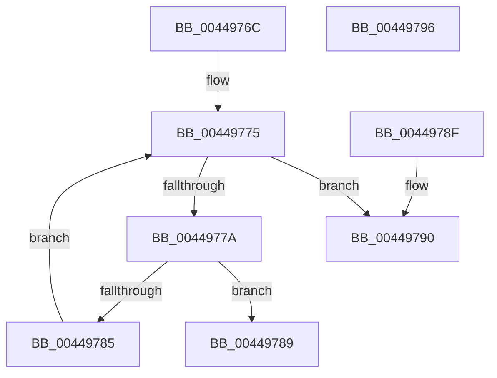

# HalpConvertEfiToNtStatus

- RVA: `0x0044976C`–`0x00449797` (길이 `43` bytes)
- VA: `0x000000014044976C`
- 실행 섹션: `.text`
- PDB 이름 있음: `예`; PDB Function 태그: `아니요`
- unwind 정보 RVA: `0x000DB714`
- 디코드: `16`개 명령, `43/43` bytes 표시
- 미해석 바이트: `0` (있으면 어셈블리에 `.byte`로 보존)

> 이 문서는 커널 이미지의 기계어와 PDB 기호를 분석해 생성했습니다. 4번과 5번은 함수 원형과 자료형을 바이너리 사용 방식에서 추정한 C 해석이며 원본 소스 복구 결과는 아닙니다.

## 1. Dependencies

- 직접 호출 지점: **0**; 고유 호출 대상: **0**
- 직접 호출자로 확인된 함수: **7**
- RIP 상대 이미지 참조: **1**

### Outgoing calls
- 직접 디코드된 call 명령이 없습니다.

### Direct callers
- [HalQueryEnvironmentVariableInfoEx](HalQueryEnvironmentVariableInfoEx_function_00448D50.md) at `0x00448E0A`
- [HalEfiSetEnvironmentVariable](HalEfiSetEnvironmentVariable_function_00449038.md) at `0x004490DB`
- [HalGetEnvironmentVariableEx](HalGetEnvironmentVariableEx_function_00449100.md) at `0x00449270`
- [HalEfiGetTime](../54/HalEfiGetTime_function_0054DC6C.md) at `0x0054DD06`
- [HalEfiSetTime](../54/HalEfiSetTime_function_0054DE84.md) at `0x0054DF2B`
- [HalEfiSetTime](../54/HalEfiSetTime_function_0054DE84.md) at `0x0054E01F`
- [HalEfiUpdateCapsule](../54/HalEfiUpdateCapsule_function_0054E0C0.md) at `0x0054E14A`
- [HalpQueryCapsuleCapabilities](../56/HalpQueryCapsuleCapabilities_function_00563CE0.md) at `0x00563DEA`

### Static image references
- `0x0044976E` → RVA `0x000147C0` (`.rdata`; read)

## 2. Other-region calls and transfers

- 다른 실행 섹션으로 향하는 call: **0**
- 별도 외부 분기/꼬리 이동을 확인하지 못했습니다.

## 3. Assembly (complete function range)

```asm
0044976C  33 C0                           xor eax, eax
0044976E  4C 8D 05 4B B0 BC FF            lea r8, [rip - 0x434fb5]
00449775  83 F8 20                        cmp eax, 0x20
00449778  73 16                           jae 0x140449790
0044977A  8B D0                           mov edx, eax
0044977C  48 03 D2                        add rdx, rdx
0044977F  49 39 0C D0                     cmp qword ptr [r8 + rdx*8], rcx
00449783  74 04                           je 0x140449789
00449785  FF C0                           inc eax
00449787  EB EC                           jmp 0x140449775
00449789  41 8B 44 D0 08                  mov eax, dword ptr [r8 + rdx*8 + 8]
0044978E  C3                              ret
0044978F  CC                              int3
00449790  B8 01 00 00 C0                  mov eax, 0xc0000001
00449795  C3                              ret
00449796  CC                              int3
```

## 4. C-style interpretation (structured pseudocode)

```c
__int64 __fastcall HalpConvertEfiToNtStatus(__int64 a1)
{
    __int64 result;

    result = 0;
loc_00449775:
    if (0 >= 32) goto loc_00449790;
    a2 = (0) + (0);
    if ((*(unsigned __int64 *)(v_rip - 4411317 + a2 * 8)) == a1) goto loc_00449789;
    result = (unsigned int)((result) + 1);
    goto loc_00449775;
loc_00449789:
    return (unsigned int)(*(unsigned int *)(v_rip - 4411317 + a2 * 8 + 8));
loc_00449790:
    return (unsigned int)(0xC0000001ULL);
}
```

## 5. (Beta) C Style

```c
int64_t HalpConvertEfiToNtStatus(int64_t Arg1)
{
    int64_t result;

    result = 0;
loc_00449775:
    if (0 >= 32) goto loc_00449790;
    a2 = (0) + (0);
    if ((*(uint64_t *)(v_rip - 0x434FB5 + a2 * 8)) == Arg1) goto loc_00449789;
    result = (uint32_t)((result) + 1);
    goto loc_00449775;
loc_00449789:
    return (uint32_t)(*(uint32_t *)(v_rip - 0x434FB5 + a2 * 8 + 0x8));
loc_00449790:
    return (uint32_t)(0xC0000001ULL);
}
```

## 6. Execution-region graph

[열기: 2D/3D 그래프와 함수 탐색 컨트롤 패널](../../../control-panel.html?section=text&rva=0x0044976C&view=graph)

- 2D 그래프는 위에서 아래로 흐르고, 3D 그래프는 빈 공간을 드래그해 회전합니다. Shift+드래그는 이동, 휠은 확대·축소, 함수 노드 선택은 대상 보고서 이동입니다.

### Static fallback


