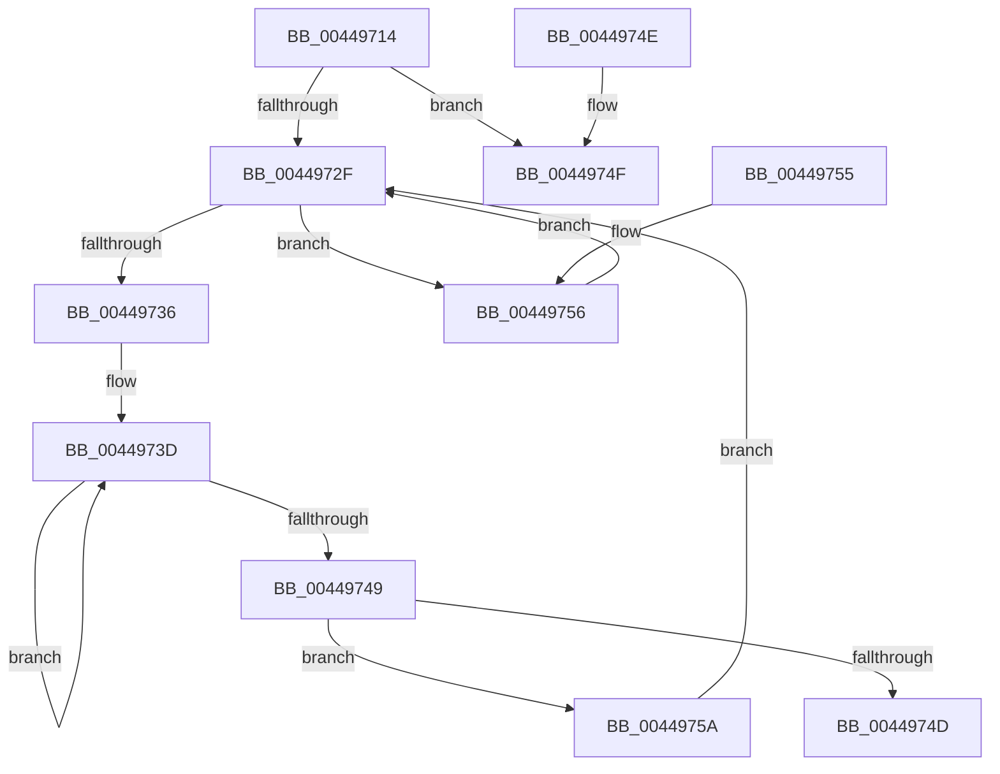

# HalpEfiStartRuntimeCode

- RVA: `0x00449714`–`0x00449765` (길이 `81` bytes)
- VA: `0x0000000140449714`
- 실행 섹션: `.text`
- PDB 이름 있음: `예`; PDB Function 태그: `아니요`
- unwind 정보 RVA: `0x000DB714`
- 디코드: `28`개 명령, `81/81` bytes 표시
- 미해석 바이트: `0` (있으면 어셈블리에 `.byte`로 보존)

> 이 문서는 커널 이미지의 기계어와 PDB 기호를 분석해 생성했습니다. 4번과 5번은 함수 원형과 자료형을 바이너리 사용 방식에서 추정한 C 해석이며 원본 소스 복구 결과는 아닙니다.

## 1. Dependencies

- 직접 호출 지점: **0**; 고유 호출 대상: **0**
- 직접 호출자로 확인된 함수: **9**
- RIP 상대 이미지 참조: **0**

### Outgoing calls
- 직접 디코드된 call 명령이 없습니다.

### Direct callers
- [HalQueryEnvironmentVariableInfoEx](HalQueryEnvironmentVariableInfoEx_function_00448D50.md) at `0x00448DCC`
- [HalEfiSetEnvironmentVariable](HalEfiSetEnvironmentVariable_function_00449038.md) at `0x00449083`
- [HalGetEnvironmentVariableEx](HalGetEnvironmentVariableEx_function_00449100.md) at `0x00449227`
- [HalpEnumerateEnvironmentVariablesWithFilter](HalpEnumerateEnvironmentVariablesWithFilter_function_004492D0.md) at `0x00449412`
- [HalpEnumerateEnvironmentVariablesWithFilter](HalpEnumerateEnvironmentVariablesWithFilter_function_004492D0.md) at `0x00449531`
- [HalEfiGetTime](../54/HalEfiGetTime_function_0054DC6C.md) at `0x0054DCD5`
- [HalEfiResetSystem](../54/HalEfiResetSystem_function_0054DDE8.md) at `0x0054DE28`
- [HalEfiSetTime](../54/HalEfiSetTime_function_0054DE84.md) at `0x0054DEFA`
- [HalEfiSetTime](../54/HalEfiSetTime_function_0054DE84.md) at `0x0054DFD7`
- [HalEfiUpdateCapsule](../54/HalEfiUpdateCapsule_function_0054E0C0.md) at `0x0054E0FD`
- [HalpQueryCapsuleCapabilities](../56/HalpQueryCapsuleCapabilities_function_00563CE0.md) at `0x00563DA3`

### Static image references
- 디코드된 RIP-relative 메모리 참조가 없습니다.

## 2. Other-region calls and transfers

- 다른 실행 섹션으로 향하는 call: **0**
- 별도 외부 분기/꼬리 이동을 확인하지 못했습니다.

## 3. Assembly (complete function range)

```asm
00449714  65 48 8B 14 25 18 00 00 00      mov rdx, qword ptr gs:[0x18]
0044971D  44 8B C1                        mov r8d, ecx
00449720  48 81 C2 C0 00 00 00            add rdx, 0xc0
00449727  44 0F 20 C0                     mov rax, cr8
0044972B  3C 02                           cmp al, 2
0044972D  73 20                           jae 0x14044974f
0044972F  8B 42 20                        mov eax, dword ptr [rdx + 0x20]
00449732  85 C0                           test eax, eax
00449734  78 20                           js 0x140449756
00449736  0F 0D 4A 20                     prefetchw byte ptr [rdx + 0x20]
0044973A  8B 42 20                        mov eax, dword ptr [rdx + 0x20]
0044973D  8B C8                           mov ecx, eax
0044973F  41 0B C8                        or ecx, r8d
00449742  F0 0F B1 4A 20                  lock cmpxchg dword ptr [rdx + 0x20], ecx
00449747  75 F4                           jne 0x14044973d
00449749  85 C0                           test eax, eax
0044974B  78 0D                           js 0x14044975a
0044974D  C3                              ret
0044974E  CC                              int3
0044974F  F0 44 09 42 20                  lock or dword ptr [rdx + 0x20], r8d
00449754  C3                              ret
00449755  CC                              int3
00449756  F3 90                           pause
00449758  EB D5                           jmp 0x14044972f
0044975A  41 8B C0                        mov eax, r8d
0044975D  F7 D0                           not eax
0044975F  F0 21 42 20                     lock and dword ptr [rdx + 0x20], eax
00449763  EB CA                           jmp 0x14044972f
```

## 4. C-style interpretation (structured pseudocode)

```c
__int64 __fastcall HalpEfiStartRuntimeCode(int a1)
{
    __int64 result;

    a2 = (*(unsigned __int64 *)(gs_base + (0 + 24))) + (192);
    if (((unsigned __int8)(v_cr8)) >= 2) goto loc_0044974F;
loc_0044972F:
    if (sign_flag) goto loc_00449756;
loc_0044973D:
    a1 = (unsigned int)(((unsigned int)((unsigned int)((unsigned int)(*(unsigned int *)(a2 + 32))))) | ((unsigned int)((unsigned int)(a1))));
    if (condition_is_not_equal) goto loc_0044973D;
    if (sign_flag) goto loc_0044975A;
    return (unsigned int)(*(unsigned int *)(a2 + 32));
loc_0044974F:
    return (unsigned int)(*(unsigned int *)(a2 + 32));
loc_00449756:
    goto loc_0044972F;
loc_0044975A:
    result = (unsigned int)(~((unsigned int)((unsigned int)((unsigned int)(a1)))));
    goto loc_0044972F;
}
```

## 5. (Beta) C Style

```c
int64_t HalpEfiStartRuntimeCode(int32_t Arg1)
{
    int64_t result;

    a2 = (*(uint64_t *)(gs_base + (0 + 0x18))) + (192);
    if (((uint8_t)(v_cr8)) >= 2) goto loc_0044974F;
loc_0044972F:
    if (sign_flag) goto loc_00449756;
loc_0044973D:
    Arg1 = (uint32_t)(((uint32_t)((uint32_t)((uint32_t)(*(uint32_t *)(a2 + 0x20))))) | ((uint32_t)((uint32_t)(Arg1))));
    if (condition_is_not_equal) goto loc_0044973D;
    if (sign_flag) goto loc_0044975A;
    return (uint32_t)(*(uint32_t *)(a2 + 0x20));
loc_0044974F:
    return (uint32_t)(*(uint32_t *)(a2 + 0x20));
loc_00449756:
    goto loc_0044972F;
loc_0044975A:
    result = (uint32_t)(~((uint32_t)((uint32_t)((uint32_t)(Arg1)))));
    goto loc_0044972F;
}
```

## 6. Execution-region graph

[열기: 2D/3D 그래프와 함수 탐색 컨트롤 패널](../../../control-panel.html?section=text&rva=0x00449714&view=graph)

- 2D 그래프는 위에서 아래로 흐르고, 3D 그래프는 빈 공간을 드래그해 회전합니다. Shift+드래그는 이동, 휠은 확대·축소, 함수 노드 선택은 대상 보고서 이동입니다.

### Static fallback


