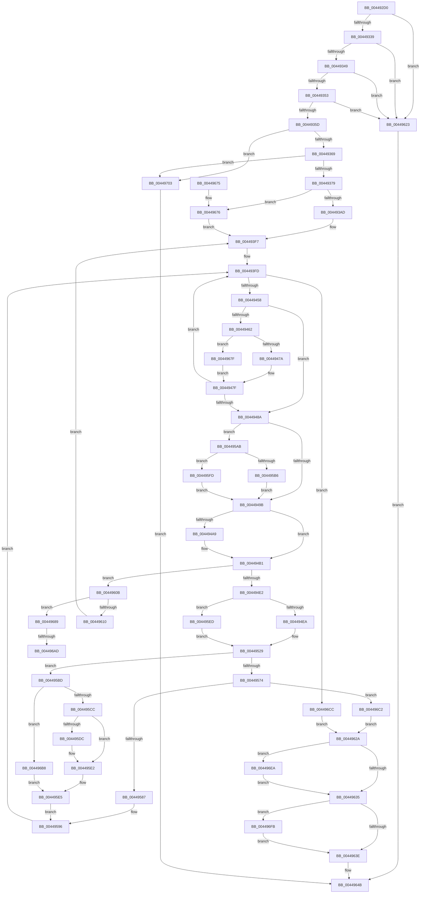

# HalpEnumerateEnvironmentVariablesWithFilter

- RVA: `0x004492D0`–`0x0044970D` (길이 `1,085` bytes)
- VA: `0x00000001404492D0`
- 실행 섹션: `.text`
- PDB 이름 있음: `예`; PDB Function 태그: `예`
- unwind 정보 RVA: `0x000A6358`
- 디코드: `268`개 명령, `1,085/1,085` bytes 표시
- 미해석 바이트: `0` (있으면 어셈블리에 `.byte`로 보존)

> 이 문서는 커널 이미지의 기계어와 PDB 기호를 분석해 생성했습니다. 4번과 5번은 함수 원형과 자료형을 바이너리 사용 방식에서 추정한 C 해석이며 원본 소스 복구 결과는 아닙니다.

## 1. Dependencies

- 직접 호출 지점: **11**; 고유 호출 대상: **8**
- 직접 호출자로 확인된 함수: **1**
- RIP 상대 이미지 참조: **6**

### Outgoing calls
- `0x004493F2` → [KeSetSystemGroupAffinityThread](../39/KeSetSystemGroupAffinityThread_function_00399140.md) (function, `0x00399140`)
- `0x00449412` → [HalpEfiStartRuntimeCode](HalpEfiStartRuntimeCode_function_00449714.md) (function, `0x00449714`)
- `0x0044942F` → `indirect target` (indirect, 간접 대상)
- `0x0044947A` → [ExpIsBootEntry](../../page/A2/ExpIsBootEntry_function_00A256D0.md) (function, `0x00A256D0`)
- `0x00449500` → [memcpy](../6C/memcpy_function_006C6840.md) (function, `0x006C6840`)
- `0x00449531` → [HalpEfiStartRuntimeCode](HalpEfiStartRuntimeCode_function_00449714.md) (function, `0x00449714`)
- `0x00449556` → `indirect target` (indirect, 간접 대상)
- `0x00449655` → [_security_check_cookie](../6A/_security_check_cookie_function_006AC640.md) (function, `0x006AC640`)
- `0x0044967F` → [guard_dispatch_icall](../6B/guard_dispatch_icall_function_006BAAD0.md) (function, `0x006BAAD0`)
- `0x0044969F` → [memcpy](../6C/memcpy_function_006C6840.md) (function, `0x006C6840`)
- `0x004496EE` → [KeRevertToUserGroupAffinityThread](../39/KeRevertToUserGroupAffinityThread_function_00398EC0.md) (function, `0x00398EC0`)

### Direct callers
- [HalEnumerateEnvironmentVariablesEx](../54/HalEnumerateEnvironmentVariablesEx_function_005430C0.md) at `0x005430CC`

### Static image references
- `0x004492EF` → RVA `0x00E0A740` (`.data`; read)
- `0x0044930F` → RVA `0x00FC1A28` (`.data`; read)
- `0x00449339` → RVA `0x01200010` (`CFGRO`; read)
- `0x004493B7` → RVA `0x00F231B0` (`.data`; read)
- `0x00449406` → RVA `0x00FC1C30` (`.data`; read/write)
- `0x00449462` → RVA `0x00A256D0` (`ExpIsBootEntry`; read)

## 2. Other-region calls and transfers

- 다른 실행 섹션으로 향하는 call: **1**
  - `0x0044947A` → [ExpIsBootEntry](../../page/A2/ExpIsBootEntry_function_00A256D0.md) (`.text` → `PAGE`)
- call이 아닌 외부 분기/꼬리 이동: **2**
  - `0x004496A7` → [sub_006F0B3C](../6F/Unknown_function_006F0B3C.md) (`tail-transfer`)
  - `0x004496B3` → [sub_006F0B3C](../6F/Unknown_function_006F0B3C.md) (`tail-transfer`)

## 3. Assembly (complete function range)

```asm
004492D0  48 89 5C 24 08                  mov qword ptr [rsp + 8], rbx
004492D5  55                              push rbp
004492D6  56                              push rsi
004492D7  57                              push rdi
004492D8  41 54                           push r12
004492DA  41 55                           push r13
004492DC  41 56                           push r14
004492DE  41 57                           push r15
004492E0  48 8D AC 24 50 FE FF FF         lea rbp, [rsp - 0x1b0]
004492E8  48 81 EC B0 02 00 00            sub rsp, 0x2b0
004492EF  48 8B 05 4A 14 9C 00            mov rax, qword ptr [rip + 0x9c144a]
004492F6  48 33 C4                        xor rax, rsp
004492F9  48 89 85 A0 01 00 00            mov qword ptr [rbp + 0x1a0], rax
00449300  0F 57 C0                        xorps xmm0, xmm0
00449303  48 89 54 24 68                  mov qword ptr [rsp + 0x68], rdx
00449308  33 D2                           xor edx, edx
0044930A  4C 89 4C 24 78                  mov qword ptr [rsp + 0x78], r9
0044930F  38 15 13 87 B7 00               cmp byte ptr [rip + 0xb78713], dl
00449315  0F 57 C9                        xorps xmm1, xmm1
00449318  4C 89 44 24 70                  mov qword ptr [rsp + 0x70], r8
0044931D  89 4C 24 4C                     mov dword ptr [rsp + 0x4c], ecx
00449321  0F 11 44 24 58                  movups xmmword ptr [rsp + 0x58], xmm0
00449326  48 89 54 24 38                  mov qword ptr [rsp + 0x38], rdx
0044932B  0F 11 4D 80                     movups xmmword ptr [rbp - 0x80], xmm1
0044932F  0F 11 45 90                     movups xmmword ptr [rbp - 0x70], xmm0
00449333  0F 84 EA 02 00 00               je 0x140449623
00449339  48 8B 05 D0 6C DB 00            mov rax, qword ptr [rip + 0xdb6cd0]
00449340  48 85 C0                        test rax, rax
00449343  0F 84 DA 02 00 00               je 0x140449623
00449349  48 39 50 20                     cmp qword ptr [rax + 0x20], rdx
0044934D  0F 84 D0 02 00 00               je 0x140449623
00449353  48 39 50 18                     cmp qword ptr [rax + 0x18], rdx
00449357  0F 84 C6 02 00 00               je 0x140449623
0044935D  8D 41 FF                        lea eax, [rcx - 1]
00449360  83 F8 01                        cmp eax, 1
00449363  0F 87 9A 03 00 00               ja 0x140449703
00449369  49 8B C0                        mov rax, r8
0044936C  48 83 E0 FC                     and rax, 0xfffffffffffffffc
00449370  49 3B C0                        cmp rax, r8
00449373  0F 85 8A 03 00 00               jne 0x140449703
00449379  41 8B 31                        mov esi, dword ptr [r9]
0044937C  8D 42 20                        lea eax, [rdx + 0x20]
0044937F  83 F9 01                        cmp ecx, 1
00449382  66 89 55 A0                     mov word ptr [rbp - 0x60], dx
00449386  44 8D 6A 14                     lea r13d, [rdx + 0x14]
0044938A  49 8B D8                        mov rbx, r8
0044938D  44 0F 45 E8                     cmovne r13d, eax
00449391  8B FA                           mov edi, edx
00449393  85 F6                           test esi, esi
00449395  44 89 6C 24 48                  mov dword ptr [rsp + 0x48], r13d
0044939A  44 8B FA                        mov r15d, edx
0044939D  41 0F 95 C6                     setne r14b
004493A1  44 0F 20 C0                     mov rax, cr8
004493A5  3C 02                           cmp al, 2
004493A7  0F 83 C9 02 00 00               jae 0x140449676
004493AD  65 8B 04 25 A4 01 00 00         mov eax, dword ptr gs:[0x1a4]
004493B5  8B C8                           mov ecx, eax
004493B7  48 8B 05 F2 9D AD 00            mov rax, qword ptr [rip + 0xad9df2]
004493BE  C6 44 24 30 01                  mov byte ptr [rsp + 0x30], 1
004493C3  8B 0C 88                        mov ecx, dword ptr [rax + rcx*4]
004493C6  33 C0                           xor eax, eax
004493C8  89 44 24 62                     mov dword ptr [rsp + 0x62], eax
004493CC  66 89 44 24 66                  mov word ptr [rsp + 0x66], ax
004493D1  8B C1                           mov eax, ecx
004493D3  C1 E8 06                        shr eax, 6
004493D6  83 E1 3F                        and ecx, 0x3f
004493D9  66 89 44 24 60                  mov word ptr [rsp + 0x60], ax
004493DE  8D 42 01                        lea eax, [rdx + 1]
004493E1  48 D3 E0                        shl rax, cl
004493E4  48 8D 55 90                     lea rdx, [rbp - 0x70]
004493E8  48 8D 4C 24 58                  lea rcx, [rsp + 0x58]
004493ED  48 89 44 24 58                  mov qword ptr [rsp + 0x58], rax
004493F2  E8 49 FD F4 FF                  call 0x140399140
004493F7  41 BC 23 00 00 C0               mov r12d, 0xc0000023
004493FD  48 C7 44 24 40 00 02 00 00      mov qword ptr [rsp + 0x40], 0x200
00449406  F0 FF 05 23 88 B7 00            lock inc dword ptr [rip + 0xb78823]
0044940D  B9 10 00 00 00                  mov ecx, 0x10
00449412  E8 FD 02 00 00                  call 0x140449714
00449417  48 8B 05 F2 6B DB 00            mov rax, qword ptr [rip + 0xdb6bf2]
0044941E  4C 8D 45 80                     lea r8, [rbp - 0x80]
00449422  48 8D 55 A0                     lea rdx, [rbp - 0x60]
00449426  48 8D 4C 24 40                  lea rcx, [rsp + 0x40]
0044942B  48 8B 40 20                     mov rax, qword ptr [rax + 0x20]
0044942F  FF D0                           call rax
00449431  0F 1F 00                        nop dword ptr [rax]
00449434  65 48 8B 0C 25 18 00 00 00      mov rcx, qword ptr gs:[0x18]
0044943D  F0 83 A1 E0 00 00 00 EF         lock and dword ptr [rcx + 0xe0], 0xffffffef
00449445  F0 FF 0D E4 87 B7 00            lock dec dword ptr [rip + 0xb787e4]
0044944C  45 33 C0                        xor r8d, r8d
0044944F  48 85 C0                        test rax, rax
00449452  0F 85 74 02 00 00               jne 0x1404496cc
00449458  48 8B 44 24 68                  mov rax, qword ptr [rsp + 0x68]
0044945D  48 85 C0                        test rax, rax
00449460  74 28                           je 0x14044948a
00449462  48 8D 0D 67 C2 5D 00            lea rcx, [rip + 0x5dc267]
00449469  48 3B C1                        cmp rax, rcx
0044946C  48 8D 55 A0                     lea rdx, [rbp - 0x60]
00449470  48 8D 4D 80                     lea rcx, [rbp - 0x80]
00449474  0F 85 05 02 00 00               jne 0x14044967f
0044947A  E8 51 C2 5D 00                  call 0x140a256d0
0044947F  45 33 C0                        xor r8d, r8d
00449482  84 C0                           test al, al
00449484  0F 84 73 FF FF FF               je 0x1404493fd
0044948A  48 8D 43 03                     lea rax, [rbx + 3]
0044948E  48 83 E0 FC                     and rax, 0xfffffffffffffffc
00449492  48 3B C3                        cmp rax, rbx
00449495  0F 85 10 01 00 00               jne 0x1404495ab
0044949B  44 03 6C 24 40                  add r13d, dword ptr [rsp + 0x40]
004494A0  8B 54 24 4C                     mov edx, dword ptr [rsp + 0x4c]
004494A4  83 FA 01                        cmp edx, 1
004494A7  74 08                           je 0x1404494b1
004494A9  41 83 C5 03                     add r13d, 3
004494AD  41 83 E5 FC                     and r13d, 0xfffffffc
004494B1  41 3B F5                        cmp esi, r13d
004494B4  8B C6                           mov eax, esi
004494B6  41 8B C8                        mov ecx, r8d
004494B9  45 0F 42 FC                     cmovb r15d, r12d
004494BD  41 2B C5                        sub eax, r13d
004494C0  41 3B F5                        cmp esi, r13d
004494C3  45 8B E0                        mov r12d, r8d
004494C6  44 0F 43 E0                     cmovae r12d, eax
004494CA  41 0F B6 C6                     movzx eax, r14b
004494CE  0F 43 C8                        cmovae ecx, eax
004494D1  44 89 64 24 50                  mov dword ptr [rsp + 0x50], r12d
004494D6  44 8A F1                        mov r14b, cl
004494D9  83 FA 01                        cmp edx, 1
004494DC  0F 84 29 01 00 00               je 0x14044960b
004494E2  84 C9                           test cl, cl
004494E4  0F 84 03 01 00 00               je 0x1404495ed
004494EA  0F 10 45 80                     movups xmm0, xmmword ptr [rbp - 0x80]
004494EE  48 8D 4B 20                     lea rcx, [rbx + 0x20]
004494F2  48 8D 55 A0                     lea rdx, [rbp - 0x60]
004494F6  F3 0F 7F 43 10                  movdqu xmmword ptr [rbx + 0x10], xmm0
004494FB  4C 8B 44 24 40                  mov r8, qword ptr [rsp + 0x40]
00449500  E8 3B D3 27 00                  call 0x1406c6840
00449505  4C 8B 4C 24 40                  mov r9, qword ptr [rsp + 0x40]
0044950A  4C 8D 53 0C                     lea r10, [rbx + 0xc]
0044950E  49 83 C1 23                     add r9, 0x23
00449512  41 8B C4                        mov eax, r12d
00449515  48 89 44 24 38                  mov qword ptr [rsp + 0x38], rax
0044951A  4C 03 CB                        add r9, rbx
0044951D  49 83 E1 FC                     and r9, 0xfffffffffffffffc
00449521  41 8B C1                        mov eax, r9d
00449524  2B C3                           sub eax, ebx
00449526  89 43 04                        mov dword ptr [rbx + 4], eax
00449529  B9 08 00 00 00                  mov ecx, 8
0044952E  44 8B E3                        mov r12d, ebx
00449531  E8 DE 01 00 00                  call 0x140449714
00449536  48 8B 05 D3 6A DB 00            mov rax, qword ptr [rip + 0xdb6ad3]
0044953D  48 8D 55 80                     lea rdx, [rbp - 0x80]
00449541  4C 89 4C 24 20                  mov qword ptr [rsp + 0x20], r9
00449546  48 8D 4D A0                     lea rcx, [rbp - 0x60]
0044954A  4C 8D 4C 24 38                  lea r9, [rsp + 0x38]
0044954F  4D 8B C2                        mov r8, r10
00449552  48 8B 40 18                     mov rax, qword ptr [rax + 0x18]
00449556  FF D0                           call rax
00449558  0F 1F 00                        nop dword ptr [rax]
0044955B  65 48 8B 0C 25 18 00 00 00      mov rcx, qword ptr gs:[0x18]
00449564  F0 83 A1 E0 00 00 00 F7         lock and dword ptr [rcx + 0xe0], 0xfffffff7
0044956C  45 33 C0                        xor r8d, r8d
0044956F  48 85 C0                        test rax, rax
00449572  74 49                           je 0x1404495bd
00449574  48 B9 05 00 00 00 00 00 00 80   movabs rcx, 0x8000000000000005
0044957E  48 3B C1                        cmp rax, rcx
00449581  0F 85 3B 01 00 00               jne 0x1404496c2
00449587  41 BC 23 00 00 C0               mov r12d, 0xc0000023
0044958D  41 8B F0                        mov esi, r8d
00449590  45 8B FC                        mov r15d, r12d
00449593  45 8A F0                        mov r14b, r8b
00449596  41 8B C5                        mov eax, r13d
00449599  48 03 44 24 38                  add rax, qword ptr [rsp + 0x38]
0044959E  44 8B 6C 24 48                  mov r13d, dword ptr [rsp + 0x48]
004495A3  48 03 D8                        add rbx, rax
004495A6  E9 52 FE FF FF                  jmp 0x1404493fd
004495AB  8B C8                           mov ecx, eax
004495AD  2B CB                           sub ecx, ebx
004495AF  48 8B D8                        mov rbx, rax
004495B2  3B F1                           cmp esi, ecx
004495B4  72 47                           jb 0x1404495fd
004495B6  2B F1                           sub esi, ecx
004495B8  E9 DE FE FF FF                  jmp 0x14044949b
004495BD  8B 4C 24 50                     mov ecx, dword ptr [rsp + 0x50]
004495C1  8B F1                           mov esi, ecx
004495C3  45 84 F6                        test r14b, r14b
004495C6  0F 84 EC 00 00 00               je 0x1404496b8
004495CC  8B 44 24 38                     mov eax, dword ptr [rsp + 0x38]
004495D0  89 43 08                        mov dword ptr [rbx + 8], eax
004495D3  2B 74 24 38                     sub esi, dword ptr [rsp + 0x38]
004495D7  48 85 FF                        test rdi, rdi
004495DA  74 06                           je 0x1404495e2
004495DC  44 2B E7                        sub r12d, edi
004495DF  44 89 27                        mov dword ptr [rdi], r12d
004495E2  48 8B FB                        mov rdi, rbx
004495E5  41 BC 23 00 00 C0               mov r12d, 0xc0000023
004495EB  EB A9                           jmp 0x140449596
004495ED  4D 8B C8                        mov r9, r8
004495F0  4C 89 44 24 38                  mov qword ptr [rsp + 0x38], r8
004495F5  4D 8B D0                        mov r10, r8
004495F8  E9 2C FF FF FF                  jmp 0x140449529
004495FD  45 8A F0                        mov r14b, r8b
00449600  41 8B F0                        mov esi, r8d
00449603  45 8B FC                        mov r15d, r12d
00449606  E9 90 FE FF FF                  jmp 0x14044949b
0044960B  45 84 F6                        test r14b, r14b
0044960E  75 79                           jne 0x140449689
00449610  41 8B C5                        mov eax, r13d
00449613  41 8B F4                        mov esi, r12d
00449616  44 8B 6C 24 48                  mov r13d, dword ptr [rsp + 0x48]
0044961B  48 03 D8                        add rbx, rax
0044961E  E9 D4 FD FF FF                  jmp 0x1404493f7
00449623  B8 02 00 00 C0                  mov eax, 0xc0000002
00449628  EB 21                           jmp 0x14044964b
0044962A  44 38 44 24 30                  cmp byte ptr [rsp + 0x30], r8b
0044962F  0F 85 B5 00 00 00               jne 0x1404496ea
00449635  48 85 FF                        test rdi, rdi
00449638  0F 85 BD 00 00 00               jne 0x1404496fb
0044963E  48 8B 44 24 78                  mov rax, qword ptr [rsp + 0x78]
00449643  2B 5C 24 70                     sub ebx, dword ptr [rsp + 0x70]
00449647  89 18                           mov dword ptr [rax], ebx
00449649  8B C6                           mov eax, esi
0044964B  48 8B 8D A0 01 00 00            mov rcx, qword ptr [rbp + 0x1a0]
00449652  48 33 CC                        xor rcx, rsp
00449655  E8 E6 2F 26 00                  call 0x1406ac640
0044965A  48 8B 9C 24 F0 02 00 00         mov rbx, qword ptr [rsp + 0x2f0]
00449662  48 81 C4 B0 02 00 00            add rsp, 0x2b0
00449669  41 5F                           pop r15
0044966B  41 5E                           pop r14
0044966D  41 5D                           pop r13
0044966F  41 5C                           pop r12
00449671  5F                              pop rdi
00449672  5E                              pop rsi
00449673  5D                              pop rbp
00449674  C3                              ret
00449675  CC                              int3
00449676  88 54 24 30                     mov byte ptr [rsp + 0x30], dl
0044967A  E9 78 FD FF FF                  jmp 0x1404493f7
0044967F  E8 4C 14 27 00                  call 0x1406baad0
00449684  E9 F6 FD FF FF                  jmp 0x14044947f
00449689  0F 10 45 80                     movups xmm0, xmmword ptr [rbp - 0x80]
0044968D  48 8D 4B 14                     lea rcx, [rbx + 0x14]
00449691  48 8D 55 A0                     lea rdx, [rbp - 0x60]
00449695  F3 0F 7F 43 04                  movdqu xmmword ptr [rbx + 4], xmm0
0044969A  4C 8B 44 24 40                  mov r8, qword ptr [rsp + 0x40]
0044969F  E8 9C D1 27 00                  call 0x1406c6840
004496A4  48 85 FF                        test rdi, rdi
004496A7  0F 84 8F 74 2A 00               je 0x1406f0b3c
004496AD  8B C3                           mov eax, ebx
004496AF  2B C7                           sub eax, edi
004496B1  89 07                           mov dword ptr [rdi], eax
004496B3  E9 84 74 2A 00                  jmp 0x1406f0b3c
004496B8  48 89 7C 24 40                  mov qword ptr [rsp + 0x40], rdi
004496BD  E9 23 FF FF FF                  jmp 0x1404495e5
004496C2  BE 01 00 00 C0                  mov esi, 0xc0000001
004496C7  E9 5E FF FF FF                  jmp 0x14044962a
004496CC  BE 01 00 00 C0                  mov esi, 0xc0000001
004496D1  48 B9 0E 00 00 00 00 00 00 80   movabs rcx, 0x800000000000000e
004496DB  48 3B C1                        cmp rax, rcx
004496DE  44 0F 45 FE                     cmovne r15d, esi
004496E2  41 8B F7                        mov esi, r15d
004496E5  E9 40 FF FF FF                  jmp 0x14044962a
004496EA  48 8D 4D 90                     lea rcx, [rbp - 0x70]
004496EE  E8 CD F7 F4 FF                  call 0x140398ec0
004496F3  45 33 C0                        xor r8d, r8d
004496F6  E9 3A FF FF FF                  jmp 0x140449635
004496FB  44 89 07                        mov dword ptr [rdi], r8d
004496FE  E9 3B FF FF FF                  jmp 0x14044963e
00449703  B8 0D 00 00 C0                  mov eax, 0xc000000d
00449708  E9 3E FF FF FF                  jmp 0x14044964b
```

## 4. C-style interpretation (structured pseudocode)

```c
__int64 __fastcall HalpEnumerateEnvironmentVariablesWithFilter(__int64 a1, __int64 a2, __int64 a3, __int64 a4)
{
    __int64 result;
    __int64 v_r12;
    __int64 v_r13;
    __int64 v_r14;
    __int64 v_r15;
    __int64 v_rbx;
    __int64 v_rsi;
    __int64 v_rsp;
    unsigned __int64 v_stack_m1E8;
    unsigned __int16 v_stack_m248;
    unsigned __int64 v_stack_m258;
    unsigned __int64 v_stack_m268;
    unsigned __int64 v_stack_m270;
    unsigned __int64 v_stack_m278;
    unsigned __int64 v_stack_m280;
    unsigned __int16 v_stack_m282;
    unsigned int v_stack_m286;
    unsigned __int16 v_stack_m288;
    unsigned __int64 v_stack_m290;
    unsigned int v_stack_m298;
    unsigned int v_stack_m29C;
    unsigned int v_stack_m2A0;
    unsigned __int64 v_stack_m2A8;
    unsigned __int64 v_stack_m2B0;
    unsigned __int8 v_stack_m2B8;
    unsigned __int64 v_stack_m2C8;
    unsigned __int64 v_stack_m48;
    unsigned __int8 v_stack_p30;
    unsigned __int64 v_stack_p40;
    unsigned __int64 v_stack_p8;

    v_stack_p8 = v_rbx;
    v_rsp = (v_rsp) - (688);
    result = (*(unsigned __int64 *)(v_rip + 10228810)) ^ (v_rsp);
    v_stack_m48 = result;
    v_stack_m280 = a2;
    a2 = 0;
    v_stack_m270 = a4;
    v_stack_m278 = a3;
    v_stack_m29C = (unsigned int)(a1);
    v_stack_m290 = v_xmm0;
    v_stack_m2B0 = 0;
    v_stack_m268 = v_xmm1;
    v_stack_m258 = v_xmm0;
    if ((*(unsigned __int8 *)(v_rip + 12027667)) == 0) goto loc_00449623;
    if (*(unsigned __int64 *)(v_rip + 14380240) == 0) goto loc_00449623;
    if ((*(unsigned __int64 *)(*(unsigned __int64 *)(v_rip + 14380240) + 32)) == 0) goto loc_00449623;
    if ((*(unsigned __int64 *)(*(unsigned __int64 *)(v_rip + 14380240) + 24)) == 0) goto loc_00449623;
    if (((unsigned int)(a1 - 1)) > 1) goto loc_00449703;
    result = (a3) & (-4);
    if (result != a3) goto loc_00449703;
    v_stack_m248 = 0;
    v_r13 = a2 + 20;
    if (((unsigned int)(a1)) != 1) { v_r13 = (unsigned int)(a2 + 32); }
    v_stack_m2A0 = (unsigned int)(v_r13);
    v_r14 = ((unsigned int)((unsigned int)(*(unsigned int *)(a4))) != 0) ? 1 : 0;
    if (((unsigned __int8)(v_cr8)) >= 2) goto loc_00449676;
    v_stack_m2B8 = 1;
    result = 0;
    v_stack_m286 = 0;
    v_stack_m282 = 0;
    result = (unsigned int)(((unsigned int)((unsigned int)((unsigned int)(*(unsigned int *)(*(unsigned __int64 *)(v_rip + 11378162) + (unsigned int)((unsigned int)((unsigned int)(*(unsigned int *)(gs_base + (0 + 420))))) * 4))))) >> (6));
    a1 = (unsigned int)(((unsigned int)(*(unsigned int *)(*(unsigned __int64 *)(v_rip + 11378162) + (unsigned int)((unsigned int)((unsigned int)(*(unsigned int *)(gs_base + (0 + 420))))) * 4))) & (63));
    v_stack_m288 = (unsigned __int16)(result);
    result = (a2 + 1) << ((unsigned __int8)(a1));
    v_stack_m290 = result;
    result = KeSetSystemGroupAffinityThread(v_stack_m290, v_stack_m258, a3, a4);
loc_004493F7:
loc_004493FD:
    v_stack_m2A8 = 512;
    result = HalpEfiStartRuntimeCode(16, v_stack_m258, a3, a4);
    result = kernel_indirect_call(v_stack_m2A8, v_stack_m248, v_stack_m268, a4);
    a3 = 0;
    if (result != 0) goto loc_004496CC;
    if (v_stack_m280 == 0) goto loc_0044948A;
    if (v_stack_m280 != (v_rip + 6144615)) goto loc_0044967F;
    result = ExpIsBootEntry(v_stack_m268, v_stack_m248, a3, a4);
loc_0044947F:
    a3 = 0;
    if ((unsigned __int8)(result) == 0) goto loc_004493FD;
loc_0044948A:
    result = (a3 + 3) & (-4);
    if (result != 0) goto loc_004495AB;
loc_0044949B:
    v_r13 = (unsigned int)((v_r13) + (v_stack_m2A8));
    if (((unsigned int)((unsigned int)(v_stack_m29C))) != 1) {
        v_r13 = (unsigned int)((v_r13) + (3));
        v_r13 = (unsigned int)((v_r13) & (0xFFFFFFFCULL));
    }
    v_r15 = 0;
    if (((unsigned int)((unsigned int)(*(unsigned int *)(a4)))) < ((unsigned int)(v_r13))) { v_r15 = (unsigned int)((unsigned int)(0xC0000023ULL)); }
    result = (unsigned int)(((unsigned int)((unsigned int)((unsigned int)(*(unsigned int *)(a4))))) - ((unsigned int)(v_r13)));
    v_r12 = 0;
    if (((unsigned int)((unsigned int)(*(unsigned int *)(a4)))) >= ((unsigned int)(v_r13))) { v_r12 = (unsigned int)(result); }
    a1 = 0;
    if (((unsigned int)((unsigned int)(*(unsigned int *)(a4)))) >= ((unsigned int)(v_r13))) { a1 = (unsigned int)((unsigned __int8)(v_r14)); }
    v_stack_m298 = (unsigned int)(v_r12);
    if (((unsigned int)((unsigned int)(v_stack_m29C))) == 1) goto loc_0044960B;
    if ((unsigned __int8)(a1) == 0) goto loc_004495ED;
    *(unsigned __int64 *)(a3 + 16) = v_xmm0;
    result = memcpy(a3 + 32, v_stack_m248, v_stack_m2A8, a4);
    a4 = (v_stack_m2A8) + (35);
    v_stack_m2B0 = (unsigned int)((unsigned int)(v_r12));
    a4 = (a4) + (0);
    a4 = (a4) & (-4);
    result = (unsigned int)(((unsigned int)((unsigned int)(a4))) - (0));
    *(unsigned int *)(a3 + 4) = (unsigned int)(result);
loc_00449529:
    result = HalpEfiStartRuntimeCode(8, v_stack_m248, v_stack_m2A8, a4);
    v_stack_m2C8 = a4;
    result = kernel_indirect_call(v_stack_m248, v_stack_m268, a3 + 12, v_stack_m2B0);
    a3 = 0;
    if (result == 0) goto loc_004495BD;
    if (result != (*(unsigned __int64 *)(gs_base + (0 + 24)))) goto loc_004496C2;
loc_00449596:
    result = ((unsigned int)((unsigned int)(v_r13))) + (v_stack_m2B0);
    v_rbx = (a3) + (result);
    goto loc_004493FD;
loc_004495AB:
    a1 = (unsigned int)(((unsigned int)((unsigned int)(result))) - ((unsigned int)(v_rbx)));
    if (0 < ((unsigned int)(a1))) goto loc_004495FD;
    v_rsi = (unsigned int)((0) - ((unsigned int)(a1)));
    goto loc_0044949B;
loc_004495BD:
    if (0 == 0) goto loc_004496B8;
    *(unsigned int *)(result + 8) = (unsigned int)((unsigned int)(v_stack_m2B0));
    v_rsi = (unsigned int)(((unsigned int)((unsigned int)((unsigned int)(v_stack_m298)))) - (v_stack_m2B0));
    v_r12 = (unsigned int)(0xC0000023ULL);
    if (0 != 0) {
        v_r12 = (unsigned int)(((unsigned int)(0xC0000023ULL)) - (0));
        *(unsigned int *)(0) = (unsigned int)(v_r12);
    }
loc_004495E5:
    goto loc_00449596;
loc_004495ED:
    v_stack_m2B0 = 0;
    goto loc_00449529;
loc_004495FD:
    goto loc_0044949B;
loc_0044960B:
    if (0 != 0) goto loc_00449689;
    v_rbx = (result) + ((unsigned int)((unsigned int)((unsigned int)(v_stack_m2A0))));
    goto loc_004493F7;
loc_00449623:
    goto loc_0044964B;
loc_0044962A:
    if (v_stack_m2B8 != 0) goto loc_004496EA;
loc_00449635:
    if (result != 0) goto loc_004496FB;
loc_0044963E:
    v_rbx = (unsigned int)((v_rbx) - (v_stack_m278));
    *(unsigned int *)(v_stack_m270) = (unsigned int)(v_rbx);
loc_0044964B:
    a1 = (v_stack_m48) ^ (v_rsp);
    result = _security_check_cookie(a1, v_stack_m268, a3, 0);
    v_rsp = (v_rsp) + (688);
    return result;
loc_00449676:
    v_stack_p30 = (unsigned __int8)(v_stack_m268);
    goto loc_004493F7;
loc_0044967F:
    result = guard_dispatch_icall(a1, v_stack_m268, a3, 0);
    goto loc_0044947F;
loc_00449689:
    *(unsigned __int64 *)(v_stack_p8 + 4) = v_xmm0;
    result = memcpy(v_stack_p8 + 20, v_stack_m248, v_stack_p40, 0);
    result = (unsigned int)(((unsigned int)((unsigned int)(v_stack_p8))) - ((unsigned int)(result)));
    *(unsigned int *)(result) = (unsigned int)(result);
loc_004496B8:
    v_stack_p40 = result;
    goto loc_004495E5;
loc_004496C2:
    goto loc_0044962A;
loc_004496CC:
    v_r15 = (unsigned int)((unsigned int)((unsigned int)(0xC0000023ULL)));
    if (result != (v_stack_p8 + 20)) { v_r15 = (unsigned int)((unsigned int)(0xC0000001ULL)); }
    goto loc_0044962A;
loc_004496EA:
    result = KeRevertToUserGroupAffinityThread(v_stack_m258, v_stack_m248, v_stack_p40, 0);
    a3 = 0;
    goto loc_00449635;
loc_004496FB:
    *(unsigned int *)(result) = 0;
    goto loc_0044963E;
loc_00449703:
    goto loc_0044964B;
}
```

## 5. (Beta) C Style

```c
int64_t HalpEnumerateEnvironmentVariablesWithFilter(void *Arg1, int64_t Arg2, int64_t Arg3, void *Arg4)
{
    uint8_t *arg1 = (uint8_t *)Arg1;
    uint8_t *arg4 = (uint8_t *)Arg4;

    int64_t result;
    int64_t local_r12;
    int64_t local_r13;
    int64_t local_r14;
    int64_t local_r15;
    int64_t local_rbx;
    int64_t local_rsi;
    int64_t local_rsp;
    uint64_t v_stack_m1E8;
    uint16_t v_stack_m248;
    uint64_t v_stack_m258;
    uint64_t v_stack_m268;
    uint64_t v_stack_m270;
    uint64_t v_stack_m278;
    uint64_t v_stack_m280;
    uint16_t v_stack_m282;
    uint32_t v_stack_m286;
    uint16_t v_stack_m288;
    uint64_t v_stack_m290;
    uint32_t v_stack_m298;
    uint32_t v_stack_m29C;
    uint32_t v_stack_m2A0;
    uint64_t v_stack_m2A8;
    uint64_t v_stack_m2B0;
    uint8_t v_stack_m2B8;
    uint64_t v_stack_m2C8;
    uint64_t v_stack_m48;
    uint8_t v_stack_p30;
    uint64_t v_stack_p40;
    uint64_t v_stack_p8;

    v_stack_p8 = local_rbx;
    local_rsp = (local_rsp) - (688);
    result = (*(uint64_t *)(v_rip + 0x9C144A)) ^ (local_rsp);
    v_stack_m48 = result;
    v_stack_m280 = Arg2;
    Arg2 = 0;
    v_stack_m270 = Arg4;
    v_stack_m278 = Arg3;
    v_stack_m29C = (uint32_t)(Arg1);
    v_stack_m290 = v_xmm0;
    v_stack_m2B0 = 0;
    v_stack_m268 = v_xmm1;
    v_stack_m258 = v_xmm0;
    if ((*(uint8_t *)(v_rip + 0xB78713)) == 0) goto loc_00449623;
    if (*(uint64_t *)(v_rip + 0xDB6CD0) == 0) goto loc_00449623;
    if ((*(uint64_t *)(*(uint64_t *)(v_rip + 0xDB6CD0) + 0x20)) == 0) goto loc_00449623;
    if ((*(uint64_t *)(*(uint64_t *)(v_rip + 0xDB6CD0) + 0x18)) == 0) goto loc_00449623;
    if (((uint32_t)(Arg1 - 1)) > 1) goto loc_00449703;
    result = (Arg3) & (-4);
    if (result != Arg3) goto loc_00449703;
    v_stack_m248 = 0;
    local_r13 = Arg2 + 20;
    if (((uint32_t)(Arg1)) != 1) { local_r13 = (uint32_t)(Arg2 + 32); }
    v_stack_m2A0 = (uint32_t)(local_r13);
    local_r14 = ((uint32_t)((uint32_t)(*(uint32_t *)(arg4))) != 0) ? 1 : 0;
    if (((uint8_t)(v_cr8)) >= 2) goto loc_00449676;
    v_stack_m2B8 = 1;
    result = 0;
    v_stack_m286 = 0;
    v_stack_m282 = 0;
    result = (uint32_t)(((uint32_t)((uint32_t)((uint32_t)(*(uint32_t *)(*(uint64_t *)(v_rip + 0xAD9DF2) + (uint32_t)((uint32_t)((uint32_t)(*(uint32_t *)(gs_base + (0 + 0x1A4))))) * 4))))) >> (6));
    Arg1 = (uint32_t)(((uint32_t)(*(uint32_t *)(*(uint64_t *)(v_rip + 0xAD9DF2) + (uint32_t)((uint32_t)((uint32_t)(*(uint32_t *)(gs_base + (0 + 0x1A4))))) * 4))) & (63));
    v_stack_m288 = (uint16_t)(result);
    result = (Arg2 + 1) << ((uint8_t)(Arg1));
    v_stack_m290 = result;
    result = KeSetSystemGroupAffinityThread(v_stack_m290, v_stack_m258, Arg3, Arg4);
loc_004493F7:
loc_004493FD:
    v_stack_m2A8 = 512;
    result = HalpEfiStartRuntimeCode(16, v_stack_m258, Arg3, Arg4);
    result = kernel_indirect_call(v_stack_m2A8, v_stack_m248, v_stack_m268, Arg4);
    Arg3 = 0;
    if (result != 0) goto loc_004496CC;
    if (v_stack_m280 == 0) goto loc_0044948A;
    if (v_stack_m280 != (v_rip + 6144615)) goto loc_0044967F;
    result = ExpIsBootEntry(v_stack_m268, v_stack_m248, Arg3, Arg4);
loc_0044947F:
    Arg3 = 0;
    if ((uint8_t)(result) == 0) goto loc_004493FD;
loc_0044948A:
    result = (Arg3 + 3) & (-4);
    if (result != 0) goto loc_004495AB;
loc_0044949B:
    local_r13 = (uint32_t)((local_r13) + (v_stack_m2A8));
    if (((uint32_t)((uint32_t)(v_stack_m29C))) != 1) {
        local_r13 = (uint32_t)((local_r13) + (3));
        local_r13 = (uint32_t)((local_r13) & (0xFFFFFFFCULL));
    }
    local_r15 = 0;
    if (((uint32_t)((uint32_t)(*(uint32_t *)(arg4)))) < ((uint32_t)(local_r13))) { local_r15 = (uint32_t)((uint32_t)(0xC0000023ULL)); }
    result = (uint32_t)(((uint32_t)((uint32_t)((uint32_t)(*(uint32_t *)(arg4))))) - ((uint32_t)(local_r13)));
    local_r12 = 0;
    if (((uint32_t)((uint32_t)(*(uint32_t *)(arg4)))) >= ((uint32_t)(local_r13))) { local_r12 = (uint32_t)(result); }
    Arg1 = 0;
    if (((uint32_t)((uint32_t)(*(uint32_t *)(arg4)))) >= ((uint32_t)(local_r13))) { Arg1 = (uint32_t)((uint8_t)(local_r14)); }
    v_stack_m298 = (uint32_t)(local_r12);
    if (((uint32_t)((uint32_t)(v_stack_m29C))) == 1) goto loc_0044960B;
    if ((uint8_t)(Arg1) == 0) goto loc_004495ED;
    *(uint64_t *)(Arg3 + 0x10) = v_xmm0;
    result = memcpy(Arg3 + 32, v_stack_m248, v_stack_m2A8, Arg4);
    Arg4 = (v_stack_m2A8) + (35);
    v_stack_m2B0 = (uint32_t)((uint32_t)(local_r12));
    Arg4 = (Arg4) + (0);
    Arg4 = (Arg4) & (-4);
    result = (uint32_t)(((uint32_t)((uint32_t)(Arg4))) - (0));
    *(uint32_t *)(Arg3 + 0x4) = (uint32_t)(result);
loc_00449529:
    result = HalpEfiStartRuntimeCode(8, v_stack_m248, v_stack_m2A8, Arg4);
    v_stack_m2C8 = Arg4;
    result = kernel_indirect_call(v_stack_m248, v_stack_m268, Arg3 + 12, v_stack_m2B0);
    Arg3 = 0;
    if (result == 0) goto loc_004495BD;
    if (result != (*(uint64_t *)(gs_base + (0 + 0x18)))) goto loc_004496C2;
loc_00449596:
    result = ((uint32_t)((uint32_t)(local_r13))) + (v_stack_m2B0);
    local_rbx = (Arg3) + (result);
    goto loc_004493FD;
loc_004495AB:
    Arg1 = (uint32_t)(((uint32_t)((uint32_t)(result))) - ((uint32_t)(local_rbx)));
    if (0 < ((uint32_t)(Arg1))) goto loc_004495FD;
    local_rsi = (uint32_t)((0) - ((uint32_t)(Arg1)));
    goto loc_0044949B;
loc_004495BD:
    if (0 == 0) goto loc_004496B8;
    *(uint32_t *)(result + 0x8) = (uint32_t)((uint32_t)(v_stack_m2B0));
    local_rsi = (uint32_t)(((uint32_t)((uint32_t)((uint32_t)(v_stack_m298)))) - (v_stack_m2B0));
    local_r12 = (uint32_t)(0xC0000023ULL);
    if (0 != 0) {
        local_r12 = (uint32_t)(((uint32_t)(0xC0000023ULL)) - (0));
        *(uint32_t *)(0) = (uint32_t)(local_r12);
    }
loc_004495E5:
    goto loc_00449596;
loc_004495ED:
    v_stack_m2B0 = 0;
    goto loc_00449529;
loc_004495FD:
    goto loc_0044949B;
loc_0044960B:
    if (0 != 0) goto loc_00449689;
    local_rbx = (result) + ((uint32_t)((uint32_t)((uint32_t)(v_stack_m2A0))));
    goto loc_004493F7;
loc_00449623:
    goto loc_0044964B;
loc_0044962A:
    if (v_stack_m2B8 != 0) goto loc_004496EA;
loc_00449635:
    if (result != 0) goto loc_004496FB;
loc_0044963E:
    local_rbx = (uint32_t)((local_rbx) - (v_stack_m278));
    *(uint32_t *)(v_stack_m270) = (uint32_t)(local_rbx);
loc_0044964B:
    Arg1 = (v_stack_m48) ^ (local_rsp);
    result = _security_check_cookie(Arg1, v_stack_m268, Arg3, 0);
    local_rsp = (local_rsp) + (688);
    return result;
loc_00449676:
    v_stack_p30 = (uint8_t)(v_stack_m268);
    goto loc_004493F7;
loc_0044967F:
    result = guard_dispatch_icall(Arg1, v_stack_m268, Arg3, 0);
    goto loc_0044947F;
loc_00449689:
    *(uint64_t *)(v_stack_p8 + 0x4) = v_xmm0;
    result = memcpy(v_stack_p8 + 20, v_stack_m248, v_stack_p40, 0);
    result = (uint32_t)(((uint32_t)((uint32_t)(v_stack_p8))) - ((uint32_t)(result)));
    *(uint32_t *)(result) = (uint32_t)(result);
loc_004496B8:
    v_stack_p40 = result;
    goto loc_004495E5;
loc_004496C2:
    goto loc_0044962A;
loc_004496CC:
    local_r15 = (uint32_t)((uint32_t)((uint32_t)(0xC0000023ULL)));
    if (result != (v_stack_p8 + 20)) { local_r15 = (uint32_t)((uint32_t)(0xC0000001ULL)); }
    goto loc_0044962A;
loc_004496EA:
    result = KeRevertToUserGroupAffinityThread(v_stack_m258, v_stack_m248, v_stack_p40, 0);
    Arg3 = 0;
    goto loc_00449635;
loc_004496FB:
    *(uint32_t *)(result) = 0;
    goto loc_0044963E;
loc_00449703:
    goto loc_0044964B;
}
```

### 관측된 메모리 오프셋

구조체 형식이 확인되지 않은 접근은 인자 기준의 오프셋으로만 기록했습니다.

| 기준 인자 | 오프셋 표현 | 폭 (bit) | 접근 |
|---|---:|---:|---|
| `Arg1` | `- 0x1` | `32` | `R` |
| `Arg4` | `+ 0x0` | `32` | `R` |

## 6. Execution-region graph

[열기: 2D/3D 그래프와 함수 탐색 컨트롤 패널](../../../control-panel.html?section=text&rva=0x004492D0&view=graph)

- 2D 그래프는 위에서 아래로 흐르고, 3D 그래프는 빈 공간을 드래그해 회전합니다. Shift+드래그는 이동, 휠은 확대·축소, 함수 노드 선택은 대상 보고서 이동입니다.

### Static fallback


