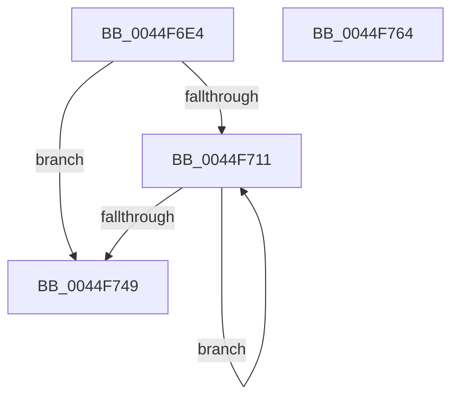

# HalpPCIPerformConfigAccess

- RVA: `0x0044F6E4`–`0x0044F765` (길이 `129` bytes)
- VA: `0x000000014044F6E4`
- 실행 섹션: `.text`
- PDB 이름 있음: `예`; PDB Function 태그: `아니요`
- unwind 정보 RVA: `0x0005E6B4`
- 디코드: `39`개 명령, `129/129` bytes 표시
- 미해석 바이트: `0` (있으면 어셈블리에 `.byte`로 보존)

> 이 문서는 커널 이미지의 기계어와 PDB 기호를 분석해 생성했습니다. 4번과 5번은 함수 원형과 자료형을 바이너리 사용 방식에서 추정한 C 해석이며 원본 소스 복구 결과는 아닙니다.

## 1. Dependencies

- 직접 호출 지점: **1**; 고유 호출 대상: **1**
- 직접 호출자로 확인된 함수: **1**
- RIP 상대 이미지 참조: **1**

### Outgoing calls
- `0x0044F739` → [guard_dispatch_icall](../6B/guard_dispatch_icall_function_006BAAD0.md) (function, `0x006BAAD0`)

### Direct callers
- [HalpPciAccessIoConfigSpace](../55/HalpPciAccessIoConfigSpace_function_00553948.md) at `0x005539B8`

### Static image references
- `0x0044F727` → RVA `0x000105D0` (`.rdata`; read)

## 2. Other-region calls and transfers

- 다른 실행 섹션으로 향하는 call: **0**
- 별도 외부 분기/꼬리 이동을 확인하지 못했습니다.

## 3. Assembly (complete function range)

```asm
0044F6E4  48 8B C4                        mov rax, rsp
0044F6E7  48 89 58 08                     mov qword ptr [rax + 8], rbx
0044F6EB  48 89 68 10                     mov qword ptr [rax + 0x10], rbp
0044F6EF  48 89 70 18                     mov qword ptr [rax + 0x18], rsi
0044F6F3  48 89 78 20                     mov qword ptr [rax + 0x20], rdi
0044F6F7  41 56                           push r14
0044F6F9  48 83 EC 20                     sub rsp, 0x20
0044F6FD  8B 5C 24 50                     mov ebx, dword ptr [rsp + 0x50]
0044F701  41 8B F9                        mov edi, r9d
0044F704  49 8B F0                        mov rsi, r8
0044F707  48 8B EA                        mov rbp, rdx
0044F70A  4C 8B F1                        mov r14, rcx
0044F70D  85 DB                           test ebx, ebx
0044F70F  74 38                           je 0x14044f749
0044F711  44 8B D7                        mov r10d, edi
0044F714  8B C3                           mov eax, ebx
0044F716  83 E0 03                        and eax, 3
0044F719  41 83 E2 03                     and r10d, 3
0044F71D  44 8B C7                        mov r8d, edi
0044F720  48 8B CD                        mov rcx, rbp
0044F723  4A 8D 14 90                     lea rdx, [rax + r10*4]
0044F727  48 8D 05 A2 0E BC FF            lea rax, [rip - 0x43f15e]
0044F72E  0F B6 04 02                     movzx eax, byte ptr [rdx + rax]
0044F732  48 8B D6                        mov rdx, rsi
0044F735  49 8B 04 C6                     mov rax, qword ptr [r14 + rax*8]
0044F739  E8 92 B3 26 00                  call 0x1406baad0
0044F73E  8B C8                           mov ecx, eax
0044F740  03 F8                           add edi, eax
0044F742  48 03 F1                        add rsi, rcx
0044F745  2B D8                           sub ebx, eax
0044F747  75 C8                           jne 0x14044f711
0044F749  48 8B 5C 24 30                  mov rbx, qword ptr [rsp + 0x30]
0044F74E  48 8B 6C 24 38                  mov rbp, qword ptr [rsp + 0x38]
0044F753  48 8B 74 24 40                  mov rsi, qword ptr [rsp + 0x40]
0044F758  48 8B 7C 24 48                  mov rdi, qword ptr [rsp + 0x48]
0044F75D  48 83 C4 20                     add rsp, 0x20
0044F761  41 5E                           pop r14
0044F763  C3                              ret
0044F764  CC                              int3
```

## 4. C-style interpretation (structured pseudocode)

```c
__int64 __fastcall HalpPCIPerformConfigAccess(__int64 a1, __int64 a2, __int64 a3, int a4, unsigned int a5)
{
    __int64 result;
    __int64 v_r10;
    __int64 v_rbx;
    __int64 v_rdi;
    __int64 v_rsi;
    __int64 v_rsp;
    unsigned __int64 v_stack_p10;
    unsigned __int64 v_stack_p18;
    unsigned __int64 v_stack_p20;
    unsigned __int64 v_stack_p8;

    *(unsigned __int64 *)(v_rsp + 8) = v_rbx;
    *(unsigned __int64 *)(v_rsp + 16) = v_rbp;
    *(unsigned __int64 *)(v_rsp + 24) = v_rsi;
    *(unsigned __int64 *)(v_rsp + 32) = v_rdi;
    v_rsp = (v_rsp) - (32);
    if ((unsigned int)((unsigned int)(a5)) == 0) goto loc_0044F749;
loc_0044F711:
    result = (unsigned int)(((unsigned int)((unsigned int)((unsigned int)(a5)))) & (3));
    v_r10 = (unsigned int)(((unsigned int)((unsigned int)((unsigned int)(a4)))) & (3));
    result = guard_dispatch_icall(a2, a3, (unsigned int)((unsigned int)((unsigned int)(a4))), a4);
    v_rdi = (unsigned int)(((unsigned int)(a4)) + ((unsigned int)(result)));
    v_rsi = (a3) + ((unsigned int)((unsigned int)(result)));
    v_rbx = (unsigned int)(((unsigned int)(a5)) - ((unsigned int)(result)));
    if (condition_is_not_equal) goto loc_0044F711;
loc_0044F749:
    v_rsp = (v_rsp) + (32);
    return result;
}
```

## 5. (Beta) C Style

```c
int64_t HalpPCIPerformConfigAccess(void *Arg1, int64_t Arg2, int64_t Arg3, int32_t Arg4, uint32_t Arg5)
{
    uint8_t *arg1 = (uint8_t *)Arg1;

    int64_t result;
    int64_t local_r10;
    int64_t local_rbx;
    int64_t local_rdi;
    int64_t local_rsi;
    int64_t local_rsp;
    uint64_t v_stack_p10;
    uint64_t v_stack_p18;
    uint64_t v_stack_p20;
    uint64_t v_stack_p8;

    *(uint64_t *)(local_rsp + 0x8) = local_rbx;
    *(uint64_t *)(local_rsp + 0x10) = local_rbp;
    *(uint64_t *)(local_rsp + 0x18) = local_rsi;
    *(uint64_t *)(local_rsp + 0x20) = local_rdi;
    local_rsp = (local_rsp) - (32);
    if ((uint32_t)((uint32_t)(Arg5)) == 0) goto loc_0044F749;
loc_0044F711:
    result = (uint32_t)(((uint32_t)((uint32_t)((uint32_t)(Arg5)))) & (3));
    local_r10 = (uint32_t)(((uint32_t)((uint32_t)((uint32_t)(Arg4)))) & (3));
    result = guard_dispatch_icall(Arg2, Arg3, (uint32_t)((uint32_t)((uint32_t)(Arg4))), Arg4);
    local_rdi = (uint32_t)(((uint32_t)(Arg4)) + ((uint32_t)(result)));
    local_rsi = (Arg3) + ((uint32_t)((uint32_t)(result)));
    local_rbx = (uint32_t)(((uint32_t)(Arg5)) - ((uint32_t)(result)));
    if (condition_is_not_equal) goto loc_0044F711;
loc_0044F749:
    local_rsp = (local_rsp) + (32);
    return result;
}
```

### 관측된 메모리 오프셋

구조체 형식이 확인되지 않은 접근은 인자 기준의 오프셋으로만 기록했습니다.

| 기준 인자 | 오프셋 표현 | 폭 (bit) | 접근 |
|---|---:|---:|---|
| `Arg1` | `+ 0x0 + rax*8` | `64` | `R` |

## 6. Execution-region graph

[열기: 2D/3D 그래프와 함수 탐색 컨트롤 패널](../../../control-panel.html?section=text&rva=0x0044F6E4&view=graph)

- 2D 그래프는 위에서 아래로 흐르고, 3D 그래프는 빈 공간을 드래그해 회전합니다. Shift+드래그는 이동, 휠은 확대·축소, 함수 노드 선택은 대상 보고서 이동입니다.

### Static fallback


