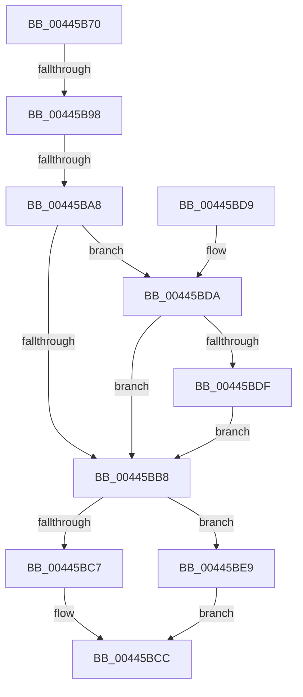

# HalpPerfInterrupt

- RVA: `0x00445B70`–`0x00445C09` (길이 `153` bytes)
- VA: `0x0000000140445B70`
- 실행 섹션: `.text`
- PDB 이름 있음: `예`; PDB Function 태그: `예`
- unwind 정보 RVA: `0x000A59E4`
- 디코드: `39`개 명령, `153/153` bytes 표시
- 미해석 바이트: `0` (있으면 어셈블리에 `.byte`로 보존)

> 이 문서는 커널 이미지의 기계어와 PDB 기호를 분석해 생성했습니다. 4번과 5번은 함수 원형과 자료형을 바이너리 사용 방식에서 추정한 C 해석이며 원본 소스 복구 결과는 아닙니다.

## 1. Dependencies

- 직접 호출 지점: **5**; 고유 호출 대상: **2**
- 직접 호출자로 확인된 함수: **0**
- RIP 상대 이미지 참조: **4**

### Outgoing calls
- `0x00445B84` → [Feature_Test52061194__private_IsEnabledNoReportingNoInline](Feature_Test52061194__private_IsEnabledNoReportingNoInline_function_00445C10.md) (function, `0x00445C10`)
- `0x00445BC7` → [guard_dispatch_icall](../6B/guard_dispatch_icall_function_006BAAD0.md) (function, `0x006BAAD0`)
- `0x00445BE2` → [guard_dispatch_icall](../6B/guard_dispatch_icall_function_006BAAD0.md) (function, `0x006BAAD0`)
- `0x00445BF4` → [guard_dispatch_icall](../6B/guard_dispatch_icall_function_006BAAD0.md) (function, `0x006BAAD0`)
- `0x00445C02` → [guard_dispatch_icall](../6B/guard_dispatch_icall_function_006BAAD0.md) (function, `0x006BAAD0`)

### Direct callers
- 이 함수 시작 RVA로 연결되는 직접 call은 확인되지 않았습니다. 간접 호출은 완전히 역산할 수 없습니다.

### Static image references
- `0x00445B89` → RVA `0x00E03B20` (`.data`; read)
- `0x00445B98` → RVA `0x00002A40` (`.rdata`; read)
- `0x00445BB8` → RVA `0x00E10310` (`.data`; read)
- `0x00445BF9` → RVA `0x00E00C08` (`.data`; read)

## 2. Other-region calls and transfers

- 다른 실행 섹션으로 향하는 call: **0**
- call이 아닌 외부 분기/꼬리 이동: **2**
  - `0x00445B92` → [sub_006F0080 + 0x77](../6F/Unknown_function_006F0080.md) (`tail-transfer`)
  - `0x00445BA2` → [sub_006F0080](../6F/Unknown_function_006F0080.md) (`tail-transfer`)

## 3. Assembly (complete function range)

```asm
00445B70  48 89 5C 24 08                  mov qword ptr [rsp + 8], rbx
00445B75  57                              push rdi
00445B76  48 83 EC 30                     sub rsp, 0x30
00445B7A  48 8B 99 88 00 00 00            mov rbx, qword ptr [rcx + 0x88]
00445B81  40 32 FF                        xor dil, dil
00445B84  E8 87 00 00 00                  call 0x140445c10
00445B89  4C 8B 0D 90 DF 9B 00            mov r9, qword ptr [rip + 0x9bdf90]
00445B90  85 C0                           test eax, eax
00445B92  0F 84 5F A5 2A 00               je 0x1406f00f7
00445B98  48 8D 05 A1 CE BB FF            lea rax, [rip - 0x44315f]
00445B9F  4C 3B C8                        cmp r9, rax
00445BA2  0F 84 D8 A4 2A 00               je 0x1406f0080
00445BA8  48 8B 05 71 DF 9B 00            mov rax, qword ptr [rip + 0x9bdf71]
00445BAF  48 8B 40 68                     mov rax, qword ptr [rax + 0x68]
00445BB3  48 85 C0                        test rax, rax
00445BB6  75 22                           jne 0x140445bda
00445BB8  48 8B 05 51 A7 9C 00            mov rax, qword ptr [rip + 0x9ca751]
00445BBF  48 8B CB                        mov rcx, rbx
00445BC2  48 85 C0                        test rax, rax
00445BC5  74 22                           je 0x140445be9
00445BC7  E8 04 4F 27 00                  call 0x1406baad0
00445BCC  48 8B 5C 24 40                  mov rbx, qword ptr [rsp + 0x40]
00445BD1  B0 01                           mov al, 1
00445BD3  48 83 C4 30                     add rsp, 0x30
00445BD7  5F                              pop rdi
00445BD8  C3                              ret
00445BD9  CC                              int3
00445BDA  40 84 FF                        test dil, dil
00445BDD  75 D9                           jne 0x140445bb8
00445BDF  48 8B CB                        mov rcx, rbx
00445BE2  E8 E9 4E 27 00                  call 0x1406baad0
00445BE7  EB CF                           jmp 0x140445bb8
00445BE9  48 8B 05 30 DF 9B 00            mov rax, qword ptr [rip + 0x9bdf30]
00445BF0  48 8B 40 28                     mov rax, qword ptr [rax + 0x28]
00445BF4  E8 D7 4E 27 00                  call 0x1406baad0
00445BF9  48 8B 05 08 B0 9B 00            mov rax, qword ptr [rip + 0x9bb008]
00445C00  33 C9                           xor ecx, ecx
00445C02  E8 C9 4E 27 00                  call 0x1406baad0
00445C07  EB C3                           jmp 0x140445bcc
```

## 4. C-style interpretation (structured pseudocode)

```c
__int64 __fastcall HalpPerfInterrupt(__int64 a1)
{
    __int64 result;
    __int64 v_rdi;
    __int64 v_rsp;
    unsigned __int64 v_stack_p8;

    v_stack_p8 = v_rbx;
    v_rsp = (v_rsp) - (48);
    v_rdi = 0;
    result = Feature_Test52061194__private_IsEnabledNoReportingNoInline(a1, a2, a3, a4);
    if (*(unsigned __int64 *)(*(unsigned __int64 *)(v_rip + 10215281) + 104) != 0) goto loc_00445BDA;
loc_00445BB8:
    if (*(unsigned __int64 *)(v_rip + 10266449) == 0) goto loc_00445BE9;
    result = guard_dispatch_icall(*(unsigned __int64 *)(a1 + 136), a2, a3, *(unsigned __int64 *)(v_rip + 10215312));
loc_00445BCC:
    v_rsp = (v_rsp) + (48);
    return 1;
loc_00445BDA:
    if (0 != 0) goto loc_00445BB8;
    result = guard_dispatch_icall(v_stack_p8, a2, a3, *(unsigned __int64 *)(v_rip + 10215312));
    goto loc_00445BB8;
loc_00445BE9:
    result = guard_dispatch_icall(v_stack_p8, a2, a3, *(unsigned __int64 *)(v_rip + 10215312));
    a1 = 0;
    result = guard_dispatch_icall(a1, a2, a3, *(unsigned __int64 *)(v_rip + 10215312));
    goto loc_00445BCC;
}
```

## 5. (Beta) C Style

```c
int64_t HalpPerfInterrupt(void *Arg1)
{
    uint8_t *arg1 = (uint8_t *)Arg1;

    int64_t result;
    int64_t local_rdi;
    int64_t local_rsp;
    uint64_t v_stack_p8;

    v_stack_p8 = local_rbx;
    local_rsp = (local_rsp) - (48);
    local_rdi = 0;
    result = Feature_Test52061194__private_IsEnabledNoReportingNoInline(Arg1, a2, a3, a4);
    if (*(uint64_t *)(*(uint64_t *)(v_rip + 0x9BDF71) + 0x68) != 0) goto loc_00445BDA;
loc_00445BB8:
    if (*(uint64_t *)(v_rip + 0x9CA751) == 0) goto loc_00445BE9;
    result = guard_dispatch_icall(*(uint64_t *)(arg1 + 0x88), a2, a3, *(uint64_t *)(v_rip + 0x9BDF90));
loc_00445BCC:
    local_rsp = (local_rsp) + (48);
    return 1;
loc_00445BDA:
    if (0 != 0) goto loc_00445BB8;
    result = guard_dispatch_icall(v_stack_p8, a2, a3, *(uint64_t *)(v_rip + 0x9BDF90));
    goto loc_00445BB8;
loc_00445BE9:
    result = guard_dispatch_icall(v_stack_p8, a2, a3, *(uint64_t *)(v_rip + 0x9BDF90));
    Arg1 = 0;
    result = guard_dispatch_icall(Arg1, a2, a3, *(uint64_t *)(v_rip + 0x9BDF90));
    goto loc_00445BCC;
}
```

### 관측된 메모리 오프셋

구조체 형식이 확인되지 않은 접근은 인자 기준의 오프셋으로만 기록했습니다.

| 기준 인자 | 오프셋 표현 | 폭 (bit) | 접근 |
|---|---:|---:|---|
| `Arg1` | `+ 0x88` | `64` | `R` |

## 6. Execution-region graph

[열기: 2D/3D 그래프와 함수 탐색 컨트롤 패널](../../../control-panel.html?section=text&rva=0x00445B70&view=graph)

- 2D 그래프는 위에서 아래로 흐르고, 3D 그래프는 빈 공간을 드래그해 회전합니다. Shift+드래그는 이동, 휠은 확대·축소, 함수 노드 선택은 대상 보고서 이동입니다.

### Static fallback


