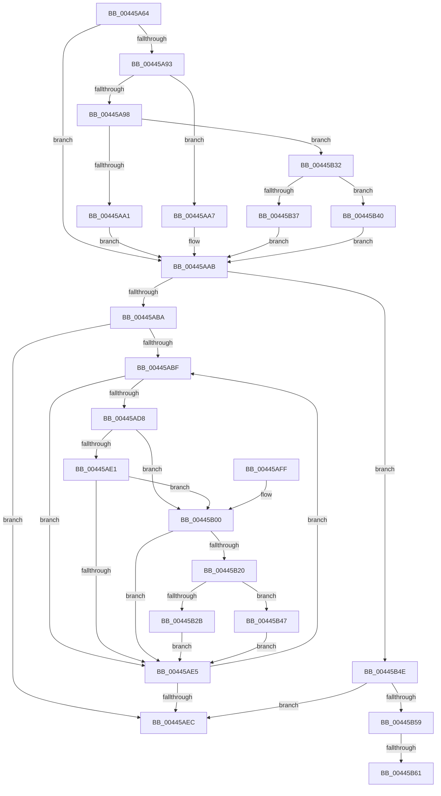

# HalpScanForProfilingCorruptionInternal

- RVA: `0x00445A64`–`0x00445B66` (길이 `258` bytes)
- VA: `0x0000000140445A64`
- 실행 섹션: `.text`
- PDB 이름 있음: `예`; PDB Function 태그: `예`
- unwind 정보 RVA: `0x000A59BC`
- 디코드: `77`개 명령, `258/258` bytes 표시
- 미해석 바이트: `0` (있으면 어셈블리에 `.byte`로 보존)

> 이 문서는 커널 이미지의 기계어와 PDB 기호를 분석해 생성했습니다. 4번과 5번은 함수 원형과 자료형을 바이너리 사용 방식에서 추정한 C 해석이며 원본 소스 복구 결과는 아닙니다.

## 1. Dependencies

- 직접 호출 지점: **2**; 고유 호출 대상: **2**
- 직접 호출자로 확인된 함수: **2**
- RIP 상대 이미지 참조: **2**

### Outgoing calls
- `0x00445AAB` → [Feature_Test52061194__private_IsEnabledNoReportingNoInline](Feature_Test52061194__private_IsEnabledNoReportingNoInline_function_00445C10.md) (function, `0x00445C10`)
- `0x00445B17` → [guard_dispatch_icall](../6B/guard_dispatch_icall_function_006BAAD0.md) (function, `0x006BAAD0`)

### Direct callers
- [HalpScanForProfilingCorruption](HalpScanForProfilingCorruption_function_00445A00.md) at `0x00445A1D`
- [HalpScanForProfilingCorruption](HalpScanForProfilingCorruption_function_00445A00.md) at `0x00445A2C`
- [HalpScanForProfilingCorruption](HalpScanForProfilingCorruption_function_00445A00.md) at `0x00445A3B`
- [HalpScanForProfilingCorruption](HalpScanForProfilingCorruption_function_00445A00.md) at `0x00445A4A`
- [HalpTimerAlwaysOnClockInterrupt](../56/HalpTimerAlwaysOnClockInterrupt_function_00560240.md) at `0x00560457`
- [HalpTimerAlwaysOnClockInterrupt](../56/HalpTimerAlwaysOnClockInterrupt_function_00560240.md) at `0x00560466`
- [HalpTimerAlwaysOnClockInterrupt](../56/HalpTimerAlwaysOnClockInterrupt_function_00560240.md) at `0x00560475`
- [HalpTimerAlwaysOnClockInterrupt](../56/HalpTimerAlwaysOnClockInterrupt_function_00560240.md) at `0x00560484`

### Static image references
- `0x00445A78` → RVA `0x00FC8C40` (`ALMOSTRO`; read)
- `0x00445B00` → RVA `0x00E03B20` (`.data`; read)

## 2. Other-region calls and transfers

- 다른 실행 섹션으로 향하는 call: **0**
- call이 아닌 외부 분기/꼬리 이동: **2**
  - `0x00445B5B` → [sub_006EFFEC](../6E/Unknown_function_006EFFEC.md) (`tail-transfer`)
  - `0x00445B61` → [sub_006EFFEC + 0x2C](../6E/Unknown_function_006EFFEC.md) (`tail-transfer`)

## 3. Assembly (complete function range)

```asm
00445A64  48 89 5C 24 10                  mov qword ptr [rsp + 0x10], rbx
00445A69  48 89 6C 24 18                  mov qword ptr [rsp + 0x18], rbp
00445A6E  56                              push rsi
00445A6F  57                              push rdi
00445A70  41 56                           push r14
00445A72  48 83 EC 20                     sub rsp, 0x20
00445A76  8B C2                           mov eax, edx
00445A78  48 8D 15 C1 31 B8 00            lea rdx, [rip + 0xb831c1]
00445A7F  C6 44 24 40 00                  mov byte ptr [rsp + 0x40], 0
00445A84  49 8B D8                        mov rbx, r8
00445A87  48 8B 04 C2                     mov rax, qword ptr [rdx + rax*8]
00445A8B  48 8B 78 58                     mov rdi, qword ptr [rax + 0x58]
00445A8F  85 C9                           test ecx, ecx
00445A91  74 18                           je 0x140445aab
00445A93  83 E9 01                        sub ecx, 1
00445A96  74 0F                           je 0x140445aa7
00445A98  83 E9 63                        sub ecx, 0x63
00445A9B  0F 85 91 00 00 00               jne 0x140445b32
00445AA1  48 83 C7 30                     add rdi, 0x30
00445AA5  EB 04                           jmp 0x140445aab
00445AA7  48 83 C7 18                     add rdi, 0x18
00445AAB  E8 60 01 00 00                  call 0x140445c10
00445AB0  33 ED                           xor ebp, ebp
00445AB2  85 C0                           test eax, eax
00445AB4  0F 85 94 00 00 00               jne 0x140445b4e
00445ABA  39 6F 04                        cmp dword ptr [rdi + 4], ebp
00445ABD  76 2D                           jbe 0x140445aec
00445ABF  48 8B 47 10                     mov rax, qword ptr [rdi + 0x10]
00445AC3  48 8D 34 6D 00 00 00 00         lea rsi, [rbp*2]
00445ACB  48 03 F5                        add rsi, rbp
00445ACE  48 03 F6                        add rsi, rsi
00445AD1  80 7C F0 28 00                  cmp byte ptr [rax + rsi*8 + 0x28], 0
00445AD6  75 0D                           jne 0x140445ae5
00445AD8  8B 44 F0 18                     mov eax, dword ptr [rax + rsi*8 + 0x18]
00445ADC  83 F8 01                        cmp eax, 1
00445ADF  74 1F                           je 0x140445b00
00445AE1  85 C0                           test eax, eax
00445AE3  74 1B                           je 0x140445b00
00445AE5  FF C5                           inc ebp
00445AE7  3B 6F 04                        cmp ebp, dword ptr [rdi + 4]
00445AEA  72 D3                           jb 0x140445abf
00445AEC  48 8B 5C 24 48                  mov rbx, qword ptr [rsp + 0x48]
00445AF1  48 8B 6C 24 50                  mov rbp, qword ptr [rsp + 0x50]
00445AF6  48 83 C4 20                     add rsp, 0x20
00445AFA  41 5E                           pop r14
00445AFC  5F                              pop rdi
00445AFD  5E                              pop rsi
00445AFE  C3                              ret
00445AFF  CC                              int3
00445B00  48 8B 05 19 E0 9B 00            mov rax, qword ptr [rip + 0x9be019]
00445B07  4C 8D 44 24 40                  lea r8, [rsp + 0x40]
00445B0C  8B 17                           mov edx, dword ptr [rdi]
00445B0E  8B CD                           mov ecx, ebp
00445B10  48 8B 80 90 00 00 00            mov rax, qword ptr [rax + 0x90]
00445B17  E8 B4 4F 27 00                  call 0x1406baad0
00445B1C  85 C0                           test eax, eax
00445B1E  78 C5                           js 0x140445ae5
00445B20  80 7C 24 40 00                  cmp byte ptr [rsp + 0x40], 0
00445B25  48 8B 47 10                     mov rax, qword ptr [rdi + 0x10]
00445B29  75 1C                           jne 0x140445b47
00445B2B  48 89 5C F0 08                  mov qword ptr [rax + rsi*8 + 8], rbx
00445B30  EB B3                           jmp 0x140445ae5
00445B32  83 F9 01                        cmp ecx, 1
00445B35  75 09                           jne 0x140445b40
00445B37  48 83 C7 48                     add rdi, 0x48
00445B3B  E9 6B FF FF FF                  jmp 0x140445aab
00445B40  33 FF                           xor edi, edi
00445B42  E9 64 FF FF FF                  jmp 0x140445aab
00445B47  C6 44 F0 28 01                  mov byte ptr [rax + rsi*8 + 0x28], 1
00445B4C  EB 97                           jmp 0x140445ae5
00445B4E  8B 47 04                        mov eax, dword ptr [rdi + 4]
00445B51  4C 8B 77 10                     mov r14, qword ptr [rdi + 0x10]
00445B55  85 C0                           test eax, eax
00445B57  74 93                           je 0x140445aec
00445B59  3B E8                           cmp ebp, eax
00445B5B  0F 82 8B A4 2A 00               jb 0x1406effec
00445B61  E9 B2 A4 2A 00                  jmp 0x1406f0018
```

## 4. C-style interpretation (structured pseudocode)

```c
__int64 __fastcall HalpScanForProfilingCorruptionInternal(int a1, int a2, __int64 a3)
{
    __int64 result;
    __int64 v_rbp;
    __int64 v_rdi;
    __int64 v_rsi;
    __int64 v_rsp;
    unsigned __int64 v_stack_p10;
    unsigned __int64 v_stack_p18;
    unsigned __int64 v_stack_p40;
    unsigned __int8 v_stack_p8;

    v_stack_p10 = v_rbx;
    v_stack_p18 = v_rbp;
    v_rsp = (v_rsp) - (32);
    v_stack_p8 = 0;
    if (a1 == 0) goto loc_00445AAB;
    a1 = (unsigned int)((a1) - (1));
    if (condition_is_equal) goto loc_00445AA7;
    a1 = (unsigned int)((a1) - (99));
    if (condition_is_not_equal) goto loc_00445B32;
    v_rdi = (*(unsigned __int64 *)(*(unsigned __int64 *)(v_rip + 12071361 + (unsigned int)(a2) * 8) + 88)) + (48);
    goto loc_00445AAB;
loc_00445AA7:
    v_rdi = (v_rdi) + (24);
loc_00445AAB:
    result = Feature_Test52061194__private_IsEnabledNoReportingNoInline(a1, v_rip + 12071361, a3, a4);
    v_rbp = 0;
    if ((unsigned int)(result) != 0) goto loc_00445B4E;
    if ((*(unsigned int *)(v_rdi + 4)) <= 0) goto loc_00445AEC;
loc_00445ABF:
    v_rsi = (v_rbp * 2) + (0);
    v_rsi = (v_rsi) + (v_rsi);
    if ((*(unsigned __int8 *)(*(unsigned __int64 *)(v_rdi + 16) + v_rsi * 8 + 40)) != 0) goto loc_00445AE5;
    if (((unsigned int)((unsigned int)(*(unsigned int *)(*(unsigned __int64 *)(v_rdi + 16) + v_rsi * 8 + 24)))) == 1) goto loc_00445B00;
    if ((unsigned int)((unsigned int)(*(unsigned int *)(*(unsigned __int64 *)(v_rdi + 16) + v_rsi * 8 + 24))) == 0) goto loc_00445B00;
loc_00445AE5:
    v_rbp = (unsigned int)((v_rbp) + 1);
    if (((unsigned int)(v_rbp)) < (*(unsigned int *)(v_rdi + 4))) goto loc_00445ABF;
loc_00445AEC:
    v_rsp = (v_rsp) + (32);
    return (unsigned int)(*(unsigned int *)(*(unsigned __int64 *)(v_rdi + 16) + v_rsi * 8 + 24));
loc_00445B00:
    result = guard_dispatch_icall((unsigned int)((unsigned int)(v_stack_p18)), (unsigned int)(*(unsigned int *)(v_rdi)), v_stack_p40, a4);
    if (sign_flag) goto loc_00445AE5;
    if (v_stack_p40 != 0) goto loc_00445B47;
    *(unsigned __int64 *)(*(unsigned __int64 *)(v_rdi + 16) + v_rsi * 8 + 8) = v_stack_p10;
    goto loc_00445AE5;
loc_00445B32:
    if (((unsigned int)((unsigned int)((unsigned int)(v_stack_p18)))) != 1) goto loc_00445B40;
    v_rdi = (v_rdi) + (72);
    goto loc_00445AAB;
loc_00445B40:
    v_rdi = 0;
    goto loc_00445AAB;
loc_00445B47:
    *(unsigned __int8 *)(*(unsigned __int64 *)(v_rdi + 16) + v_rsi * 8 + 40) = 1;
    goto loc_00445AE5;
loc_00445B4E:
    if ((unsigned int)((unsigned int)(*(unsigned int *)(v_rdi + 4))) == 0) goto loc_00445AEC;
}
```

## 5. (Beta) C Style

```c
int64_t HalpScanForProfilingCorruptionInternal(int32_t Arg1, int32_t Arg2, int64_t Arg3)
{
    int64_t result;
    int64_t local_rbp;
    int64_t local_rdi;
    int64_t local_rsi;
    int64_t local_rsp;
    uint64_t v_stack_p10;
    uint64_t v_stack_p18;
    uint64_t v_stack_p40;
    uint8_t v_stack_p8;

    v_stack_p10 = local_rbx;
    v_stack_p18 = local_rbp;
    local_rsp = (local_rsp) - (32);
    v_stack_p8 = 0;
    if (Arg1 == 0) goto loc_00445AAB;
    Arg1 = (uint32_t)((Arg1) - (1));
    if (condition_is_equal) goto loc_00445AA7;
    Arg1 = (uint32_t)((Arg1) - (99));
    if (condition_is_not_equal) goto loc_00445B32;
    local_rdi = (*(uint64_t *)(*(uint64_t *)(v_rip + 0xB831C1 + (uint32_t)(Arg2) * 8) + 0x58)) + (48);
    goto loc_00445AAB;
loc_00445AA7:
    local_rdi = (local_rdi) + (24);
loc_00445AAB:
    result = Feature_Test52061194__private_IsEnabledNoReportingNoInline(Arg1, v_rip + 12071361, Arg3, a4);
    local_rbp = 0;
    if ((uint32_t)(result) != 0) goto loc_00445B4E;
    if ((*(uint32_t *)(local_rdi + 0x4)) <= 0) goto loc_00445AEC;
loc_00445ABF:
    local_rsi = (local_rbp * 2) + (0);
    local_rsi = (local_rsi) + (local_rsi);
    if ((*(uint8_t *)(*(uint64_t *)(local_rdi + 0x10) + local_rsi * 8 + 0x28)) != 0) goto loc_00445AE5;
    if (((uint32_t)((uint32_t)(*(uint32_t *)(*(uint64_t *)(local_rdi + 0x10) + local_rsi * 8 + 0x18)))) == 1) goto loc_00445B00;
    if ((uint32_t)((uint32_t)(*(uint32_t *)(*(uint64_t *)(local_rdi + 0x10) + local_rsi * 8 + 0x18))) == 0) goto loc_00445B00;
loc_00445AE5:
    local_rbp = (uint32_t)((local_rbp) + 1);
    if (((uint32_t)(local_rbp)) < (*(uint32_t *)(local_rdi + 0x4))) goto loc_00445ABF;
loc_00445AEC:
    local_rsp = (local_rsp) + (32);
    return (uint32_t)(*(uint32_t *)(*(uint64_t *)(local_rdi + 0x10) + local_rsi * 8 + 0x18));
loc_00445B00:
    result = guard_dispatch_icall((uint32_t)((uint32_t)(v_stack_p18)), (uint32_t)(*(uint32_t *)(local_rdi)), v_stack_p40, a4);
    if (sign_flag) goto loc_00445AE5;
    if (v_stack_p40 != 0) goto loc_00445B47;
    *(uint64_t *)(*(uint64_t *)(local_rdi + 0x10) + local_rsi * 8 + 0x8) = v_stack_p10;
    goto loc_00445AE5;
loc_00445B32:
    if (((uint32_t)((uint32_t)((uint32_t)(v_stack_p18)))) != 1) goto loc_00445B40;
    local_rdi = (local_rdi) + (72);
    goto loc_00445AAB;
loc_00445B40:
    local_rdi = 0;
    goto loc_00445AAB;
loc_00445B47:
    *(uint8_t *)(*(uint64_t *)(local_rdi + 0x10) + local_rsi * 8 + 0x28) = 1;
    goto loc_00445AE5;
loc_00445B4E:
    if ((uint32_t)((uint32_t)(*(uint32_t *)(local_rdi + 0x4))) == 0) goto loc_00445AEC;
}
```

## 6. Execution-region graph

[열기: 2D/3D 그래프와 함수 탐색 컨트롤 패널](../../../control-panel.html?section=text&rva=0x00445A64&view=graph)

- 2D 그래프는 위에서 아래로 흐르고, 3D 그래프는 빈 공간을 드래그해 회전합니다. Shift+드래그는 이동, 휠은 확대·축소, 함수 노드 선택은 대상 보고서 이동입니다.

### Static fallback


