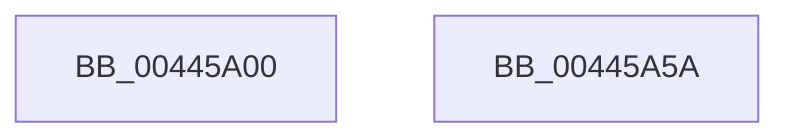

# HalpScanForProfilingCorruption

- RVA: `0x00445A00`–`0x00445A5B` (길이 `91` bytes)
- VA: `0x0000000140445A00`
- 실행 섹션: `.text`
- PDB 이름 있음: `예`; PDB Function 태그: `아니요`
- unwind 정보 RVA: `0x0005CAAC`
- 디코드: `28`개 명령, `91/91` bytes 표시
- 미해석 바이트: `0` (있으면 어셈블리에 `.byte`로 보존)

> 이 문서는 커널 이미지의 기계어와 PDB 기호를 분석해 생성했습니다. 4번과 5번은 함수 원형과 자료형을 바이너리 사용 방식에서 추정한 C 해석이며 원본 소스 복구 결과는 아닙니다.

## 1. Dependencies

- 직접 호출 지점: **5**; 고유 호출 대상: **2**
- 직접 호출자로 확인된 함수: **3**
- RIP 상대 이미지 참조: **0**

### Outgoing calls
- `0x00445A0E` → [KeQueryPerformanceCounter](../37/KeQueryPerformanceCounter_function_0037E7E0.md) (function, `0x0037E7E0`)
- `0x00445A1D` → [HalpScanForProfilingCorruptionInternal](HalpScanForProfilingCorruptionInternal_function_00445A64.md) (function, `0x00445A64`)
- `0x00445A2C` → [HalpScanForProfilingCorruptionInternal](HalpScanForProfilingCorruptionInternal_function_00445A64.md) (function, `0x00445A64`)
- `0x00445A3B` → [HalpScanForProfilingCorruptionInternal](HalpScanForProfilingCorruptionInternal_function_00445A64.md) (function, `0x00445A64`)
- `0x00445A4A` → [HalpScanForProfilingCorruptionInternal](HalpScanForProfilingCorruptionInternal_function_00445A64.md) (function, `0x00445A64`)

### Direct callers
- [HalpTimerClockInterrupt](../20/HalpTimerClockInterrupt_function_002086A0.md) at `0x0020886F`
- [sub_00208C94](../20/Unknown_function_00208C94.md) at `0x00208D77`
- [HalpTimerClockIpiRoutine](../39/HalpTimerClockIpiRoutine_function_00399CC0.md) at `0x00399DB9`

### Static image references
- 디코드된 RIP-relative 메모리 참조가 없습니다.

## 2. Other-region calls and transfers

- 다른 실행 섹션으로 향하는 call: **0**
- 별도 외부 분기/꼬리 이동을 확인하지 못했습니다.

## 3. Assembly (complete function range)

```asm
00445A00  48 89 5C 24 08                  mov qword ptr [rsp + 8], rbx
00445A05  57                              push rdi
00445A06  48 83 EC 20                     sub rsp, 0x20
00445A0A  8B F9                           mov edi, ecx
00445A0C  33 C9                           xor ecx, ecx
00445A0E  E8 CD 8D F3 FF                  call 0x14037e7e0
00445A13  4C 8B C0                        mov r8, rax
00445A16  8B D7                           mov edx, edi
00445A18  33 C9                           xor ecx, ecx
00445A1A  48 8B D8                        mov rbx, rax
00445A1D  E8 42 00 00 00                  call 0x140445a64
00445A22  4C 8B C3                        mov r8, rbx
00445A25  8B D7                           mov edx, edi
00445A27  B9 01 00 00 00                  mov ecx, 1
00445A2C  E8 33 00 00 00                  call 0x140445a64
00445A31  4C 8B C3                        mov r8, rbx
00445A34  8B D7                           mov edx, edi
00445A36  B9 64 00 00 00                  mov ecx, 0x64
00445A3B  E8 24 00 00 00                  call 0x140445a64
00445A40  4C 8B C3                        mov r8, rbx
00445A43  8B D7                           mov edx, edi
00445A45  B9 65 00 00 00                  mov ecx, 0x65
00445A4A  E8 15 00 00 00                  call 0x140445a64
00445A4F  48 8B 5C 24 30                  mov rbx, qword ptr [rsp + 0x30]
00445A54  48 83 C4 20                     add rsp, 0x20
00445A58  5F                              pop rdi
00445A59  C3                              ret
00445A5A  CC                              int3
```

## 4. C-style interpretation (structured pseudocode)

```c
__int64 __fastcall HalpScanForProfilingCorruption(int a1)
{
    __int64 result;
    __int64 v_rsp;
    unsigned __int64 v_stack_p8;

    v_stack_p8 = v_rbx;
    v_rsp = (v_rsp) - (32);
    a1 = 0;
    result = KeQueryPerformanceCounter(a1, a2, a3, a4);
    a1 = 0;
    result = HalpScanForProfilingCorruptionInternal(a1, (unsigned int)((unsigned int)((unsigned int)(a1))), result, a4);
    result = HalpScanForProfilingCorruptionInternal(1, (unsigned int)((unsigned int)((unsigned int)(a1))), result, a4);
    result = HalpScanForProfilingCorruptionInternal(100, (unsigned int)((unsigned int)((unsigned int)(a1))), result, a4);
    result = HalpScanForProfilingCorruptionInternal(101, (unsigned int)((unsigned int)((unsigned int)(a1))), result, a4);
    v_rsp = (v_rsp) + (32);
    return result;
}
```

## 5. (Beta) C Style

```c
int64_t HalpScanForProfilingCorruption(int32_t Arg1)
{
    int64_t result;
    int64_t local_rsp;
    uint64_t v_stack_p8;

    v_stack_p8 = local_rbx;
    local_rsp = (local_rsp) - (32);
    Arg1 = 0;
    result = KeQueryPerformanceCounter(Arg1, a2, a3, a4);
    Arg1 = 0;
    result = HalpScanForProfilingCorruptionInternal(Arg1, (uint32_t)((uint32_t)((uint32_t)(Arg1))), result, a4);
    result = HalpScanForProfilingCorruptionInternal(1, (uint32_t)((uint32_t)((uint32_t)(Arg1))), result, a4);
    result = HalpScanForProfilingCorruptionInternal(100, (uint32_t)((uint32_t)((uint32_t)(Arg1))), result, a4);
    result = HalpScanForProfilingCorruptionInternal(101, (uint32_t)((uint32_t)((uint32_t)(Arg1))), result, a4);
    local_rsp = (local_rsp) + (32);
    return result;
}
```

## 6. Execution-region graph

[열기: 2D/3D 그래프와 함수 탐색 컨트롤 패널](../../../control-panel.html?section=text&rva=0x00445A00&view=graph)

- 2D 그래프는 위에서 아래로 흐르고, 3D 그래프는 빈 공간을 드래그해 회전합니다. Shift+드래그는 이동, 휠은 확대·축소, 함수 노드 선택은 대상 보고서 이동입니다.

### Static fallback


