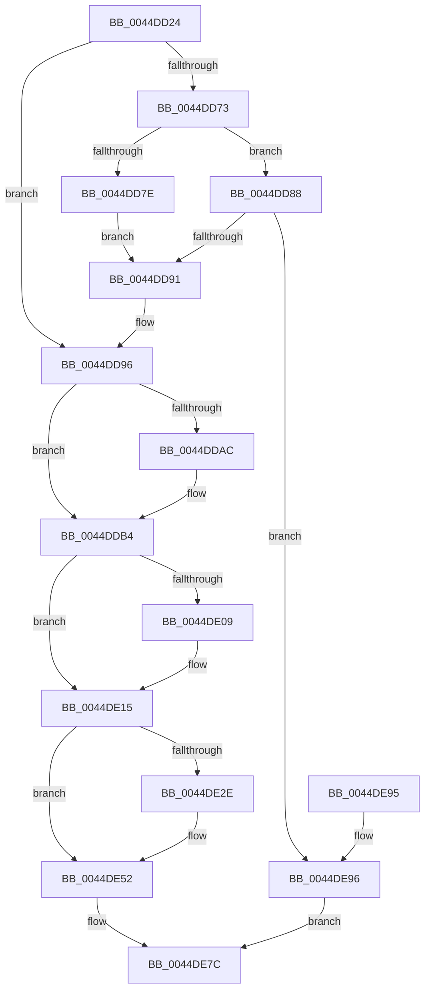

# HsaAttachDeviceDomainInternal

- RVA: `0x0044DD24`–`0x0044DE9D` (길이 `377` bytes)
- VA: `0x000000014044DD24`
- 실행 섹션: `.text`
- PDB 이름 있음: `예`; PDB Function 태그: `아니요`
- unwind 정보 RVA: `0x000A69F0`
- 디코드: `89`개 명령, `377/377` bytes 표시
- 미해석 바이트: `0` (있으면 어셈블리에 `.byte`로 보존)

> 이 문서는 커널 이미지의 기계어와 PDB 기호를 분석해 생성했습니다. 4번과 5번은 함수 원형과 자료형을 바이너리 사용 방식에서 추정한 C 해석이며 원본 소스 복구 결과는 아닙니다.

## 1. Dependencies

- 직접 호출 지점: **8**; 고유 호출 대상: **7**
- 직접 호출자로 확인된 함수: **2**
- RIP 상대 이미지 참조: **1**

### Outgoing calls
- `0x0044DD69` → [memset](../6C/memset_function_006C6C40.md) (function, `0x006C6C40`)
- `0x0044DDAF` → [KiRaiseIrqlProcessIrqlFlags](../4F/KiRaiseIrqlProcessIrqlFlags_function_004F56FC.md) (function, `0x004F56FC`)
- `0x0044DDC0` → [KeAcquireInStackQueuedSpinLockAtDpcLevel](../27/KeAcquireInStackQueuedSpinLockAtDpcLevel_function_00275740.md) (function, `0x00275740`)
- `0x0044DDF1` → [HsaUpdateDeviceTableEntry](HsaUpdateDeviceTableEntry_function_0044E404.md) (function, `0x0044E404`)
- `0x0044DDFB` → [KeReleaseInStackQueuedSpinLockFromDpcLevel](../21/KeReleaseInStackQueuedSpinLockFromDpcLevel_function_002171B0.md) (function, `0x002171B0`)
- `0x0044DE10` → [KiLowerIrqlProcessIrqlFlags](../4F/KiLowerIrqlProcessIrqlFlags_function_004F5698.md) (function, `0x004F5698`)
- `0x0044DE4D` → [HsaFlushTbInternal](HsaFlushTbInternal_function_0044DEE8.md) (function, `0x0044DEE8`)
- `0x0044DE75` → [HsaFlushTbInternal](HsaFlushTbInternal_function_0044DEE8.md) (function, `0x0044DEE8`)

### Direct callers
- [HsaAttachDeviceDomain](../57/HsaAttachDeviceDomain_function_00573B30.md) at `0x00573B34`
- [HsaDetachDeviceDomain](../57/HsaDetachDeviceDomain_function_00573CB0.md) at `0x00573CB7`

### Static image references
- `0x0044DDA3` → RVA `0x00FC6D20` (`ALMOSTRO`; read)

## 2. Other-region calls and transfers

- 다른 실행 섹션으로 향하는 call: **0**
- 별도 외부 분기/꼬리 이동을 확인하지 못했습니다.

## 3. Assembly (complete function range)

```asm
0044DD24  4C 8B DC                        mov r11, rsp
0044DD27  49 89 5B 08                     mov qword ptr [r11 + 8], rbx
0044DD2B  49 89 6B 10                     mov qword ptr [r11 + 0x10], rbp
0044DD2F  49 89 73 18                     mov qword ptr [r11 + 0x18], rsi
0044DD33  4D 89 4B 20                     mov qword ptr [r11 + 0x20], r9
0044DD37  57                              push rdi
0044DD38  48 81 EC E0 00 00 00            sub rsp, 0xe0
0044DD3F  33 C0                           xor eax, eax
0044DD41  49 C7 43 20 00 00 01 00         mov qword ptr [r11 + 0x20], 0x10000
0044DD49  49 8B F0                        mov rsi, r8
0044DD4C  48 89 44 24 60                  mov qword ptr [rsp + 0x60], rax
0044DD51  48 8B EA                        mov rbp, rdx
0044DD54  48 8B D9                        mov rbx, rcx
0044DD57  0F 57 C0                        xorps xmm0, xmm0
0044DD5A  49 8D 4B 88                     lea rcx, [r11 - 0x78]
0044DD5E  44 8D 40 70                     lea r8d, [rax + 0x70]
0044DD62  33 D2                           xor edx, edx
0044DD64  0F 11 44 24 50                  movups xmmword ptr [rsp + 0x50], xmm0
0044DD69  E8 D2 8E 27 00                  call 0x1406c6c40
0044DD6E  48 85 F6                        test rsi, rsi
0044DD71  75 23                           jne 0x14044dd96
0044DD73  8B 83 AC 00 00 00               mov eax, dword ptr [rbx + 0xac]
0044DD79  83 F8 02                        cmp eax, 2
0044DD7C  75 0A                           jne 0x14044dd88
0044DD7E  C7 44 24 74 01 00 00 00         mov dword ptr [rsp + 0x74], 1
0044DD86  EB 09                           jmp 0x14044dd91
0044DD88  83 F8 01                        cmp eax, 1
0044DD8B  0F 85 05 01 00 00               jne 0x14044de96
0044DD91  48 8D 74 24 70                  lea rsi, [rsp + 0x70]
0044DD96  44 0F 20 C7                     mov rdi, cr8
0044DD9A  BA 0F 00 00 00                  mov edx, 0xf
0044DD9F  44 0F 22 C2                     mov cr8, rdx
0044DDA3  83 3D 76 8F B7 00 00            cmp dword ptr [rip + 0xb78f76], 0
0044DDAA  74 08                           je 0x14044ddb4
0044DDAC  40 8A CF                        mov cl, dil
0044DDAF  E8 48 79 0A 00                  call 0x1404f56fc
0044DDB4  48 8D 8B 98 00 00 00            lea rcx, [rbx + 0x98]
0044DDBB  48 8D 54 24 50                  lea rdx, [rsp + 0x50]
0044DDC0  E8 7B 79 E2 FF                  call 0x140275740
0044DDC5  48 8B 55 28                     mov rdx, qword ptr [rbp + 0x28]
0044DDC9  48 8D 84 24 08 01 00 00         lea rax, [rsp + 0x108]
0044DDD1  48 89 44 24 48                  mov qword ptr [rsp + 0x48], rax
0044DDD6  41 B1 01                        mov r9b, 1
0044DDD9  83 64 24 30 00                  and dword ptr [rsp + 0x30], 0
0044DDDE  45 33 C0                        xor r8d, r8d
0044DDE1  C7 44 24 28 01 00 00 00         mov dword ptr [rsp + 0x28], 1
0044DDE9  48 8B CB                        mov rcx, rbx
0044DDEC  48 89 74 24 20                  mov qword ptr [rsp + 0x20], rsi
0044DDF1  E8 0E 06 00 00                  call 0x14044e404
0044DDF6  48 8D 4C 24 50                  lea rcx, [rsp + 0x50]
0044DDFB  E8 B0 93 DC FF                  call 0x1402171b0
0044DE00  83 3D 19 8F B7 00 00            cmp dword ptr [rip + 0xb78f19], 0
0044DE07  74 0C                           je 0x14044de15
0044DE09  44 0F 20 C1                     mov rcx, cr8
0044DE0D  40 8A D7                        mov dl, dil
0044DE10  E8 83 78 0A 00                  call 0x1404f5698
0044DE15  40 0F B6 C7                     movzx eax, dil
0044DE19  44 0F 22 C0                     mov cr8, rax
0044DE1D  4C 8B 84 24 08 01 00 00         mov r8, qword ptr [rsp + 0x108]
0044DE25  49 81 F8 00 00 01 00            cmp r8, 0x10000
0044DE2C  74 24                           je 0x14044de52
0044DE2E  48 83 64 24 38 00               and qword ptr [rsp + 0x38], 0
0044DE34  41 B1 01                        mov r9b, 1
0044DE37  83 64 24 30 00                  and dword ptr [rsp + 0x30], 0
0044DE3C  33 D2                           xor edx, edx
0044DE3E  48 83 64 24 28 00               and qword ptr [rsp + 0x28], 0
0044DE44  48 8B CB                        mov rcx, rbx
0044DE47  48 83 64 24 20 00               and qword ptr [rsp + 0x20], 0
0044DE4D  E8 96 00 00 00                  call 0x14044dee8
0044DE52  48 83 64 24 38 00               and qword ptr [rsp + 0x38], 0
0044DE58  41 B1 01                        mov r9b, 1
0044DE5B  83 64 24 30 00                  and dword ptr [rsp + 0x30], 0
0044DE60  33 D2                           xor edx, edx
0044DE62  48 83 64 24 28 00               and qword ptr [rsp + 0x28], 0
0044DE68  48 8B CB                        mov rcx, rbx
0044DE6B  44 8B 46 30                     mov r8d, dword ptr [rsi + 0x30]
0044DE6F  48 83 64 24 20 00               and qword ptr [rsp + 0x20], 0
0044DE75  E8 6E 00 00 00                  call 0x14044dee8
0044DE7A  33 C0                           xor eax, eax
0044DE7C  4C 8D 9C 24 E0 00 00 00         lea r11, [rsp + 0xe0]
0044DE84  49 8B 5B 10                     mov rbx, qword ptr [r11 + 0x10]
0044DE88  49 8B 6B 18                     mov rbp, qword ptr [r11 + 0x18]
0044DE8C  49 8B 73 20                     mov rsi, qword ptr [r11 + 0x20]
0044DE90  49 8B E3                        mov rsp, r11
0044DE93  5F                              pop rdi
0044DE94  C3                              ret
0044DE95  CC                              int3
0044DE96  B8 01 00 00 C0                  mov eax, 0xc0000001
0044DE9B  EB DF                           jmp 0x14044de7c
```

## 4. C-style interpretation (structured pseudocode)

```c
__int64 __fastcall HsaAttachDeviceDomainInternal(__int64 a1, __int64 a2, __int64 a3, __int64 a4)
{
    __int64 result;
    __int64 v_rsp;
    unsigned int v_stack_m74;
    unsigned __int64 v_stack_m78;
    unsigned __int64 v_stack_m8;
    unsigned __int64 v_stack_m88;
    unsigned __int64 v_stack_m98;
    unsigned __int64 v_stack_mA0;
    unsigned __int64 v_stack_mB0;
    unsigned int v_stack_mB8;
    unsigned int v_stack_mC0;
    unsigned __int64 v_stack_mC8;
    unsigned __int64 v_stack_p20;

    *(unsigned __int64 *)(v_rsp + 8) = v_rbx;
    *(unsigned __int64 *)(v_rsp + 16) = v_rbp;
    *(unsigned __int64 *)(v_rsp + 24) = v_rsi;
    *(unsigned __int64 *)(v_rsp + 32) = a4;
    v_rsp = (v_rsp) - (224);
    result = 0;
    *(unsigned __int64 *)(v_rsp + 32) = 0x10000ULL;
    v_stack_m88 = 0;
    a2 = 0;
    v_stack_m98 = v_xmm0;
    result = memset(v_rsp - 120, a2, result + 112, a4);
    if (a3 != 0) goto loc_0044DD96;
    if (((unsigned int)((unsigned int)(*(unsigned int *)(a1 + 172)))) != 2) goto loc_0044DD88;
    v_stack_m74 = 1;
    goto loc_0044DD91;
loc_0044DD88:
    if (((unsigned int)((unsigned int)(*(unsigned int *)(a1 + 172)))) != 1) goto loc_0044DE96;
loc_0044DD91:
loc_0044DD96:
    result = (unsigned int)(*(unsigned int *)(a1 + 172));
    if ((*(unsigned int *)(v_rip + 12029814)) != 0) {
        a1 = (unsigned __int8)(v_cr8);
        result = KiRaiseIrqlProcessIrqlFlags(a1, 15, result + 112, a4);
    }
    result = KeAcquireInStackQueuedSpinLockAtDpcLevel(a1 + 152, v_stack_m98, result + 112, a4);
    v_stack_mA0 = v_stack_p20;
    a3 = 0;
    v_stack_mC0 = 1;
    v_stack_mC8 = v_stack_m78;
    result = HsaUpdateDeviceTableEntry(a1, *(unsigned __int64 *)(a2 + 40), a3, 1);
    result = KeReleaseInStackQueuedSpinLockFromDpcLevel(v_stack_m98, *(unsigned __int64 *)(a2 + 40), a3, 1);
    if ((*(unsigned int *)(v_rip + 12029721)) != 0) {
        a1 = 15;
        a2 = (unsigned __int8)(v_cr8);
        result = KiLowerIrqlProcessIrqlFlags(a1, a2, a3, 1);
    }
    result = (unsigned __int8)(v_cr8);
    if (v_stack_p20 != 0x10000ULL) {
        a4 = 1;
        a2 = 0;
        a1 = a1;
        result = HsaFlushTbInternal(a1, a2, v_stack_p20, a4);
    }
    a2 = 0;
    result = HsaFlushTbInternal(a1, a2, (unsigned int)(*(unsigned int *)(v_stack_m78 + 48)), 1);
    result = 0;
loc_0044DE7C:
    return result;
loc_0044DE96:
    goto loc_0044DE7C;
}
```

## 5. (Beta) C Style

```c
int64_t HsaAttachDeviceDomainInternal(void *Arg1, void *Arg2, int64_t Arg3, int64_t Arg4)
{
    uint8_t *arg1 = (uint8_t *)Arg1;
    uint8_t *arg2 = (uint8_t *)Arg2;

    int64_t result;
    int64_t local_rsp;
    uint32_t v_stack_m74;
    uint64_t v_stack_m78;
    uint64_t v_stack_m8;
    uint64_t v_stack_m88;
    uint64_t v_stack_m98;
    uint64_t v_stack_mA0;
    uint64_t v_stack_mB0;
    uint32_t v_stack_mB8;
    uint32_t v_stack_mC0;
    uint64_t v_stack_mC8;
    uint64_t v_stack_p20;

    *(uint64_t *)(local_rsp + 0x8) = local_rbx;
    *(uint64_t *)(local_rsp + 0x10) = local_rbp;
    *(uint64_t *)(local_rsp + 0x18) = local_rsi;
    *(uint64_t *)(local_rsp + 0x20) = Arg4;
    local_rsp = (local_rsp) - (224);
    result = 0;
    *(uint64_t *)(local_rsp + 0x20) = 0x10000ULL;
    v_stack_m88 = 0;
    Arg2 = 0;
    v_stack_m98 = v_xmm0;
    result = memset(local_rsp - 120, Arg2, result + 112, Arg4);
    if (Arg3 != 0) goto loc_0044DD96;
    if (((uint32_t)((uint32_t)(*(uint32_t *)(arg1 + 0xAC)))) != 2) goto loc_0044DD88;
    v_stack_m74 = 1;
    goto loc_0044DD91;
loc_0044DD88:
    if (((uint32_t)((uint32_t)(*(uint32_t *)(arg1 + 0xAC)))) != 1) goto loc_0044DE96;
loc_0044DD91:
loc_0044DD96:
    result = (uint32_t)(*(uint32_t *)(arg1 + 0xAC));
    if ((*(uint32_t *)(v_rip + 0xB78F76)) != 0) {
        Arg1 = (uint8_t)(v_cr8);
        result = KiRaiseIrqlProcessIrqlFlags(Arg1, 15, result + 112, Arg4);
    }
    result = KeAcquireInStackQueuedSpinLockAtDpcLevel(Arg1 + 152, v_stack_m98, result + 112, Arg4);
    v_stack_mA0 = v_stack_p20;
    Arg3 = 0;
    v_stack_mC0 = 1;
    v_stack_mC8 = v_stack_m78;
    result = HsaUpdateDeviceTableEntry(Arg1, *(uint64_t *)(arg2 + 0x28), Arg3, 1);
    result = KeReleaseInStackQueuedSpinLockFromDpcLevel(v_stack_m98, *(uint64_t *)(arg2 + 0x28), Arg3, 1);
    if ((*(uint32_t *)(v_rip + 0xB78F19)) != 0) {
        Arg1 = 15;
        Arg2 = (uint8_t)(v_cr8);
        result = KiLowerIrqlProcessIrqlFlags(Arg1, Arg2, Arg3, 1);
    }
    result = (uint8_t)(v_cr8);
    if (v_stack_p20 != 0x10000ULL) {
        Arg4 = 1;
        Arg2 = 0;
        Arg1 = Arg1;
        result = HsaFlushTbInternal(Arg1, Arg2, v_stack_p20, Arg4);
    }
    Arg2 = 0;
    result = HsaFlushTbInternal(Arg1, Arg2, (uint32_t)(*(uint32_t *)(v_stack_m78 + 0x30)), 1);
    result = 0;
loc_0044DE7C:
    return result;
loc_0044DE96:
    goto loc_0044DE7C;
}
```

### 관측된 메모리 오프셋

구조체 형식이 확인되지 않은 접근은 인자 기준의 오프셋으로만 기록했습니다.

| 기준 인자 | 오프셋 표현 | 폭 (bit) | 접근 |
|---|---:|---:|---|
| `Arg1` | `+ 0x98` | `64` | `R` |
| `Arg1` | `+ 0xAC` | `32` | `R` |
| `Arg2` | `+ 0x28` | `64` | `R` |

## 6. Execution-region graph

[열기: 2D/3D 그래프와 함수 탐색 컨트롤 패널](../../../control-panel.html?section=text&rva=0x0044DD24&view=graph)

- 2D 그래프는 위에서 아래로 흐르고, 3D 그래프는 빈 공간을 드래그해 회전합니다. Shift+드래그는 이동, 휠은 확대·축소, 함수 노드 선택은 대상 보고서 이동입니다.

### Static fallback


