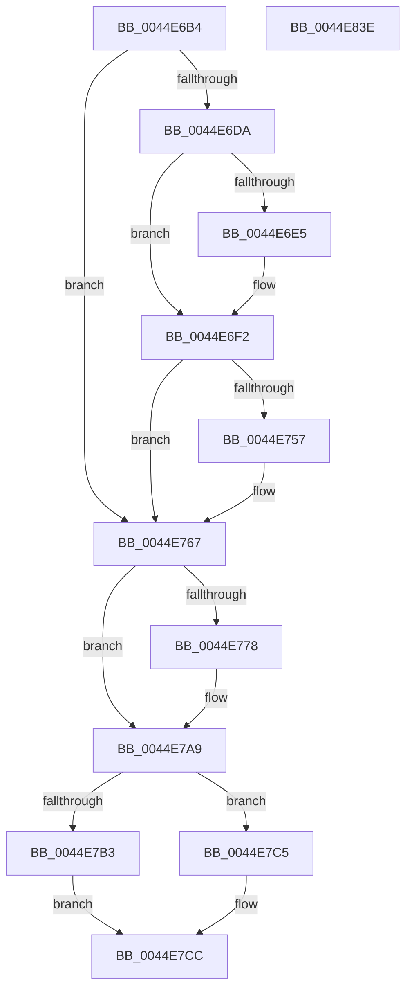

# HsaBuildDeviceTableEntry

- RVA: `0x0044E6B4`–`0x0044E83F` (길이 `395` bytes)
- VA: `0x000000014044E6B4`
- 실행 섹션: `.text`
- PDB 이름 있음: `예`; PDB Function 태그: `아니요`
- unwind 정보 RVA: `0x0005CF00`
- 디코드: `86`개 명령, `395/395` bytes 표시
- 미해석 바이트: `0` (있으면 어셈블리에 `.byte`로 보존)

> 이 문서는 커널 이미지의 기계어와 PDB 기호를 분석해 생성했습니다. 4번과 5번은 함수 원형과 자료형을 바이너리 사용 방식에서 추정한 C 해석이며 원본 소스 복구 결과는 아닙니다.

## 1. Dependencies

- 직접 호출 지점: **1**; 고유 호출 대상: **1**
- 직접 호출자로 확인된 함수: **2**
- RIP 상대 이미지 참조: **0**

### Outgoing calls
- `0x0044E7BE` → [HsaBuildInterruptRemappingEntry](../4F/HsaBuildInterruptRemappingEntry_function_004FC3D4.md) (function, `0x004FC3D4`)

### Direct callers
- [HsaUpdateDeviceTableEntry](HsaUpdateDeviceTableEntry_function_0044E404.md) at `0x0044E5E2`
- [HsaInitializeIommu](../../pagelk/B6/HsaInitializeIommu_function_00B63140.md) at `0x00B633BD`

### Static image references
- 디코드된 RIP-relative 메모리 참조가 없습니다.

## 2. Other-region calls and transfers

- 다른 실행 섹션으로 향하는 call: **0**
- 별도 외부 분기/꼬리 이동을 확인하지 못했습니다.

## 3. Assembly (complete function range)

```asm
0044E6B4  40 53                           push rbx
0044E6B6  48 83 EC 20                     sub rsp, 0x20
0044E6BA  4C 8B 94 24 80 00 00 00         mov r10, qword ptr [rsp + 0x80]
0044E6C2  0F 57 C0                        xorps xmm0, xmm0
0044E6C5  4C 8B D9                        mov r11, rcx
0044E6C8  41 0F 11 02                     movups xmmword ptr [r10], xmm0
0044E6CC  41 0F 11 42 10                  movups xmmword ptr [r10 + 0x10], xmm0
0044E6D1  45 84 C0                        test r8b, r8b
0044E6D4  0F 84 8D 00 00 00               je 0x14044e767
0044E6DA  80 7C 24 50 00                  cmp byte ptr [rsp + 0x50], 0
0044E6DF  4D 8D 42 08                     lea r8, [r10 + 8]
0044E6E3  74 0D                           je 0x14044e6f2
0044E6E5  48 B8 00 00 00 00 01 00 00 00   movabs rax, 0x100000000
0044E6EF  49 89 00                        mov qword ptr [r8], rax
0044E6F2  49 8B 0A                        mov rcx, qword ptr [r10]
0044E6F5  48 8B C2                        mov rax, rdx
0044E6F8  48 C1 E0 3A                     shl rax, 0x3a
0044E6FC  48 BB FF FF FF FF FF FF FF E1   movabs rbx, 0xe1ffffffffffffff
0044E706  48 23 CB                        and rcx, rbx
0044E709  48 BB 00 00 00 00 00 00 80 01   movabs rbx, 0x180000000000000
0044E713  48 0B CB                        or rcx, rbx
0044E716  48 BB 00 00 00 00 00 00 00 1C   movabs rbx, 0x1c00000000000000
0044E720  48 23 C3                        and rax, rbx
0044E723  48 BB 00 00 00 00 00 F8 FF FF   movabs rbx, 0xfffff80000000000
0044E72D  48 33 C8                        xor rcx, rax
0044E730  48 8B C2                        mov rax, rdx
0044E733  48 C1 E2 18                     shl rdx, 0x18
0044E737  48 C1 E8 03                     shr rax, 3
0044E73B  66 41 89 42 0A                  mov word ptr [r10 + 0xa], ax
0044E740  49 8B 00                        mov rax, qword ptr [r8]
0044E743  48 33 D0                        xor rdx, rax
0044E746  49 89 0A                        mov qword ptr [r10], rcx
0044E749  48 23 D3                        and rdx, rbx
0044E74C  48 33 D0                        xor rdx, rax
0044E74F  49 89 10                        mov qword ptr [r8], rdx
0044E752  45 84 C9                        test r9b, r9b
0044E755  74 10                           je 0x14044e767
0044E757  48 B8 00 00 00 00 00 00 40 00   movabs rax, 0x40000000000000
0044E761  48 0B C8                        or rcx, rax
0044E764  49 89 0A                        mov qword ptr [r10], rcx
0044E767  83 7C 24 60 00                  cmp dword ptr [rsp + 0x60], 0
0044E76C  0F B7 44 24 58                  movzx eax, word ptr [rsp + 0x58]
0044E771  66 41 89 42 08                  mov word ptr [r10 + 8], ax
0044E776  74 31                           je 0x14044e7a9
0044E778  49 8B 02                        mov rax, qword ptr [r10]
0044E77B  48 BA FF 09 00 00 00 00 F0 FF   movabs rdx, 0xfff00000000009ff
0044E785  48 8B 4C 24 68                  mov rcx, qword ptr [rsp + 0x68]
0044E78A  48 23 C2                        and rax, rdx
0044E78D  48 C1 E1 0C                     shl rcx, 0xc
0044E791  48 BA 00 F0 FF FF FF FF 0F 00   movabs rdx, 0xffffffffff000
0044E79B  48 23 CA                        and rcx, rdx
0044E79E  48 0F BA E8 0B                  bts rax, 0xb
0044E7A3  48 33 C1                        xor rax, rcx
0044E7A6  49 89 02                        mov qword ptr [r10], rax
0044E7A9  48 8B 44 24 70                  mov rax, qword ptr [rsp + 0x70]
0044E7AE  48 85 C0                        test rax, rax
0044E7B1  75 12                           jne 0x14044e7c5
0044E7B3  48 8B 54 24 78                  mov rdx, qword ptr [rsp + 0x78]
0044E7B8  4D 8B C2                        mov r8, r10
0044E7BB  49 8B CB                        mov rcx, r11
0044E7BE  E8 11 DC 0A 00                  call 0x1404fc3d4
0044E7C3  EB 07                           jmp 0x14044e7cc
0044E7C5  48 8B 00                        mov rax, qword ptr [rax]
0044E7C8  49 89 42 10                     mov qword ptr [r10 + 0x10], rax
0044E7CC  48 B8 03 00 00 00 00 00 00 60   movabs rax, 0x6000000000000003
0044E7D6  48 B9 FF FF FF FF FF FD FF FF   movabs rcx, 0xfffffdffffffffff
0044E7E0  49 09 02                        or qword ptr [r10], rax
0044E7E3  49 8B 42 08                     mov rax, qword ptr [r10 + 8]
0044E7E7  48 23 C1                        and rax, rcx
0044E7EA  48 B9 00 00 00 00 00 01 00 00   movabs rcx, 0x10000000000
0044E7F4  48 0B C1                        or rax, rcx
0044E7F7  48 B9 00 00 00 00 00 00 00 40   movabs rcx, 0x4000000000000000
0044E801  49 89 42 08                     mov qword ptr [r10 + 8], rax
0044E805  48 B8 00 00 00 00 00 00 00 02   movabs rax, 0x200000000000000
0044E80F  49 09 42 10                     or qword ptr [r10 + 0x10], rax
0044E813  49 8B 42 10                     mov rax, qword ptr [r10 + 0x10]
0044E817  48 0B C1                        or rax, rcx
0044E81A  48 B9 00 00 00 00 00 00 00 80   movabs rcx, 0x8000000000000000
0044E824  48 0B C1                        or rax, rcx
0044E827  48 B9 00 00 00 00 00 00 00 01   movabs rcx, 0x100000000000000
0044E831  48 0B C1                        or rax, rcx
0044E834  49 89 42 10                     mov qword ptr [r10 + 0x10], rax
0044E838  48 83 C4 20                     add rsp, 0x20
0044E83C  5B                              pop rbx
0044E83D  C3                              ret
0044E83E  CC                              int3
```

## 4. C-style interpretation (structured pseudocode)

```c
__int64 __fastcall HsaBuildDeviceTableEntry(__int64 a1, __int64 a2, unsigned __int8 a3, unsigned __int8 a4, unsigned __int8 a5, unsigned __int16 a6, unsigned int a7, __int64 a8, __int64 a9, __int64 a10, __int64 a11)
{
    __int64 result;
    __int64 v_rsp;

    v_rsp = (v_rsp) - (32);
    *(unsigned __int64 *)(a11) = v_xmm0;
    *(unsigned __int64 *)(a11 + 16) = v_xmm0;
    if (a3 == 0) goto loc_0044E767;
    if (a5 != 0) {
        *(unsigned __int64 *)(a11 + 8) = result;
    }
    result = (a2) << (58);
    a1 = (*(unsigned __int64 *)(a11)) & (v_rbx);
    a1 = (a1) | (v_rbx);
    result = (result) & (v_rbx);
    a1 = (a1) ^ (result);
    a2 = (a2) << (24);
    result = (a2) >> (3);
    *(unsigned __int16 *)(a11 + 10) = (unsigned __int16)(result);
    a2 = (a2) ^ (*(unsigned __int64 *)(a11 + 8));
    *(unsigned __int64 *)(a11) = a1;
    a2 = (a2) & (v_rbx);
    a2 = (a2) ^ (*(unsigned __int64 *)(a11 + 8));
    *(unsigned __int64 *)(a11 + 8) = a2;
    if (a4 != 0) {
        a1 = (a1) | (*(unsigned __int64 *)(a11 + 8));
        *(unsigned __int64 *)(a11) = a1;
    }
    *(unsigned __int16 *)(a11 + 8) = a6;
    result = a6;
    if (a7 != 0) {
        result = *(unsigned __int64 *)(a11);
        a1 = a8;
        result = (result) & (a2);
        a1 = (a1) << (12);
        a1 = (a1) & (a2);
        result = (result) ^ (a1);
        *(unsigned __int64 *)(a11) = result;
    }
    if (a9 != 0) goto loc_0044E7C5;
    result = HsaBuildInterruptRemappingEntry(a1, a10, a11, a4);
    goto loc_0044E7CC;
loc_0044E7C5:
    *(unsigned __int64 *)(a11 + 16) = *(unsigned __int64 *)(result);
loc_0044E7CC:
    result = (*(unsigned __int64 *)(a11 + 8)) & (a1);
    result = (result) | (a1);
    *(unsigned __int64 *)(a11 + 8) = result;
    result = (*(unsigned __int64 *)(a11 + 16)) | (a1);
    result = (result) | (a1);
    result = (result) | (a1);
    *(unsigned __int64 *)(a11 + 16) = result;
    v_rsp = (v_rsp) + (32);
    return result;
}
```

## 5. (Beta) C Style

```c
int64_t HsaBuildDeviceTableEntry(int64_t Arg1, int64_t Arg2, uint8_t Arg3, uint8_t Arg4, uint8_t Arg5, uint16_t Arg6, uint32_t Arg7, int64_t Arg8, int64_t Arg9, int64_t Arg10, void *Arg11)
{
    uint8_t *arg11 = (uint8_t *)Arg11;

    int64_t result;
    int64_t local_rsp;

    local_rsp = (local_rsp) - (32);
    *(uint64_t *)(arg11) = v_xmm0;
    *(uint64_t *)(arg11 + 0x10) = v_xmm0;
    if (Arg3 == 0) goto loc_0044E767;
    if (Arg5 != 0) {
        *(uint64_t *)(arg11 + 0x8) = result;
    }
    result = (Arg2) << (58);
    Arg1 = (*(uint64_t *)(arg11)) & (local_rbx);
    Arg1 = (Arg1) | (local_rbx);
    result = (result) & (local_rbx);
    Arg1 = (Arg1) ^ (result);
    Arg2 = (Arg2) << (24);
    result = (Arg2) >> (3);
    *(uint16_t *)(arg11 + 0xA) = (uint16_t)(result);
    Arg2 = (Arg2) ^ (*(uint64_t *)(arg11 + 0x8));
    *(uint64_t *)(arg11) = Arg1;
    Arg2 = (Arg2) & (local_rbx);
    Arg2 = (Arg2) ^ (*(uint64_t *)(arg11 + 0x8));
    *(uint64_t *)(arg11 + 0x8) = Arg2;
    if (Arg4 != 0) {
        Arg1 = (Arg1) | (*(uint64_t *)(arg11 + 0x8));
        *(uint64_t *)(arg11) = Arg1;
    }
    *(uint16_t *)(arg11 + 0x8) = Arg6;
    result = Arg6;
    if (Arg7 != 0) {
        result = *(uint64_t *)(arg11);
        Arg1 = Arg8;
        result = (result) & (Arg2);
        Arg1 = (Arg1) << (12);
        Arg1 = (Arg1) & (Arg2);
        result = (result) ^ (Arg1);
        *(uint64_t *)(arg11) = result;
    }
    if (Arg9 != 0) goto loc_0044E7C5;
    result = HsaBuildInterruptRemappingEntry(Arg1, Arg10, Arg11, Arg4);
    goto loc_0044E7CC;
loc_0044E7C5:
    *(uint64_t *)(arg11 + 0x10) = *(uint64_t *)(result);
loc_0044E7CC:
    result = (*(uint64_t *)(arg11 + 0x8)) & (Arg1);
    result = (result) | (Arg1);
    *(uint64_t *)(arg11 + 0x8) = result;
    result = (*(uint64_t *)(arg11 + 0x10)) | (Arg1);
    result = (result) | (Arg1);
    result = (result) | (Arg1);
    *(uint64_t *)(arg11 + 0x10) = result;
    local_rsp = (local_rsp) + (32);
    return result;
}
```

### 관측된 메모리 오프셋

구조체 형식이 확인되지 않은 접근은 인자 기준의 오프셋으로만 기록했습니다.

| 기준 인자 | 오프셋 표현 | 폭 (bit) | 접근 |
|---|---:|---:|---|
| `Arg11` | `+ 0x0` | `64` | `R` |
| `Arg11` | `+ 0x0` | `64` | `W` |
| `Arg11` | `+ 0x0` | `128` | `R` |
| `Arg11` | `+ 0x8` | `16` | `W` |
| `Arg11` | `+ 0x8` | `64` | `R` |
| `Arg11` | `+ 0xA` | `16` | `W` |
| `Arg11` | `+ 0x10` | `64` | `W` |
| `Arg11` | `+ 0x10` | `128` | `R` |

## 6. Execution-region graph

[열기: 2D/3D 그래프와 함수 탐색 컨트롤 패널](../../../control-panel.html?section=text&rva=0x0044E6B4&view=graph)

- 2D 그래프는 위에서 아래로 흐르고, 3D 그래프는 빈 공간을 드래그해 회전합니다. Shift+드래그는 이동, 휠은 확대·축소, 함수 노드 선택은 대상 보고서 이동입니다.

### Static fallback


