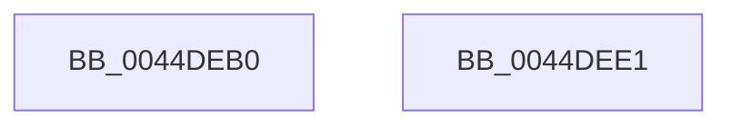

# HsaFlushDomainTb

- RVA: `0x0044DEB0`–`0x0044DEE2` (길이 `50` bytes)
- VA: `0x000000014044DEB0`
- 실행 섹션: `.text`
- PDB 이름 있음: `예`; PDB Function 태그: `아니요`
- unwind 정보 RVA: `0x00082420`
- 디코드: `14`개 명령, `50/50` bytes 표시
- 미해석 바이트: `0` (있으면 어셈블리에 `.byte`로 보존)

> 이 문서는 커널 이미지의 기계어와 PDB 기호를 분석해 생성했습니다. 4번과 5번은 함수 원형과 자료형을 바이너리 사용 방식에서 추정한 C 해석이며 원본 소스 복구 결과는 아닙니다.

## 1. Dependencies

- 직접 호출 지점: **1**; 고유 호출 대상: **1**
- 직접 호출자로 확인된 함수: **0**
- RIP 상대 이미지 참조: **0**

### Outgoing calls
- `0x0044DED7` → [HsaFlushTbInternal](HsaFlushTbInternal_function_0044DEE8.md) (function, `0x0044DEE8`)

### Direct callers
- 이 함수 시작 RVA로 연결되는 직접 call은 확인되지 않았습니다. 간접 호출은 완전히 역산할 수 없습니다.

### Static image references
- 디코드된 RIP-relative 메모리 참조가 없습니다.

## 2. Other-region calls and transfers

- 다른 실행 섹션으로 향하는 call: **0**
- 별도 외부 분기/꼬리 이동을 확인하지 못했습니다.

## 3. Assembly (complete function range)

```asm
0044DEB0  4C 8B DC                        mov r11, rsp
0044DEB3  48 83 EC 48                     sub rsp, 0x48
0044DEB7  48 8B 44 24 70                  mov rax, qword ptr [rsp + 0x70]
0044DEBC  44 8B 42 30                     mov r8d, dword ptr [rdx + 0x30]
0044DEC0  33 D2                           xor edx, edx
0044DEC2  49 89 43 F0                     mov qword ptr [r11 - 0x10], rax
0044DEC6  45 89 4B E8                     mov dword ptr [r11 - 0x18], r9d
0044DECA  41 B1 01                        mov r9b, 1
0044DECD  49 83 63 E0 00                  and qword ptr [r11 - 0x20], 0
0044DED2  49 83 63 D8 00                  and qword ptr [r11 - 0x28], 0
0044DED7  E8 0C 00 00 00                  call 0x14044dee8
0044DEDC  48 83 C4 48                     add rsp, 0x48
0044DEE0  C3                              ret
0044DEE1  CC                              int3
```

## 4. C-style interpretation (structured pseudocode)

```c
__int64 __fastcall HsaFlushDomainTb(__int64 a1, __int64 a2, __int64 a3, int a4, __int64 a5)
{
    __int64 result;
    __int64 v_rsp;

    v_rsp = (v_rsp) - (72);
    a2 = 0;
    *(unsigned __int64 *)(v_rsp - 16) = a5;
    *(unsigned int *)(v_rsp - 24) = a4;
    result = HsaFlushTbInternal(a1, a2, (unsigned int)(*(unsigned int *)(a2 + 48)), 1);
    v_rsp = (v_rsp) + (72);
    return result;
}
```

## 5. (Beta) C Style

```c
int64_t HsaFlushDomainTb(int64_t Arg1, void *Arg2, int64_t Arg3, int32_t Arg4, int64_t Arg5)
{
    uint8_t *arg2 = (uint8_t *)Arg2;

    int64_t result;
    int64_t local_rsp;

    local_rsp = (local_rsp) - (72);
    Arg2 = 0;
    *(uint64_t *)(local_rsp - 0x10) = Arg5;
    *(uint32_t *)(local_rsp - 0x18) = Arg4;
    result = HsaFlushTbInternal(Arg1, Arg2, (uint32_t)(*(uint32_t *)(arg2 + 0x30)), 1);
    local_rsp = (local_rsp) + (72);
    return result;
}
```

### 관측된 메모리 오프셋

구조체 형식이 확인되지 않은 접근은 인자 기준의 오프셋으로만 기록했습니다.

| 기준 인자 | 오프셋 표현 | 폭 (bit) | 접근 |
|---|---:|---:|---|
| `Arg2` | `+ 0x30` | `32` | `R` |

## 6. Execution-region graph

[열기: 2D/3D 그래프와 함수 탐색 컨트롤 패널](../../../control-panel.html?section=text&rva=0x0044DEB0&view=graph)

- 2D 그래프는 위에서 아래로 흐르고, 3D 그래프는 빈 공간을 드래그해 회전합니다. Shift+드래그는 이동, 휠은 확대·축소, 함수 노드 선택은 대상 보고서 이동입니다.

### Static fallback


