# HsaFlushTbInternal

- RVA: `0x0044DEE8`–`0x0044E1A2` (길이 `698` bytes)
- VA: `0x000000014044DEE8`
- 실행 섹션: `.text`
- PDB 이름 있음: `예`; PDB Function 태그: `예`
- unwind 정보 RVA: `0x000A6A0C`
- 디코드: `190`개 명령, `698/698` bytes 표시
- 미해석 바이트: `0` (있으면 어셈블리에 `.byte`로 보존)

> 이 문서는 커널 이미지의 기계어와 PDB 기호를 분석해 생성했습니다. 4번과 5번은 함수 원형과 자료형을 바이너리 사용 방식에서 추정한 C 해석이며 원본 소스 복구 결과는 아닙니다.

## 1. Dependencies

- 직접 호출 지점: **4**; 고유 호출 대상: **4**
- 직접 호출자로 확인된 함수: **3**
- RIP 상대 이미지 참조: **0**

### Outgoing calls
- `0x0044E055` → [HsaIommuSendCommand](HsaIommuSendCommand_function_0044E1DC.md) (function, `0x0044E1DC`)
- `0x0044E085` → [HsaIommuWaitCommand](HsaIommuWaitCommand_function_0044E1A8.md) (function, `0x0044E1A8`)
- `0x0044E0CB` → [HalpIommuGetNextFlushDevice](../4F/HalpIommuGetNextFlushDevice_function_004FB8E8.md) (function, `0x004FB8E8`)
- `0x0044E198` → [ExReleaseRundownProtection](../34/ExReleaseRundownProtection_function_00349E80.md) (function, `0x00349E80`)

### Direct callers
- [HsaAttachDeviceDomainInternal](HsaAttachDeviceDomainInternal_function_0044DD24.md) at `0x0044DE4D`
- [HsaAttachDeviceDomainInternal](HsaAttachDeviceDomainInternal_function_0044DD24.md) at `0x0044DE75`
- [HsaFlushDomainTb](HsaFlushDomainTb_function_0044DEB0.md) at `0x0044DED7`
- [HsaFlushTb](../57/HsaFlushTb_function_00573FE0.md) at `0x0057400B`

### Static image references
- 디코드된 RIP-relative 메모리 참조가 없습니다.

## 2. Other-region calls and transfers

- 다른 실행 섹션으로 향하는 call: **0**
- call이 아닌 외부 분기/꼬리 이동: **4**
  - `0x0044E0D2` → [sub_006F0EF6 + 0x1B5](../6F/Unknown_function_006F0EF6.md) (`tail-transfer`)
  - `0x0044E129` → [sub_006F0EF6](../6F/Unknown_function_006F0EF6.md) (`tail-transfer`)
  - `0x0044E17D` → [sub_006F0EF6 + 0x69](../6F/Unknown_function_006F0EF6.md) (`tail-transfer`)
  - `0x0044E18B` → [sub_006F0EF6 + 0x69](../6F/Unknown_function_006F0EF6.md) (`tail-transfer`)

## 3. Assembly (complete function range)

```asm
0044DEE8  48 8B C4                        mov rax, rsp
0044DEEB  48 89 58 10                     mov qword ptr [rax + 0x10], rbx
0044DEEF  48 89 70 18                     mov qword ptr [rax + 0x18], rsi
0044DEF3  48 89 78 20                     mov qword ptr [rax + 0x20], rdi
0044DEF7  48 89 48 08                     mov qword ptr [rax + 8], rcx
0044DEFB  55                              push rbp
0044DEFC  41 54                           push r12
0044DEFE  41 55                           push r13
0044DF00  41 56                           push r14
0044DF02  41 57                           push r15
0044DF04  48 8D 68 C1                     lea rbp, [rax - 0x3f]
0044DF08  48 81 EC A0 00 00 00            sub rsp, 0xa0
0044DF0F  48 8B 01                        mov rax, qword ptr [rcx]
0044DF12  45 8A D9                        mov r11b, r9b
0044DF15  48 83 65 CF 00                  and qword ptr [rbp - 0x31], 0
0044DF1A  90                              nop
0044DF1B  48 83 65 C7 00                  and qword ptr [rbp - 0x39], 0
0044DF20  4C 8B C9                        mov r9, rcx
0044DF23  83 65 BF 00                     and dword ptr [rbp - 0x41], 0
0044DF27  48 8B 40 18                     mov rax, qword ptr [rax + 0x18]
0044DF2B  48 8B 01                        mov rax, qword ptr [rcx]
0044DF2E  90                              nop
0044DF2F  83 65 BB 00                     and dword ptr [rbp - 0x45], 0
0044DF33  48 83 65 DF 00                  and qword ptr [rbp - 0x21], 0
0044DF38  44 8B D2                        mov r10d, edx
0044DF3B  48 8B 80 20 20 00 00            mov rax, qword ptr [rax + 0x2020]
0044DF42  A8 10                           test al, 0x10
0044DF44  75 22                           jne 0x14044df68
0044DF46  4C 8D 9C 24 A0 00 00 00         lea r11, [rsp + 0xa0]
0044DF4E  49 8B 5B 38                     mov rbx, qword ptr [r11 + 0x38]
0044DF52  49 8B 73 40                     mov rsi, qword ptr [r11 + 0x40]
0044DF56  49 8B 7B 48                     mov rdi, qword ptr [r11 + 0x48]
0044DF5A  49 8B E3                        mov rsp, r11
0044DF5D  41 5F                           pop r15
0044DF5F  41 5E                           pop r14
0044DF61  41 5D                           pop r13
0044DF63  41 5C                           pop r12
0044DF65  5D                              pop rbp
0044DF66  C3                              ret
0044DF67  CC                              int3
0044DF68  8B 75 77                        mov esi, dword ptr [rbp + 0x77]
0044DF6B  33 DB                           xor ebx, ebx
0044DF6D  48 83 CB 02                     or rbx, 2
0044DF71  41 0F B7 D0                     movzx edx, r8w
0044DF75  48 C1 E2 20                     shl rdx, 0x20
0044DF79  33 FF                           xor edi, edi
0044DF7B  48 8B C2                        mov rax, rdx
0044DF7E  48 89 5D D7                     mov qword ptr [rbp - 0x29], rbx
0044DF82  49 BE 00 00 00 00 00 00 00 30   movabs r14, 0x3000000000000000
0044DF8C  48 89 5D F7                     mov qword ptr [rbp - 9], rbx
0044DF90  49 0B C6                        or rax, r14
0044DF93  48 89 7D 07                     mov qword ptr [rbp + 7], rdi
0044DF97  48 89 45 EF                     mov qword ptr [rbp - 0x11], rax
0044DF9B  48 B8 00 00 00 00 00 00 00 40   movabs rax, 0x4000000000000000
0044DFA5  48 89 45 0F                     mov qword ptr [rbp + 0xf], rax
0044DFA9  41 B8 FE 0F 00 00               mov r8d, 0xffe
0044DFAF  45 84 DB                        test r11b, r11b
0044DFB2  0F 84 6D 01 00 00               je 0x14044e125
0044DFB8  85 F6                           test esi, esi
0044DFBA  75 5E                           jne 0x14044e01a
0044DFBC  48 B8 01 F0 FF FF FF FF FF 7F   movabs rax, 0x7ffffffffffff001
0044DFC6  49 23 D8                        and rbx, r8
0044DFC9  48 0B D8                        or rbx, rax
0044DFCC  45 32 F6                        xor r14b, r14b
0044DFCF  49 23 F8                        and rdi, r8
0044DFD2  48 89 5D F7                     mov qword ptr [rbp - 9], rbx
0044DFD6  48 0B F8                        or rdi, rax
0044DFD9  48 89 5D D7                     mov qword ptr [rbp - 0x29], rbx
0044DFDD  48 89 7D 07                     mov qword ptr [rbp + 7], rdi
0044DFE1  4C 8B 6D 67                     mov r13, qword ptr [rbp + 0x67]
0044DFE5  48 8B 75 6F                     mov rsi, qword ptr [rbp + 0x6f]
0044DFE9  4D 85 ED                        test r13, r13
0044DFEC  74 31                           je 0x14044e01f
0044DFEE  C6 45 B8 01                     mov byte ptr [rbp - 0x48], 1
0044DFF2  45 33 E4                        xor r12d, r12d
0044DFF5  C6 45 B9 00                     mov byte ptr [rbp - 0x47], 0
0044DFF9  45 33 FF                        xor r15d, r15d
0044DFFC  44 89 65 BF                     mov dword ptr [rbp - 0x41], r12d
0044E000  33 C0                           xor eax, eax
0044E002  89 45 C3                        mov dword ptr [rbp - 0x3d], eax
0044E005  EB 04                           jmp 0x14044e00b
0044E007  4C 8B 4D 47                     mov r9, qword ptr [rbp + 0x47]
0044E00B  45 84 F6                        test r14b, r14b
0044E00E  0F 85 C9 00 00 00               jne 0x14044e0dd
0044E014  85 C0                           test eax, eax
0044E016  75 4D                           jne 0x14044e065
0044E018  EB 31                           jmp 0x14044e04b
0044E01A  41 B6 01                        mov r14b, 1
0044E01D  EB C2                           jmp 0x14044dfe1
0044E01F  C6 45 B8 00                     mov byte ptr [rbp - 0x48], 0
0044E023  48 85 F6                        test rsi, rsi
0044E026  74 CA                           je 0x14044dff2
0044E028  EB C4                           jmp 0x14044dfee
0044E02A  45 33 E4                        xor r12d, r12d
0044E02D  41 8B CC                        mov ecx, r12d
0044E030  44 89 65 BF                     mov dword ptr [rbp - 0x41], r12d
0044E034  83 E1 01                        and ecx, 1
0044E037  49 23 D8                        and rbx, r8
0044E03A  49 8B C7                        mov rax, r15
0044E03D  48 0B CB                        or rcx, rbx
0044E040  48 C1 E0 0C                     shl rax, 0xc
0044E044  48 0B C8                        or rcx, rax
0044E047  48 89 4D F7                     mov qword ptr [rbp - 9], rcx
0044E04B  45 33 C0                        xor r8d, r8d
0044E04E  48 8D 55 EF                     lea rdx, [rbp - 0x11]
0044E052  49 8B C9                        mov rcx, r9
0044E055  E8 82 01 00 00                  call 0x14044e1dc
0044E05A  48 8B 5D F7                     mov rbx, qword ptr [rbp - 9]
0044E05E  8B 45 C3                        mov eax, dword ptr [rbp - 0x3d]
0044E061  48 89 5D D7                     mov qword ptr [rbp - 0x29], rbx
0044E065  80 7D B8 00                     cmp byte ptr [rbp - 0x48], 0
0044E069  0F 85 0B 01 00 00               jne 0x14044e17a
0044E06F  FF C0                           inc eax
0044E071  41 B8 FE 0F 00 00               mov r8d, 0xffe
0044E077  89 45 C3                        mov dword ptr [rbp - 0x3d], eax
0044E07A  3B 45 77                        cmp eax, dword ptr [rbp + 0x77]
0044E07D  72 88                           jb 0x14044e007
0044E07F  48 8B 4D 47                     mov rcx, qword ptr [rbp + 0x47]
0044E083  33 D2                           xor edx, edx
0044E085  E8 1E 01 00 00                  call 0x14044e1a8
0044E08A  80 7D B9 00                     cmp byte ptr [rbp - 0x47], 0
0044E08E  0F 85 FC 00 00 00               jne 0x14044e190
0044E094  48 85 F6                        test rsi, rsi
0044E097  0F 84 A9 FE FF FF               je 0x14044df46
0044E09D  48 89 75 E7                     mov qword ptr [rbp - 0x19], rsi
0044E0A1  48 8D 45 C7                     lea rax, [rbp - 0x39]
0044E0A5  48 8B CE                        mov rcx, rsi
0044E0A8  48 89 44 24 30                  mov qword ptr [rsp + 0x30], rax
0044E0AD  4C 8D 4D BB                     lea r9, [rbp - 0x45]
0044E0B1  48 8D 45 CF                     lea rax, [rbp - 0x31]
0044E0B5  48 89 44 24 28                  mov qword ptr [rsp + 0x28], rax
0044E0BA  4C 8D 45 DF                     lea r8, [rbp - 0x21]
0044E0BE  48 8D 45 B7                     lea rax, [rbp - 0x49]
0044E0C2  48 8D 55 E7                     lea rdx, [rbp - 0x19]
0044E0C6  48 89 44 24 20                  mov qword ptr [rsp + 0x20], rax
0044E0CB  E8 18 D8 0A 00                  call 0x1404fb8e8
0044E0D0  84 C0                           test al, al
0044E0D2  0F 85 D3 2F 2A 00               jne 0x1406f10ab
0044E0D8  E9 69 FE FF FF                  jmp 0x14044df46
0044E0DD  48 8B 4D 7F                     mov rcx, qword ptr [rbp + 0x7f]
0044E0E1  48 8B 14 C1                     mov rdx, qword ptr [rcx + rax*8]
0044E0E5  48 8B C2                        mov rax, rdx
0044E0E8  4C 8B FA                        mov r15, rdx
0044E0EB  48 C1 E8 0A                     shr rax, 0xa
0044E0EF  83 E0 03                        and eax, 3
0044E0F2  49 C1 EF 0C                     shr r15, 0xc
0044E0F6  8D 0C C0                        lea ecx, [rax + rax*8]
0044E0F9  81 E2 FF 03 00 00               and edx, 0x3ff
0044E0FF  75 4E                           jne 0x14044e14f
0044E101  89 4D BF                        mov dword ptr [rbp - 0x41], ecx
0044E104  85 C9                           test ecx, ecx
0044E106  0F 84 1E FF FF FF               je 0x14044e02a
0044E10C  FF C9                           dec ecx
0044E10E  41 BC 01 00 00 00               mov r12d, 1
0044E114  41 8B C4                        mov eax, r12d
0044E117  48 D3 E0                        shl rax, cl
0044E11A  48 FF C8                        dec rax
0044E11D  4C 0B F8                        or r15, rax
0044E120  E9 08 FF FF FF                  jmp 0x14044e02d
0044E125  41 83 FA FF                     cmp r10d, -1
0044E129  0F 85 C7 2D 2A 00               jne 0x1406f0ef6
0044E12F  45 32 F6                        xor r14b, r14b
0044E132  49 23 D8                        and rbx, r8
0044E135  48 B8 01 F0 FF FF FF FF FF 7F   movabs rax, 0x7ffffffffffff001
0044E13F  48 0B D8                        or rbx, rax
0044E142  48 89 5D D7                     mov qword ptr [rbp - 0x29], rbx
0044E146  48 89 5D F7                     mov qword ptr [rbp - 9], rbx
0044E14A  E9 92 FE FF FF                  jmp 0x14044dfe1
0044E14F  B8 01 00 00 00                  mov eax, 1
0044E154  48 D3 E0                        shl rax, cl
0044E157  48 0F AF C2                     imul rax, rdx
0044E15B  49 03 C7                        add rax, r15
0044E15E  49 33 C7                        xor rax, r15
0044E161  48 0F BD C8                     bsr rcx, rax
0044E165  B8 01 00 00 00                  mov eax, 1
0044E16A  FF C1                           inc ecx
0044E16C  48 D3 E0                        shl rax, cl
0044E16F  48 FF C8                        dec rax
0044E172  48 F7 D0                        not rax
0044E175  4C 23 F8                        and r15, rax
0044E178  EB 87                           jmp 0x14044e101
0044E17A  45 84 F6                        test r14b, r14b
0044E17D  0F 85 DC 2D 2A 00               jne 0x1406f0f5f
0044E183  85 C0                           test eax, eax
0044E185  0F 85 E4 FE FF FF               jne 0x14044e06f
0044E18B  E9 CF 2D 2A 00                  jmp 0x1406f0f5f
0044E190  49 8D 4D 40                     lea rcx, [r13 + 0x40]
0044E194  48 89 4D CF                     mov qword ptr [rbp - 0x31], rcx
0044E198  E8 E3 BC EF FF                  call 0x140349e80
0044E19D  E9 F2 FE FF FF                  jmp 0x14044e094
```

## 4. C-style interpretation (structured pseudocode)

```c
__int64 __fastcall HsaFlushTbInternal(__int64 a1, int a2, unsigned __int16 a3, unsigned __int8 a4)
{
    __int64 result;
    __int64 v_r12;
    __int64 v_r14;
    __int64 v_r15;
    __int64 v_rbx;
    __int64 v_rdi;
    __int64 v_rsp;
    unsigned __int64 v_stack_m28;
    unsigned __int64 v_stack_m70;
    unsigned __int64 v_stack_m78;
    unsigned __int64 v_stack_m80;

    *(unsigned __int64 *)(v_rsp + 16) = v_rbx;
    *(unsigned __int64 *)(v_rsp + 24) = v_rsi;
    *(unsigned __int64 *)(v_rsp + 32) = v_rdi;
    *(unsigned __int64 *)(v_rsp + 8) = a1;
    v_rsp = (v_rsp) - (160);
    if ((((unsigned __int8)(*(unsigned __int64 *)(*(unsigned __int64 *)(a1) + 8224))) & (16)) != 0) goto loc_0044DF68;
loc_0044DF46:
    return *(unsigned __int64 *)(*(unsigned __int64 *)(a1) + 8224);
loc_0044DF68:
    v_rbx = 0;
    v_rbx = (v_rbx) | (2);
    a2 = (a3) << (32);
    v_rdi = 0;
    *(unsigned __int64 *)(v_rsp - 63 - 41) = v_rbx;
    *(unsigned __int64 *)(v_rsp - 63 - 9) = v_rbx;
    result = (a2) | (v_r14);
    *(unsigned __int64 *)(v_rsp - 63 + 7) = 0;
    *(unsigned __int64 *)(v_rsp - 63 - 17) = result;
    *(unsigned __int64 *)(v_rsp - 63 + 15) = result;
    if ((unsigned __int8)(v_stack_m28) == 0) goto loc_0044E125;
    if ((unsigned int)((unsigned int)(*(unsigned int *)(v_rsp - 63 + 119))) != 0) goto loc_0044E01A;
    v_rbx = (v_rbx) & ((unsigned int)(0xFFEULL));
    v_rbx = (v_rbx) | (result);
    v_r14 = 0;
    v_rdi = (v_rdi) & ((unsigned int)(0xFFEULL));
    *(unsigned __int64 *)(v_rsp - 63 - 9) = v_rbx;
    v_rdi = (v_rdi) | (result);
    *(unsigned __int64 *)(v_rsp - 63 - 41) = v_rbx;
    *(unsigned __int64 *)(v_rsp - 63 + 7) = v_rdi;
loc_0044DFE1:
    if (*(unsigned __int64 *)(v_rsp - 63 + 103) == 0) goto loc_0044E01F;
loc_0044DFEE:
    *(unsigned __int8 *)(v_rsp - 63 - 72) = 1;
loc_0044DFF2:
    v_r12 = 0;
    *(unsigned __int8 *)(v_rsp - 63 - 71) = 0;
    v_r15 = 0;
    *(unsigned int *)(v_rsp - 63 - 65) = 0;
    result = 0;
    *(unsigned int *)(v_rsp - 63 - 61) = 0;
    goto loc_0044E00B;
loc_0044E007:
loc_0044E00B:
    if (0 != 0) goto loc_0044E0DD;
    if (0 != 0) goto loc_0044E065;
    goto loc_0044E04B;
loc_0044E01A:
    goto loc_0044DFE1;
loc_0044E01F:
    *(unsigned __int8 *)(v_rsp - 63 - 72) = 0;
    if (*(unsigned __int64 *)(v_rsp - 63 + 111) == 0) goto loc_0044DFF2;
    goto loc_0044DFEE;
loc_0044E02A:
    v_r12 = 0;
loc_0044E02D:
    *(unsigned int *)(v_rsp - 63 - 65) = 0;
    a1 = (unsigned int)((0) & (1));
    v_rbx = (v_rbx) & ((unsigned int)(0xFFEULL));
    a1 = (a1) | (v_rbx);
    result = (0) << (12);
    a1 = (a1) | (result);
    *(unsigned __int64 *)(v_rsp - 63 - 9) = a1;
loc_0044E04B:
    a3 = 0;
    result = HsaIommuSendCommand(*(unsigned __int64 *)(v_rsp - 63 + 71), v_rsp - 63 - 17, a3, *(unsigned __int64 *)(v_rsp - 63 + 71));
    *(unsigned __int64 *)(v_rsp - 63 - 41) = *(unsigned __int64 *)(v_rsp - 63 - 9);
loc_0044E065:
    if ((*(unsigned __int8 *)(v_rsp - 63 - 72)) != 0) goto loc_0044E17A;
loc_0044E06F:
    result = (unsigned int)(((unsigned int)(*(unsigned int *)(v_rsp - 63 - 61))) + 1);
    *(unsigned int *)(v_rsp - 63 - 61) = (unsigned int)(result);
    if (((unsigned int)(result)) < (*(unsigned int *)(v_rsp - 63 + 119))) goto loc_0044E007;
    a2 = 0;
    result = HsaIommuWaitCommand(*(unsigned __int64 *)(v_rsp - 63 + 71), a2, (unsigned int)(0xFFEULL), *(unsigned __int64 *)(v_rsp - 63 + 71));
    if ((*(unsigned __int8 *)(v_rsp - 63 - 71)) != 0) goto loc_0044E190;
loc_0044E094:
    if (*(unsigned __int64 *)(v_rsp - 63 + 111) == 0) goto loc_0044DF46;
    *(unsigned __int64 *)(v_rsp - 63 - 25) = *(unsigned __int64 *)(v_rsp - 63 + 111);
    v_stack_m70 = v_rsp - 63 - 57;
    v_stack_m78 = v_rsp - 63 - 49;
    v_stack_m80 = v_rsp - 63 - 73;
    result = HalpIommuGetNextFlushDevice(*(unsigned __int64 *)(v_rsp - 63 + 111), v_rsp - 63 - 25, v_rsp - 63 - 33, v_rsp - 63 - 69);
    goto loc_0044DF46;
loc_0044E0DD:
    result = (*(unsigned __int64 *)(*(unsigned __int64 *)(v_rsp - 63 + 127) + result * 8)) >> (10);
    result = (unsigned int)((result) & (3));
    v_r15 = (*(unsigned __int64 *)(*(unsigned __int64 *)(v_rsp - 63 + 127) + result * 8)) >> (12);
    a2 = (unsigned int)((*(unsigned __int64 *)(*(unsigned __int64 *)(v_rsp - 63 + 127) + result * 8)) & (0x3FFULL));
    if (condition_is_not_equal) goto loc_0044E14F;
loc_0044E101:
    *(unsigned int *)(v_rsp - 63 - 65) = (unsigned int)(result + result * 8);
    if ((unsigned int)(result + result * 8) == 0) goto loc_0044E02A;
    a1 = (unsigned int)((result + result * 8) - 1);
    result = (1) << ((unsigned __int8)(a1));
    result = (result) - 1;
    v_r15 = (v_r15) | (result);
    goto loc_0044E02D;
loc_0044E125:
    v_r14 = 0;
    v_rbx = (*(unsigned __int64 *)(v_rsp - 63 - 9)) & (v_rsp - 63 - 33);
    v_rbx = (v_rbx) | (result);
    *(unsigned __int64 *)(v_rsp - 63 - 41) = v_rbx;
    *(unsigned __int64 *)(v_rsp - 63 - 9) = v_rbx;
    goto loc_0044DFE1;
loc_0044E14F:
    result = (1) << ((unsigned __int8)(a1));
    result = (result) * (a2);
    result = (result) + (v_r15);
    result = (result) ^ (v_r15);
    a1 = (unsigned int)((a1) + 1);
    result = (1) << ((unsigned __int8)(a1));
    result = (result) - 1;
    result = ~(result);
    v_r15 = (v_r15) & (result);
    goto loc_0044E101;
loc_0044E17A:
    if ((unsigned int)(result) != 0) goto loc_0044E06F;
loc_0044E190:
    *(unsigned __int64 *)(v_rsp - 63 - 49) = *(unsigned __int64 *)(v_rsp - 63 + 103) + 64;
    result = ExReleaseRundownProtection(*(unsigned __int64 *)(v_rsp - 63 + 103) + 64, a2, v_rsp - 63 - 33, v_rsp - 63 - 69);
    goto loc_0044E094;
}
```

## 5. (Beta) C Style

```c
int64_t HsaFlushTbInternal(void *Arg1, int32_t Arg2, uint16_t Arg3, uint8_t Arg4)
{
    uint8_t *arg1 = (uint8_t *)Arg1;

    int64_t result;
    int64_t local_r12;
    int64_t local_r14;
    int64_t local_r15;
    int64_t local_rbx;
    int64_t local_rdi;
    int64_t local_rsp;
    uint64_t v_stack_m28;
    uint64_t v_stack_m70;
    uint64_t v_stack_m78;
    uint64_t v_stack_m80;

    *(uint64_t *)(local_rsp + 0x10) = local_rbx;
    *(uint64_t *)(local_rsp + 0x18) = local_rsi;
    *(uint64_t *)(local_rsp + 0x20) = local_rdi;
    *(void **)(local_rsp + 0x8) = Arg1;
    local_rsp = (local_rsp) - (160);
    if ((((uint8_t)(*(uint64_t *)(*(uint64_t *)(arg1) + 0x2020))) & (16)) != 0) goto loc_0044DF68;
loc_0044DF46:
    return *(uint64_t *)(*(uint64_t *)(arg1) + 0x2020);
loc_0044DF68:
    local_rbx = 0;
    local_rbx = (local_rbx) | (2);
    Arg2 = (Arg3) << (32);
    local_rdi = 0;
    *(uint64_t *)(local_rsp - 0x3F - 0x29) = local_rbx;
    *(uint64_t *)(local_rsp - 0x3F - 0x9) = local_rbx;
    result = (Arg2) | (local_r14);
    *(uint64_t *)(local_rsp - 0x3F + 0x7) = 0;
    *(uint64_t *)(local_rsp - 0x3F - 0x11) = result;
    *(uint64_t *)(local_rsp - 0x3F + 0xF) = result;
    if ((uint8_t)(v_stack_m28) == 0) goto loc_0044E125;
    if ((uint32_t)((uint32_t)(*(uint32_t *)(local_rsp - 0x3F + 0x77))) != 0) goto loc_0044E01A;
    local_rbx = (local_rbx) & ((uint32_t)(0xFFEULL));
    local_rbx = (local_rbx) | (result);
    local_r14 = 0;
    local_rdi = (local_rdi) & ((uint32_t)(0xFFEULL));
    *(uint64_t *)(local_rsp - 0x3F - 0x9) = local_rbx;
    local_rdi = (local_rdi) | (result);
    *(uint64_t *)(local_rsp - 0x3F - 0x29) = local_rbx;
    *(uint64_t *)(local_rsp - 0x3F + 0x7) = local_rdi;
loc_0044DFE1:
    if (*(uint64_t *)(local_rsp - 0x3F + 0x67) == 0) goto loc_0044E01F;
loc_0044DFEE:
    *(uint8_t *)(local_rsp - 0x3F - 0x48) = 1;
loc_0044DFF2:
    local_r12 = 0;
    *(uint8_t *)(local_rsp - 0x3F - 0x47) = 0;
    local_r15 = 0;
    *(uint32_t *)(local_rsp - 0x3F - 0x41) = 0;
    result = 0;
    *(uint32_t *)(local_rsp - 0x3F - 0x3D) = 0;
    goto loc_0044E00B;
loc_0044E007:
loc_0044E00B:
    if (0 != 0) goto loc_0044E0DD;
    if (0 != 0) goto loc_0044E065;
    goto loc_0044E04B;
loc_0044E01A:
    goto loc_0044DFE1;
loc_0044E01F:
    *(uint8_t *)(local_rsp - 0x3F - 0x48) = 0;
    if (*(uint64_t *)(local_rsp - 0x3F + 0x6F) == 0) goto loc_0044DFF2;
    goto loc_0044DFEE;
loc_0044E02A:
    local_r12 = 0;
loc_0044E02D:
    *(uint32_t *)(local_rsp - 0x3F - 0x41) = 0;
    Arg1 = (uint32_t)((0) & (1));
    local_rbx = (local_rbx) & ((uint32_t)(0xFFEULL));
    Arg1 = (Arg1) | (local_rbx);
    result = (0) << (12);
    Arg1 = (Arg1) | (result);
    *(void **)(local_rsp - 0x3F - 0x9) = Arg1;
loc_0044E04B:
    Arg3 = 0;
    result = HsaIommuSendCommand(*(uint64_t *)(local_rsp - 0x3F + 0x47), local_rsp - 63 - 17, Arg3, *(uint64_t *)(local_rsp - 0x3F + 0x47));
    *(uint64_t *)(local_rsp - 0x3F - 0x29) = *(uint64_t *)(local_rsp - 0x3F - 0x9);
loc_0044E065:
    if ((*(uint8_t *)(local_rsp - 0x3F - 0x48)) != 0) goto loc_0044E17A;
loc_0044E06F:
    result = (uint32_t)(((uint32_t)(*(uint32_t *)(local_rsp - 0x3F - 0x3D))) + 1);
    *(uint32_t *)(local_rsp - 0x3F - 0x3D) = (uint32_t)(result);
    if (((uint32_t)(result)) < (*(uint32_t *)(local_rsp - 0x3F + 0x77))) goto loc_0044E007;
    Arg2 = 0;
    result = HsaIommuWaitCommand(*(uint64_t *)(local_rsp - 0x3F + 0x47), Arg2, (uint32_t)(0xFFEULL), *(uint64_t *)(local_rsp - 0x3F + 0x47));
    if ((*(uint8_t *)(local_rsp - 0x3F - 0x47)) != 0) goto loc_0044E190;
loc_0044E094:
    if (*(uint64_t *)(local_rsp - 0x3F + 0x6F) == 0) goto loc_0044DF46;
    *(uint64_t *)(local_rsp - 0x3F - 0x19) = *(uint64_t *)(local_rsp - 0x3F + 0x6F);
    v_stack_m70 = local_rsp - 63 - 57;
    v_stack_m78 = local_rsp - 63 - 49;
    v_stack_m80 = local_rsp - 63 - 73;
    result = HalpIommuGetNextFlushDevice(*(uint64_t *)(local_rsp - 0x3F + 0x6F), local_rsp - 63 - 25, local_rsp - 63 - 33, local_rsp - 63 - 69);
    goto loc_0044DF46;
loc_0044E0DD:
    result = (*(uint64_t *)(*(uint64_t *)(local_rsp - 0x3F + 0x7F) + result * 8)) >> (10);
    result = (uint32_t)((result) & (3));
    local_r15 = (*(uint64_t *)(*(uint64_t *)(local_rsp - 0x3F + 0x7F) + result * 8)) >> (12);
    Arg2 = (uint32_t)((*(uint64_t *)(*(uint64_t *)(local_rsp - 0x3F + 0x7F) + result * 8)) & (0x3FFULL));
    if (condition_is_not_equal) goto loc_0044E14F;
loc_0044E101:
    *(uint32_t *)(local_rsp - 0x3F - 0x41) = (uint32_t)(result + result * 8);
    if ((uint32_t)(result + result * 8) == 0) goto loc_0044E02A;
    Arg1 = (uint32_t)((result + result * 8) - 1);
    result = (1) << ((uint8_t)(Arg1));
    result = (result) - 1;
    local_r15 = (local_r15) | (result);
    goto loc_0044E02D;
loc_0044E125:
    local_r14 = 0;
    local_rbx = (*(uint64_t *)(local_rsp - 0x3F - 0x9)) & (local_rsp - 63 - 33);
    local_rbx = (local_rbx) | (result);
    *(uint64_t *)(local_rsp - 0x3F - 0x29) = local_rbx;
    *(uint64_t *)(local_rsp - 0x3F - 0x9) = local_rbx;
    goto loc_0044DFE1;
loc_0044E14F:
    result = (1) << ((uint8_t)(Arg1));
    result = (result) * (Arg2);
    result = (result) + (local_r15);
    result = (result) ^ (local_r15);
    Arg1 = (uint32_t)((Arg1) + 1);
    result = (1) << ((uint8_t)(Arg1));
    result = (result) - 1;
    result = ~(result);
    local_r15 = (local_r15) & (result);
    goto loc_0044E101;
loc_0044E17A:
    if ((uint32_t)(result) != 0) goto loc_0044E06F;
loc_0044E190:
    *(uint64_t *)(local_rsp - 0x3F - 0x31) = *(uint64_t *)(local_rsp - 0x3F + 0x67) + 64;
    result = ExReleaseRundownProtection(*(uint64_t *)(local_rsp - 0x3F + 0x67) + 64, Arg2, local_rsp - 63 - 33, local_rsp - 63 - 69);
    goto loc_0044E094;
}
```

### 관측된 메모리 오프셋

구조체 형식이 확인되지 않은 접근은 인자 기준의 오프셋으로만 기록했습니다.

| 기준 인자 | 오프셋 표현 | 폭 (bit) | 접근 |
|---|---:|---:|---|
| `Arg1` | `+ 0x0` | `64` | `R` |

## 6. Execution-region graph

[열기: 2D/3D 그래프와 함수 탐색 컨트롤 패널](../../../control-panel.html?section=text&rva=0x0044DEE8&view=graph)

- 2D 그래프는 위에서 아래로 흐르고, 3D 그래프는 빈 공간을 드래그해 회전합니다. Shift+드래그는 이동, 휠은 확대·축소, 함수 노드 선택은 대상 보고서 이동입니다.

### Static fallback

```mermaid
flowchart TD
  bb_0044DEE8[BB_0044DEE8]
  bb_0044DF46[BB_0044DF46]
  bb_0044DF67[BB_0044DF67]
  bb_0044DF68[BB_0044DF68]
  bb_0044DFB8[BB_0044DFB8]
  bb_0044DFBC[BB_0044DFBC]
  bb_0044DFE1[BB_0044DFE1]
  bb_0044DFEE[BB_0044DFEE]
  bb_0044DFF2[BB_0044DFF2]
  bb_0044E007[BB_0044E007]
  bb_0044E00B[BB_0044E00B]
  bb_0044E014[BB_0044E014]
  bb_0044E018[BB_0044E018]
  bb_0044E01A[BB_0044E01A]
  bb_0044E01F[BB_0044E01F]
  bb_0044E028[BB_0044E028]
  bb_0044E02A[BB_0044E02A]
  bb_0044E02D[BB_0044E02D]
  bb_0044E04B[BB_0044E04B]
  bb_0044E065[BB_0044E065]
  bb_0044E06F[BB_0044E06F]
  bb_0044E07F[BB_0044E07F]
  bb_0044E094[BB_0044E094]
  bb_0044E09D[BB_0044E09D]
  bb_0044E0D8[BB_0044E0D8]
  bb_0044E0DD[BB_0044E0DD]
  bb_0044E101[BB_0044E101]
  bb_0044E10C[BB_0044E10C]
  bb_0044E125[BB_0044E125]
  bb_0044E12F[BB_0044E12F]
  bb_0044E14F[BB_0044E14F]
  bb_0044E17A[BB_0044E17A]
  bb_0044E183[BB_0044E183]
  bb_0044E18B[BB_0044E18B]
  bb_0044E190[BB_0044E190]
  bb_0044DEE8 -->|branch| bb_0044DF68
  bb_0044DEE8 -->|fallthrough| bb_0044DF46
  bb_0044DF67 -->|flow| bb_0044DF68
  bb_0044DF68 -->|branch| bb_0044E125
  bb_0044DF68 -->|fallthrough| bb_0044DFB8
  bb_0044DFB8 -->|branch| bb_0044E01A
  bb_0044DFB8 -->|fallthrough| bb_0044DFBC
  bb_0044DFBC -->|flow| bb_0044DFE1
  bb_0044DFE1 -->|branch| bb_0044E01F
  bb_0044DFE1 -->|fallthrough| bb_0044DFEE
  bb_0044DFEE -->|flow| bb_0044DFF2
  bb_0044DFF2 -->|branch| bb_0044E00B
  bb_0044E007 -->|flow| bb_0044E00B
  bb_0044E00B -->|branch| bb_0044E0DD
  bb_0044E00B -->|fallthrough| bb_0044E014
  bb_0044E014 -->|branch| bb_0044E065
  bb_0044E014 -->|fallthrough| bb_0044E018
  bb_0044E018 -->|branch| bb_0044E04B
  bb_0044E01A -->|branch| bb_0044DFE1
  bb_0044E01F -->|branch| bb_0044DFF2
  bb_0044E01F -->|fallthrough| bb_0044E028
  bb_0044E028 -->|branch| bb_0044DFEE
  bb_0044E02A -->|flow| bb_0044E02D
  bb_0044E02D -->|flow| bb_0044E04B
  bb_0044E04B -->|flow| bb_0044E065
  bb_0044E065 -->|branch| bb_0044E17A
  bb_0044E065 -->|fallthrough| bb_0044E06F
  bb_0044E06F -->|branch| bb_0044E007
  bb_0044E06F -->|fallthrough| bb_0044E07F
  bb_0044E07F -->|branch| bb_0044E190
  bb_0044E07F -->|fallthrough| bb_0044E094
  bb_0044E094 -->|branch| bb_0044DF46
  bb_0044E094 -->|fallthrough| bb_0044E09D
  bb_0044E09D -->|fallthrough| bb_0044E0D8
  bb_0044E0D8 -->|branch| bb_0044DF46
  bb_0044E0DD -->|branch| bb_0044E14F
  bb_0044E0DD -->|fallthrough| bb_0044E101
  bb_0044E101 -->|branch| bb_0044E02A
  bb_0044E101 -->|fallthrough| bb_0044E10C
  bb_0044E10C -->|branch| bb_0044E02D
  bb_0044E125 -->|fallthrough| bb_0044E12F
  bb_0044E12F -->|branch| bb_0044DFE1
  bb_0044E14F -->|branch| bb_0044E101
  bb_0044E17A -->|fallthrough| bb_0044E183
  bb_0044E183 -->|branch| bb_0044E06F
  bb_0044E183 -->|fallthrough| bb_0044E18B
  bb_0044E190 -->|branch| bb_0044E094
```


