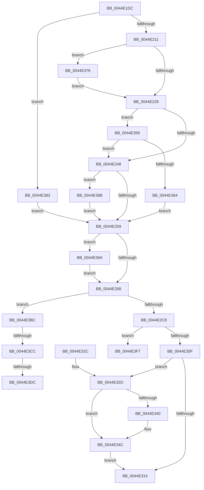

# HsaIommuSendCommand

- RVA: `0x0044E1DC`–`0x0044E3FE` (길이 `546` bytes)
- VA: `0x000000014044E1DC`
- 실행 섹션: `.text`
- PDB 이름 있음: `예`; PDB Function 태그: `예`
- unwind 정보 RVA: `0x000A6A40`
- 디코드: `138`개 명령, `546/546` bytes 표시
- 미해석 바이트: `0` (있으면 어셈블리에 `.byte`로 보존)

> 이 문서는 커널 이미지의 기계어와 PDB 기호를 분석해 생성했습니다. 4번과 5번은 함수 원형과 자료형을 바이너리 사용 방식에서 추정한 C 해석이며 원본 소스 복구 결과는 아닙니다.

## 1. Dependencies

- 직접 호출 지점: **6**; 고유 호출 대상: **6**
- 직접 호출자로 확인된 함수: **7**
- RIP 상대 이미지 참조: **5**

### Outgoing calls
- `0x0044E332` → [KeReleaseInStackQueuedSpinLockFromDpcLevel](../21/KeReleaseInStackQueuedSpinLockFromDpcLevel_function_002171B0.md) (function, `0x002171B0`)
- `0x0044E347` → [KiLowerIrqlProcessIrqlFlags](../4F/KiLowerIrqlProcessIrqlFlags_function_004F5698.md) (function, `0x004F5698`)
- `0x0044E36C` → [KiAcquireQueuedSpinLockInstrumented](../27/KiAcquireQueuedSpinLockInstrumented_function_00275850.md) (function, `0x00275850`)
- `0x0044E379` → [KiRaiseIrqlProcessIrqlFlags](../4F/KiRaiseIrqlProcessIrqlFlags_function_004F56FC.md) (function, `0x004F56FC`)
- `0x0044E390` → [KxWaitForLockOwnerShip](../25/KxWaitForLockOwnerShip_function_00257EB0.md) (function, `0x00257EB0`)
- `0x0044E3DF` → [guard_dispatch_icall](../6B/guard_dispatch_icall_function_006BAAD0.md) (function, `0x006BAAD0`)

### Direct callers
- [HsaFlushTbInternal](HsaFlushTbInternal_function_0044DEE8.md) at `0x0044E055`
- [HsaIommuWaitCommand](HsaIommuWaitCommand_function_0044E1A8.md) at `0x0044E1C9`
- [HsaDismissPageFault](../57/HsaDismissPageFault_function_00573CD0.md) at `0x00573D9A`
- [HsaFlushDeviceTbOnly](../57/HsaFlushDeviceTbOnly_function_00573F70.md) at `0x00573FC3`
- [HsaInvalidateDTE](../57/HsaInvalidateDTE_function_005746E4.md) at `0x00574713`
- [HsaInvalidateRemappingTableEntries](../57/HsaInvalidateRemappingTableEntries_function_00574734.md) at `0x00574765`
- [sub_006F0EF6](../6F/Unknown_function_006F0EF6.md) at `0x006F1049`

### Static image references
- `0x0044E21C` → RVA `0x00FC6D20` (`ALMOSTRO`; read)
- `0x0044E23B` → RVA `0x00FC6B06` (`ALMOSTRO`; read)
- `0x0044E356` → RVA `0x00F0DE58` (`.data`; read)
- `0x0044E3BF` → RVA `0x00FC1C7C` (`.data`; reference)
- `0x0044E3CC` → RVA `0x00FC1C80` (`.data`; read)

## 2. Other-region calls and transfers

- 다른 실행 섹션으로 향하는 call: **0**
- call이 아닌 외부 분기/꼬리 이동: **4**
  - `0x0044E3C6` → [sub_006F10CA](../6F/Unknown_function_006F10CA.md) (`tail-transfer`)
  - `0x0044E3D6` → [sub_006F10CA](../6F/Unknown_function_006F10CA.md) (`tail-transfer`)
  - `0x0044E3F2` → [sub_006F10CA + 0x2](../6F/Unknown_function_006F10CA.md) (`tail-transfer`)
  - `0x0044E3F9` → [sub_006F10CA + 0x48](../6F/Unknown_function_006F10CA.md) (`tail-transfer`)

## 3. Assembly (complete function range)

```asm
0044E1DC  48 89 5C 24 18                  mov qword ptr [rsp + 0x18], rbx
0044E1E1  55                              push rbp
0044E1E2  56                              push rsi
0044E1E3  57                              push rdi
0044E1E4  41 54                           push r12
0044E1E6  41 55                           push r13
0044E1E8  41 56                           push r14
0044E1EA  41 57                           push r15
0044E1EC  48 83 EC 40                     sub rsp, 0x40
0044E1F0  33 C0                           xor eax, eax
0044E1F2  0F 57 C0                        xorps xmm0, xmm0
0044E1F5  48 89 44 24 30                  mov qword ptr [rsp + 0x30], rax
0044E1FA  45 8B E0                        mov r12d, r8d
0044E1FD  48 8B F2                        mov rsi, rdx
0044E200  48 8B F9                        mov rdi, rcx
0044E203  0F 11 44 24 20                  movups xmmword ptr [rsp + 0x20], xmm0
0044E208  45 85 C0                        test r8d, r8d
0044E20B  0F 85 72 01 00 00               jne 0x14044e383
0044E211  44 0F 20 C5                     mov rbp, cr8
0044E215  8D 50 0F                        lea edx, [rax + 0xf]
0044E218  44 0F 22 C2                     mov cr8, rdx
0044E21C  39 05 FE 8A B7 00               cmp dword ptr [rip + 0xb78afe], eax
0044E222  0F 85 4E 01 00 00               jne 0x14044e376
0044E228  48 83 64 24 20 00               and qword ptr [rsp + 0x20], 0
0044E22E  48 8D 8F 98 00 00 00            lea rcx, [rdi + 0x98]
0044E235  48 89 4C 24 28                  mov qword ptr [rsp + 0x28], rcx
0044E23A  90                              nop
0044E23B  F6 05 C4 88 B7 00 21            test byte ptr [rip + 0xb788c4], 0x21
0044E242  0F 85 0E 01 00 00               jne 0x14044e356
0044E248  48 8D 54 24 20                  lea rdx, [rsp + 0x20]
0044E24D  48 87 11                        xchg qword ptr [rcx], rdx
0044E250  48 85 D2                        test rdx, rdx
0044E253  0F 85 32 01 00 00               jne 0x14044e38b
0044E259  48 8B 06                        mov rax, qword ptr [rsi]
0044E25C  48 C1 E8 3C                     shr rax, 0x3c
0044E260  3C 01                           cmp al, 1
0044E262  0F 84 32 01 00 00               je 0x14044e39a
0044E268  4C 8B 2F                        mov r13, qword ptr [rdi]
0044E26B  33 C0                           xor eax, eax
0044E26D  48 8B 57 40                     mov rdx, qword ptr [rdi + 0x40]
0044E271  41 B9 FF 7F 00 00               mov r9d, 0x7fff
0044E277  90                              nop
0044E278  48 C1 EA 04                     shr rdx, 4
0044E27C  49 8B 9D 08 20 00 00            mov rbx, qword ptr [r13 + 0x2008]
0044E283  4C 8B 47 30                     mov r8, qword ptr [rdi + 0x30]
0044E287  4C 8B FB                        mov r15, rbx
0044E28A  49 C1 EF 04                     shr r15, 4
0044E28E  90                              nop
0044E28F  41 8B CF                        mov ecx, r15d
0044E292  4C 89 84 24 88 00 00 00         mov qword ptr [rsp + 0x88], r8
0044E29A  41 23 C9                        and ecx, r9d
0044E29D  FF C1                           inc ecx
0044E29F  3B CA                           cmp ecx, edx
0044E2A1  0F 45 C1                        cmovne eax, ecx
0044E2A4  45 33 F6                        xor r14d, r14d
0044E2A7  8B C8                           mov ecx, eax
0044E2A9  49 8B 85 00 20 00 00            mov rax, qword ptr [r13 + 0x2000]
0044E2B0  48 C1 E8 04                     shr rax, 4
0044E2B4  49 23 C1                        and rax, r9
0044E2B7  48 89 8C 24 80 00 00 00         mov qword ptr [rsp + 0x80], rcx
0044E2BF  48 3B C8                        cmp rcx, rax
0044E2C2  0F 84 F4 00 00 00               je 0x14044e3bc
0044E2C8  48 8B 06                        mov rax, qword ptr [rsi]
0044E2CB  4D 23 F9                        and r15, r9
0044E2CE  4D 03 FF                        add r15, r15
0044E2D1  8B C9                           mov ecx, ecx
0044E2D3  48 C1 E1 04                     shl rcx, 4
0044E2D7  4B 89 04 F8                     mov qword ptr [r8 + r15*8], rax
0044E2DB  48 8B 46 08                     mov rax, qword ptr [rsi + 8]
0044E2DF  4B 89 44 F8 08                  mov qword ptr [r8 + r15*8 + 8], rax
0044E2E4  48 8B C1                        mov rax, rcx
0044E2E7  48 33 C3                        xor rax, rbx
0044E2EA  90                              nop
0044E2EB  48 25 0F 00 F8 FF               and rax, 0xfffffffffff8000f
0044E2F1  48 33 C1                        xor rax, rcx
0044E2F4  49 89 85 08 20 00 00            mov qword ptr [r13 + 0x2008], rax
0044E2FB  F0 83 0C 24 00                  lock or dword ptr [rsp], 0
0044E300  48 8B 06                        mov rax, qword ptr [rsi]
0044E303  48 C1 E8 3C                     shr rax, 0x3c
0044E307  3C 01                           cmp al, 1
0044E309  0F 84 E8 00 00 00               je 0x14044e3f7
0044E30F  45 85 E4                        test r12d, r12d
0044E312  74 19                           je 0x14044e32d
0044E314  48 8B 9C 24 90 00 00 00         mov rbx, qword ptr [rsp + 0x90]
0044E31C  48 83 C4 40                     add rsp, 0x40
0044E320  41 5F                           pop r15
0044E322  41 5E                           pop r14
0044E324  41 5D                           pop r13
0044E326  41 5C                           pop r12
0044E328  5F                              pop rdi
0044E329  5E                              pop rsi
0044E32A  5D                              pop rbp
0044E32B  C3                              ret
0044E32C  CC                              int3
0044E32D  48 8D 4C 24 20                  lea rcx, [rsp + 0x20]
0044E332  E8 79 8E DC FF                  call 0x1402171b0
0044E337  83 3D E2 89 B7 00 00            cmp dword ptr [rip + 0xb789e2], 0
0044E33E  74 0C                           je 0x14044e34c
0044E340  44 0F 20 C1                     mov rcx, cr8
0044E344  40 8A D5                        mov dl, bpl
0044E347  E8 4C 73 0A 00                  call 0x1404f5698
0044E34C  40 0F B6 C5                     movzx eax, bpl
0044E350  44 0F 22 C0                     mov cr8, rax
0044E354  EB BE                           jmp 0x14044e314
0044E356  8B 05 FC FA AB 00               mov eax, dword ptr [rip + 0xabfafc]
0044E35C  85 C0                           test eax, eax
0044E35E  0F 85 E4 FE FF FF               jne 0x14044e248
0044E364  48 8B D1                        mov rdx, rcx
0044E367  48 8D 4C 24 20                  lea rcx, [rsp + 0x20]
0044E36C  E8 DF 74 E2 FF                  call 0x140275850
0044E371  E9 E3 FE FF FF                  jmp 0x14044e259
0044E376  40 8A CD                        mov cl, bpl
0044E379  E8 7E 73 0A 00                  call 0x1404f56fc
0044E37E  E9 A5 FE FF FF                  jmp 0x14044e228
0044E383  40 32 ED                        xor bpl, bpl
0044E386  E9 CE FE FF FF                  jmp 0x14044e259
0044E38B  48 8D 4C 24 20                  lea rcx, [rsp + 0x20]
0044E390  E8 1B 9B E0 FF                  call 0x140257eb0
0044E395  E9 BF FE FF FF                  jmp 0x14044e259
0044E39A  48 8B 87 88 00 00 00            mov rax, qword ptr [rdi + 0x88]
0044E3A1  48 C7 47 78 01 00 00 00         mov qword ptr [rdi + 0x78], 1
0044E3A9  48 89 06                        mov qword ptr [rsi], rax
0044E3AC  48 8B 87 90 00 00 00            mov rax, qword ptr [rdi + 0x90]
0044E3B3  48 89 46 08                     mov qword ptr [rsi + 8], rax
0044E3B7  E9 AC FE FF FF                  jmp 0x14044e268
0044E3BC  41 FF C6                        inc r14d
0044E3BF  44 85 35 B6 38 B7 00            test dword ptr [rip + 0xb738b6], r14d
0044E3C6  0F 85 FE 2C 2A 00               jne 0x1406f10ca
0044E3CC  48 8B 05 AD 38 B7 00            mov rax, qword ptr [rip + 0xb738ad]
0044E3D3  48 85 C0                        test rax, rax
0044E3D6  0F 84 EE 2C 2A 00               je 0x1406f10ca
0044E3DC  41 8B CE                        mov ecx, r14d
0044E3DF  E8 EC C6 26 00                  call 0x1406baad0
0044E3E4  48 8B 8C 24 80 00 00 00         mov rcx, qword ptr [rsp + 0x80]
0044E3EC  41 B9 FF 7F 00 00               mov r9d, 0x7fff
0044E3F2  E9 D5 2C 2A 00                  jmp 0x1406f10cc
0044E3F7  33 DB                           xor ebx, ebx
0044E3F9  E9 14 2D 2A 00                  jmp 0x1406f1112
```

## 4. C-style interpretation (structured pseudocode)

```c
__int64 __fastcall HsaIommuSendCommand(__int64 a1, __int64 a2, int a3)
{
    __int64 result;
    __int64 v_r14;
    __int64 v_r15;
    __int64 v_rbp;
    __int64 v_rbx;
    __int64 v_rsp;
    unsigned __int64 v_stack_m48;
    unsigned __int64 v_stack_m50;
    unsigned __int64 v_stack_m58;
    unsigned int v_stack_m78;
    unsigned __int64 v_stack_p10;
    unsigned __int64 v_stack_p18;
    unsigned __int64 v_stack_p20;
    unsigned __int64 v_stack_p8;
    unsigned __int64 v_stack_p80;

    v_stack_p18 = v_rbx;
    v_rsp = (v_rsp) - (64);
    result = 0;
    v_stack_m48 = 0;
    v_stack_m58 = v_xmm0;
    if (a3 != 0) goto loc_0044E383;
    if ((*(unsigned int *)(v_rip + 12028670)) != 0) goto loc_0044E376;
loc_0044E228:
    v_stack_m50 = a1 + 152;
    if (((*(unsigned __int8 *)(v_rip + 12028100)) & (33)) != 0) goto loc_0044E356;
loc_0044E248:
    if (v_stack_m58 != 0) goto loc_0044E38B;
loc_0044E259:
    result = (*(unsigned __int64 *)(a2)) >> (60);
    if (((unsigned __int8)(result)) == 1) goto loc_0044E39A;
loc_0044E268:
    result = 0;
    a2 = (*(unsigned __int64 *)(a1 + 64)) >> (4);
    v_r15 = (*(unsigned __int64 *)(*(unsigned __int64 *)(a1) + 8200)) >> (4);
    v_stack_p10 = *(unsigned __int64 *)(a1 + 48);
    a1 = (unsigned int)(((unsigned int)((unsigned int)(v_r15))) & ((unsigned int)((unsigned int)(0x7FFFULL))));
    a1 = (unsigned int)((a1) + 1);
    if (((unsigned int)(a1)) != ((unsigned int)(a2))) { result = (unsigned int)(a1); }
    v_r14 = 0;
    result = (*(unsigned __int64 *)(*(unsigned __int64 *)(a1) + 8192)) >> (4);
    result = (result) & ((unsigned int)(0x7FFFULL));
    v_stack_p8 = (unsigned int)((unsigned int)(result));
    if (((unsigned int)((unsigned int)(result))) == result) goto loc_0044E3BC;
    v_r15 = (v_r15) & ((unsigned int)(0x7FFFULL));
    v_r15 = (v_r15) + (v_r15);
    a1 = ((unsigned int)((unsigned int)((unsigned int)((unsigned int)(result))))) << (4);
    *(unsigned __int64 *)(*(unsigned __int64 *)(a1 + 48) + v_r15 * 8) = *(unsigned __int64 *)(a2);
    *(unsigned __int64 *)(*(unsigned __int64 *)(a1 + 48) + v_r15 * 8 + 8) = *(unsigned __int64 *)(a2 + 8);
    result = (a1) ^ (*(unsigned __int64 *)(*(unsigned __int64 *)(a1) + 8200));
    result = (result) & (0xFFFFFFFFFFF8000FULL);
    result = (result) ^ (a1);
    *(unsigned __int64 *)(*(unsigned __int64 *)(a1) + 8200) = result;
    result = (*(unsigned __int64 *)(a2)) >> (60);
    if (((unsigned __int8)(result)) == 1) goto loc_0044E3F7;
    if ((unsigned int)((unsigned int)(a3)) == 0) goto loc_0044E32D;
loc_0044E314:
    v_rsp = (v_rsp) + (64);
    return result;
loc_0044E32D:
    result = KeReleaseInStackQueuedSpinLockFromDpcLevel(v_stack_p20, a2, *(unsigned __int64 *)(a1 + 48), (unsigned int)(0x7FFFULL));
    if ((*(unsigned int *)(v_rip + 12028386)) != 0) {
        a1 = result + 15;
        a2 = (unsigned __int8)(v_cr8);
        result = KiLowerIrqlProcessIrqlFlags(a1, a2, *(unsigned __int64 *)(a1 + 48), (unsigned int)(0x7FFFULL));
    }
    goto loc_0044E314;
loc_0044E356:
    if ((unsigned int)((unsigned int)(*(unsigned int *)(v_rip + 11270908))) != 0) goto loc_0044E248;
    result = KiAcquireQueuedSpinLockInstrumented(v_stack_p20, a1, *(unsigned __int64 *)(a1 + 48), (unsigned int)(0x7FFFULL));
    goto loc_0044E259;
loc_0044E376:
    result = KiRaiseIrqlProcessIrqlFlags((unsigned __int8)(v_cr8), a1, *(unsigned __int64 *)(a1 + 48), (unsigned int)(0x7FFFULL));
    goto loc_0044E228;
loc_0044E383:
    v_rbp = 0;
    goto loc_0044E259;
loc_0044E38B:
    result = KxWaitForLockOwnerShip(v_stack_p20, a1, *(unsigned __int64 *)(a1 + 48), (unsigned int)(0x7FFFULL));
    goto loc_0044E259;
loc_0044E39A:
    *(unsigned __int64 *)(a1 + 120) = 1;
    *(unsigned __int64 *)(a2) = *(unsigned __int64 *)(a1 + 136);
    *(unsigned __int64 *)(a2 + 8) = *(unsigned __int64 *)(a1 + 144);
    goto loc_0044E268;
loc_0044E3BC:
    v_r14 = (unsigned int)((v_r14) + 1);
    result = guard_dispatch_icall((unsigned int)((unsigned int)(v_r14)), a1, *(unsigned __int64 *)(a1 + 48), (unsigned int)(0x7FFFULL));
loc_0044E3F7:
    v_rbx = 0;
}
```

## 5. (Beta) C Style

```c
int64_t HsaIommuSendCommand(void *Arg1, void *Arg2, int32_t Arg3)
{
    uint8_t *arg1 = (uint8_t *)Arg1;
    uint8_t *arg2 = (uint8_t *)Arg2;

    int64_t result;
    int64_t local_r14;
    int64_t local_r15;
    int64_t local_rbp;
    int64_t local_rbx;
    int64_t local_rsp;
    uint64_t v_stack_m48;
    uint64_t v_stack_m50;
    uint64_t v_stack_m58;
    uint32_t v_stack_m78;
    uint64_t v_stack_p10;
    uint64_t v_stack_p18;
    uint64_t v_stack_p20;
    uint64_t v_stack_p8;
    uint64_t v_stack_p80;

    v_stack_p18 = local_rbx;
    local_rsp = (local_rsp) - (64);
    result = 0;
    v_stack_m48 = 0;
    v_stack_m58 = v_xmm0;
    if (Arg3 != 0) goto loc_0044E383;
    if ((*(uint32_t *)(v_rip + 0xB78AFE)) != 0) goto loc_0044E376;
loc_0044E228:
    v_stack_m50 = Arg1 + 152;
    if (((*(uint8_t *)(v_rip + 0xB788C4)) & (33)) != 0) goto loc_0044E356;
loc_0044E248:
    if (v_stack_m58 != 0) goto loc_0044E38B;
loc_0044E259:
    result = (*(uint64_t *)(arg2)) >> (60);
    if (((uint8_t)(result)) == 1) goto loc_0044E39A;
loc_0044E268:
    result = 0;
    Arg2 = (*(uint64_t *)(arg1 + 0x40)) >> (4);
    local_r15 = (*(uint64_t *)(*(uint64_t *)(arg1) + 0x2008)) >> (4);
    v_stack_p10 = *(uint64_t *)(arg1 + 0x30);
    Arg1 = (uint32_t)(((uint32_t)((uint32_t)(local_r15))) & ((uint32_t)((uint32_t)(0x7FFFULL))));
    Arg1 = (uint32_t)((Arg1) + 1);
    if (((uint32_t)(Arg1)) != ((uint32_t)(Arg2))) { result = (uint32_t)(Arg1); }
    local_r14 = 0;
    result = (*(uint64_t *)(*(uint64_t *)(arg1) + 0x2000)) >> (4);
    result = (result) & ((uint32_t)(0x7FFFULL));
    v_stack_p8 = (uint32_t)((uint32_t)(result));
    if (((uint32_t)((uint32_t)(result))) == result) goto loc_0044E3BC;
    local_r15 = (local_r15) & ((uint32_t)(0x7FFFULL));
    local_r15 = (local_r15) + (local_r15);
    Arg1 = ((uint32_t)((uint32_t)((uint32_t)((uint32_t)(result))))) << (4);
    *(uint64_t *)(*(uint64_t *)(arg1 + 0x30) + local_r15 * 8) = *(uint64_t *)(arg2);
    *(uint64_t *)(*(uint64_t *)(arg1 + 0x30) + local_r15 * 8 + 0x8) = *(uint64_t *)(arg2 + 0x8);
    result = (Arg1) ^ (*(uint64_t *)(*(uint64_t *)(arg1) + 0x2008));
    result = (result) & (0xFFFFFFFFFFF8000FULL);
    result = (result) ^ (Arg1);
    *(uint64_t *)(*(uint64_t *)(arg1) + 0x2008) = result;
    result = (*(uint64_t *)(arg2)) >> (60);
    if (((uint8_t)(result)) == 1) goto loc_0044E3F7;
    if ((uint32_t)((uint32_t)(Arg3)) == 0) goto loc_0044E32D;
loc_0044E314:
    local_rsp = (local_rsp) + (64);
    return result;
loc_0044E32D:
    result = KeReleaseInStackQueuedSpinLockFromDpcLevel(v_stack_p20, Arg2, *(uint64_t *)(arg1 + 0x30), (uint32_t)(0x7FFFULL));
    if ((*(uint32_t *)(v_rip + 0xB789E2)) != 0) {
        Arg1 = result + 15;
        Arg2 = (uint8_t)(v_cr8);
        result = KiLowerIrqlProcessIrqlFlags(Arg1, Arg2, *(uint64_t *)(arg1 + 0x30), (uint32_t)(0x7FFFULL));
    }
    goto loc_0044E314;
loc_0044E356:
    if ((uint32_t)((uint32_t)(*(uint32_t *)(v_rip + 0xABFAFC))) != 0) goto loc_0044E248;
    result = KiAcquireQueuedSpinLockInstrumented(v_stack_p20, Arg1, *(uint64_t *)(arg1 + 0x30), (uint32_t)(0x7FFFULL));
    goto loc_0044E259;
loc_0044E376:
    result = KiRaiseIrqlProcessIrqlFlags((uint8_t)(v_cr8), Arg1, *(uint64_t *)(arg1 + 0x30), (uint32_t)(0x7FFFULL));
    goto loc_0044E228;
loc_0044E383:
    local_rbp = 0;
    goto loc_0044E259;
loc_0044E38B:
    result = KxWaitForLockOwnerShip(v_stack_p20, Arg1, *(uint64_t *)(arg1 + 0x30), (uint32_t)(0x7FFFULL));
    goto loc_0044E259;
loc_0044E39A:
    *(uint64_t *)(arg1 + 0x78) = 1;
    *(uint64_t *)(arg2) = *(uint64_t *)(arg1 + 0x88);
    *(uint64_t *)(arg2 + 0x8) = *(uint64_t *)(arg1 + 0x90);
    goto loc_0044E268;
loc_0044E3BC:
    local_r14 = (uint32_t)((local_r14) + 1);
    result = guard_dispatch_icall((uint32_t)((uint32_t)(local_r14)), Arg1, *(uint64_t *)(arg1 + 0x30), (uint32_t)(0x7FFFULL));
loc_0044E3F7:
    local_rbx = 0;
}
```

### 관측된 메모리 오프셋

구조체 형식이 확인되지 않은 접근은 인자 기준의 오프셋으로만 기록했습니다.

| 기준 인자 | 오프셋 표현 | 폭 (bit) | 접근 |
|---|---:|---:|---|
| `Arg1` | `+ 0x0` | `64` | `R` |
| `Arg1` | `+ 0x0` | `64` | `R/W` |
| `Arg1` | `+ 0x30` | `64` | `R` |
| `Arg1` | `+ 0x40` | `64` | `R` |
| `Arg1` | `+ 0x78` | `64` | `W` |
| `Arg1` | `+ 0x88` | `64` | `R` |
| `Arg1` | `+ 0x90` | `64` | `R` |
| `Arg1` | `+ 0x98` | `64` | `R` |
| `Arg2` | `+ 0x0` | `64` | `R` |
| `Arg2` | `+ 0x0` | `64` | `W` |
| `Arg2` | `+ 0x8` | `64` | `R` |
| `Arg2` | `+ 0x8` | `64` | `W` |

## 6. Execution-region graph

[열기: 2D/3D 그래프와 함수 탐색 컨트롤 패널](../../../control-panel.html?section=text&rva=0x0044E1DC&view=graph)

- 2D 그래프는 위에서 아래로 흐르고, 3D 그래프는 빈 공간을 드래그해 회전합니다. Shift+드래그는 이동, 휠은 확대·축소, 함수 노드 선택은 대상 보고서 이동입니다.

### Static fallback


