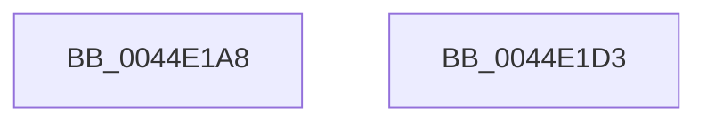

# HsaIommuWaitCommand

- RVA: `0x0044E1A8`–`0x0044E1D4` (길이 `44` bytes)
- VA: `0x000000014044E1A8`
- 실행 섹션: `.text`
- PDB 이름 있음: `예`; PDB Function 태그: `아니요`
- unwind 정보 RVA: `0x0005D2F4`
- 디코드: `10`개 명령, `44/44` bytes 표시
- 미해석 바이트: `0` (있으면 어셈블리에 `.byte`로 보존)

> 이 문서는 커널 이미지의 기계어와 PDB 기호를 분석해 생성했습니다. 4번과 5번은 함수 원형과 자료형을 바이너리 사용 방식에서 추정한 C 해석이며 원본 소스 복구 결과는 아닙니다.

## 1. Dependencies

- 직접 호출 지점: **1**; 고유 호출 대상: **1**
- 직접 호출자로 확인된 함수: **4**
- RIP 상대 이미지 참조: **0**

### Outgoing calls
- `0x0044E1C9` → [HsaIommuSendCommand](HsaIommuSendCommand_function_0044E1DC.md) (function, `0x0044E1DC`)

### Direct callers
- [HsaFlushTbInternal](HsaFlushTbInternal_function_0044DEE8.md) at `0x0044E085`
- [HsaFlushDeviceTbOnly](../57/HsaFlushDeviceTbOnly_function_00573F70.md) at `0x00573FCD`
- [HsaInvalidateDTE](../57/HsaInvalidateDTE_function_005746E4.md) at `0x0057471D`
- [HsaInvalidateRemappingTableEntries](../57/HsaInvalidateRemappingTableEntries_function_00574734.md) at `0x0057476F`

### Static image references
- 디코드된 RIP-relative 메모리 참조가 없습니다.

## 2. Other-region calls and transfers

- 다른 실행 섹션으로 향하는 call: **0**
- 별도 외부 분기/꼬리 이동을 확인하지 못했습니다.

## 3. Assembly (complete function range)

```asm
0044E1A8  48 83 EC 38                     sub rsp, 0x38
0044E1AC  48 83 64 24 28 00               and qword ptr [rsp + 0x28], 0
0044E1B2  48 B8 00 00 00 00 00 00 00 10   movabs rax, 0x1000000000000000
0044E1BC  44 8B C2                        mov r8d, edx
0044E1BF  48 89 44 24 20                  mov qword ptr [rsp + 0x20], rax
0044E1C4  48 8D 54 24 20                  lea rdx, [rsp + 0x20]
0044E1C9  E8 0E 00 00 00                  call 0x14044e1dc
0044E1CE  48 83 C4 38                     add rsp, 0x38
0044E1D2  C3                              ret
0044E1D3  CC                              int3
```

## 4. C-style interpretation (structured pseudocode)

```c
__int64 __fastcall HsaIommuWaitCommand(__int64 a1, int a2)
{
    __int64 result;
    __int64 v_rsp;
    unsigned __int64 v_stack_m10;
    unsigned __int64 v_stack_m18;

    v_rsp = (v_rsp) - (56);
    v_stack_m18 = result;
    result = HsaIommuSendCommand(a1, v_stack_m18, (unsigned int)(a2), a4);
    v_rsp = (v_rsp) + (56);
    return result;
}
```

## 5. (Beta) C Style

```c
int64_t HsaIommuWaitCommand(int64_t Arg1, int32_t Arg2)
{
    int64_t result;
    int64_t local_rsp;
    uint64_t v_stack_m10;
    uint64_t v_stack_m18;

    local_rsp = (local_rsp) - (56);
    v_stack_m18 = result;
    result = HsaIommuSendCommand(Arg1, v_stack_m18, (uint32_t)(Arg2), a4);
    local_rsp = (local_rsp) + (56);
    return result;
}
```

## 6. Execution-region graph

[열기: 2D/3D 그래프와 함수 탐색 컨트롤 패널](../../../control-panel.html?section=text&rva=0x0044E1A8&view=graph)

- 2D 그래프는 위에서 아래로 흐르고, 3D 그래프는 빈 공간을 드래그해 회전합니다. Shift+드래그는 이동, 휠은 확대·축소, 함수 노드 선택은 대상 보고서 이동입니다.

### Static fallback


