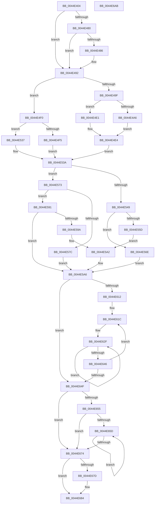

# HsaUpdateDeviceTableEntry

- RVA: `0x0044E404`–`0x0044E6AC` (길이 `680` bytes)
- VA: `0x000000014044E404`
- 실행 섹션: `.text`
- PDB 이름 있음: `예`; PDB Function 태그: `아니요`
- unwind 정보 RVA: `0x000A6A6C`
- 디코드: `192`개 명령, `680/680` bytes 표시
- 미해석 바이트: `0` (있으면 어셈블리에 `.byte`로 보존)

> 이 문서는 커널 이미지의 기계어와 PDB 기호를 분석해 생성했습니다. 4번과 5번은 함수 원형과 자료형을 바이너리 사용 방식에서 추정한 C 해석이며 원본 소스 복구 결과는 아닙니다.

## 1. Dependencies

- 직접 호출 지점: **5**; 고유 호출 대상: **5**
- 직접 호출자로 확인된 함수: **4**
- RIP 상대 이미지 참조: **1**

### Outgoing calls
- `0x0044E4F9` → [MmGetPhysicalAddress](../23/MmGetPhysicalAddress_function_0023A500.md) (function, `0x0023A500`)
- `0x0044E583` → [HsaGetBlockedDomain](../4F/HsaGetBlockedDomain_function_004FBCD4.md) (function, `0x004FBCD4`)
- `0x0044E5E2` → [HsaBuildDeviceTableEntry](HsaBuildDeviceTableEntry_function_0044E6B4.md) (function, `0x0044E6B4`)
- `0x0044E666` → [HsaInvalidateDTE](../57/HsaInvalidateDTE_function_005746E4.md) (function, `0x005746E4`)
- `0x0044E68B` → [_security_check_cookie](../6A/_security_check_cookie_function_006AC640.md) (function, `0x006AC640`)

### Direct callers
- [HsaAttachDeviceDomainInternal](HsaAttachDeviceDomainInternal_function_0044DD24.md) at `0x0044DDF1`
- [HalpHsapInitializeReservedDomain](../57/HalpHsapInitializeReservedDomain_function_00572B7C.md) at `0x00572C2E`
- [HsaProcessDeviceExceptions](../57/HsaProcessDeviceExceptions_function_005747DC.md) at `0x005748CD`
- [HsaSetDevicePasidTable](../57/HsaSetDevicePasidTable_function_00574B30.md) at `0x00574BCF`

### Static image references
- `0x0044E420` → RVA `0x00E0A740` (`.data`; read)

## 2. Other-region calls and transfers

- 다른 실행 섹션으로 향하는 call: **0**
- 별도 외부 분기/꼬리 이동을 확인하지 못했습니다.

## 3. Assembly (complete function range)

```asm
0044E404  48 89 5C 24 20                  mov qword ptr [rsp + 0x20], rbx
0044E409  55                              push rbp
0044E40A  56                              push rsi
0044E40B  57                              push rdi
0044E40C  41 54                           push r12
0044E40E  41 55                           push r13
0044E410  41 56                           push r14
0044E412  41 57                           push r15
0044E414  48 8D 6C 24 F9                  lea rbp, [rsp - 7]
0044E419  48 81 EC C0 00 00 00            sub rsp, 0xc0
0044E420  48 8B 05 19 C3 9B 00            mov rax, qword ptr [rip + 0x9bc319]
0044E427  48 33 C4                        xor rax, rsp
0044E42A  48 89 45 FF                     mov qword ptr [rbp - 1], rax
0044E42E  8B 32                           mov esi, dword ptr [rdx]
0044E430  4D 8B E8                        mov r13, r8
0044E433  48 8B 85 8F 00 00 00            mov rax, qword ptr [rbp + 0x8f]
0044E43A  41 B8 01 00 00 00               mov r8d, 1
0044E440  48 C1 E6 05                     shl rsi, 5
0044E444  4C 8B D1                        mov r10, rcx
0044E447  48 03 71 18                     add rsi, qword ptr [rcx + 0x18]
0044E44B  48 89 55 B7                     mov qword ptr [rbp - 0x49], rdx
0044E44F  48 89 4D C7                     mov qword ptr [rbp - 0x39], rcx
0044E453  48 89 45 D7                     mov qword ptr [rbp - 0x29], rax
0044E457  0F 10 0E                        movups xmm1, xmmword ptr [rsi]
0044E45A  4C 8B 76 08                     mov r14, qword ptr [rsi + 8]
0044E45E  0F 10 46 10                     movups xmm0, xmmword ptr [rsi + 0x10]
0044E462  C6 45 A8 00                     mov byte ptr [rbp - 0x58], 0
0044E466  66 49 0F 7E CF                  movq r15, xmm1
0044E46B  48 C7 45 CF 00 00 01 00         mov qword ptr [rbp - 0x31], 0x10000
0044E473  0F 11 4D DF                     movups xmmword ptr [rbp - 0x21], xmm1
0044E477  0F 11 45 EF                     movups xmmword ptr [rbp - 0x11], xmm0
0044E47B  45 84 F8                        test r8b, r15b
0044E47E  74 12                           je 0x14044e492
0044E480  83 7D 77 00                     cmp dword ptr [rbp + 0x77], 0
0044E484  75 0C                           jne 0x14044e492
0044E486  41 0F B7 C6                     movzx eax, r14w
0044E48A  48 89 45 CF                     mov qword ptr [rbp - 0x31], rax
0044E48E  44 88 45 A8                     mov byte ptr [rbp - 0x58], r8b
0044E492  40 32 FF                        xor dil, dil
0044E495  33 DB                           xor ebx, ebx
0044E497  45 32 E4                        xor r12b, r12b
0044E49A  45 84 C9                        test r9b, r9b
0044E49D  74 51                           je 0x14044e4f0
0044E49F  49 0F BA E7 37                  bt r15, 0x37
0044E4A4  73 3B                           jae 0x14044e4e1
0044E4A6  48 B9 FF FF FF 00 00 F8 FF FF   movabs rcx, 0xfffff80000ffffff
0044E4B0  49 8B DF                        mov rbx, r15
0044E4B3  48 C1 EB 22                     shr rbx, 0x22
0044E4B7  49 8B C6                        mov rax, r14
0044E4BA  48 23 C1                        and rax, rcx
0044E4BD  81 E3 00 00 00 07               and ebx, 0x7000000
0044E4C3  48 0B D8                        or rbx, rax
0044E4C6  B9 00 00 FF FF                  mov ecx, 0xffff0000
0044E4CB  48 C1 EB 0B                     shr rbx, 0xb
0044E4CF  49 8B C6                        mov rax, r14
0044E4D2  48 23 C1                        and rax, rcx
0044E4D5  45 8A E8                        mov r13b, r8b
0044E4D8  48 0B D8                        or rbx, rax
0044E4DB  48 C1 EB 0D                     shr rbx, 0xd
0044E4DF  EB 03                           jmp 0x14044e4e4
0044E4E1  44 8A EB                        mov r13b, bl
0044E4E4  49 8B FE                        mov rdi, r14
0044E4E7  48 C1 EF 20                     shr rdi, 0x20
0044E4EB  41 22 F8                        and dil, r8b
0044E4EE  EB 4A                           jmp 0x14044e53a
0044E4F0  4D 85 ED                        test r13, r13
0044E4F3  74 42                           je 0x14044e537
0044E4F5  49 8B 4D 30                     mov rcx, qword ptr [r13 + 0x30]
0044E4F9  E8 02 C0 DE FF                  call 0x14023a500
0044E4FE  48 8B 55 B7                     mov rdx, qword ptr [rbp - 0x49]
0044E502  41 B8 01 00 00 00               mov r8d, 1
0044E508  4C 8B 55 C7                     mov r10, qword ptr [rbp - 0x39]
0044E50C  48 8B D8                        mov rbx, rax
0044E50F  41 8B 45 24                     mov eax, dword ptr [r13 + 0x24]
0044E513  48 C1 EB 0C                     shr rbx, 0xc
0044E517  FF C8                           dec eax
0044E519  45 0F B6 E4                     movzx r12d, r12b
0044E51D  A9 FD FF FF FF                  test eax, 0xfffffffd
0044E522  40 0F B6 FF                     movzx edi, dil
0044E526  45 0F 44 E0                     cmove r12d, r8d
0044E52A  45 39 45 28                     cmp dword ptr [r13 + 0x28], r8d
0044E52E  45 8A E8                        mov r13b, r8b
0044E531  41 0F 44 F8                     cmove edi, r8d
0044E535  EB 03                           jmp 0x14044e53a
0044E537  44 8A EB                        mov r13b, bl
0044E53A  48 8B 45 67                     mov rax, qword ptr [rbp + 0x67]
0044E53E  33 C9                           xor ecx, ecx
0044E540  48 89 4D AF                     mov qword ptr [rbp - 0x51], rcx
0044E544  48 85 C0                        test rax, rax
0044E547  75 2A                           jne 0x14044e573
0044E549  49 8B C7                        mov rax, r15
0044E54C  41 0F B7 D6                     movzx edx, r14w
0044E550  25 00 0E 00 00                  and eax, 0xe00
0044E555  48 3D 00 08 00 00               cmp rax, 0x800
0044E55B  75 11                           jne 0x14044e56e
0044E55D  44 8D 71 02                     lea r14d, [rcx + 2]
0044E561  49 8B CF                        mov rcx, r15
0044E564  48 C1 E1 0C                     shl rcx, 0xc
0044E568  48 C1 F9 18                     sar rcx, 0x18
0044E56C  EB 34                           jmp 0x14044e5a2
0044E56E  45 33 F6                        xor r14d, r14d
0044E571  EB 33                           jmp 0x14044e5a6
0044E573  44 8B 70 04                     mov r14d, dword ptr [rax + 4]
0044E577  45 3B F0                        cmp r14d, r8d
0044E57A  75 15                           jne 0x14044e591
0044E57C  4C 8D 45 AF                     lea r8, [rbp - 0x51]
0044E580  49 8B CA                        mov rcx, r10
0044E583  E8 4C D7 0A 00                  call 0x1404fbcd4
0044E588  48 8B 4D AF                     mov rcx, qword ptr [rbp - 0x51]
0044E58C  48 8B D0                        mov rdx, rax
0044E58F  EB 15                           jmp 0x14044e5a6
0044E591  8B 50 30                        mov edx, dword ptr [rax + 0x30]
0044E594  41 83 FE 02                     cmp r14d, 2
0044E598  75 0C                           jne 0x14044e5a6
0044E59A  48 8B 48 28                     mov rcx, qword ptr [rax + 0x28]
0044E59E  48 C1 E9 0C                     shr rcx, 0xc
0044E5A2  48 89 4D AF                     mov qword ptr [rbp - 0x51], rcx
0044E5A6  4C 8B 7D C7                     mov r15, qword ptr [rbp - 0x39]
0044E5AA  48 8D 45 DF                     lea rax, [rbp - 0x21]
0044E5AE  48 89 44 24 50                  mov qword ptr [rsp + 0x50], rax
0044E5B3  45 8A CC                        mov r9b, r12b
0044E5B6  48 83 64 24 48 00               and qword ptr [rsp + 0x48], 0
0044E5BC  48 8D 45 EF                     lea rax, [rbp - 0x11]
0044E5C0  48 89 44 24 40                  mov qword ptr [rsp + 0x40], rax
0044E5C5  45 8A C5                        mov r8b, r13b
0044E5C8  48 89 4C 24 38                  mov qword ptr [rsp + 0x38], rcx
0044E5CD  49 8B CF                        mov rcx, r15
0044E5D0  44 89 74 24 30                  mov dword ptr [rsp + 0x30], r14d
0044E5D5  48 89 54 24 28                  mov qword ptr [rsp + 0x28], rdx
0044E5DA  48 8B D3                        mov rdx, rbx
0044E5DD  40 88 7C 24 20                  mov byte ptr [rsp + 0x20], dil
0044E5E2  E8 CD 00 00 00                  call 0x14044e6b4
0044E5E7  4C 8B 5D B7                     mov r11, qword ptr [rbp - 0x49]
0044E5EB  41 BA 01 00 00 00               mov r10d, 1
0044E5F1  41 BE 01 00 00 00               mov r14d, 1
0044E5F7  41 8B 43 04                     mov eax, dword ptr [r11 + 4]
0044E5FB  8B C8                           mov ecx, eax
0044E5FD  41 D3 E2                        shl r10d, cl
0044E600  B9 03 00 00 00                  mov ecx, 3
0044E605  2B C8                           sub ecx, eax
0044E607  41 8B FA                        mov edi, r10d
0044E60A  41 D3 E6                        shl r14d, cl
0044E60D  45 85 D2                        test r10d, r10d
0044E610  74 3D                           je 0x14044e64f
0044E612  45 8B C6                        mov r8d, r14d
0044E615  44 8B CF                        mov r9d, edi
0044E618  49 C1 E0 05                     shl r8, 5
0044E61C  48 8B 06                        mov rax, qword ptr [rsi]
0044E61F  48 8B 56 08                     mov rdx, qword ptr [rsi + 8]
0044E623  48 89 45 B7                     mov qword ptr [rbp - 0x49], rax
0044E627  48 8B 45 B7                     mov rax, qword ptr [rbp - 0x49]
0044E62B  48 89 55 BF                     mov qword ptr [rbp - 0x41], rdx
0044E62F  48 8B 4D E7                     mov rcx, qword ptr [rbp - 0x19]
0044E633  48 8B 5D DF                     mov rbx, qword ptr [rbp - 0x21]
0044E637  F0 48 0F C7 0E                  lock cmpxchg16b xmmword ptr [rsi]
0044E63C  48 89 45 B7                     mov qword ptr [rbp - 0x49], rax
0044E640  48 89 55 BF                     mov qword ptr [rbp - 0x41], rdx
0044E644  75 E9                           jne 0x14044e62f
0044E646  49 03 F0                        add rsi, r8
0044E649  49 83 E9 01                     sub r9, 1
0044E64D  75 CD                           jne 0x14044e61c
0044E64F  80 7D A8 00                     cmp byte ptr [rbp - 0x58], 0
0044E653  74 1F                           je 0x14044e674
0044E655  41 8B 1B                        mov ebx, dword ptr [r11]
0044E658  45 85 D2                        test r10d, r10d
0044E65B  74 17                           je 0x14044e674
0044E65D  44 8B 45 6F                     mov r8d, dword ptr [rbp + 0x6f]
0044E661  8B D3                           mov edx, ebx
0044E663  49 8B CF                        mov rcx, r15
0044E666  E8 79 60 12 00                  call 0x1405746e4
0044E66B  41 03 DE                        add ebx, r14d
0044E66E  48 83 EF 01                     sub rdi, 1
0044E672  75 E9                           jne 0x14044e65d
0044E674  48 8B 45 D7                     mov rax, qword ptr [rbp - 0x29]
0044E678  48 85 C0                        test rax, rax
0044E67B  74 07                           je 0x14044e684
0044E67D  48 8B 4D CF                     mov rcx, qword ptr [rbp - 0x31]
0044E681  48 89 08                        mov qword ptr [rax], rcx
0044E684  48 8B 4D FF                     mov rcx, qword ptr [rbp - 1]
0044E688  48 33 CC                        xor rcx, rsp
0044E68B  E8 B0 DF 25 00                  call 0x1406ac640
0044E690  48 8B 9C 24 18 01 00 00         mov rbx, qword ptr [rsp + 0x118]
0044E698  48 81 C4 C0 00 00 00            add rsp, 0xc0
0044E69F  41 5F                           pop r15
0044E6A1  41 5E                           pop r14
0044E6A3  41 5D                           pop r13
0044E6A5  41 5C                           pop r12
0044E6A7  5F                              pop rdi
0044E6A8  5E                              pop rsi
0044E6A9  5D                              pop rbp
0044E6AA  C3                              ret
0044E6AB  CC                              int3
```

## 4. C-style interpretation (structured pseudocode)

```c
__int64 __fastcall HsaUpdateDeviceTableEntry(__int64 a1, __int64 a2, __int64 a3, unsigned __int8 a4, __int64 a5, unsigned int a6, unsigned int a7, __int64 a8, __int64 a9, __int64 a10)
{
    __int64 result;
    __int64 v_r10;
    __int64 v_r12;
    __int64 v_r14;
    __int64 v_rbx;
    __int64 v_rdi;
    __int64 v_rsi;
    __int64 v_rsp;
    unsigned __int64 v_stack_m3F;
    unsigned __int64 v_stack_m40;
    unsigned __int64 v_stack_m50;
    unsigned __int64 v_stack_m58;
    unsigned __int64 v_stack_m60;
    unsigned __int64 v_stack_m68;
    unsigned __int64 v_stack_m70;
    unsigned __int64 v_stack_m78;
    unsigned __int64 v_stack_m80;
    unsigned __int64 v_stack_m88;
    unsigned __int64 v_stack_m90;
    unsigned __int8 v_stack_m97;
    unsigned __int64 v_stack_mA8;
    unsigned __int64 v_stack_mB0;
    unsigned __int64 v_stack_mB8;
    unsigned __int64 v_stack_mC0;
    unsigned int v_stack_mC8;
    unsigned __int64 v_stack_mD0;
    unsigned __int8 v_stack_mD8;
    unsigned __int64 v_stack_p20;

    v_stack_p20 = v_rbx;
    v_rsp = (v_rsp) - (192);
    result = (*(unsigned __int64 *)(v_rip + 10208025)) ^ (v_rsp);
    v_stack_m40 = result;
    v_rsi = ((unsigned int)(*(unsigned int *)(a2))) << (5);
    v_rsi = (v_rsi) + (*(unsigned __int64 *)(a1 + 24));
    v_stack_m88 = a2;
    v_stack_m78 = a1;
    v_stack_m68 = a10;
    v_stack_m97 = 0;
    v_stack_m70 = 0x10000ULL;
    v_stack_m60 = v_xmm1;
    v_stack_m50 = v_xmm0;
    if (((1) & ((unsigned __int8)(v_r15))) == 0) goto loc_0044E492;
    result = a10;
    if (a7 == 0) {
        result = (unsigned __int16)(*(unsigned __int64 *)(v_rsi + 8));
        v_stack_m70 = result;
        v_stack_m97 = 1;
    }
    v_rdi = 0;
    v_rbx = 0;
    v_r12 = 0;
    if (a4 == 0) goto loc_0044E4F0;
    if (condition_is_above_or_equal) goto loc_0044E4E1;
    v_rbx = (v_r15) >> (34);
    result = (*(unsigned __int64 *)(v_rsi + 8)) & (a1);
    v_rbx = (unsigned int)((v_rbx) & (0x7000000ULL));
    v_rbx = (v_rbx) | (result);
    v_rbx = (v_rbx) >> (11);
    result = (*(unsigned __int64 *)(v_rsi + 8)) & ((unsigned int)(0xFFFF0000ULL));
    v_rbx = (v_rbx) | (result);
    v_rbx = (v_rbx) >> (13);
    goto loc_0044E4E4;
loc_0044E4E1:
loc_0044E4E4:
    v_rdi = (*(unsigned __int64 *)(v_rsi + 8)) >> (32);
    v_rdi = (unsigned __int8)((v_rdi) & (1));
    goto loc_0044E53A;
loc_0044E4F0:
    if ((unsigned __int8)(v_rbx) == 0) goto loc_0044E537;
    result = MmGetPhysicalAddress(*(unsigned __int64 *)((unsigned __int8)(v_rbx) + 48), a2, 1, a4);
    v_rbx = (result) >> (12);
    result = (unsigned int)(((unsigned int)(*(unsigned int *)((unsigned __int8)(v_rbx) + 36))) - 1);
    v_r12 = 0;
    if ((((unsigned int)(result)) & (0xFFFFFFFDULL)) == 0) { v_r12 = 1; }
    v_rdi = (unsigned __int8)(v_rdi);
    if ((*(unsigned int *)((unsigned __int8)(v_rbx) + 40)) == 1) { v_rdi = 1; }
    goto loc_0044E53A;
loc_0044E537:
loc_0044E53A:
    a1 = 0;
    v_stack_m90 = 0;
    if (a5 != 0) goto loc_0044E573;
    result = (unsigned int)((v_r15) & (0xE00ULL));
    if (result != 0x800ULL) goto loc_0044E56E;
    a1 = (v_r15) << (12);
    a1 = (a1) >> (24);
    goto loc_0044E5A2;
loc_0044E56E:
    v_r14 = 0;
    goto loc_0044E5A6;
loc_0044E573:
    if (((unsigned int)((unsigned int)(*(unsigned int *)(result + 4)))) != 1) goto loc_0044E591;
    result = HsaGetBlockedDomain(v_stack_m78, (unsigned __int16)(*(unsigned __int64 *)(v_rsi + 8)), v_stack_m90, a4);
    goto loc_0044E5A6;
loc_0044E591:
    if (((unsigned int)((unsigned int)(*(unsigned int *)(result + 4)))) != 2) goto loc_0044E5A6;
    a1 = (*(unsigned __int64 *)(result + 40)) >> (12);
loc_0044E5A2:
    v_stack_m90 = a1;
loc_0044E5A6:
    v_stack_mA8 = v_stack_m60;
    v_stack_mB8 = v_stack_m50;
    v_stack_mC0 = a1;
    v_stack_mC8 = (unsigned int)((unsigned int)(*(unsigned int *)(result + 4)));
    v_stack_mD0 = (unsigned int)(*(unsigned int *)(result + 48));
    v_stack_mD8 = (unsigned __int8)(v_rdi);
    result = HsaBuildDeviceTableEntry(v_stack_m78, v_rbx, (unsigned __int8)((unsigned __int8)(v_rbx)), (unsigned __int8)(v_r12));
    v_r10 = (unsigned int)((1) << ((unsigned __int8)((unsigned int)((unsigned int)((unsigned int)(*(unsigned int *)(v_stack_m88 + 4)))))));
    a1 = (unsigned int)((3) - ((unsigned int)((unsigned int)(*(unsigned int *)(v_stack_m88 + 4)))));
    v_r14 = (unsigned int)((1) << ((unsigned __int8)(a1)));
    if ((unsigned int)(v_r10) == 0) goto loc_0044E64F;
    a3 = ((unsigned int)((unsigned int)(v_r14))) << (5);
loc_0044E61C:
    v_stack_m88 = *(unsigned __int64 *)(v_rsi);
    v_stack_m80 = *(unsigned __int64 *)(v_rsi + 8);
loc_0044E62F:
    v_stack_m88 = v_stack_m88;
    v_stack_m80 = *(unsigned __int64 *)(v_rsi + 8);
    if (condition_is_not_equal) goto loc_0044E62F;
    v_rsi = (v_rsi) + (a3);
    a4 = ((unsigned int)((unsigned int)((unsigned int)((unsigned int)(v_r10))))) - (1);
    if (condition_is_not_equal) goto loc_0044E61C;
loc_0044E64F:
    if (v_stack_m97 == 0) goto loc_0044E674;
    if ((unsigned int)(v_r10) == 0) goto loc_0044E674;
loc_0044E65D:
    result = HsaInvalidateDTE(v_stack_m78, (unsigned int)((unsigned int)((unsigned int)(*(unsigned int *)(v_stack_m88)))), (unsigned int)(a6), a4);
    v_rbx = (unsigned int)(((unsigned int)(*(unsigned int *)(v_stack_m88))) + ((unsigned int)(v_r14)));
    v_rdi = ((unsigned int)((unsigned int)(v_r10))) - (1);
    if (condition_is_not_equal) goto loc_0044E65D;
loc_0044E674:
    if (v_stack_m68 != 0) {
        a1 = v_stack_m70;
        *(unsigned __int64 *)(v_stack_m68) = a1;
    }
    a1 = (v_stack_m40) ^ (v_rsp);
    result = _security_check_cookie(a1, (unsigned int)((unsigned int)((unsigned int)(*(unsigned int *)(v_stack_m88)))), (unsigned int)(a6), a4);
    v_rsp = (v_rsp) + (192);
    return result;
}
```

## 5. (Beta) C Style

```c
int64_t HsaUpdateDeviceTableEntry(void *Arg1, void *Arg2, int64_t Arg3, uint8_t Arg4, int64_t Arg5, uint32_t Arg6, uint32_t Arg7, uint64_t Arg8, uint64_t Arg9, int64_t Arg10)
{
    uint8_t *arg1 = (uint8_t *)Arg1;
    uint8_t *arg2 = (uint8_t *)Arg2;

    int64_t result;
    int64_t local_r10;
    int64_t local_r12;
    int64_t local_r14;
    int64_t local_rbx;
    int64_t local_rdi;
    int64_t local_rsi;
    int64_t local_rsp;
    uint64_t v_stack_m3F;
    uint64_t v_stack_m40;
    uint64_t v_stack_m50;
    uint64_t v_stack_m58;
    uint64_t v_stack_m60;
    uint64_t v_stack_m68;
    uint64_t v_stack_m70;
    uint64_t v_stack_m78;
    uint64_t v_stack_m80;
    uint64_t v_stack_m88;
    uint64_t v_stack_m90;
    uint8_t v_stack_m97;
    uint64_t v_stack_mA8;
    uint64_t v_stack_mB0;
    uint64_t v_stack_mB8;
    uint64_t v_stack_mC0;
    uint32_t v_stack_mC8;
    uint64_t v_stack_mD0;
    uint8_t v_stack_mD8;
    uint64_t v_stack_p20;

    v_stack_p20 = local_rbx;
    local_rsp = (local_rsp) - (192);
    result = (*(uint64_t *)(v_rip + 0x9BC319)) ^ (local_rsp);
    v_stack_m40 = result;
    local_rsi = ((uint32_t)(*(uint32_t *)(arg2))) << (5);
    local_rsi = (local_rsi) + (*(uint64_t *)(arg1 + 0x18));
    v_stack_m88 = Arg2;
    v_stack_m78 = Arg1;
    v_stack_m68 = Arg10;
    v_stack_m97 = 0;
    v_stack_m70 = 0x10000ULL;
    v_stack_m60 = v_xmm1;
    v_stack_m50 = v_xmm0;
    if (((1) & ((uint8_t)(local_r15))) == 0) goto loc_0044E492;
    result = Arg10;
    if (Arg7 == 0) {
        result = (uint16_t)(*(uint64_t *)(local_rsi + 0x8));
        v_stack_m70 = result;
        v_stack_m97 = 1;
    }
    local_rdi = 0;
    local_rbx = 0;
    local_r12 = 0;
    if (Arg4 == 0) goto loc_0044E4F0;
    if (condition_is_above_or_equal) goto loc_0044E4E1;
    local_rbx = (local_r15) >> (34);
    result = (*(uint64_t *)(local_rsi + 0x8)) & (Arg1);
    local_rbx = (uint32_t)((local_rbx) & (0x7000000ULL));
    local_rbx = (local_rbx) | (result);
    local_rbx = (local_rbx) >> (11);
    result = (*(uint64_t *)(local_rsi + 0x8)) & ((uint32_t)(0xFFFF0000ULL));
    local_rbx = (local_rbx) | (result);
    local_rbx = (local_rbx) >> (13);
    goto loc_0044E4E4;
loc_0044E4E1:
loc_0044E4E4:
    local_rdi = (*(uint64_t *)(local_rsi + 0x8)) >> (32);
    local_rdi = (uint8_t)((local_rdi) & (1));
    goto loc_0044E53A;
loc_0044E4F0:
    if ((uint8_t)(local_rbx) == 0) goto loc_0044E537;
    result = MmGetPhysicalAddress(*(uint64_t *)((uint8_t)(local_rbx) + 0x30), Arg2, 1, Arg4);
    local_rbx = (result) >> (12);
    result = (uint32_t)(((uint32_t)(*(uint32_t *)((uint8_t)(local_rbx) + 0x24))) - 1);
    local_r12 = 0;
    if ((((uint32_t)(result)) & (0xFFFFFFFDULL)) == 0) { local_r12 = 1; }
    local_rdi = (uint8_t)(local_rdi);
    if ((*(uint32_t *)((uint8_t)(local_rbx) + 0x28)) == 1) { local_rdi = 1; }
    goto loc_0044E53A;
loc_0044E537:
loc_0044E53A:
    Arg1 = 0;
    v_stack_m90 = 0;
    if (Arg5 != 0) goto loc_0044E573;
    result = (uint32_t)((local_r15) & (0xE00ULL));
    if (result != 0x800ULL) goto loc_0044E56E;
    Arg1 = (local_r15) << (12);
    Arg1 = (Arg1) >> (24);
    goto loc_0044E5A2;
loc_0044E56E:
    local_r14 = 0;
    goto loc_0044E5A6;
loc_0044E573:
    if (((uint32_t)((uint32_t)(*(uint32_t *)(result + 0x4)))) != 1) goto loc_0044E591;
    result = HsaGetBlockedDomain(v_stack_m78, (uint16_t)(*(uint64_t *)(local_rsi + 0x8)), v_stack_m90, Arg4);
    goto loc_0044E5A6;
loc_0044E591:
    if (((uint32_t)((uint32_t)(*(uint32_t *)(result + 0x4)))) != 2) goto loc_0044E5A6;
    Arg1 = (*(uint64_t *)(result + 0x28)) >> (12);
loc_0044E5A2:
    v_stack_m90 = Arg1;
loc_0044E5A6:
    v_stack_mA8 = v_stack_m60;
    v_stack_mB8 = v_stack_m50;
    v_stack_mC0 = Arg1;
    v_stack_mC8 = (uint32_t)((uint32_t)(*(uint32_t *)(result + 0x4)));
    v_stack_mD0 = (uint32_t)(*(uint32_t *)(result + 0x30));
    v_stack_mD8 = (uint8_t)(local_rdi);
    result = HsaBuildDeviceTableEntry(v_stack_m78, local_rbx, (uint8_t)((uint8_t)(local_rbx)), (uint8_t)(local_r12));
    local_r10 = (uint32_t)((1) << ((uint8_t)((uint32_t)((uint32_t)((uint32_t)(*(uint32_t *)(v_stack_m88 + 0x4)))))));
    Arg1 = (uint32_t)((3) - ((uint32_t)((uint32_t)(*(uint32_t *)(v_stack_m88 + 0x4)))));
    local_r14 = (uint32_t)((1) << ((uint8_t)(Arg1)));
    if ((uint32_t)(local_r10) == 0) goto loc_0044E64F;
    Arg3 = ((uint32_t)((uint32_t)(local_r14))) << (5);
loc_0044E61C:
    v_stack_m88 = *(uint64_t *)(local_rsi);
    v_stack_m80 = *(uint64_t *)(local_rsi + 0x8);
loc_0044E62F:
    v_stack_m88 = v_stack_m88;
    v_stack_m80 = *(uint64_t *)(local_rsi + 0x8);
    if (condition_is_not_equal) goto loc_0044E62F;
    local_rsi = (local_rsi) + (Arg3);
    Arg4 = ((uint32_t)((uint32_t)((uint32_t)((uint32_t)(local_r10))))) - (1);
    if (condition_is_not_equal) goto loc_0044E61C;
loc_0044E64F:
    if (v_stack_m97 == 0) goto loc_0044E674;
    if ((uint32_t)(local_r10) == 0) goto loc_0044E674;
loc_0044E65D:
    result = HsaInvalidateDTE(v_stack_m78, (uint32_t)((uint32_t)((uint32_t)(*(uint32_t *)(v_stack_m88)))), (uint32_t)(Arg6), Arg4);
    local_rbx = (uint32_t)(((uint32_t)(*(uint32_t *)(v_stack_m88))) + ((uint32_t)(local_r14)));
    local_rdi = ((uint32_t)((uint32_t)(local_r10))) - (1);
    if (condition_is_not_equal) goto loc_0044E65D;
loc_0044E674:
    if (v_stack_m68 != 0) {
        Arg1 = v_stack_m70;
        *(void **)(v_stack_m68) = Arg1;
    }
    Arg1 = (v_stack_m40) ^ (local_rsp);
    result = _security_check_cookie(Arg1, (uint32_t)((uint32_t)((uint32_t)(*(uint32_t *)(v_stack_m88)))), (uint32_t)(Arg6), Arg4);
    local_rsp = (local_rsp) + (192);
    return result;
}
```

### 관측된 메모리 오프셋

구조체 형식이 확인되지 않은 접근은 인자 기준의 오프셋으로만 기록했습니다.

| 기준 인자 | 오프셋 표현 | 폭 (bit) | 접근 |
|---|---:|---:|---|
| `Arg1` | `+ 0x18` | `64` | `R` |
| `Arg2` | `+ 0x0` | `32` | `R` |

## 6. Execution-region graph

[열기: 2D/3D 그래프와 함수 탐색 컨트롤 패널](../../../control-panel.html?section=text&rva=0x0044E404&view=graph)

- 2D 그래프는 위에서 아래로 흐르고, 3D 그래프는 빈 공간을 드래그해 회전합니다. Shift+드래그는 이동, 휠은 확대·축소, 함수 노드 선택은 대상 보고서 이동입니다.

### Static fallback


