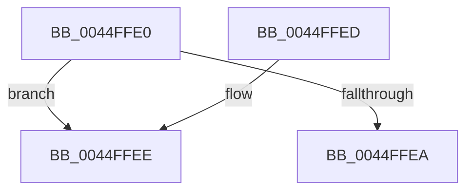

# HvlGetLpIndexFromProcessorIndex

- RVA: `0x0044FFE0`–`0x0044FFFA` (길이 `26` bytes)
- VA: `0x000000014044FFE0`
- 실행 섹션: `.text`
- PDB 이름 있음: `예`; PDB Function 태그: `예`
- unwind 정보 RVA: `0x000DB714`
- 디코드: `8`개 명령, `26/26` bytes 표시
- 미해석 바이트: `0` (있으면 어셈블리에 `.byte`로 보존)

> 이 문서는 커널 이미지의 기계어와 PDB 기호를 분석해 생성했습니다. 4번과 5번은 함수 원형과 자료형을 바이너리 사용 방식에서 추정한 C 해석이며 원본 소스 복구 결과는 아닙니다.

## 1. Dependencies

- 직접 호출 지점: **0**; 고유 호출 대상: **0**
- 직접 호출자로 확인된 함수: **7**
- RIP 상대 이미지 참조: **2**

### Outgoing calls
- 직접 디코드된 call 명령이 없습니다.

### Direct callers
- [PpmScaleIdleStateValues](PpmScaleIdleStateValues_function_00447674.md) at `0x004476FB`
- [HvlEnlightenProcessor](../4D/HvlEnlightenProcessor_function_004DCD9C.md) at `0x004DCEC8`
- [HvlGetVpSintMessagePage](../58/HvlGetVpSintMessagePage_function_00584760.md) at `0x00584764`
- [HvlpInitializeBootProcessor](../58/HvlpInitializeBootProcessor_function_00585964.md) at `0x00585A30`
- [HvlSetPlatformIdleState](../58/HvlSetPlatformIdleState_function_0058AA20.md) at `0x0058AA53`
- [HvlInitializeProcessor](../../page/71/HvlInitializeProcessor_function_0071804C.md) at `0x00718170`
- [PpmPerfRegisterHvPerfStateCounters](../../page/77/PpmPerfRegisterHvPerfStateCounters_function_00770C40.md) at `0x00770CBC`

### Static image references
- `0x0044FFE2` → RVA `0x00E0A8BC` (`.data`; read)
- `0x0044FFEE` → RVA `0x00FC6C40` (`ALMOSTRO`; read)

## 2. Other-region calls and transfers

- 다른 실행 섹션으로 향하는 call: **0**
- call이 아닌 외부 분기/꼬리 이동: **1**
  - `0x0044FFF5` → `0x006F134C` (`tail-transfer`)

## 3. Assembly (complete function range)

```asm
0044FFE0  33 D2                           xor edx, edx
0044FFE2  38 15 D4 A8 9B 00               cmp byte ptr [rip + 0x9ba8d4], dl
0044FFE8  74 04                           je 0x14044ffee
0044FFEA  8B C1                           mov eax, ecx
0044FFEC  C3                              ret
0044FFED  CC                              int3
0044FFEE  48 8B 05 4B 6C B7 00            mov rax, qword ptr [rip + 0xb76c4b]
0044FFF5  E9 52 13 2A 00                  jmp 0x1406f134c
```

## 4. C-style interpretation (structured pseudocode)

```c
__int64 __fastcall HvlGetLpIndexFromProcessorIndex(int a1, int a2)
{
    a2 = 0;
    if ((*(unsigned __int8 *)(v_rip + 10201300)) == 0) goto loc_0044FFEE;
    return (unsigned int)(a1);
loc_0044FFEE:
}
```

## 5. (Beta) C Style

```c
int64_t HvlGetLpIndexFromProcessorIndex(int32_t Arg1, int32_t Arg2)
{
    Arg2 = 0;
    if ((*(uint8_t *)(v_rip + 0x9BA8D4)) == 0) goto loc_0044FFEE;
    return (uint32_t)(Arg1);
loc_0044FFEE:
}
```

## 6. Execution-region graph

[열기: 2D/3D 그래프와 함수 탐색 컨트롤 패널](../../../control-panel.html?section=text&rva=0x0044FFE0&view=graph)

- 2D 그래프는 위에서 아래로 흐르고, 3D 그래프는 빈 공간을 드래그해 회전합니다. Shift+드래그는 이동, 휠은 확대·축소, 함수 노드 선택은 대상 보고서 이동입니다.

### Static fallback


