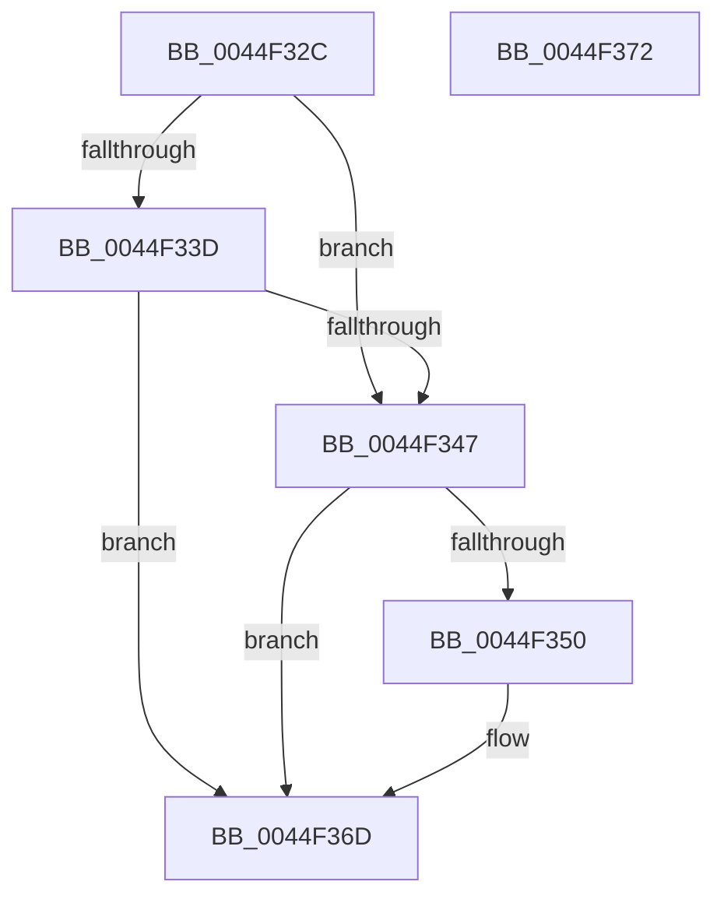

# HvlInvokeHypervisorDebugger

- RVA: `0x0044F32C`–`0x0044F373` (길이 `71` bytes)
- VA: `0x000000014044F32C`
- 실행 섹션: `.text`
- PDB 이름 있음: `예`; PDB Function 태그: `아니요`
- unwind 정보 RVA: `0x0005C788`
- 디코드: `18`개 명령, `71/71` bytes 표시
- 미해석 바이트: `0` (있으면 어셈블리에 `.byte`로 보존)

> 이 문서는 커널 이미지의 기계어와 PDB 기호를 분석해 생성했습니다. 4번과 5번은 함수 원형과 자료형을 바이너리 사용 방식에서 추정한 C 해석이며 원본 소스 복구 결과는 아닙니다.

## 1. Dependencies

- 직접 호출 지점: **1**; 고유 호출 대상: **1**
- 직접 호출자로 확인된 함수: **1**
- RIP 상대 이미지 참조: **3**

### Outgoing calls
- `0x0044F368` → [HvcallInitiateHypercall](../31/HvcallInitiateHypercall_function_00313630.md) (function, `0x00313630`)

### Direct callers
- [KeAccumulateTicks](../39/KeAccumulateTicks_function_0039C140.md) at `0x0039C69D`
- [KeAccumulateTicks](../39/KeAccumulateTicks_function_0039C140.md) at `0x0039C80A`

### Static image references
- `0x0044F330` → RVA `0x00FC6A90` (`ALMOSTRO`; read)
- `0x0044F33D` → RVA `0x00FC6AD8` (`ALMOSTRO`; read)
- `0x0044F347` → RVA `0x00FC6A97` (`ALMOSTRO`; read)

## 2. Other-region calls and transfers

- 다른 실행 섹션으로 향하는 call: **0**
- 별도 외부 분기/꼬리 이동을 확인하지 못했습니다.

## 3. Assembly (complete function range)

```asm
0044F32C  48 83 EC 28                     sub rsp, 0x28
0044F330  8B 05 5A 77 B7 00               mov eax, dword ptr [rip + 0xb7775a]
0044F336  4C 8B C2                        mov r8, rdx
0044F339  A8 02                           test al, 2
0044F33B  74 0A                           je 0x14044f347
0044F33D  8B 05 95 77 B7 00               mov eax, dword ptr [rip + 0xb77795]
0044F343  A8 01                           test al, 1
0044F345  74 26                           je 0x14044f36d
0044F347  80 3D 49 77 B7 00 00            cmp byte ptr [rip + 0xb77749], 0
0044F34E  74 1D                           je 0x14044f36d
0044F350  48 C7 44 24 40 0A 00 00 00      mov qword ptr [rsp + 0x40], 0xa
0044F359  8B D1                           mov edx, ecx
0044F35B  C7 44 24 40 0A 00 01 00         mov dword ptr [rsp + 0x40], 0x1000a
0044F363  48 8B 4C 24 40                  mov rcx, qword ptr [rsp + 0x40]
0044F368  E8 C3 42 EC FF                  call 0x140313630
0044F36D  48 83 C4 28                     add rsp, 0x28
0044F371  C3                              ret
0044F372  CC                              int3
```

## 4. C-style interpretation (structured pseudocode)

```c
__int64 __fastcall HvlInvokeHypervisorDebugger(int a1, __int64 a2)
{
    __int64 result;
    __int64 v_rsp;
    unsigned __int64 v_stack_p18;

    v_rsp = (v_rsp) - (40);
    if ((((unsigned __int8)((unsigned int)(*(unsigned int *)(v_rip + 12023642)))) & (2)) == 0) goto loc_0044F347;
    if ((((unsigned __int8)((unsigned int)(*(unsigned int *)(v_rip + 12023701)))) & (1)) == 0) goto loc_0044F36D;
loc_0044F347:
    result = (unsigned int)(*(unsigned int *)(v_rip + 12023701));
    if ((*(unsigned __int8 *)(v_rip + 12023625)) != 0) {
        v_stack_p18 = 10;
        a2 = a1;
        v_stack_p18 = 0x1000AULL;
        a1 = v_stack_p18;
        result = HvcallInitiateHypercall(a1, a2, a2, a4);
    }
    v_rsp = (v_rsp) + (40);
    return result;
}
```

## 5. (Beta) C Style

```c
int64_t HvlInvokeHypervisorDebugger(int32_t Arg1, int64_t Arg2)
{
    int64_t result;
    int64_t local_rsp;
    uint64_t v_stack_p18;

    local_rsp = (local_rsp) - (40);
    if ((((uint8_t)((uint32_t)(*(uint32_t *)(v_rip + 0xB7775A)))) & (2)) == 0) goto loc_0044F347;
    if ((((uint8_t)((uint32_t)(*(uint32_t *)(v_rip + 0xB77795)))) & (1)) == 0) goto loc_0044F36D;
loc_0044F347:
    result = (uint32_t)(*(uint32_t *)(v_rip + 0xB77795));
    if ((*(uint8_t *)(v_rip + 0xB77749)) != 0) {
        v_stack_p18 = 10;
        Arg2 = Arg1;
        v_stack_p18 = 0x1000AULL;
        Arg1 = v_stack_p18;
        result = HvcallInitiateHypercall(Arg1, Arg2, Arg2, a4);
    }
    local_rsp = (local_rsp) + (40);
    return result;
}
```

## 6. Execution-region graph

[열기: 2D/3D 그래프와 함수 탐색 컨트롤 패널](../../../control-panel.html?section=text&rva=0x0044F32C&view=graph)

- 2D 그래프는 위에서 아래로 흐르고, 3D 그래프는 빈 공간을 드래그해 회전합니다. Shift+드래그는 이동, 휠은 확대·축소, 함수 노드 선택은 대상 보고서 이동입니다.

### Static fallback


