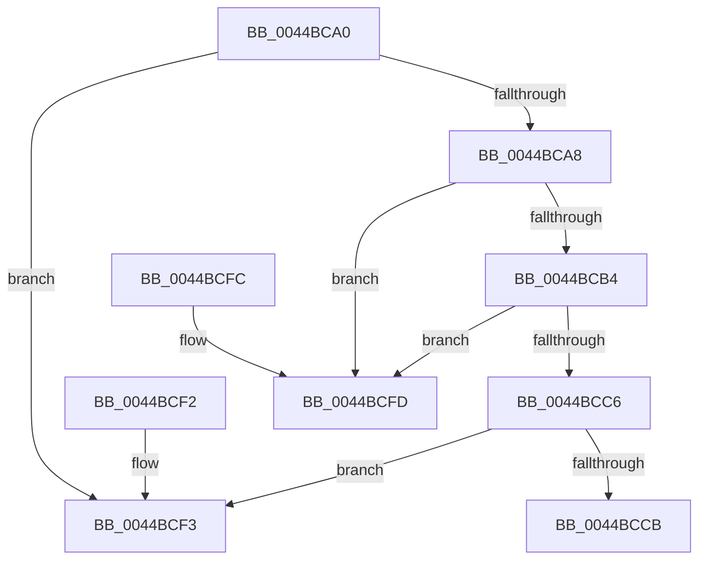

# HvlReadPerformanceStateCounters

- RVA: `0x0044BCA0`–`0x0044BD0B` (길이 `107` bytes)
- VA: `0x000000014044BCA0`
- 실행 섹션: `.text`
- PDB 이름 있음: `예`; PDB Function 태그: `예`
- unwind 정보 RVA: `0x000DB714`
- 디코드: `31`개 명령, `107/107` bytes 표시
- 미해석 바이트: `0` (있으면 어셈블리에 `.byte`로 보존)

> 이 문서는 커널 이미지의 기계어와 PDB 기호를 분석해 생성했습니다. 4번과 5번은 함수 원형과 자료형을 바이너리 사용 방식에서 추정한 C 해석이며 원본 소스 복구 결과는 아닙니다.

## 1. Dependencies

- 직접 호출 지점: **0**; 고유 호출 대상: **0**
- 직접 호출자로 확인된 함수: **0**
- RIP 상대 이미지 참조: **3**

### Outgoing calls
- 직접 디코드된 call 명령이 없습니다.

### Direct callers
- 이 함수 시작 RVA로 연결되는 직접 call은 확인되지 않았습니다. 간접 호출은 완전히 역산할 수 없습니다.

### Static image references
- `0x0044BCA8` → RVA `0x00FC6BA0` (`ALMOSTRO`; read)
- `0x0044BCBA` → RVA `0x00FC6C40` (`ALMOSTRO`; read)
- `0x0044BCD2` → RVA `0x00E3EDD0` (`.data`; read)

## 2. Other-region calls and transfers

- 다른 실행 섹션으로 향하는 call: **0**
- call이 아닌 외부 분기/꼬리 이동: **1**
  - `0x0044BD06` → `0x006F0DE4` (`tail-transfer`)

## 3. Assembly (complete function range)

```asm
0044BCA0  44 8B DA                        mov r11d, edx
0044BCA3  83 FA 02                        cmp edx, 2
0044BCA6  73 4B                           jae 0x14044bcf3
0044BCA8  44 8B 15 F1 AE B7 00            mov r10d, dword ptr [rip + 0xb7aef1]
0044BCAF  41 3B CA                        cmp ecx, r10d
0044BCB2  73 49                           jae 0x14044bcfd
0044BCB4  8B C1                           mov eax, ecx
0044BCB6  48 6B D0 68                     imul rdx, rax, 0x68
0044BCBA  48 03 15 7F AF B7 00            add rdx, qword ptr [rip + 0xb7af7f]
0044BCC1  39 4A 04                        cmp dword ptr [rdx + 4], ecx
0044BCC4  75 37                           jne 0x14044bcfd
0044BCC6  48 85 D2                        test rdx, rdx
0044BCC9  74 28                           je 0x14044bcf3
0044BCCB  0F AE E8                        lfence
0044BCCE  48 8B 52 18                     mov rdx, qword ptr [rdx + 0x18]
0044BCD2  4C 8D 15 F7 30 9F 00            lea r10, [rip + 0x9f30f7]
0044BCD9  43 8B 44 DA 18                  mov eax, dword ptr [r10 + r11*8 + 0x18]
0044BCDE  43 8B 4C DA 1C                  mov ecx, dword ptr [r10 + r11*8 + 0x1c]
0044BCE3  48 8B 04 C2                     mov rax, qword ptr [rdx + rax*8]
0044BCE7  49 89 00                        mov qword ptr [r8], rax
0044BCEA  48 8B 04 CA                     mov rax, qword ptr [rdx + rcx*8]
0044BCEE  49 89 01                        mov qword ptr [r9], rax
0044BCF1  C3                              ret
0044BCF2  CC                              int3
0044BCF3  49 83 20 00                     and qword ptr [r8], 0
0044BCF7  49 83 21 00                     and qword ptr [r9], 0
0044BCFB  C3                              ret
0044BCFC  CC                              int3
0044BCFD  48 8B 15 3C AF B7 00            mov rdx, qword ptr [rip + 0xb7af3c]
0044BD04  33 C0                           xor eax, eax
0044BD06  E9 D9 50 2A 00                  jmp 0x1406f0de4
```

## 4. C-style interpretation (structured pseudocode)

```c
__int64 __fastcall HvlReadPerformanceStateCounters(int a1, int a2, __int64 a3, __int64 a4)
{
    __int64 result;

    if (a2 >= 2) goto loc_0044BCF3;
    if (a1 >= ((unsigned int)((unsigned int)(*(unsigned int *)(v_rip + 12037873))))) goto loc_0044BCFD;
    a2 = (a2) * ((unsigned int)(a1));
    a2 = (a2) + (*(unsigned __int64 *)(v_rip + 12038015));
    if ((*(unsigned int *)(a2 + 4)) != a1) goto loc_0044BCFD;
    if (a2 == 0) goto loc_0044BCF3;
    *(unsigned __int64 *)(a3) = *(unsigned __int64 *)(*(unsigned __int64 *)(a2 + 24) + (unsigned int)(*(unsigned int *)(v_rip + 10432759 + (unsigned int)(a2) * 8 + 24)) * 8);
    *(unsigned __int64 *)(a4) = *(unsigned __int64 *)(*(unsigned __int64 *)(a2 + 24) + (unsigned int)(*(unsigned int *)(v_rip + 10432759 + (unsigned int)(a2) * 8 + 28)) * 8);
    return *(unsigned __int64 *)(*(unsigned __int64 *)(a2 + 24) + (unsigned int)(*(unsigned int *)(v_rip + 10432759 + (unsigned int)(a2) * 8 + 28)) * 8);
loc_0044BCF3:
    return *(unsigned __int64 *)(*(unsigned __int64 *)(a2 + 24) + (unsigned int)(*(unsigned int *)(v_rip + 10432759 + (unsigned int)(a2) * 8 + 28)) * 8);
loc_0044BCFD:
    result = 0;
}
```

## 5. (Beta) C Style

```c
int64_t HvlReadPerformanceStateCounters(int32_t Arg1, int32_t Arg2, void *Arg3, void *Arg4)
{
    uint8_t *arg3 = (uint8_t *)Arg3;
    uint8_t *arg4 = (uint8_t *)Arg4;

    int64_t result;

    if (Arg2 >= 2) goto loc_0044BCF3;
    if (Arg1 >= ((uint32_t)((uint32_t)(*(uint32_t *)(v_rip + 0xB7AEF1))))) goto loc_0044BCFD;
    Arg2 = (Arg2) * ((uint32_t)(Arg1));
    Arg2 = (Arg2) + (*(uint64_t *)(v_rip + 0xB7AF7F));
    if ((*(uint32_t *)(Arg2 + 0x4)) != Arg1) goto loc_0044BCFD;
    if (Arg2 == 0) goto loc_0044BCF3;
    *(uint64_t *)(arg3) = *(uint64_t *)(*(uint64_t *)(Arg2 + 0x18) + (uint32_t)(*(uint32_t *)(v_rip + 0x9F30F7 + (uint32_t)(Arg2) * 8 + 0x18)) * 8);
    *(uint64_t *)(arg4) = *(uint64_t *)(*(uint64_t *)(Arg2 + 0x18) + (uint32_t)(*(uint32_t *)(v_rip + 0x9F30F7 + (uint32_t)(Arg2) * 8 + 0x1C)) * 8);
    return *(uint64_t *)(*(uint64_t *)(Arg2 + 0x18) + (uint32_t)(*(uint32_t *)(v_rip + 0x9F30F7 + (uint32_t)(Arg2) * 8 + 0x1C)) * 8);
loc_0044BCF3:
    return *(uint64_t *)(*(uint64_t *)(Arg2 + 0x18) + (uint32_t)(*(uint32_t *)(v_rip + 0x9F30F7 + (uint32_t)(Arg2) * 8 + 0x1C)) * 8);
loc_0044BCFD:
    result = 0;
}
```

### 관측된 메모리 오프셋

구조체 형식이 확인되지 않은 접근은 인자 기준의 오프셋으로만 기록했습니다.

| 기준 인자 | 오프셋 표현 | 폭 (bit) | 접근 |
|---|---:|---:|---|
| `Arg3` | `+ 0x0` | `64` | `R/W` |
| `Arg3` | `+ 0x0` | `64` | `W` |
| `Arg4` | `+ 0x0` | `64` | `R/W` |
| `Arg4` | `+ 0x0` | `64` | `W` |

## 6. Execution-region graph

[열기: 2D/3D 그래프와 함수 탐색 컨트롤 패널](../../../control-panel.html?section=text&rva=0x0044BCA0&view=graph)

- 2D 그래프는 위에서 아래로 흐르고, 3D 그래프는 빈 공간을 드래그해 회전합니다. Shift+드래그는 이동, 휠은 확대·축소, 함수 노드 선택은 대상 보고서 이동입니다.

### Static fallback


