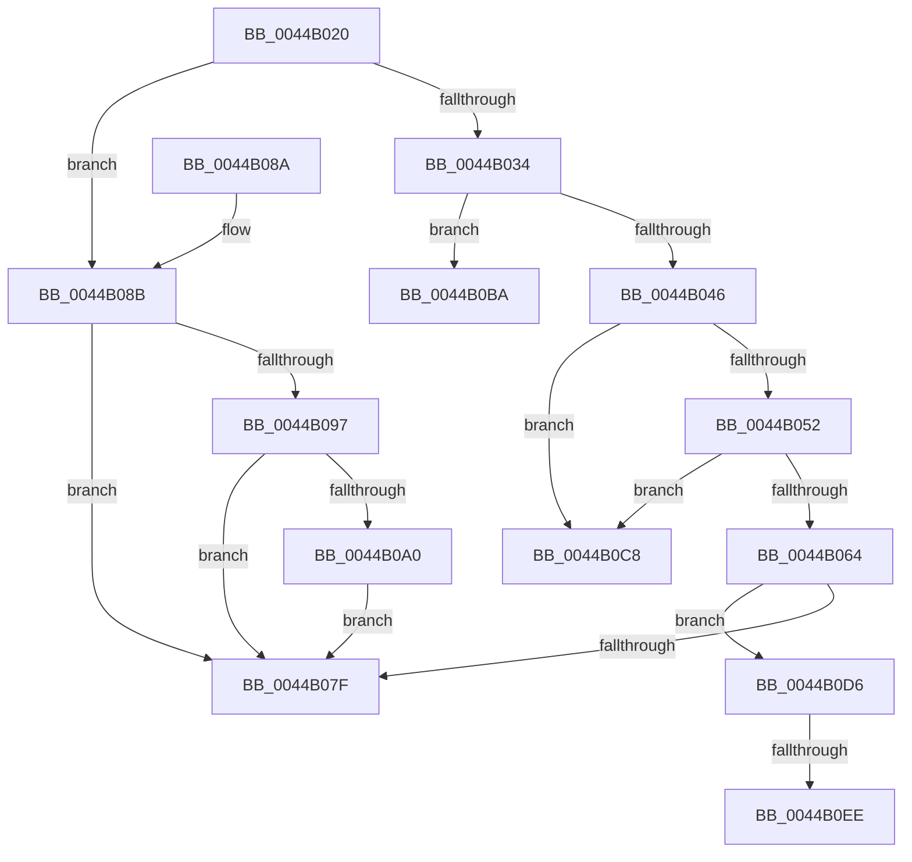

# HvlSharedIsr

- RVA: `0x0044B020`–`0x0044B0F9` (길이 `217` bytes)
- VA: `0x000000014044B020`
- 실행 섹션: `.text`
- PDB 이름 있음: `예`; PDB Function 태그: `예`
- unwind 정보 RVA: `0x000A6520`
- 디코드: `54`개 명령, `217/217` bytes 표시
- 미해석 바이트: `0` (있으면 어셈블리에 `.byte`로 보존)

> 이 문서는 커널 이미지의 기계어와 PDB 기호를 분석해 생성했습니다. 4번과 5번은 함수 원형과 자료형을 바이너리 사용 방식에서 추정한 C 해석이며 원본 소스 복구 결과는 아닙니다.

## 1. Dependencies

- 직접 호출 지점: **2**; 고유 호출 대상: **2**
- 직접 호출자로 확인된 함수: **2**
- RIP 상대 이미지 참조: **7**

### Outgoing calls
- `0x0044B0B3` → [KeInsertQueueDpc](../20/KeInsertQueueDpc_function_00207C50.md) (function, `0x00207C50`)
- `0x0044B0EE` → [HvlpHandleIommuFaultMessage](../58/HvlpHandleIommuFaultMessage_function_0058C0F0.md) (function, `0x0058C0F0`)

### Direct callers
- [HvlEnlightenProcessor](../4D/HvlEnlightenProcessor_function_004DCD9C.md) at `0x004DCF4F`
- [KiHvInterruptSubDispatch](../6B/KiHvInterruptSubDispatch_function_006B7F10.md) at `0x006B7F6C`

### Static image references
- `0x0044B02A` → RVA `0x00FC6A90` (`ALMOSTRO`; read)
- `0x0044B03E` → RVA `0x00E0A8BC` (`.data`; read)
- `0x0044B046` → RVA `0x00FC6BA0` (`ALMOSTRO`; read)
- `0x0044B058` → RVA `0x00FC6C40` (`ALMOSTRO`; read)
- `0x0044B08B` → RVA `0x00F10D68` (`.data`; read)
- `0x0044B0A0` → RVA `0x00F10DC8` (`.data`; read/write)
- `0x0044B0AA` → RVA `0x00F10D80` (`.data`; read)

## 2. Other-region calls and transfers

- 다른 실행 섹션으로 향하는 call: **0**
- call이 아닌 외부 분기/꼬리 이동: **4**
  - `0x0044B0C3` → [sub_006F0BD0](../6F/Unknown_function_006F0BD0.md) (`tail-transfer`)
  - `0x0044B0D1` → [sub_006F0BD0 + 0x25](../6F/Unknown_function_006F0BD0.md) (`tail-transfer`)
  - `0x0044B0E8` → [sub_006F0BD0 + 0x4D](../6F/Unknown_function_006F0BD0.md) (`tail-transfer`)
  - `0x0044B0F4` → [sub_006F0BD0 + 0x6F](../6F/Unknown_function_006F0BD0.md) (`tail-transfer`)

## 3. Assembly (complete function range)

```asm
0044B020  48 89 5C 24 08                  mov qword ptr [rsp + 8], rbx
0044B025  57                              push rdi
0044B026  48 83 EC 20                     sub rsp, 0x20
0044B02A  8B 05 60 BA B7 00               mov eax, dword ptr [rip + 0xb7ba60]
0044B030  A8 02                           test al, 2
0044B032  74 57                           je 0x14044b08b
0044B034  65 8B 14 25 A4 01 00 00         mov edx, dword ptr gs:[0x1a4]
0044B03C  33 DB                           xor ebx, ebx
0044B03E  38 1D 78 F8 9B 00               cmp byte ptr [rip + 0x9bf878], bl
0044B044  74 74                           je 0x14044b0ba
0044B046  44 8B 05 53 BB B7 00            mov r8d, dword ptr [rip + 0xb7bb53]
0044B04D  41 3B D0                        cmp edx, r8d
0044B050  73 76                           jae 0x14044b0c8
0044B052  8B C2                           mov eax, edx
0044B054  48 6B C8 68                     imul rcx, rax, 0x68
0044B058  48 03 0D E1 BB B7 00            add rcx, qword ptr [rip + 0xb7bbe1]
0044B05F  39 51 04                        cmp dword ptr [rcx + 4], edx
0044B062  75 64                           jne 0x14044b0c8
0044B064  48 8B 79 20                     mov rdi, qword ptr [rcx + 0x20]
0044B068  0F 0D 8F 00 04 00 00            prefetchw byte ptr [rdi + 0x400]
0044B06F  8B 87 00 04 00 00               mov eax, dword ptr [rdi + 0x400]
0044B075  8B 87 00 04 00 00               mov eax, dword ptr [rdi + 0x400]
0044B07B  85 C0                           test eax, eax
0044B07D  75 57                           jne 0x14044b0d6
0044B07F  48 8B 5C 24 30                  mov rbx, qword ptr [rsp + 0x30]
0044B084  48 83 C4 20                     add rsp, 0x20
0044B088  5F                              pop rdi
0044B089  C3                              ret
0044B08A  CC                              int3
0044B08B  48 8B 0D D6 5C AC 00            mov rcx, qword ptr [rip + 0xac5cd6]
0044B092  48 85 C9                        test rcx, rcx
0044B095  74 E8                           je 0x14044b07f
0044B097  48 8B 41 08                     mov rax, qword ptr [rcx + 8]
0044B09B  48 39 01                        cmp qword ptr [rcx], rax
0044B09E  74 DF                           je 0x14044b07f
0044B0A0  F0 FF 05 21 5D AC 00            lock inc dword ptr [rip + 0xac5d21]
0044B0A7  45 33 C0                        xor r8d, r8d
0044B0AA  48 8D 0D CF 5C AC 00            lea rcx, [rip + 0xac5ccf]
0044B0B1  33 D2                           xor edx, edx
0044B0B3  E8 98 CB DB FF                  call 0x140207c50
0044B0B8  EB C5                           jmp 0x14044b07f
0044B0BA  48 8B 05 7F BB B7 00            mov rax, qword ptr [rip + 0xb7bb7f]
0044B0C1  8B CB                           mov ecx, ebx
0044B0C3  E9 08 5B 2A 00                  jmp 0x1406f0bd0
0044B0C8  48 8B 0D 71 BB B7 00            mov rcx, qword ptr [rip + 0xb7bb71]
0044B0CF  8B C3                           mov eax, ebx
0044B0D1  E9 1F 5B 2A 00                  jmp 0x1406f0bf5
0044B0D6  8B 87 00 04 00 00               mov eax, dword ptr [rdi + 0x400]
0044B0DC  48 8D 8F 10 04 00 00            lea rcx, [rdi + 0x410]
0044B0E3  3D 24 00 00 80                  cmp eax, 0x80000024
0044B0E8  0F 85 2F 5B 2A 00               jne 0x1406f0c1d
0044B0EE  E8 FD 0F 14 00                  call 0x14058c0f0
0044B0F3  90                              nop
0044B0F4  E9 46 5B 2A 00                  jmp 0x1406f0c3f
```

## 4. C-style interpretation (structured pseudocode)

```c
__int64 __fastcall HvlSharedIsr(void)
{
    __int64 result;
    __int64 v_rbx;
    __int64 v_rsp;
    unsigned __int64 v_stack_p8;

    v_stack_p8 = v_rbx;
    v_rsp = (v_rsp) - (32);
    if ((((unsigned __int8)((unsigned int)(*(unsigned int *)(v_rip + 12040800)))) & (2)) == 0) goto loc_0044B08B;
    v_rbx = 0;
    if ((*(unsigned __int8 *)(v_rip + 10221688)) == 0) goto loc_0044B0BA;
    if (((unsigned int)((unsigned int)(*(unsigned int *)(gs_base + (0 + 420))))) >= ((unsigned int)((unsigned int)(*(unsigned int *)(v_rip + 12041043))))) goto loc_0044B0C8;
    a1 = (a1) * ((unsigned int)((unsigned int)((unsigned int)(*(unsigned int *)(gs_base + (0 + 420))))));
    a1 = (a1) + (*(unsigned __int64 *)(v_rip + 12041185));
    if ((*(unsigned int *)(a1 + 4)) != ((unsigned int)((unsigned int)(*(unsigned int *)(gs_base + (0 + 420)))))) goto loc_0044B0C8;
    if ((unsigned int)((unsigned int)(*(unsigned int *)(*(unsigned __int64 *)(a1 + 32) + 1024))) != 0) goto loc_0044B0D6;
loc_0044B07F:
    v_rsp = (v_rsp) + (32);
    return (unsigned int)(*(unsigned int *)(*(unsigned __int64 *)(a1 + 32) + 1024));
loc_0044B08B:
    if (*(unsigned __int64 *)(v_rip + 11295958) == 0) goto loc_0044B07F;
    if ((*(unsigned __int64 *)(*(unsigned __int64 *)(v_rip + 11295958))) == (*(unsigned __int64 *)(*(unsigned __int64 *)(v_rip + 11295958) + 8))) goto loc_0044B07F;
    a3 = 0;
    a2 = 0;
    result = KeInsertQueueDpc(v_rip + 11295951, a2, a3, a4);
    goto loc_0044B07F;
loc_0044B0BA:
loc_0044B0C8:
loc_0044B0D6:
    result = HvlpHandleIommuFaultMessage(*(unsigned __int64 *)(a1 + 32) + 1040, a2, a3, a4);
}
```

## 5. (Beta) C Style

```c
void HvlSharedIsr(void)
{
    int64_t result;
    int64_t local_rbx;
    int64_t local_rsp;
    uint64_t v_stack_p8;

    v_stack_p8 = local_rbx;
    local_rsp = (local_rsp) - (32);
    if ((((uint8_t)((uint32_t)(*(uint32_t *)(v_rip + 0xB7BA60)))) & (2)) == 0) goto loc_0044B08B;
    local_rbx = 0;
    if ((*(uint8_t *)(v_rip + 0x9BF878)) == 0) goto loc_0044B0BA;
    if (((uint32_t)((uint32_t)(*(uint32_t *)(gs_base + (0 + 0x1A4))))) >= ((uint32_t)((uint32_t)(*(uint32_t *)(v_rip + 0xB7BB53))))) goto loc_0044B0C8;
    a1 = (a1) * ((uint32_t)((uint32_t)((uint32_t)(*(uint32_t *)(gs_base + (0 + 0x1A4))))));
    a1 = (a1) + (*(uint64_t *)(v_rip + 0xB7BBE1));
    if ((*(uint32_t *)(a1 + 0x4)) != ((uint32_t)((uint32_t)(*(uint32_t *)(gs_base + (0 + 0x1A4)))))) goto loc_0044B0C8;
    if ((uint32_t)((uint32_t)(*(uint32_t *)(*(uint64_t *)(a1 + 0x20) + 0x400))) != 0) goto loc_0044B0D6;
loc_0044B07F:
    local_rsp = (local_rsp) + (32);
    return (uint32_t)(*(uint32_t *)(*(uint64_t *)(a1 + 0x20) + 0x400));
loc_0044B08B:
    if (*(uint64_t *)(v_rip + 0xAC5CD6) == 0) goto loc_0044B07F;
    if ((*(uint64_t *)(*(uint64_t *)(v_rip + 0xAC5CD6))) == (*(uint64_t *)(*(uint64_t *)(v_rip + 0xAC5CD6) + 0x8))) goto loc_0044B07F;
    a3 = 0;
    a2 = 0;
    result = KeInsertQueueDpc(v_rip + 11295951, a2, a3, a4);
    goto loc_0044B07F;
loc_0044B0BA:
loc_0044B0C8:
loc_0044B0D6:
    result = HvlpHandleIommuFaultMessage(*(uint64_t *)(a1 + 0x20) + 1040, a2, a3, a4);
}
```

## 6. Execution-region graph

[열기: 2D/3D 그래프와 함수 탐색 컨트롤 패널](../../../control-panel.html?section=text&rva=0x0044B020&view=graph)

- 2D 그래프는 위에서 아래로 흐르고, 3D 그래프는 빈 공간을 드래그해 회전합니다. Shift+드래그는 이동, 휠은 확대·축소, 함수 노드 선택은 대상 보고서 이동입니다.

### Static fallback


