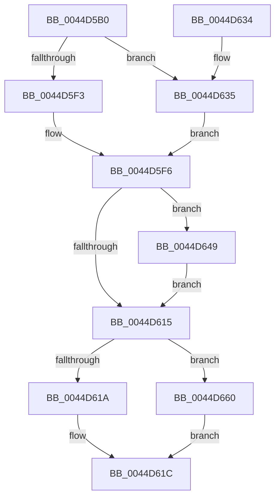

# HvlUpdatePerformanceStateCountersForLp

- RVA: `0x0044D5B0`–`0x0044D66A` (길이 `186` bytes)
- VA: `0x000000014044D5B0`
- 실행 섹션: `.text`
- PDB 이름 있음: `예`; PDB Function 태그: `아니요`
- unwind 정보 RVA: `0x000A6950`
- 디코드: `50`개 명령, `186/186` bytes 표시
- 미해석 바이트: `0` (있으면 어셈블리에 `.byte`로 보존)

> 이 문서는 커널 이미지의 기계어와 PDB 기호를 분석해 생성했습니다. 4번과 5번은 함수 원형과 자료형을 바이너리 사용 방식에서 추정한 C 해석이며 원본 소스 복구 결과는 아닙니다.

## 1. Dependencies

- 직접 호출 지점: **5**; 고유 호출 대상: **5**
- 직접 호출자로 확인된 함수: **1**
- RIP 상대 이미지 참조: **3**

### Outgoing calls
- `0x0044D608` → `indirect target` (indirect, 간접 대상)
- `0x0044D624` → [_security_check_cookie](../6A/_security_check_cookie_function_006AC640.md) (function, `0x006AC640`)
- `0x0044D642` → [EtwGetKernelTraceTimestamp](../39/EtwGetKernelTraceTimestamp_function_0039FC50.md) (function, `0x0039FC50`)
- `0x0044D659` → [EtwTraceHvHypercall](../3A/EtwTraceHvHypercall_function_003A4284.md) (function, `0x003A4284`)
- `0x0044D663` → [HvlpHvToNtStatus](../30/HvlpHvToNtStatus_function_00307BD8.md) (function, `0x00307BD8`)

### Direct callers
- [sub_006DDC2E](../6D/Unknown_function_006DDC2E.md) at `0x006DDC55`

### Static image references
- `0x0044D5BA` → RVA `0x00E0A740` (`.data`; read)
- `0x0044D5C9` → RVA `0x00FC6B14` (`ALMOSTRO`; read)
- `0x0044D5F6` → RVA `0x01201858` (`CFGRO`; read)

## 2. Other-region calls and transfers

- 다른 실행 섹션으로 향하는 call: **0**
- 별도 외부 분기/꼬리 이동을 확인하지 못했습니다.

## 3. Assembly (complete function range)

```asm
0044D5B0  48 89 5C 24 10                  mov qword ptr [rsp + 0x10], rbx
0044D5B5  57                              push rdi
0044D5B6  48 83 EC 50                     sub rsp, 0x50
0044D5BA  48 8B 05 7F D1 9B 00            mov rax, qword ptr [rip + 0x9bd17f]
0044D5C1  48 33 C4                        xor rax, rsp
0044D5C4  48 89 44 24 48                  mov qword ptr [rsp + 0x48], rax
0044D5C9  8B 05 45 95 B7 00               mov eax, dword ptr [rip + 0xb79545]
0044D5CF  0F 57 C0                        xorps xmm0, xmm0
0044D5D2  48 C7 44 24 20 EE 00 00 00      mov qword ptr [rsp + 0x20], 0xee
0044D5DB  8B D9                           mov ebx, ecx
0044D5DD  C7 44 24 20 EE 00 01 00         mov dword ptr [rsp + 0x20], 0x100ee
0044D5E5  0F 11 44 24 28                  movups xmmword ptr [rsp + 0x28], xmm0
0044D5EA  0F 11 44 24 38                  movups xmmword ptr [rsp + 0x38], xmm0
0044D5EF  A8 10                           test al, 0x10
0044D5F1  75 42                           jne 0x14044d635
0044D5F3  40 32 FF                        xor dil, dil
0044D5F6  48 8B 05 5B 42 DB 00            mov rax, qword ptr [rip + 0xdb425b]
0044D5FD  48 8B D3                        mov rdx, rbx
0044D600  48 8B 4C 24 20                  mov rcx, qword ptr [rsp + 0x20]
0044D605  45 33 C0                        xor r8d, r8d
0044D608  FF D0                           call rax
0044D60A  0F 1F 00                        nop dword ptr [rax]
0044D60D  48 8B D8                        mov rbx, rax
0044D610  40 84 FF                        test dil, dil
0044D613  75 34                           jne 0x14044d649
0044D615  66 85 DB                        test bx, bx
0044D618  75 46                           jne 0x14044d660
0044D61A  33 C0                           xor eax, eax
0044D61C  48 8B 4C 24 48                  mov rcx, qword ptr [rsp + 0x48]
0044D621  48 33 CC                        xor rcx, rsp
0044D624  E8 17 F0 25 00                  call 0x1406ac640
0044D629  48 8B 5C 24 68                  mov rbx, qword ptr [rsp + 0x68]
0044D62E  48 83 C4 50                     add rsp, 0x50
0044D632  5F                              pop rdi
0044D633  C3                              ret
0044D634  CC                              int3
0044D635  BA 10 00 00 A0                  mov edx, 0xa0000010
0044D63A  48 8D 4C 24 28                  lea rcx, [rsp + 0x28]
0044D63F  40 B7 01                        mov dil, 1
0044D642  E8 09 26 F5 FF                  call 0x14039fc50
0044D647  EB AD                           jmp 0x14044d5f6
0044D649  45 33 C9                        xor r9d, r9d
0044D64C  48 8D 4C 24 28                  lea rcx, [rsp + 0x28]
0044D651  41 B0 01                        mov r8b, 1
0044D654  BA EE 00 00 00                  mov edx, 0xee
0044D659  E8 26 6C F5 FF                  call 0x1403a4284
0044D65E  EB B5                           jmp 0x14044d615
0044D660  0F B7 CB                        movzx ecx, bx
0044D663  E8 70 A5 EB FF                  call 0x140307bd8
0044D668  EB B2                           jmp 0x14044d61c
```

## 4. C-style interpretation (structured pseudocode)

```c
__int64 __fastcall HvlUpdatePerformanceStateCountersForLp(int a1, __int64 a2, int a3, int a4)
{
    __int64 result;
    __int64 v_rdi;
    __int64 v_rsp;
    unsigned __int64 v_stack_m10;
    unsigned __int64 v_stack_m20;
    unsigned __int64 v_stack_m30;
    unsigned __int64 v_stack_m38;
    unsigned __int64 v_stack_p10;
    unsigned __int64 v_stack_p28;

    v_stack_p10 = v_rbx;
    v_rsp = (v_rsp) - (80);
    result = (*(unsigned __int64 *)(v_rip + 10211711)) ^ (v_rsp);
    v_stack_m10 = result;
    v_stack_m38 = 238;
    v_stack_m38 = 0x100EEULL;
    v_stack_m30 = v_xmm0;
    v_stack_m20 = v_xmm0;
    if ((((unsigned __int8)((unsigned int)(*(unsigned int *)(v_rip + 12031301)))) & (16)) != 0) goto loc_0044D635;
    v_rdi = 0;
loc_0044D5F6:
    a3 = 0;
    result = kernel_indirect_call(v_stack_m38, (unsigned int)(a1), a3, a4);
    if (0 != 0) goto loc_0044D649;
loc_0044D615:
    if ((unsigned __int16)(result) != 0) goto loc_0044D660;
    result = 0;
loc_0044D61C:
    a1 = (v_stack_m10) ^ (v_rsp);
    result = _security_check_cookie(a1, (unsigned int)(a1), a3, a4);
    v_rsp = (v_rsp) + (80);
    return result;
loc_0044D635:
    result = EtwGetKernelTraceTimestamp(v_stack_p28, (unsigned int)(0xA0000010ULL), a3, a4);
    goto loc_0044D5F6;
loc_0044D649:
    a4 = 0;
    result = EtwTraceHvHypercall(v_stack_p28, 238, 1, a4);
    goto loc_0044D615;
loc_0044D660:
    result = HvlpHvToNtStatus((unsigned __int16)(v_stack_p10), 238, 1, a4);
    goto loc_0044D61C;
}
```

## 5. (Beta) C Style

```c
int64_t HvlUpdatePerformanceStateCountersForLp(int32_t Arg1, int64_t Arg2, int32_t Arg3, int32_t Arg4)
{
    int64_t result;
    int64_t local_rdi;
    int64_t local_rsp;
    uint64_t v_stack_m10;
    uint64_t v_stack_m20;
    uint64_t v_stack_m30;
    uint64_t v_stack_m38;
    uint64_t v_stack_p10;
    uint64_t v_stack_p28;

    v_stack_p10 = local_rbx;
    local_rsp = (local_rsp) - (80);
    result = (*(uint64_t *)(v_rip + 0x9BD17F)) ^ (local_rsp);
    v_stack_m10 = result;
    v_stack_m38 = 238;
    v_stack_m38 = 0x100EEULL;
    v_stack_m30 = v_xmm0;
    v_stack_m20 = v_xmm0;
    if ((((uint8_t)((uint32_t)(*(uint32_t *)(v_rip + 0xB79545)))) & (16)) != 0) goto loc_0044D635;
    local_rdi = 0;
loc_0044D5F6:
    Arg3 = 0;
    result = kernel_indirect_call(v_stack_m38, (uint32_t)(Arg1), Arg3, Arg4);
    if (0 != 0) goto loc_0044D649;
loc_0044D615:
    if ((uint16_t)(result) != 0) goto loc_0044D660;
    result = 0;
loc_0044D61C:
    Arg1 = (v_stack_m10) ^ (local_rsp);
    result = _security_check_cookie(Arg1, (uint32_t)(Arg1), Arg3, Arg4);
    local_rsp = (local_rsp) + (80);
    return result;
loc_0044D635:
    result = EtwGetKernelTraceTimestamp(v_stack_p28, (uint32_t)(0xA0000010ULL), Arg3, Arg4);
    goto loc_0044D5F6;
loc_0044D649:
    Arg4 = 0;
    result = EtwTraceHvHypercall(v_stack_p28, 238, 1, Arg4);
    goto loc_0044D615;
loc_0044D660:
    result = HvlpHvToNtStatus((uint16_t)(v_stack_p10), 238, 1, Arg4);
    goto loc_0044D61C;
}
```

## 6. Execution-region graph

[열기: 2D/3D 그래프와 함수 탐색 컨트롤 패널](../../../control-panel.html?section=text&rva=0x0044D5B0&view=graph)

- 2D 그래프는 위에서 아래로 흐르고, 3D 그래프는 빈 공간을 드래그해 회전합니다. Shift+드래그는 이동, 휠은 확대·축소, 함수 노드 선택은 대상 보고서 이동입니다.

### Static fallback


